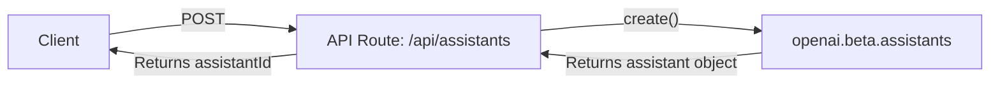
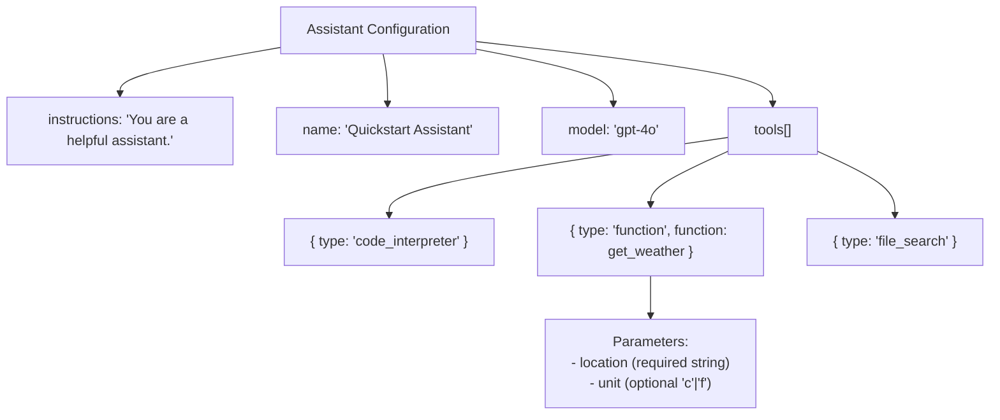
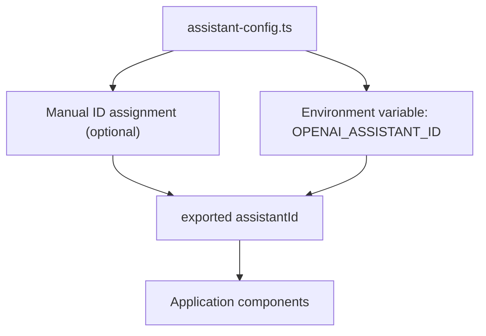
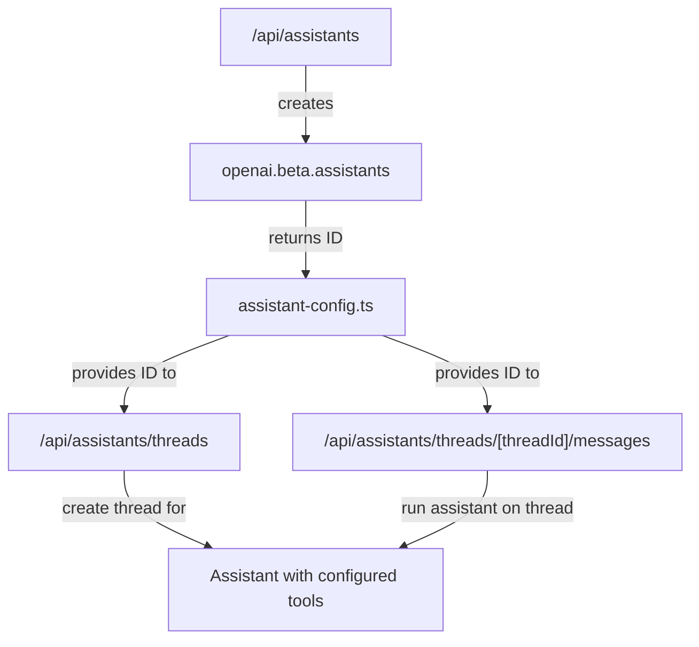

<!-- source: DeepWiki mcp.deepwiki.com · repo openai/openai-assistants-quickstart · page 4.1 Assistant Creation · fetched 2026-10-26 -->

# Assistant Creation

<details>
<summary>Relevant source files</summary>

The following files were used as context for generating this wiki page:

- [app/api/assistants/route.ts](app/api/assistants/route.ts)
- [app/assistant-config.ts](app/assistant-config.ts)

</details>


This document details the process of assistant creation in the OpenAI Assistants Quickstart application, focusing on the API endpoint that handles this functionality and how assistants are configured. For information about using the created assistant in conversations, see [Thread Management](#4.2).

## Assistant Creation API Endpoint

The application provides a dedicated API endpoint that handles the creation of a new OpenAI Assistant with predefined capabilities.



Sources: [app/api/assistants/route.ts:6-38]()

### Implementation Details

The assistant creation is implemented as a POST handler in the API route that:

1. Uses the OpenAI SDK to create a new assistant
2. Configures the assistant with specific parameters
3. Returns the assistant ID to the client

```mermaid
classDiagram
    class "POST /api/assistants" {
        +Create assistant with OpenAI API
        +Configure tools and parameters
        +Return assistantId
    }
    
    class "openai.beta.assistants.create()" {
        +instructions
        +name
        +model
        +tools[]
    }
    
    "POST /api/assistants" --> "openai.beta.assistants.create()" : calls
```

Sources: [app/api/assistants/route.ts:6-38]()

## Assistant Configuration

The assistant is created with a specific configuration that defines its capabilities:



Sources: [app/api/assistants/route.ts:7-36]()

### Tools Configuration

The assistant is configured with three tools that determine its functionality:

| Tool Type | Description | Configuration |
|-----------|-------------|---------------|
| `code_interpreter` | Allows assistant to execute code | Simple type declaration |
| `function` | Custom function for weather data | Includes name, description, and parameters schema |
| `file_search` | Enables searching through uploaded files | Simple type declaration |

The `get_weather` function is defined with parameters that match the OpenAI function calling JSON schema:
- `location`: Required string parameter (e.g., "San Francisco, CA")
- `unit`: Optional parameter that must be either "c" or "f"

Sources: [app/api/assistants/route.ts:11-35]()

## Assistant ID Management

After creation, the assistant ID is stored and managed through the `assistant-config.ts` file:



The assistant ID can be:
1. Explicitly set in the code
2. Retrieved from the `OPENAI_ASSISTANT_ID` environment variable if not explicitly set

This exported ID is used by other components of the application for interactions with the assistant.

Sources: [app/assistant-config.ts:1-5]()

## Integration with System Architecture

The assistant creation component serves as the foundation for the rest of the application:



Sources: [app/api/assistants/route.ts:6-38](), [app/assistant-config.ts:1-5]()

The assistant created by this process will be used in all subsequent interactions, including:

1. Thread creation
2. Message processing
3. Tool execution (code interpreter, function calling, and file search)

## Summary

The assistant creation functionality in the OpenAI Assistants Quickstart provides:

1. A dedicated API endpoint (`/api/assistants`) for creating assistants
2. Configuration of the assistant with specific tools and capabilities
3. Management of the assistant ID for use throughout the application
4. Integration with the broader system architecture

This implementation allows for the creation of a powerful AI assistant with capabilities like code interpretation, function calling, and file search, which forms the foundation of the application's interactive capabilities.

---

