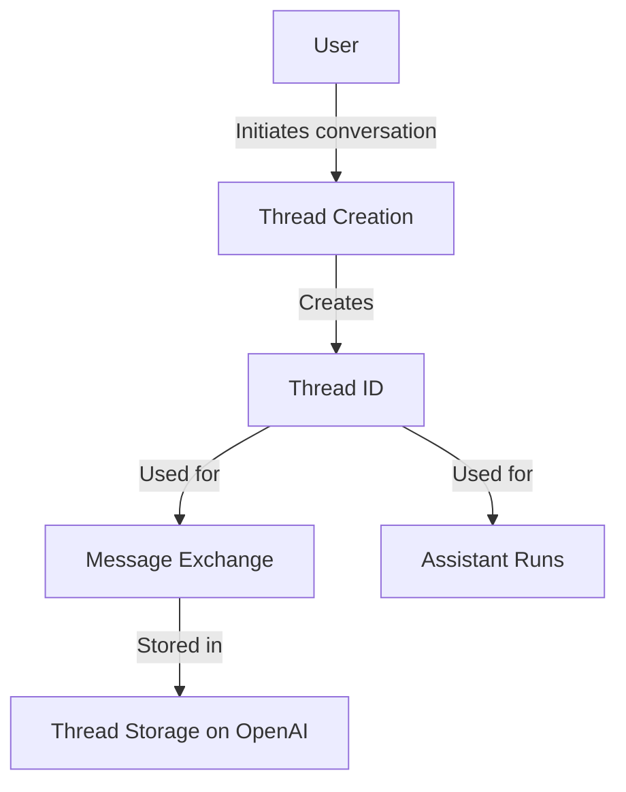
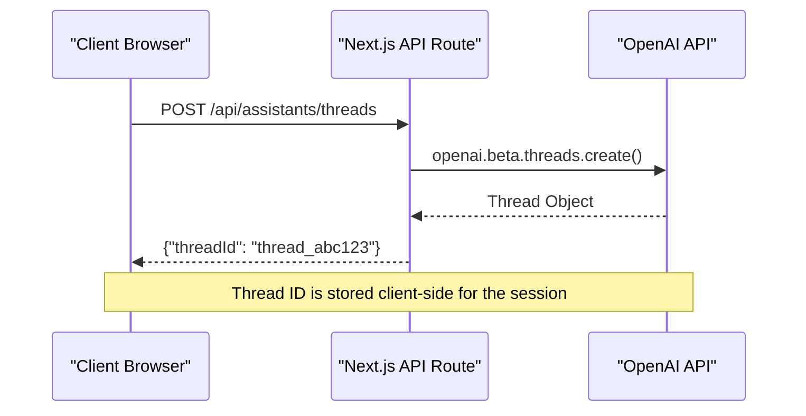
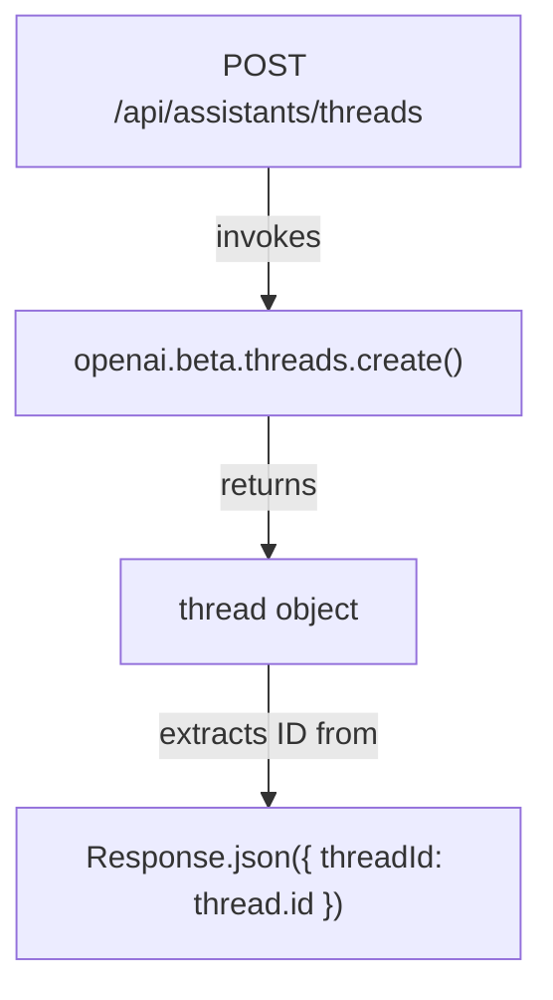
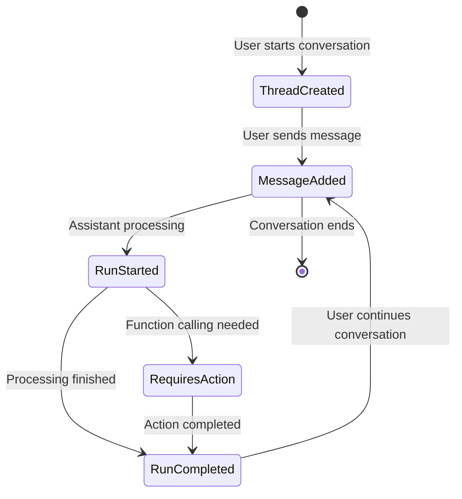
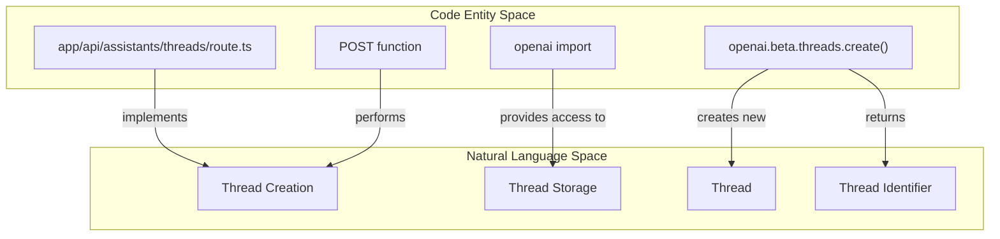
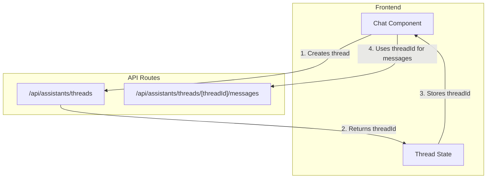

<!-- source: DeepWiki mcp.deepwiki.com · repo openai/openai-assistants-quickstart · page 4.2 Thread Management · fetched 2026-10-26 -->

# Thread Management

Relevant source files

The following files were used as context for generating this wiki page:

- [app/api/assistants/threads/route.ts](app/api/assistants/threads/route.ts)

## Purpose and Scope

This document details how conversation threads are created and managed in the OpenAI Assistants Quickstart application. Threads serve as containers for conversations between users and assistants, organizing messages and maintaining conversation context. For information about how messages are sent to threads, see [Message Management](#4.3).

## Overview of Threads

In the OpenAI Assistants API, a thread represents a conversation session that persists across multiple interactions. Each thread has a unique identifier that the application uses to add messages, run the assistant, and retrieve responses within the same conversation context.

Title: Thread Concept Flow

Sources:
- app/api/assistants/threads/route.ts

## Thread Creation API

The application implements a dedicated API endpoint for thread creation using Next.js API routes. When a user starts a new conversation, the frontend calls this endpoint to obtain a new thread ID.

Title: Thread Creation Sequence

Sources:
- app/api/assistants/threads/route.ts

## Implementation Details

The thread creation endpoint is implemented in [app/api/assistants/threads/route.ts]() as a Next.js API route. The implementation is straightforward:

Title: Thread Creation Implementation

The code specifies `nodejs` as the runtime environment and uses the OpenAI client to create a new thread:

- Runtime declaration: [app/api/assistants/threads/route.ts:3]()
- OpenAI client import: [app/api/assistants/threads/route.ts:1]()
- Thread creation function: [app/api/assistants/threads/route.ts:6-9]()

Sources:
- app/api/assistants/threads/route.ts

## Thread Lifecycle

Threads in the application follow a specific lifecycle from creation through conversation to eventual completion:

Title: Thread Lifecycle State Diagram

Sources:
- app/api/assistants/threads/route.ts

## Code-to-Concept Mapping

This diagram maps the code entities to conceptual components in the thread management system:

Title: Thread Management Code-to-Concept Mapping

Sources:
- app/api/assistants/threads/route.ts

## Integration with Frontend

The thread management system integrates with the frontend through API calls. When a user opens the chat interface, the Chat component creates a new thread and stores its ID for subsequent message operations.

Title: Frontend-API Integration Flow for Threads

Sources:
- app/api/assistants/threads/route.ts

## Thread Data Structure

In the OpenAI Assistants API, a thread has the following key properties:

| Property | Description | Example |
|----------|-------------|---------|
| `id` | Unique identifier for the thread | `"thread_abc123def456"` |
| `object` | Object type | `"thread"` |
| `created_at` | Creation timestamp (Unix) | `1699063290` |
| `metadata` | Optional key-value pairs | `{}` |

The application primarily uses the thread's `id` property to reference it in subsequent API calls.

Sources:
- app/api/assistants/threads/route.ts

## Best Practices

When working with threads in the OpenAI Assistants Quickstart:

1. Create a new thread for each distinct conversation
2. Store the thread ID in client-side state for the duration of the conversation
3. Use the thread ID for all message and run operations
4. Remember that threads persist on OpenAI's servers until explicitly deleted
5. For production applications, implement proper thread cleanup to manage resources

Sources:
- app/api/assistants/threads/route.ts

## Technical Considerations

- Threads are created on the server-side through the Next.js API route
- Thread IDs should be treated as sensitive information
- The application relies on the OpenAI Node.js SDK for thread operations
- Thread creation is a lightweight operation but requires an API call to OpenAI
- The thread creation endpoint uses a POST method as it creates a new resource

Sources:
- app/api/assistants/threads/route.ts

---

