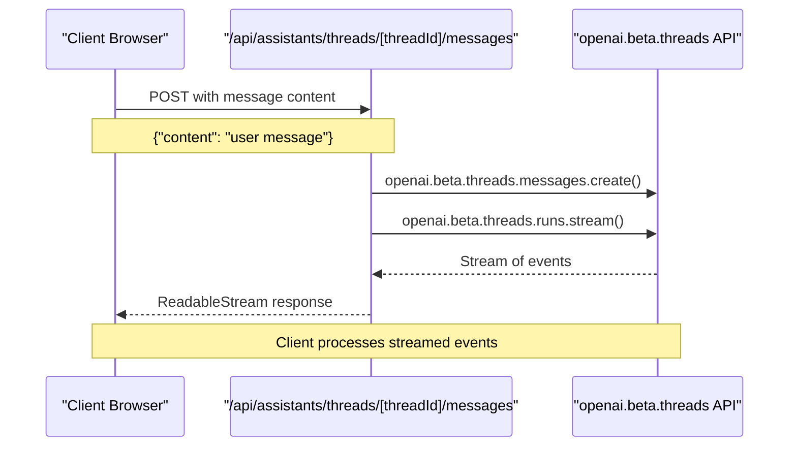
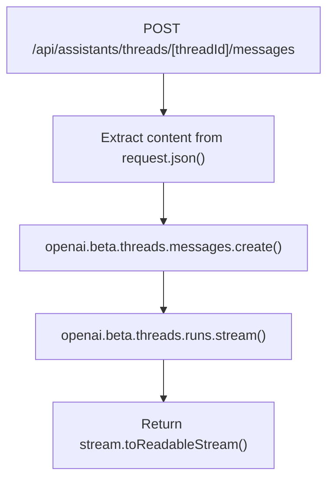
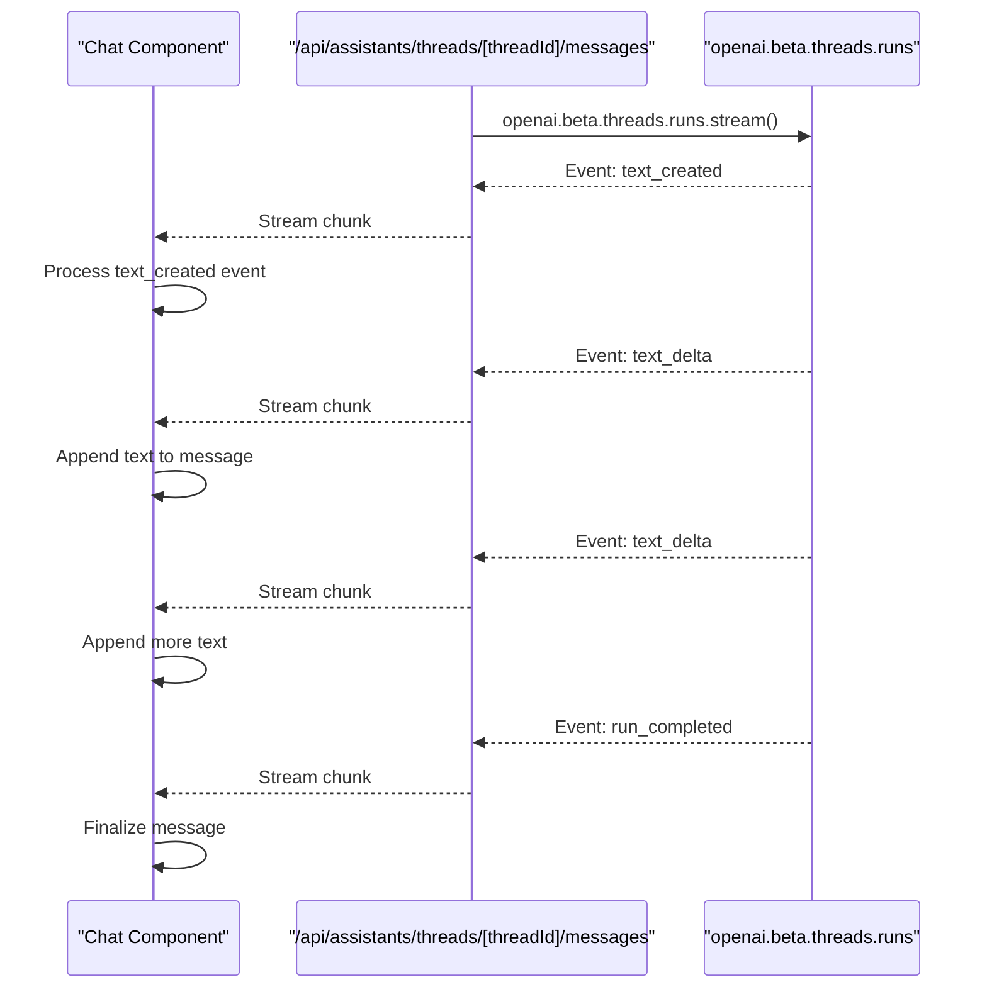
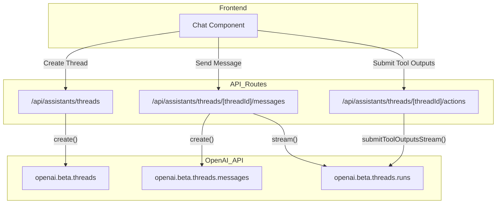

<!-- source: DeepWiki mcp.deepwiki.com · repo openai/openai-assistants-quickstart · page 4.3 Message Management · fetched 2026-10-26 -->

# Message Management

<details>
<summary>Relevant source files</summary>

The following files were used as context for generating this wiki page:

- [app/api/assistants/threads/[threadId]/messages/route.ts](app/api/assistants/threads/[threadId]/messages/route.ts)

</details>


This document explains how messages are sent to threads and how responses are streamed back to the client in the OpenAI Assistants quickstart application. It covers the API route responsible for message handling, the message creation process, and the streaming mechanism for real-time responses.

For information about creating and managing threads, see [Thread Management](#4.2). For handling function calls that might occur during message exchanges, see [Function Calling](#4.4).

## Overview

Message management is a core component of the OpenAI Assistants integration, enabling users to send messages to an assistant and receive streamed responses in real-time. The application implements a streaming pattern to deliver assistant responses as they are generated, providing a responsive user experience.

### Message Flow Diagram



Sources: [app/api/assistants/threads/[threadId]/messages/route.ts:7-20]()

## Message API Route

The application provides an API route at `/api/assistants/threads/[threadId]/messages` that handles creating new messages and streaming the assistant's response.

### API Route Structure



Sources: [app/api/assistants/threads/[threadId]/messages/route.ts:7-20]()

### Request Format

When sending a message to a thread, the client makes a POST request with the following structure:

| Field | Description |
|-------|-------------|
| URL | `/api/assistants/threads/{threadId}/messages` |
| Method | POST |
| Body | `{ "content": "User message text here" }` |

### Implementation Details

The message management endpoint implements a streamlined process:

1. Extracts the message content from the request body
2. Creates a new message in the specified thread using `openai.beta.threads.messages.create()`
3. Starts a new run with streaming using `openai.beta.threads.runs.stream()`
4. Converts the OpenAI stream to a web `ReadableStream` and returns it to the client

```typescript
// Key implementation code
await openai.beta.threads.messages.create(threadId, {
  role: "user",
  content: content,
});

const stream = openai.beta.threads.runs.stream(threadId, {
  assistant_id: assistantId,
});

return new Response(stream.toReadableStream());
```

Sources: [app/api/assistants/threads/[threadId]/messages/route.ts:10-19]()

## Streaming Response System

The streaming response is a key feature of the message management system, allowing for real-time display of the assistant's response.

### Streaming Process



Sources: [app/api/assistants/threads/[threadId]/messages/route.ts:15-19]()

### Stream Event Types

The streamed response contains various event types that the client processes:

| Event Type | Description |
|------------|-------------|
| text_created | Indicates the start of a new text message |
| text_delta | Contains incremental content for the message |
| tool_call_created | Indicates the start of a tool call |
| tool_call_delta | Contains incremental content for a tool call |
| image_file_created | Indicates an image file has been created |
| run_step_completed | Indicates a step in the run has completed |
| run_completed | Indicates the entire run has completed |

## Integration with OpenAI API and Frontend

The message management endpoint forms a crucial bridge between the frontend Chat component and the OpenAI API services.

### Component Relationships



Sources: [app/api/assistants/threads/[threadId]/messages/route.ts:1-20]()

## Summary

The message management system in the OpenAI Assistants quickstart provides an efficient way to:

1. Send user messages to an assistant via the OpenAI API
2. Stream the assistant's response in real-time back to the client
3. Support rich interactions including text responses and tool calls

This streaming architecture delivers a responsive chat experience by incrementally displaying the assistant's responses as they are generated, rather than waiting for the complete response.

Key components of the system include:
- The message API route that handles message creation and streaming
- Integration with OpenAI's Threads, Messages, and Runs APIs
- A streaming response mechanism that delivers real-time updates
- Connection to the frontend Chat component for user interaction

---

