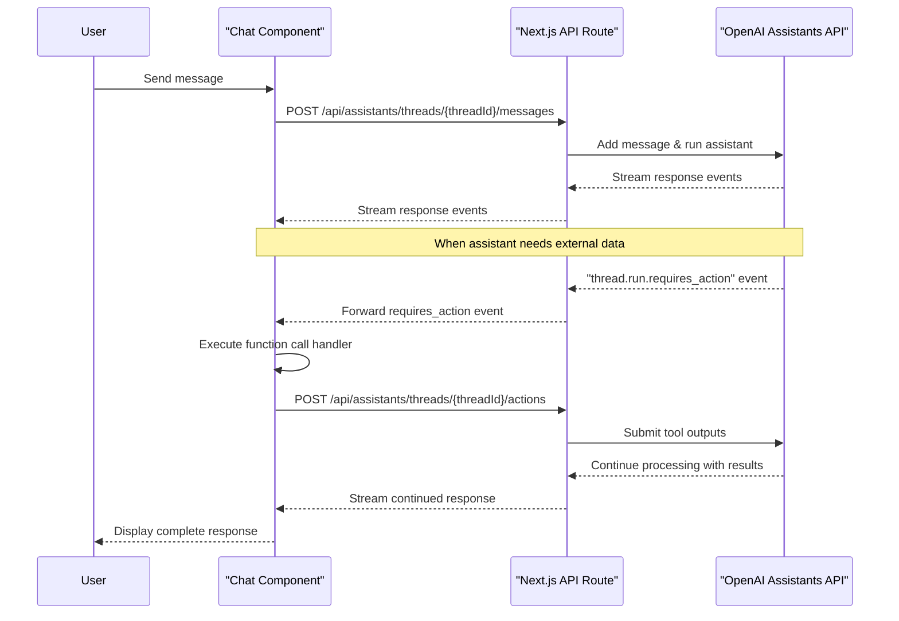
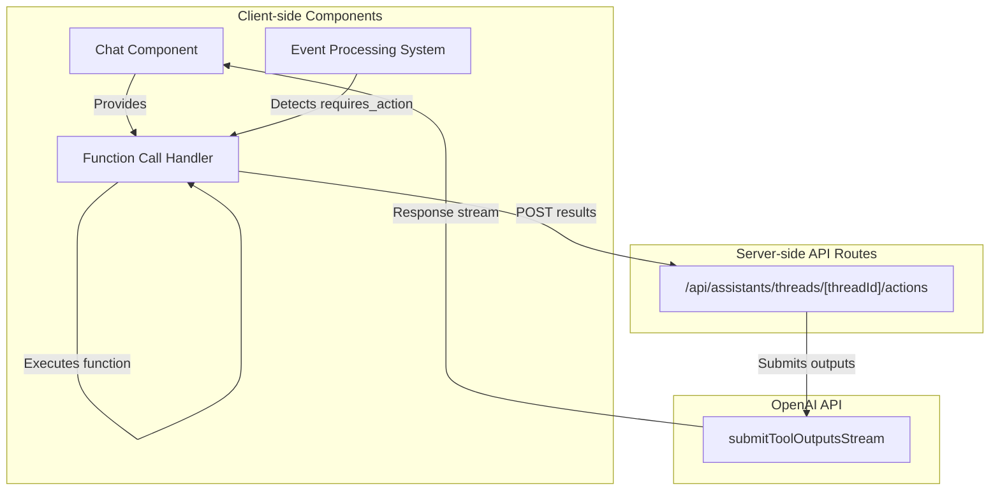
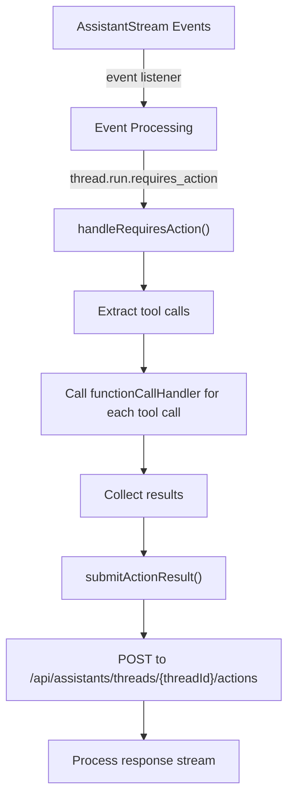

<!-- source: DeepWiki mcp.deepwiki.com · repo openai/openai-assistants-quickstart · page 4.4 Function Calling · fetched 2026-10-26 -->

# Function Calling

<details>
<summary>Relevant source files</summary>

The following files were used as context for generating this wiki page:

- [app/api/assistants/threads/[threadId]/actions/route.ts](app/api/assistants/threads/[threadId]/actions/route.ts)
- [app/components/chat.tsx](app/components/chat.tsx)

</details>


## Purpose and Scope
This document explains how function calling is implemented in the OpenAI Assistants Quickstart application. Function calling enables the AI assistant to request the execution of client-side functions during a conversation, receive the results, and continue the conversation based on that information. This creates an interactive experience where the assistant can access external data or perform actions that it couldn't handle on its own.

For information about general message management between the client and OpenAI API, see [Message Management](#4.3).

## Function Calling Overview

Function calling in this system follows a sequence of steps when the assistant needs to gather information or perform an action that requires client-side execution:



Sources: [app/components/chat.tsx:170-184](), [app/api/assistants/threads/[threadId]/actions/route.ts:4-15]()

## Component Architecture

The function calling system relies on several components working together:



Sources: [app/components/chat.tsx:54-62](), [app/components/chat.tsx:170-184](), [app/api/assistants/threads/[threadId]/actions/route.ts:4-15]()

## Function Call Handler Specification

The Chat component accepts an optional `functionCallHandler` prop that defines how function calls should be processed. This handler receives function call information and returns a promise that resolves to the result.

```tsx
type ChatProps = {
  functionCallHandler?: (
    toolCall: RequiredActionFunctionToolCall
  ) => Promise<string>;
};
```

The default implementation returns an empty string if no handler is provided:

```tsx
const Chat = ({
  functionCallHandler = () => Promise.resolve(""), // default to return empty string
}: ChatProps) => {
  // Component implementation
};
```

Sources: [app/components/chat.tsx:54-62]()

## Function Call Detection and Processing

The Chat component listens for events from the Assistants API stream and detects when a function call is requested:



The `handleRequiresAction` function is the core implementation that extracts tool calls from the event, invokes the function handler for each call, and submits the results back to the API:

Sources: [app/components/chat.tsx:170-184]()

## Tool Output Submission

After function execution, the results are formatted as tool outputs and sent to the API:

1. The client collects all function call results
2. Results are formatted as `{ output: string, tool_call_id: string }[]`
3. A POST request is made to the actions endpoint with the formatted results
4. The server forwards these results to the OpenAI API
5. The conversation continues with the new information

```typescript
// Client-side submission
const submitActionResult = async (runId, toolCallOutputs) => {
  const response = await fetch(
    `/api/assistants/threads/${threadId}/actions`,
    {
      method: "POST",
      headers: {
        "Content-Type": "application/json",
      },
      body: JSON.stringify({
        runId: runId,
        toolCallOutputs: toolCallOutputs,
      }),
    }
  );
  const stream = AssistantStream.fromReadableStream(response.body);
  handleReadableStream(stream);
};
```

On the server side, the action route handles the POST request and submits the tool outputs to OpenAI:

```typescript
// Server-side handling
export async function POST(request, { params: { threadId } }) {
  const { toolCallOutputs, runId } = await request.json();

  const stream = openai.beta.threads.runs.submitToolOutputsStream(
    threadId,
    runId,
    { tool_outputs: toolCallOutputs }
  );

  return new Response(stream.toReadableStream());
}
```

Sources: [app/components/chat.tsx:103-119](), [app/api/assistants/threads/[threadId]/actions/route.ts:4-15]()

## Complete Function Calling Flow

The complete function calling process involves the following steps:

1. The Chat component registers event handlers for the assistant stream
   ```javascript
   stream.on("event", (event) => {
     if (event.event === "thread.run.requires_action")
       handleRequiresAction(event);
     if (event.event === "thread.run.completed") handleRunCompleted();
   });
   ```

2. When a `thread.run.requires_action` event is received, the `handleRequiresAction` function is called
   ```javascript
   const handleRequiresAction = async (
     event: AssistantStreamEvent.ThreadRunRequiresAction
   ) => {
     const runId = event.data.id;
     const toolCalls = event.data.required_action.submit_tool_outputs.tool_calls;
     // Process tool calls and submit results
     // ...
   };
   ```

3. For each tool call, the function handler executes the requested function and collects the results
   ```javascript
   const toolCallOutputs = await Promise.all(
     toolCalls.map(async (toolCall) => {
       const result = await functionCallHandler(toolCall);
       return { output: result, tool_call_id: toolCall.id };
     })
   );
   ```

4. The results are submitted back to the API via the `submitActionResult` function
   ```javascript
   submitActionResult(runId, toolCallOutputs);
   ```

5. The server-side API route forwards the results to the OpenAI API
   ```javascript
   const stream = openai.beta.threads.runs.submitToolOutputsStream(
     threadId,
     runId,
     { tool_outputs: toolCallOutputs }
   );
   ```

6. The OpenAI API processes the results and continues the conversation
   ```javascript
   return new Response(stream.toReadableStream());
   ```

Sources: [app/components/chat.tsx:170-184](), [app/components/chat.tsx:103-119](), [app/api/assistants/threads/[threadId]/actions/route.ts:4-15]()

## Usage Example

To use function calling in your application, you would:

1. Define a function handler when using the Chat component:

```javascript
function MyApp() {
  const handleFunctionCall = async (toolCall) => {
    const { function: { name, arguments: args } } = toolCall;
    
    // Parse the arguments (they come as a JSON string)
    const parsedArgs = JSON.parse(args);
    
    // Execute the appropriate function based on the name
    switch (name) {
      case "getCurrentWeather":
        return await getWeatherData(parsedArgs.location);
      case "searchDatabase":
        return await searchDatabase(parsedArgs.query);
      default:
        return "Function not implemented";
    }
  };

  return <Chat functionCallHandler={handleFunctionCall} />;
}
```

2. Configure your OpenAI Assistant with the appropriate function definitions in your assistant configuration:

```javascript
const assistant = await openai.beta.assistants.create({
  name: "Function calling assistant",
  instructions: "You are a helpful assistant that can call functions.",
  model: "gpt-4-turbo",
  tools: [
    {
      type: "function",
      function: {
        name: "getCurrentWeather",
        description: "Get the current weather in a given location",
        parameters: {
          type: "object",
          properties: {
            location: {
              type: "string",
              description: "The location, e.g., 'San Francisco, CA'",
            },
          },
          required: ["location"],
        },
      },
    },
    // Additional function definitions...
  ],
});
```

This enables a complete function calling flow where the assistant can request client-side functions and use the results to provide better responses to the user.

Sources: [app/components/chat.tsx:54-62](), [app/components/chat.tsx:170-184]()

---

