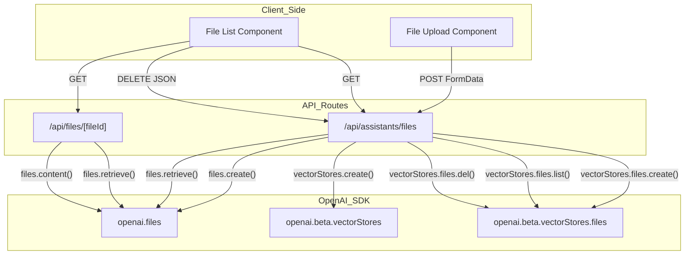
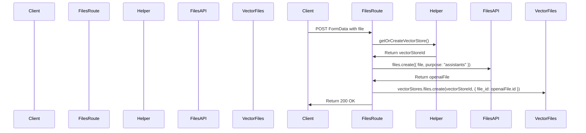
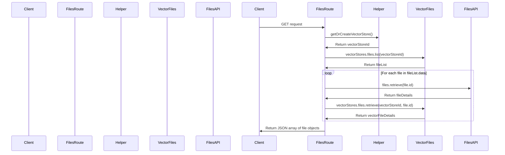
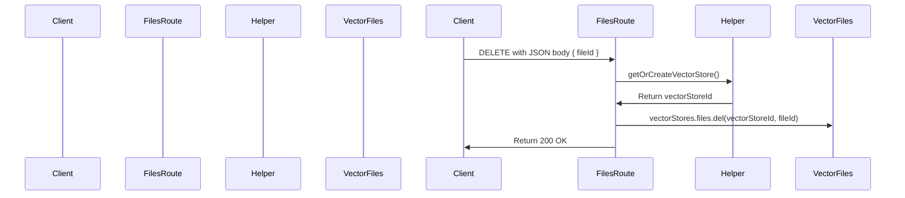
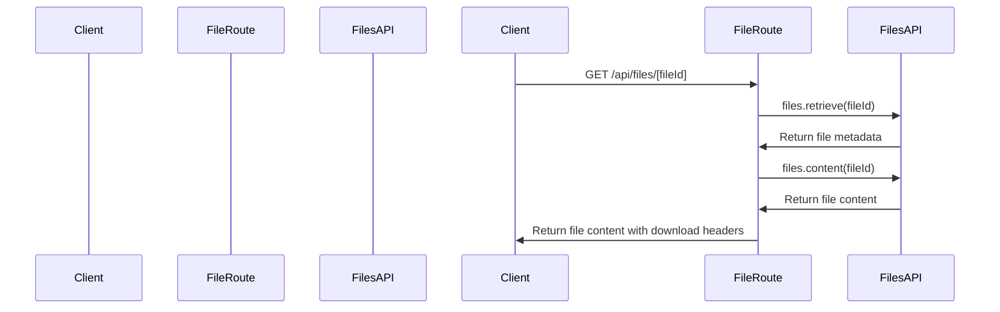
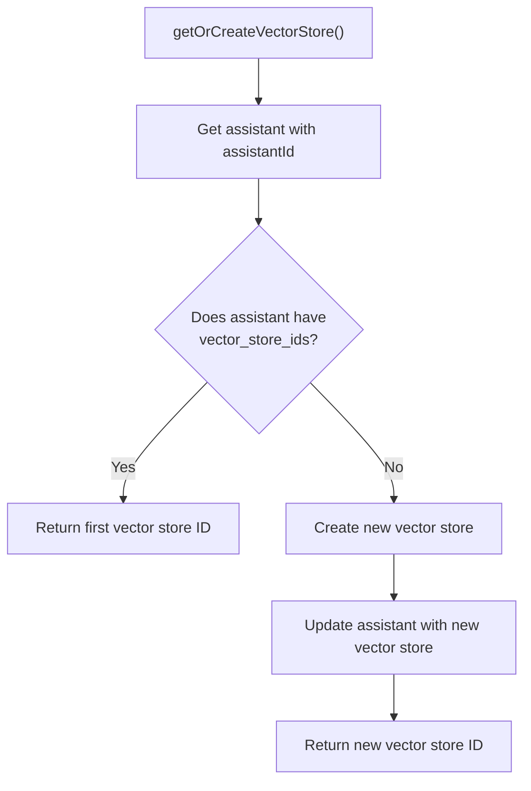

<!-- source: DeepWiki mcp.deepwiki.com · repo openai/openai-assistants-quickstart · page 4.5 File Management · fetched 2026-10-26 -->

# File Management

Relevant source files

The following files were used as context for generating this wiki page:

- [app/api/assistants/files/route.tsx](app/api/assistants/files/route.tsx)
- [app/api/files/[fileId]/route.ts](app/api/files/[fileId]/route.ts)

This document describes the file management capabilities in the OpenAI Assistants Quickstart repository. These capabilities enable uploading, listing, deleting, and downloading files for use with the assistant's file search tool. The system leverages OpenAI's vector stores to enable file searching within documents during conversations.

## File Management Architecture

The file management system consists of two API routes that interface with OpenAI's API to handle file operations and vector store management.

Sources: [app/api/assistants/files/route.tsx](), [app/api/files/[fileId]/route.ts]()

## API Endpoints

The file management system exposes the following API endpoints:

| Endpoint | Method | Purpose |
|----------|--------|---------|
| `/api/assistants/files` | POST | Upload a file to the assistant's vector store |
| `/api/assistants/files` | GET | List files in the assistant's vector store |
| `/api/assistants/files` | DELETE | Delete a file from the assistant's vector store |
| `/api/files/[fileId]` | GET | Download a file by ID |

Sources: [app/api/assistants/files/route.tsx](), [app/api/files/[fileId]/route.ts]()

## File Upload Process

The file upload endpoint processes an uploaded file and adds it to the assistant's vector store.

Implementation details:
1. Receives a file via FormData
2. Gets or creates a vector store using the helper function
3. Uploads the file to OpenAI with purpose "assistants"
4. Adds the file to the vector store
5. Returns a success response

Sources: [app/api/assistants/files/route.tsx:5-21]()

## File Listing Process

The file listing endpoint retrieves all files in the assistant's vector store along with their metadata.

Implementation details:
1. Gets or creates a vector store using the helper function
2. Lists all files in the vector store
3. For each file, retrieves additional metadata:
   - File details from the Files API
   - Vector file details from the Vector Stores API
4. Returns an array of file objects with id, filename, and status

Sources: [app/api/assistants/files/route.tsx:24-43]()

## File Deletion Process

The file deletion endpoint removes a file from the assistant's vector store.

Implementation details:
1. Receives a file ID in the request body
2. Gets or creates a vector store using the helper function
3. Deletes the file from the vector store
4. Returns a success response

Sources: [app/api/assistants/files/route.tsx:46-54]()

## File Download Process

The file download endpoint retrieves a file's content by its ID and serves it for download.

Implementation details:
1. Receives a file ID from the URL path
2. Simultaneously retrieves:
   - File metadata using `openai.files.retrieve()`
   - File content using `openai.files.content()`
3. Returns the file content with appropriate download headers
   - Sets Content-Disposition for browser download with original filename

Sources: [app/api/files/[fileId]/route.ts:4-14]()

## Vector Store Management

The file management system uses a helper function to manage the assistant's vector store, which enables file search functionality.

Implementation details:
1. Retrieves the assistant configuration using the assistant ID
2. Checks if the assistant already has vector stores configured
3. If vector stores exist, returns the first vector store ID
4. If no vector stores exist:
   - Creates a new vector store
   - Updates the assistant configuration to use this vector store
   - Returns the new vector store ID

This ensures the assistant has a vector store available for file searching capabilities.

Sources: [app/api/assistants/files/route.tsx:58-77]()

## Integration with Assistant Tools

Files uploaded through this system are made available to the assistant through the File Search tool. When a file is uploaded, it's added to the vector store and indexed for semantic search, allowing the assistant to reference and search within documents during conversations.

The process works as follows:
1. User uploads a file via the client interface
2. File is stored in OpenAI's file storage system
3. File is associated with the vector store attached to the assistant
4. Assistant can search and reference the file's content during conversations

This implementation enables users to upload documents like PDFs, text files, and other supported formats for the assistant to reference when answering questions.

Sources: [app/api/assistants/files/route.tsx]()

---

