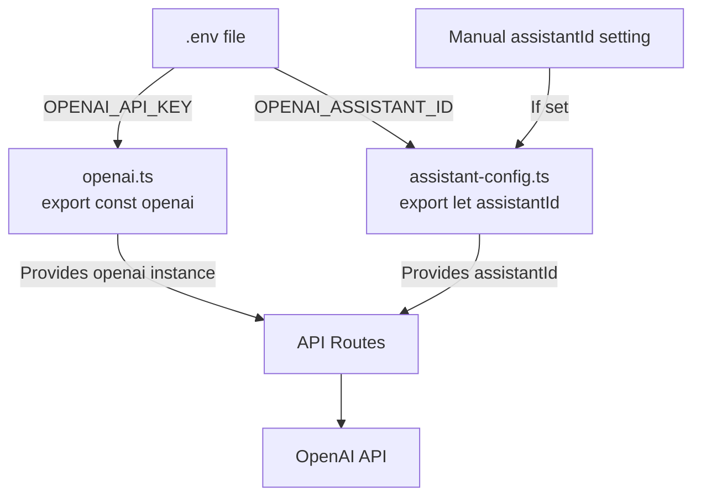
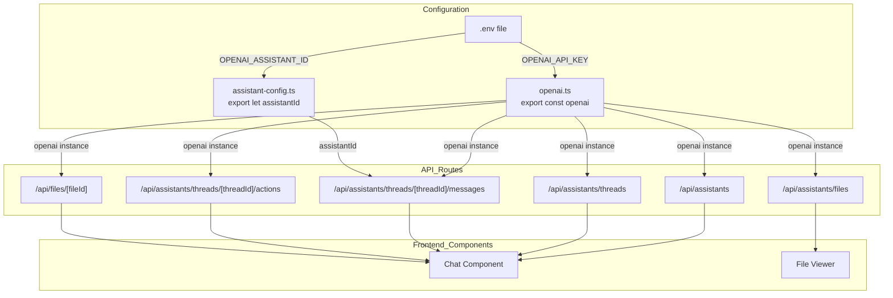

<!-- source: DeepWiki mcp.deepwiki.com · repo openai/openai-assistants-quickstart · page 5 Configuration · fetched 2026-10-26 -->

# Configuration

<details>
<summary>Relevant source files</summary>

The following files were used as context for generating this wiki page:

- [.env.example](.env.example)
- [app/assistant-config.ts](app/assistant-config.ts)
- [app/openai.ts](app/openai.ts)

</details>


This page provides an overview of the configuration system in the OpenAI Assistants Quickstart application. It covers environment variable setup, OpenAI Assistant configuration, and the initialization of the OpenAI client.

For information about how this configuration is used within the broader system architecture, see [System Architecture](#2).

## Environment Variables

The application requires environment variables to be defined in a `.env` file, which is not committed to the repository for security reasons. A template is provided in the `.env.example` file:

| Variable | Description | Required |
|----------|-------------|----------|
| `OPENAI_API_KEY` | Your OpenAI API key for authentication | Yes |
| `OPENAI_ASSISTANT_ID` | ID of your OpenAI Assistant | Optional* |

*Note: The Assistant ID can also be configured directly in code (see Assistant Configuration section below).

To set up your environment:

1. Rename `.env.example` to `.env`
2. Replace the placeholder values with your actual API key and Assistant ID
3. Ensure the `.env` file is not committed to version control

Sources: [.env.example:1-9]()

## Assistant Configuration

The Assistant ID can be set either directly in code or through an environment variable. The application first checks the `assistant-config.ts` file, and if no ID is provided there, it falls back to the environment variable:

```typescript
export let assistantId = ""; // set your assistant ID here

if (assistantId === "") {
  assistantId = process.env.OPENAI_ASSISTANT_ID;
}
```

This allows for different configuration approaches depending on your development workflow:

1. **Development/Testing**: You can hardcode the Assistant ID in `assistant-config.ts` for convenience during development
2. **Production**: Use environment variables for better security and deployment flexibility

Sources: [app/assistant-config.ts:1-6]()

## OpenAI Client Initialization

The OpenAI client is initialized in a simple manner in `openai.ts`:

```typescript
import OpenAI from "openai";

export const openai = new OpenAI();
```

The client is initialized without explicit configuration because it automatically uses the `OPENAI_API_KEY` from your environment variables. This `openai` instance is then imported and used throughout the application to interact with the OpenAI API.

Sources: [app/openai.ts:1-4]()

## Configuration Flow

The following diagram illustrates how configuration values flow through the application:



Sources: [.env.example:1-9](), [app/assistant-config.ts:1-6](), [app/openai.ts:1-4]()

## Configuration Integration with System Components

The following diagram shows how the configuration components integrate with the rest of the system:



Sources: [.env.example:1-9](), [app/assistant-config.ts:1-6](), [app/openai.ts:1-4]()

---

