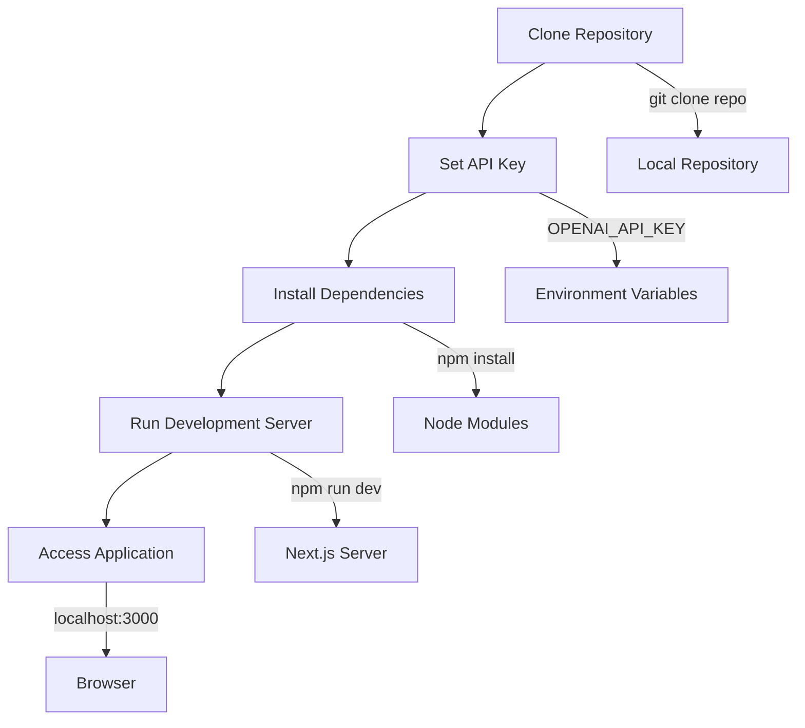
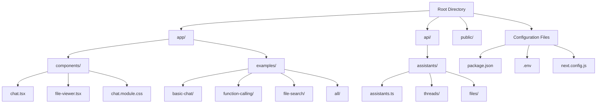
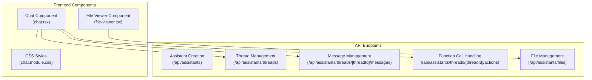
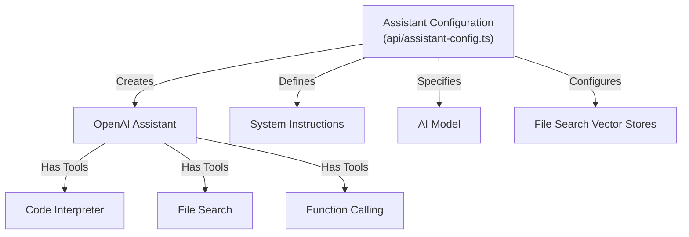
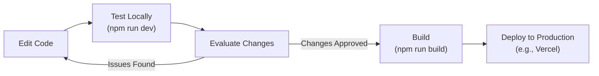
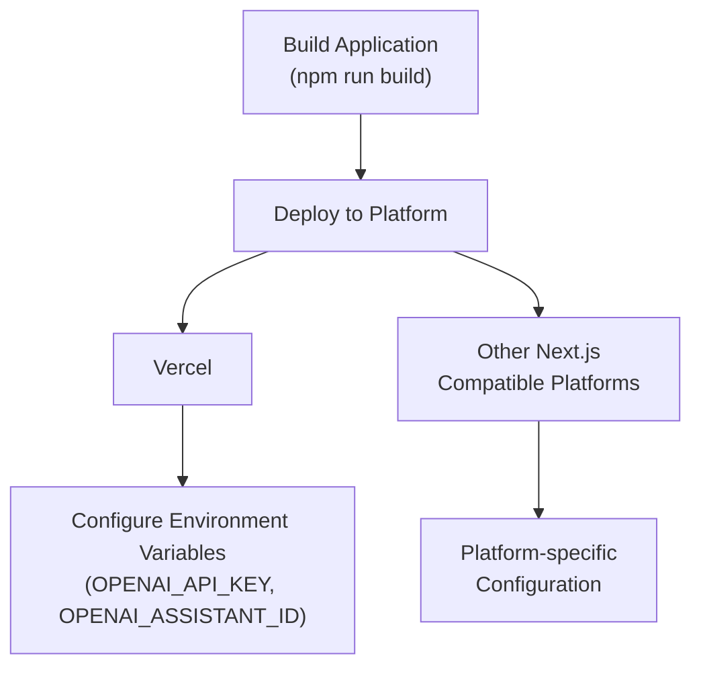

<!-- source: DeepWiki mcp.deepwiki.com · repo openai/openai-assistants-quickstart · page 6 Development Guide · fetched 2026-10-26 -->

# Development Guide

<details>
<summary>Relevant source files</summary>

The following files were used as context for generating this wiki page:

- [.env.example](.env.example)
- [README.md](README.md)
- [package.json](package.json)

</details>


This guide provides instructions for developers who want to set up, modify, or extend the OpenAI Assistants Quickstart application. It covers the development environment configuration, project structure explanation, and common development tasks. For information about the system architecture, see [System Architecture](#2).

## Development Environment Setup

Setting up your local development environment requires just a few simple steps.



### 1. Clone the Repository

```bash
git clone https://github.com/openai/openai-assistants-quickstart.git
cd openai-assistants-quickstart
```

### 2. Set up Environment Variables

Create a `.env` file based on the provided `.env.example`:

```bash
# Copy the example file and edit it
cp .env.example .env
```

Open the `.env` file and add your OpenAI API key. Optionally, you can also provide an Assistant ID if you want to use an existing assistant instead of creating a new one.

### 3. Install Dependencies

```bash
npm install
```

### 4. Run the Development Server

```bash
npm run dev
```

### 5. Access the Application

Navigate to [http://localhost:3000](http://localhost:3000) in your browser.

Sources: [README.md:8-37](), [.env.example:1-9]()

## Project Structure

The codebase follows a typical Next.js structure with a few important directories for the Assistants API integration.



### Key Directories and Files

| Directory/File | Description |
|----------------|-------------|
| `app/components/` | React components including the core chat functionality |
| `app/examples/` | Example pages demonstrating different capabilities |
| `api/assistants/` | API routes for interacting with the OpenAI Assistants API |
| `api/assistants/threads/` | Endpoints for thread and message management |
| `api/assistants/files/` | Endpoints for file management with assistants |
| `.env` | Environment variables for API keys and configuration |

Sources: [README.md:45-70](), [package.json:1-26]()

## Core Components

The application consists of several core components that you can modify or extend.



### Chat Component

The `Chat` component in `app/components/chat.tsx` is the central UI element that:

1. Handles rendering of messages from both user and assistant
2. Processes streaming responses from the Assistant API
3. Manages function calling between the assistant and client-side functions

### File Viewer Component

The `FileViewer` component in `app/components/file-viewer.tsx` manages:

1. File uploading to make files available to the assistant
2. Listing files accessible to the assistant
3. Deleting files when they're no longer needed

### API Endpoints

The application includes several API endpoints:

| Endpoint | HTTP Method | Purpose |
|----------|-------------|---------|
| `/api/assistants` | POST | Create an assistant (on startup) |
| `/api/assistants/threads` | POST | Create a new conversation thread |
| `/api/assistants/threads/[threadId]/messages` | POST | Send a message and get streaming responses |
| `/api/assistants/threads/[threadId]/actions` | POST | Submit function call results |
| `/api/assistants/files` | GET, POST, DELETE | Manage files for the assistant |

Sources: [README.md:58-70]()

## Extending the Application

The application can be extended in several ways to add new features or modify existing ones.

### Modifying the Assistant Configuration

The assistant is configured with specific capabilities when it's created. You can modify these configuration options to change the assistant's behavior.



To modify the assistant's capabilities:

1. Update the assistant configuration if one exists
2. Or modify the assistant creation endpoint to include the desired capabilities
3. Adjust the client-side code to handle the new or modified features

### Adding New Function Calls

You can extend the assistant's capabilities by adding new function calls:

1. Define the function schema in your client-side code
2. Implement the function handler in the `Chat` component
3. Make sure the function is included in the available tools for the assistant

### Creating New Example Pages

To create a new example page:

1. Create a new directory under `app/examples/`
2. Create a page component that uses the `Chat` component
3. Configure the `Chat` component with the desired features

Sources: [README.md:45-56]()

## Development Workflow

The typical development workflow involves modifying components, testing locally, and then deploying.



### Common Development Tasks

#### Customizing the Chat Interface

To modify the chat interface:

1. Edit `app/components/chat.tsx` to change the component logic
2. Update `app/components/chat.module.css` to modify the styling
3. Test your changes locally

#### Adding New API Endpoints

To add a new API endpoint:

1. Create a new file in the appropriate directory under `api/`
2. Implement the endpoint functionality
3. Update client-side code to use the new endpoint

#### Modifying Function Calling

To change the available functions:

1. Update the function definitions in your client-side code
2. Implement the function handlers in the `Chat` component
3. Ensure the assistant is configured to use the updated functions

Sources: [README.md:39-43]()

## Deployment

The application can be deployed to Vercel or any other platform that supports Next.js.



For Vercel deployment, you can use the one-click deploy button in the repository README or connect your own fork to Vercel.

Make sure to set the required environment variables (`OPENAI_API_KEY` and optionally `OPENAI_ASSISTANT_ID`) in your deployment platform.

Sources: [README.md:39-43]()

## Troubleshooting

Here are some common issues and their solutions:

| Issue | Solution |
|-------|----------|
| API key errors | Verify your OpenAI API key is correctly set in `.env` |
| Missing dependencies | Run `npm install` to ensure all dependencies are installed |
| Stream not working | Check your internet connection and API key permissions |
| Function calling not working | Ensure the assistant is configured with the function calling tool |
| File search issues | Verify the assistant has file search enabled and files are properly uploaded |

Sources: [.env.example:1-9](), [README.md:45-56]()

---

