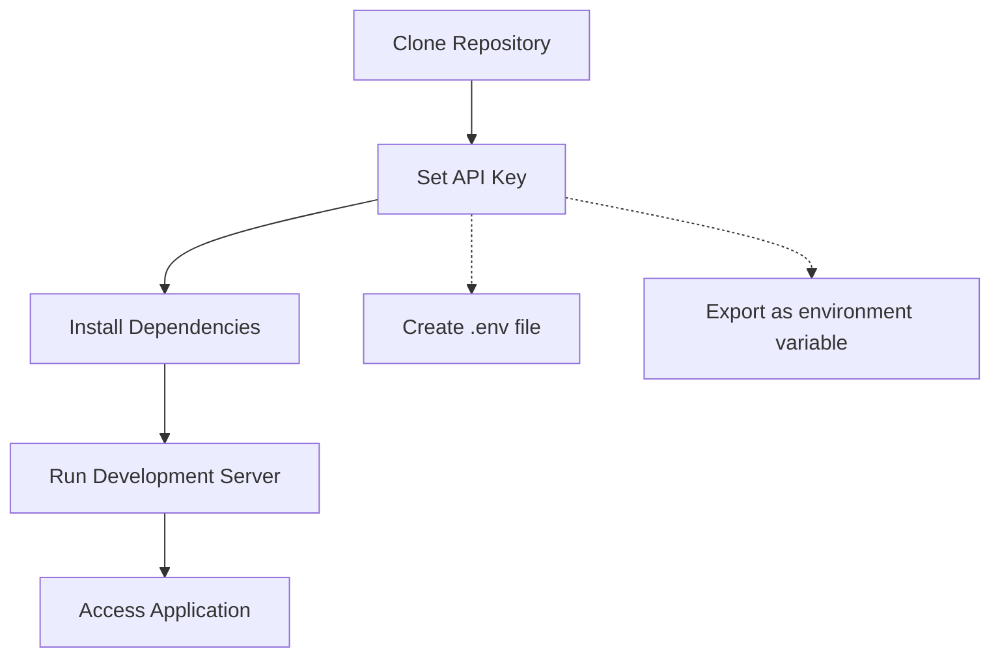
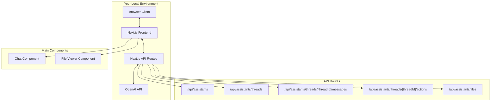

<!-- source: DeepWiki mcp.deepwiki.com · repo openai/openai-assistants-quickstart · page 6.1 Getting Started · fetched 2026-10-26 -->

# Getting Started

<details>
<summary>Relevant source files</summary>

The following files were used as context for generating this wiki page:

- [.env.example](.env.example)
- [README.md](README.md)
- [package.json](package.json)

</details>


This guide walks you through the process of setting up and running the OpenAI Assistants Quickstart application on your local development environment. For information about the project structure, see [Project Structure](#6.2).

## Prerequisites

Before starting, ensure you have the following:

- Node.js (compatible with Next.js 14.1.4)
- npm (Node Package Manager)
- An OpenAI API key (obtainable from https://platform.openai.com/api-keys)
- Git for cloning the repository

## Setup Process

The setup process involves several steps, from cloning the repository to running the application:



Sources: [README.md:8-37]()

### 1. Clone the Repository

Start by cloning the repository and navigating to the project directory:

```bash
git clone https://github.com/openai/openai-assistants-quickstart.git
cd openai-assistants-quickstart
```

Sources: [README.md:10-15]()

### 2. Set your OpenAI API Key

You have two options for setting your API key:

**Option A: Using environment variables**
```bash
export OPENAI_API_KEY="sk_..."
```

**Option B: Using a .env file**
- Rename `.env.example` to `.env`
- Update the `OPENAI_API_KEY` value with your actual API key

Optionally, you can also set an `OPENAI_ASSISTANT_ID` if you have a pre-created assistant. If not specified, the application will create a new assistant with the necessary capabilities.

Sources: [README.md:17-23](), [.env.example:1-9]()

### 3. Install Dependencies

Run the following command to install all required dependencies:

```bash
npm install
```

This will install packages like Next.js, OpenAI SDK, React, and other dependencies specified in the package.json file.

Sources: [README.md:25-29](), [package.json:11-17]()

### 4. Run the Development Server

Start the Next.js development server:

```bash
npm run dev
```

Sources: [README.md:31-35]()

### 5. Access the Application

Navigate to [http://localhost:3000](http://localhost:3000) in your web browser to access the application.

Sources: [README.md:37]()

## Application Architecture

When you start the application, the following components will be initialized:



Sources: [README.md:45-62]()

## Available Examples

The application includes several example pages that demonstrate different capabilities:

| Example Page | URL | Description |
|--------------|-----|-------------|
| Basic Chat | http://localhost:3000/examples/basic-chat | Demonstrates simple chat functionality |
| Function Calling | http://localhost:3000/examples/function-calling | Shows how to use function calling capabilities |
| File Search | http://localhost:3000/examples/file-search | Demonstrates file search features |
| All Features | http://localhost:3000/examples/all | Combines all available features |

Sources: [README.md:51-56]()

## Verification and Troubleshooting

### Successful Setup

When the application is running correctly, you should:
- See a chat interface at http://localhost:3000
- Be able to send messages and receive responses
- See no errors in the terminal console

### Common Issues

1. **API Key Errors**: Ensure your OpenAI API key is correct and has sufficient permissions
2. **Dependency Issues**: Make sure all dependencies are installed correctly with `npm install`
3. **Port Conflicts**: If port 3000 is already in use, the Next.js server will suggest an alternative port

## Next Steps

After successfully setting up the application, you can:
- Explore the different example pages
- Examine the main components like `chat.tsx` and `file-viewer.tsx`
- Study the API endpoints to understand how they interact with OpenAI
- Modify the code to customize the assistant's behavior

For a deeper understanding of the project organization, refer to the [Project Structure](#6.2) guide.

Sources: [README.md:45-70]()

---

