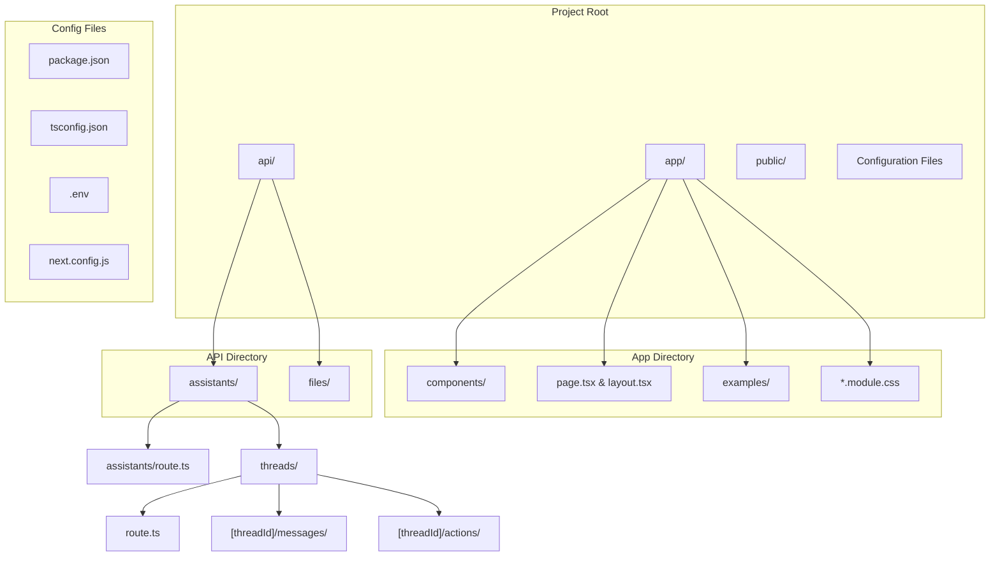
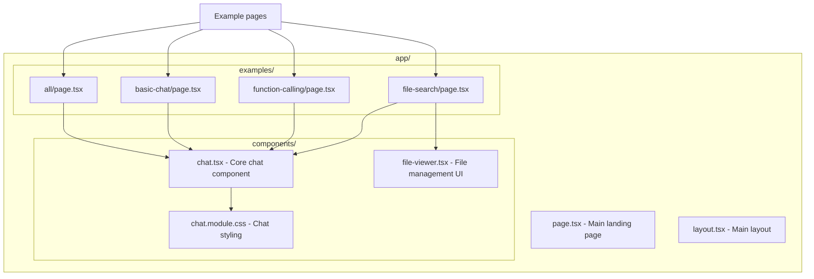
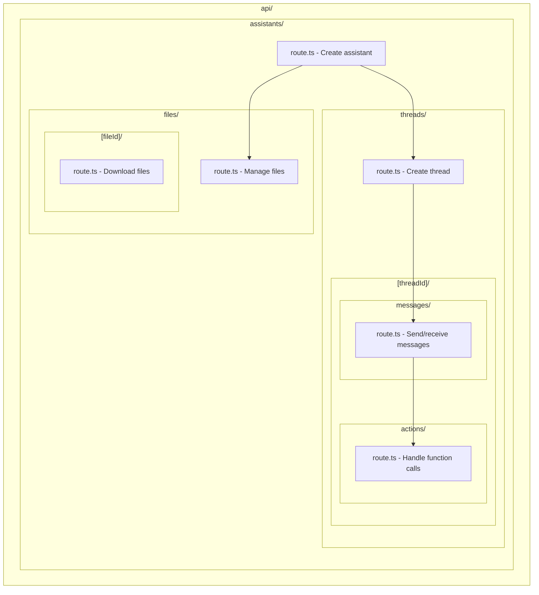
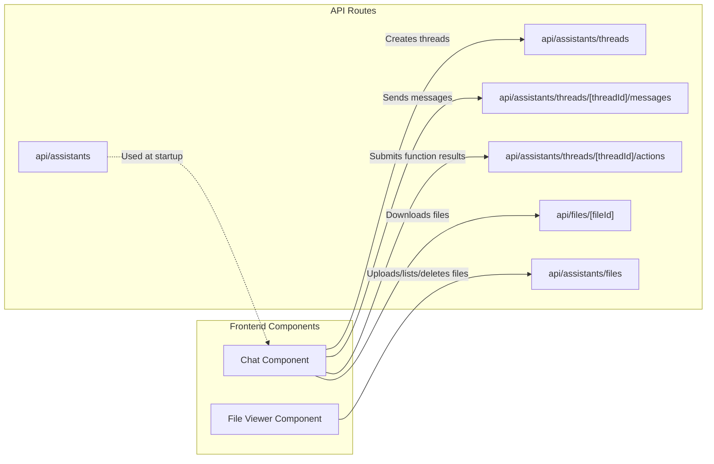
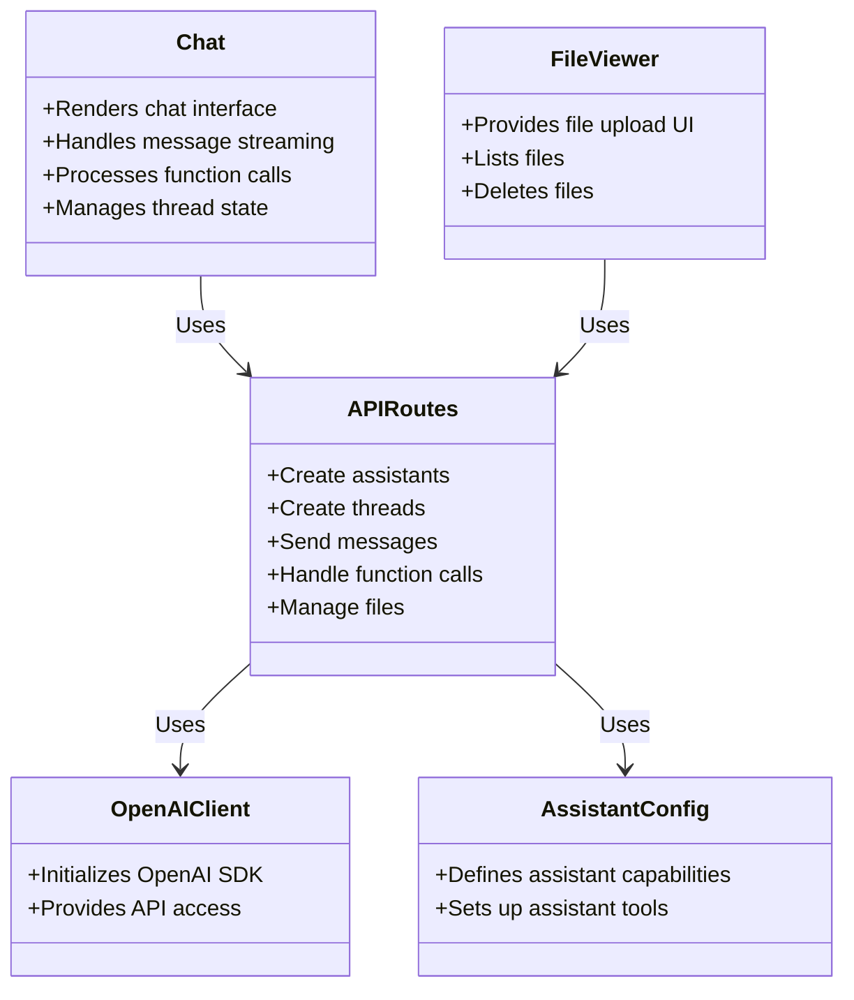

<!-- source: DeepWiki mcp.deepwiki.com · repo openai/openai-assistants-quickstart · page 6.2 Project Structure · fetched 2026-10-26 -->

# Project Structure

<details>
<summary>Relevant source files</summary>

The following files were used as context for generating this wiki page:

- [README.md](README.md)
- [package.json](package.json)
- [tsconfig.json](tsconfig.json)

</details>


This document provides an explanation of the OpenAI Assistants Quickstart project's file organization and codebase structure. It serves as a guide to help developers understand where different components are located and how they relate to each other. For information about the overall system architecture, see [System Architecture](#2), and for details on API endpoints, see [API Endpoints](#4).

## Directory Overview

The OpenAI Assistants Quickstart follows a standard Next.js application structure with the app router, organized into frontend components and API routes.



Sources: [README.md:57-70]()

## Key Files and Directories

### Frontend Structure

The frontend code is organized within the `app` directory, following Next.js app router conventions:



Sources: [README.md:52-62]()

### API Routes Structure

The API routes are organized in the `api` directory, with endpoints for managing assistants, threads, messages, actions, and files:



Sources: [README.md:63-70]()

## Component and API Integration

The following diagram illustrates how the frontend components interact with the API routes:



Sources: [README.md:57-70]()

## Key Configuration Files

| File | Purpose |
|------|---------|
| `package.json` | Defines project dependencies and scripts |
| `tsconfig.json` | TypeScript configuration |
| `.env` | Environment variables (API keys) |
| `next.config.js` | Next.js configuration |

Sources: [package.json:1-26](), [tsconfig.json:1-26]()

## Core Files and Their Roles



Sources: [README.md:46-62]()

## File Patterns and Organization

The project follows several important file organization patterns:

1. **Component Organization**: Main UI components are located in `app/components/`
   - `chat.tsx` - The core chat component
   - `file-viewer.tsx` - Component for file management

2. **API Route Organization**: 
   - Routes follow the Next.js App Router convention
   - Each endpoint has its own directory with a `route.ts` file
   - Dynamic routes use the `[paramName]` naming convention

3. **Example Pages**:
   - Located in `app/examples/`
   - Each example demonstrates different assistant capabilities
   - All examples use the same underlying components with different configurations

4. **Configuration Pattern**:
   - Environment variables in `.env`
   - Assistant configuration in a separate file for easy modification

Sources: [README.md:46-56]()

## Development Workflow

The development workflow is tied to the project structure:

1. **Setup**: Configure API keys in `.env`
2. **Component Development**: Modify components in `app/components/`
3. **API Modifications**: Update API routes in `api/`
4. **New Features**: Add new examples in `app/examples/`

To start the development server:
```
npm run dev
```

This serves the application at `http://localhost:3000`.

Sources: [README.md:8-37](), [package.json:5-10]()