# Page: Overview

# Overview

<details>
<summary>Relevant source files</summary>

The following files were used as context for generating this wiki page:

- [README.md](README.md)
- [package.json](package.json)

</details>


This document provides an introduction to the OpenAI Assistants Quickstart repository, which serves as a template for integrating the OpenAI Assistants API with Next.js applications.

## Purpose and Scope

The OpenAI Assistants Quickstart demonstrates how to implement a complete chat interface with advanced assistant capabilities including:

- Real-time streaming of assistant responses
- Tool usage (code interpreter and file search)
- Function calling capabilities
- File management for assistant interactions

This template provides both standalone examples of each feature and a comprehensive implementation combining all capabilities. The system uses the same underlying assistant configuration across all examples.

For detailed information about the system architecture, see [System Architecture](#2).

Sources: [README.md:45-49]()

## High-Level System Architecture

The following diagram illustrates the main components of the system and how they interact:

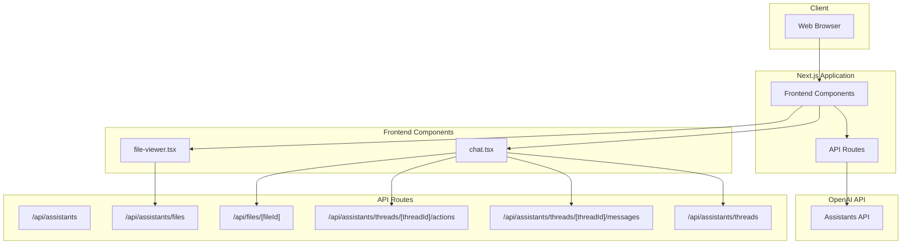

Sources: [README.md:45-49]()

## Core Components

### Frontend Components

1. **Chat Component** (`app/components/chat.tsx`): 
   - Renders the chat interface
   - Manages message state
   - Handles streaming of assistant responses
   - Processes function calls from the assistant
   - Renders different message types (text, code, images)

2. **File Viewer Component** (`app/components/file-viewer.tsx`): 
   - Handles file uploading for assistant usage
   - Lists available files
   - Manages file deletion
   - Integrates with file search capabilities

Sources: [README.md:59-62]()

### API Endpoints

The application provides several API endpoints that connect the frontend with the OpenAI Assistants API:

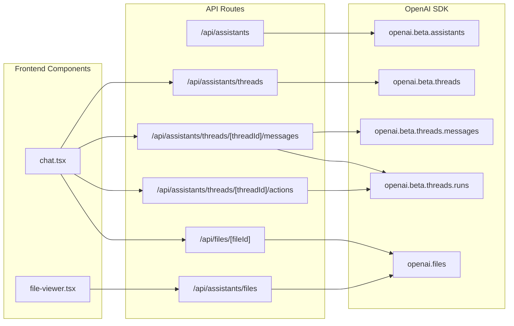

| Endpoint | Method | Purpose |
|----------|--------|---------|
| `/api/assistants` | POST | Create assistant with tools |
| `/api/assistants/threads` | POST | Create new conversation thread |
| `/api/assistants/threads/[threadId]/messages` | POST | Send message to assistant and receive streaming response |
| `/api/assistants/threads/[threadId]/actions` | POST | Submit function call results back to assistant |
| `/api/assistants/files` | GET/POST/DELETE | Manage files for file search |
| `/api/files/[fileId]` | GET | Download file content |

Sources: [README.md:63-70]()

## Data Flow

This sequence diagram illustrates the typical flow of a conversation with the assistant:

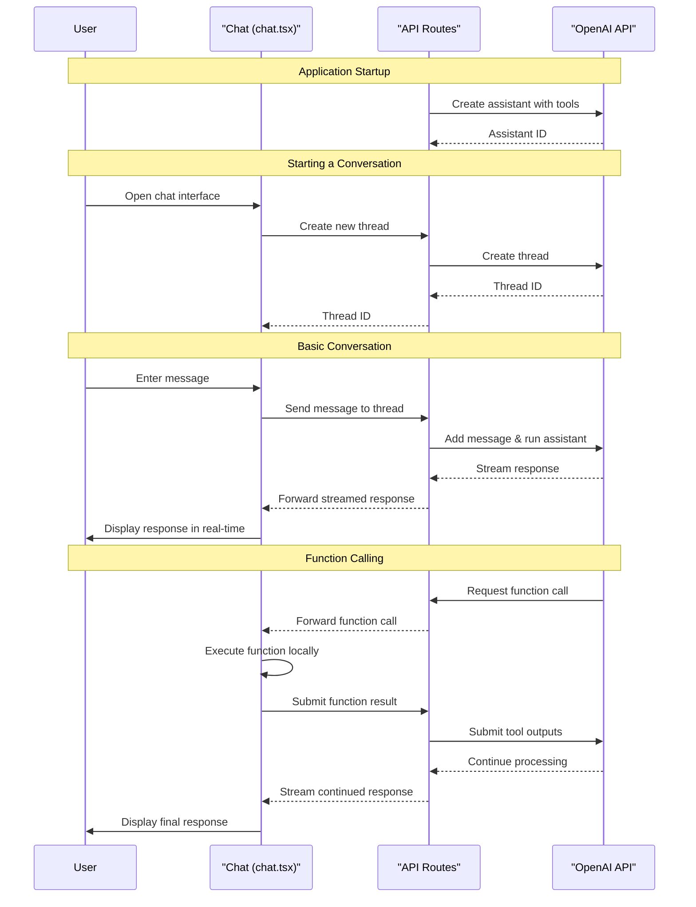

Sources: [README.md:45-49]()

## Feature Examples

The repository includes several example pages demonstrating different capabilities:

| Example | URL | Features |
|---------|-----|----------|
| Basic Chat | `/examples/basic-chat` | Simple text-based conversation |
| Function Calling | `/examples/function-calling` | Assistant calling client-side functions |
| File Search | `/examples/file-search` | File uploading and searching |
| Full-featured | `/examples/all` | All capabilities combined |

Sources: [README.md:51-56]()

## Technical Stack

| Component | Technology |
|-----------|------------|
| Frontend Framework | Next.js 14.1.4 |
| API Integration | OpenAI Node.js SDK v4.46.0 |
| UI Rendering | React 18 |
| Content Rendering | React Markdown 9.0.1 |

Sources: [package.json:11-16]()

## Main Logic Location

The core logic for the chat functionality is implemented in:
- `app/components/chat.tsx` - the frontend Chat component
- API handlers in the `api/assistants/threads/...` directory

These components handle the conversation flow, message rendering, streaming, function calls, and integration with the OpenAI Assistants API.

Sources: [README.md:47-49]()

## Getting Started

For detailed setup and development instructions, see [Development Guide](#6) and [Getting Started](#6.1).

To run the application locally:
1. Clone the repository
2. Set your OpenAI API key
3. Install dependencies with `npm install`
4. Start the development server with `npm run dev`
5. Navigate to http://localhost:3000

Sources: [README.md:8-37]()

---

# Page: System Architecture

# System Architecture

<details>
<summary>Relevant source files</summary>

The following files were used as context for generating this wiki page:

- [README.md](README.md)
- [app/api/assistants/route.ts](app/api/assistants/route.ts)
- [app/components/chat.tsx](app/components/chat.tsx)
- [app/openai.ts](app/openai.ts)

</details>


This document provides a comprehensive overview of the system architecture for the OpenAI Assistants Quickstart. It explains how the frontend components interact with Next.js API routes and how these routes communicate with the OpenAI Assistants API. For information about specific frontend components, see [Frontend Components](#3), and for detailed API endpoint documentation, see [API Endpoints](#4).

## Overview

The OpenAI Assistants Quickstart is a Next.js application that implements a chat interface using the OpenAI Assistants API. The architecture follows a client-server model with:

1. **Frontend Layer**: React components that provide the user interface
2. **API Layer**: Next.js API routes that serve as middleware between the frontend and OpenAI
3. **External Services**: The OpenAI Assistants API that powers the AI functionality

### System Components Diagram

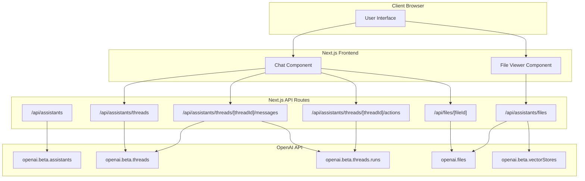

Sources: [README.md:58-70](), [app/components/chat.tsx:77-87](), [app/components/chat.tsx:89-101](), [app/api/assistants/route.ts:5-38]()

## Core Components

### Frontend Components

The application has two main frontend components:

1. **Chat Component**: Manages the chat interface, including sending messages, receiving streaming responses, and handling function calls.
2. **File Viewer Component**: Handles file upload, listing, and deletion for the assistant.

### API Routes

The application uses several Next.js API routes to interface with OpenAI:

| API Route | Purpose |
|-----------|---------|
| `/api/assistants` | Creates the assistant with specified tools |
| `/api/assistants/threads` | Creates new conversation threads |
| `/api/assistants/threads/[threadId]/messages` | Sends messages and receives streaming responses |
| `/api/assistants/threads/[threadId]/actions` | Submits function call results back to the assistant |
| `/api/assistants/files` | Manages files for file search capability |
| `/api/files/[fileId]` | Downloads file content |

Sources: [README.md:63-70]()

### OpenAI Integration

The application initializes the OpenAI client simply:

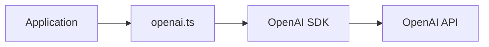

Sources: [app/openai.ts:1-3]()

## Data Flow

The following diagram shows how data flows through the system during a typical user interaction:

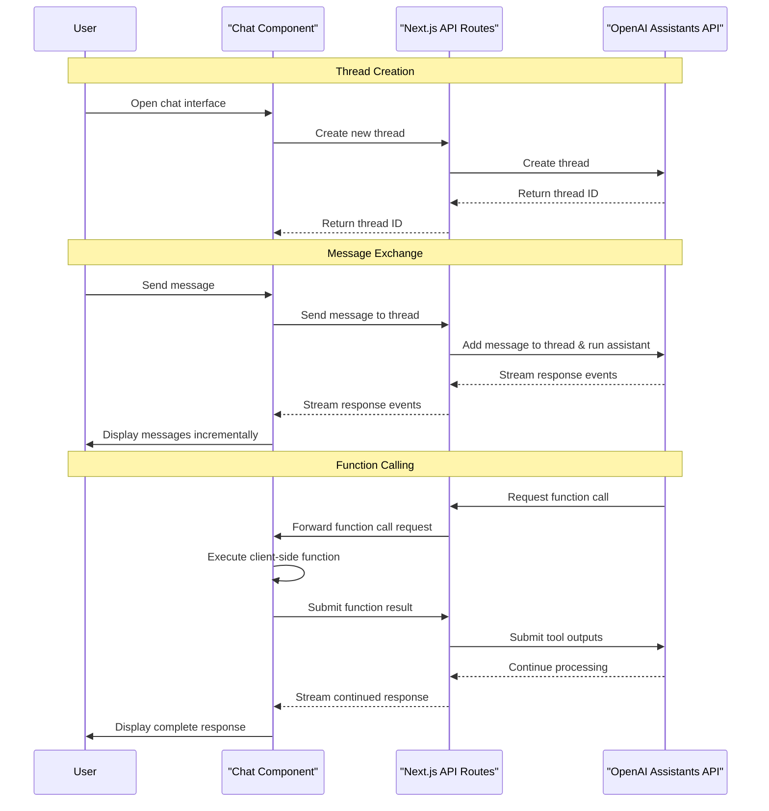

Sources: [app/components/chat.tsx:77-87](), [app/components/chat.tsx:89-101](), [app/components/chat.tsx:103-119](), [app/components/chat.tsx:170-184]()

## Chat Component Architecture

The Chat component is the central piece of the frontend and handles all chat-related functionality:

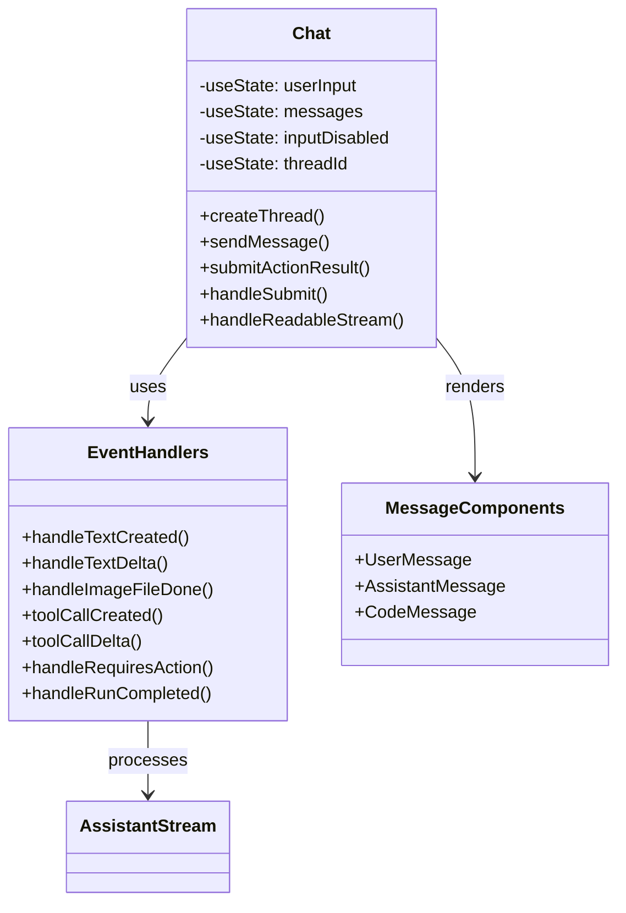

Sources: [app/components/chat.tsx:11-52](), [app/components/chat.tsx:60-132](), [app/components/chat.tsx:134-208]()

### Message Flow in Chat Component

The Chat component processes messages and streaming responses through a series of steps:

1. **Thread Creation**: When a user first opens the chat, a new conversation thread is created via the `/api/assistants/threads` endpoint.
2. **Message Sending**: When a user sends a message, it's added to the thread via the `/api/assistants/threads/[threadId]/messages` endpoint.
3. **Stream Processing**: The response is streamed back from the OpenAI API and processed through various event handlers:
   - `textCreated`: Creates a new assistant message
   - `textDelta`: Appends text to the last message incrementally
   - `imageFileDone`: Shows generated images in the chat
   - `toolCallCreated`/`toolCallDelta`: Handles code interpreter input/output
   - `thread.run.requires_action`: Processes function calls
   - `thread.run.completed`: Re-enables the input form

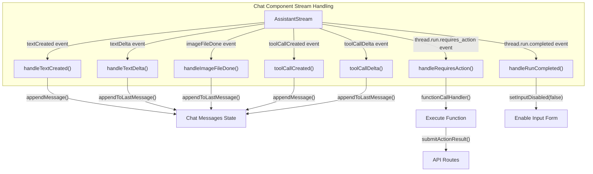

Sources: [app/components/chat.tsx:134-208](), [app/components/chat.tsx:217-249]()

## Assistant Creation and Configuration

The assistant is created with specific tools enabled through the `/api/assistants` endpoint:

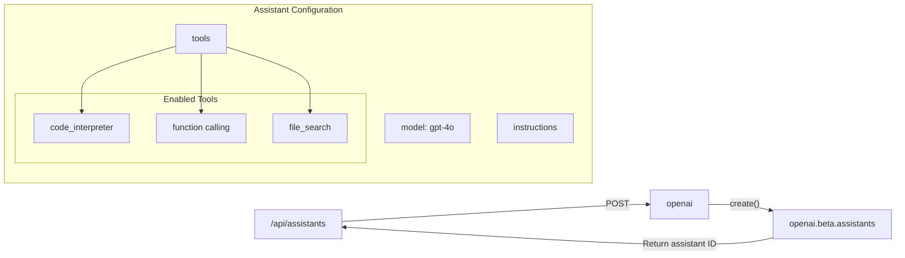

Sources: [app/api/assistants/route.ts:6-38]()

## Summary

The OpenAI Assistants Quickstart application follows a clean, modular architecture that separates concerns between frontend components and API routes. The frontend components provide the user interface for interacting with the assistant, while the API routes handle the communication with the OpenAI API.

Key architectural features include:

1. **Real-time streaming**: The Chat component processes streaming responses from the OpenAI API in real-time, providing an interactive chat experience.

2. **Function calling**: The application implements the ability for the assistant to call client-side functions and receive the results.

3. **File management**: The application supports uploading and managing files for use with the assistant's file search capability.

4. **Code interpretation**: The Chat component can display and process code outputs from the assistant's code interpreter.

This architecture provides a solid foundation for building AI assistant applications with Next.js and the OpenAI Assistants API.

Sources: [README.md:45-71](), [app/components/chat.tsx:1-282](), [app/api/assistants/route.ts:1-38](), [app/openai.ts:1-3]()

---

# Page: Data Flow

# Data Flow

<details>
<summary>Relevant source files</summary>

The following files were used as context for generating this wiki page:

- [app/api/assistants/threads/[threadId]/actions/route.ts](app/api/assistants/threads/[threadId]/actions/route.ts)
- [app/api/assistants/threads/[threadId]/messages/route.ts](app/api/assistants/threads/[threadId]/messages/route.ts)
- [app/components/chat.tsx](app/components/chat.tsx)

</details>


This document details how data flows through the OpenAI Assistants Quickstart application, focusing on communication between frontend components, API routes, and the OpenAI Assistants API. Special attention is given to the streaming functionality that enables real-time assistant responses, and how function calling is handled through the system.

## Overview of Data Flow Architecture

This diagram illustrates the primary data flows in the application:

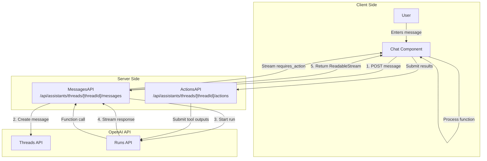

Sources: [app/components/chat.tsx:89-101](), [app/api/assistants/threads/[threadId]/messages/route.ts:7-20](), [app/api/assistants/threads/[threadId]/actions/route.ts:4-15]()

## Thread Initialization

When a user first opens the chat interface, a new conversation thread is created:

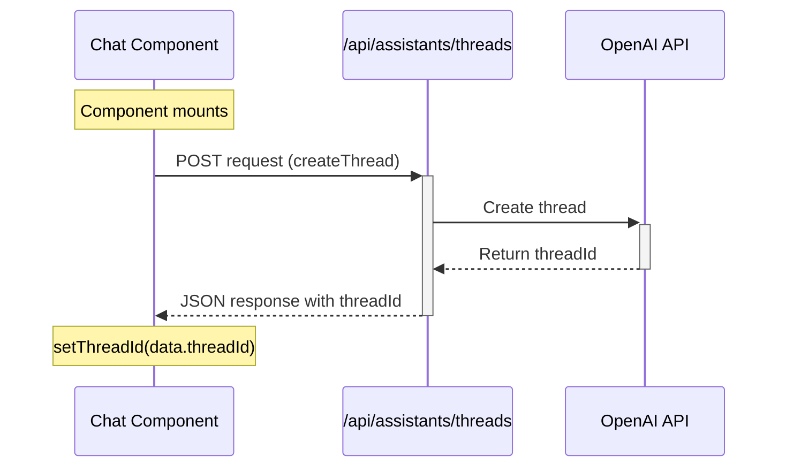

Sources: [app/components/chat.tsx:78-87]()

## Message Sending Flow

When a user sends a message, the following data flow occurs:

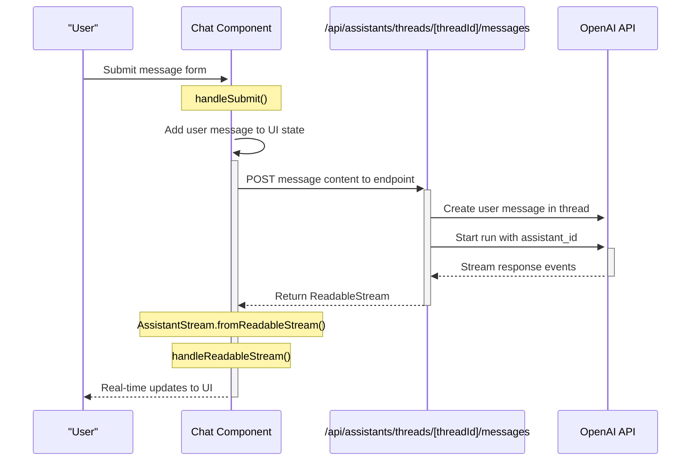

Sources: [app/components/chat.tsx:89-101](), [app/components/chat.tsx:121-132](), [app/api/assistants/threads/[threadId]/messages/route.ts:7-20]()

## Streaming Response Handling

A key feature of the application is its real-time streaming response handling:

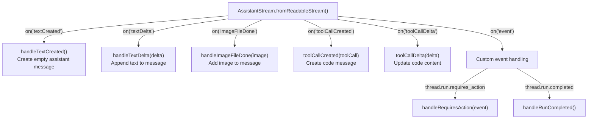

Sources: [app/components/chat.tsx:191-209](), [app/components/chat.tsx:135-190]()

The stream event handlers implement a sophisticated system for processing different types of events from the assistant:

| Event | Handler | Purpose |
|-------|---------|---------|
| `textCreated` | `handleTextCreated()` | Initializes an empty assistant message in the UI |
| `textDelta` | `handleTextDelta(delta)` | Appends incoming text chunks to the last message |
| `imageFileDone` | `handleImageFileDone(image)` | Adds an image reference to the message |
| `toolCallCreated` | `toolCallCreated(toolCall)` | Creates a new code message container |
| `toolCallDelta` | `toolCallDelta(delta, snapshot)` | Updates code content incrementally |
| `thread.run.requires_action` | `handleRequiresAction(event)` | Handles function calls |
| `thread.run.completed` | `handleRunCompleted()` | Re-enables the input form |

Sources: [app/components/chat.tsx:135-190]()

## Function Calling Flow

When the assistant needs to call a function, a specialized data flow is triggered:

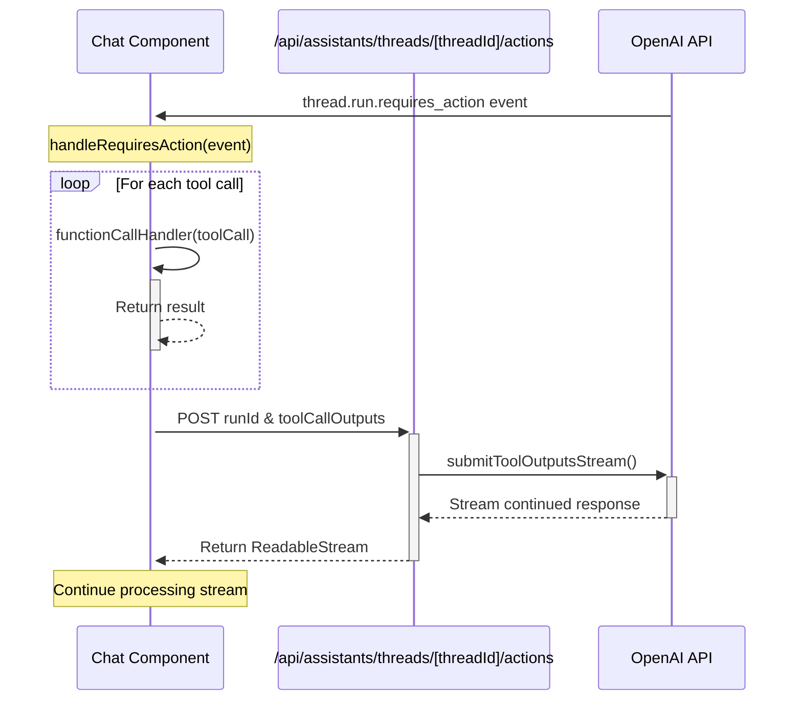

Sources: [app/components/chat.tsx:170-184](), [app/api/assistants/threads/[threadId]/actions/route.ts:4-15]()

## UI Update Flow

As stream events are processed, the UI is updated through a state management system:

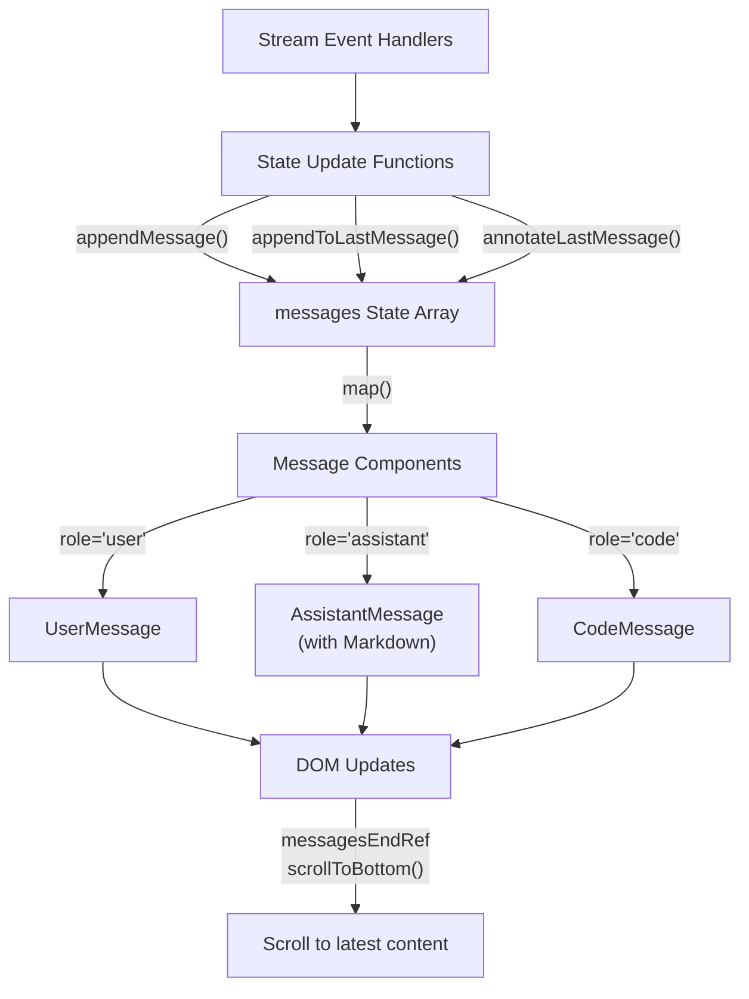

Sources: [app/components/chat.tsx:11-52](), [app/components/chat.tsx:217-249](), [app/components/chat.tsx:251-258](), [app/components/chat.tsx:69-75]()

## Complete Message-to-Response Cycle

This comprehensive diagram illustrates the entire data flow from user input to completed assistant response:

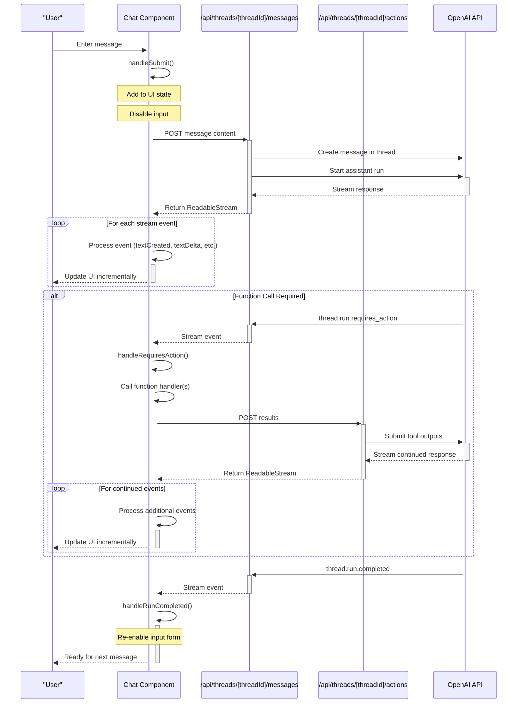

Sources: [app/components/chat.tsx:60-279](), [app/api/assistants/threads/[threadId]/messages/route.ts:7-20](), [app/api/assistants/threads/[threadId]/actions/route.ts:4-15]()

## Data Types and Transformations

The application transforms data between different formats as it flows through the system:

| Location | Input Data | Transformation | Output Data |
|----------|------------|----------------|------------|
| Frontend | User text input | `handleSubmit()` | UI state update + API request |
| API Route | Message content JSON | OpenAI API calls | ReadableStream |
| Frontend | ReadableStream | `AssistantStream.fromReadableStream()` | Event stream |
| Frontend | Event stream | Event handlers | UI state updates |
| Frontend | Tool call events | `functionCallHandler()` | Function results |
| API Route | Tool outputs JSON | `submitToolOutputsStream()` | ReadableStream |
| Frontend | Message state array | React rendering | DOM elements |

Sources: [app/components/chat.tsx:89-119](), [app/api/assistants/threads/[threadId]/messages/route.ts:7-20](), [app/api/assistants/threads/[threadId]/actions/route.ts:4-15]()

---

# Page: Frontend Components

# Frontend Components

<details>
<summary>Relevant source files</summary>

The following files were used as context for generating this wiki page:

- [app/components/chat.module.css](app/components/chat.module.css)
- [app/components/chat.tsx](app/components/chat.tsx)

</details>


This document provides an overview of the frontend components in the OpenAI Assistants Quickstart application. It focuses on the structure, functionality, and relationships between the UI components that enable users to interact with the OpenAI Assistants API. For information about API endpoints that these components interact with, see [API Endpoints](#4).

## Component Architecture Overview

The frontend of the application consists primarily of a Chat component that manages user interactions, message rendering, and communication with the backend API routes. The following diagram illustrates the core frontend components and their relationships:

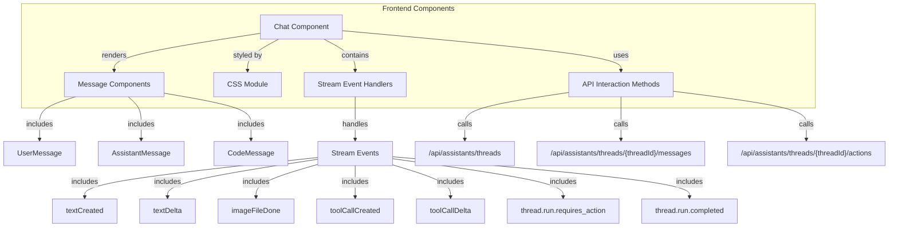

Sources: [app/components/chat.tsx:1-282]()

## Chat Component

The Chat component is the central UI element of the application, responsible for:
- Managing user input and message history
- Rendering messages of different types (user, assistant, code)
- Creating conversation threads
- Sending user messages to the assistant
- Processing streaming responses
- Handling function calls

### Structure and Props

The Chat component accepts a `functionCallHandler` prop that allows it to process function calls requested by the assistant.

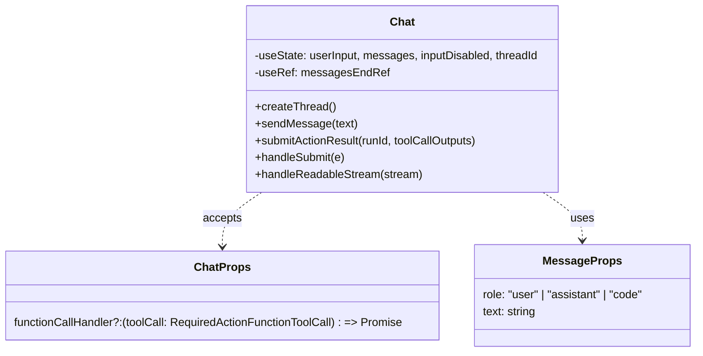

Sources: [app/components/chat.tsx:54-62](), [app/components/chat.tsx:11-14]()

### State Management

The Chat component manages several pieces of state:

| State Variable | Type | Purpose |
|----------------|------|---------|
| `userInput` | string | Stores the current text in the input field |
| `messages` | array | Stores the conversation history |
| `inputDisabled` | boolean | Controls whether the input field is enabled |
| `threadId` | string | Stores the ID of the current conversation thread |

Sources: [app/components/chat.tsx:63-66]()

### Lifecycle and Initialization

On component mount, the Chat component creates a new thread via the API:

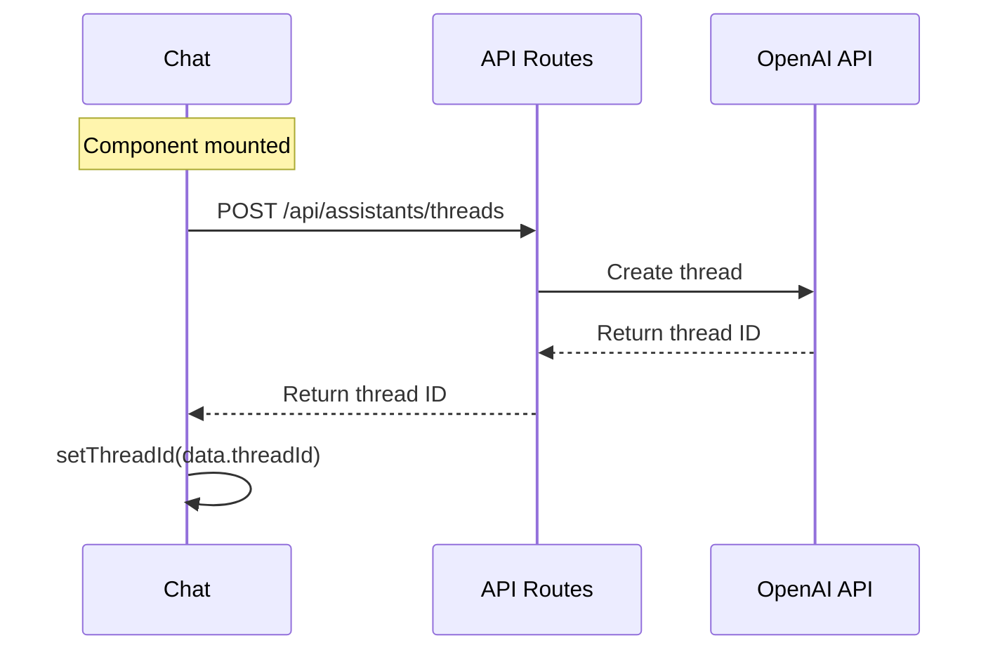

Sources: [app/components/chat.tsx:77-87]()

### Message Rendering

The Chat component renders three types of messages:

1. **UserMessage**: Displays user inputs in a distinctive style
2. **AssistantMessage**: Renders assistant responses with Markdown support
3. **CodeMessage**: Formats code with line numbers

```mermaid
graph TD
    Message["Message Component"]
    Message -->|role="user"| UserMessage
    Message -->|role="assistant"| AssistantMessage
    Message -->|role="code"| CodeMessage
    
    UserMessage -->|renders| UserText["Simple text display"]
    AssistantMessage -->|renders| MarkdownText["Markdown with image support"]
    CodeMessage -->|renders| CodeWithLineNumbers["Code with line numbers"]
```

Sources: [app/components/chat.tsx:16-52]()

Each message type has distinct styling defined in the CSS module:

| Message Type | CSS Class | Visual Characteristics |
|--------------|-----------|------------------------|
| UserMessage | `.userMessage` | Right-aligned, dark background, white text |
| AssistantMessage | `.assistantMessage` | Left-aligned, light gray background, supports images |
| CodeMessage | `.codeMessage` | Monospace font, line numbers, light background |

Sources: [app/components/chat.module.css:55-96]()

### Stream Event Handling

A key feature of the Chat component is its ability to process streaming events from the OpenAI API, providing real-time updates to the UI:

```mermaid
flowchart TD
    Stream["AssistantStream"]
    
    Stream -->|"on('textCreated')"| HandleTextCreated["handleTextCreated()"]
    Stream -->|"on('textDelta')"| HandleTextDelta["handleTextDelta()"]
    Stream -->|"on('imageFileDone')"| HandleImageFileDone["handleImageFileDone()"]
    Stream -->|"on('toolCallCreated')"| ToolCallCreated["toolCallCreated()"]
    Stream -->|"on('toolCallDelta')"| ToolCallDelta["toolCallDelta()"]
    Stream -->|"on('event')"| HandleEvent["Handle other events"]
    
    HandleTextCreated -->|"appendMessage('assistant', '')"| NewMessage["Create new assistant message"]
    HandleTextDelta -->|"appendToLastMessage(delta.value)"| AppendText["Append text to last message"]
    HandleImageFileDone -->|"appendToLastMessage(markdown)"| AddImage["Add image to message"]
    ToolCallCreated -->|"appendMessage('code', '')"| NewCodeMsg["Create new code message"]
    ToolCallDelta -->|"appendToLastMessage(input)"| AppendCode["Append code to message"]
    HandleEvent -->|"thread.run.requires_action"| HandleAction["Process function calls"]
    HandleEvent -->|"thread.run.completed"| EnableInput["Re-enable input"]
```

Sources: [app/components/chat.tsx:135-208]()

### API Interactions

The Chat component interacts with the backend API routes in three main ways:

1. **Thread Creation**: Creates a new conversation thread when the component is mounted
2. **Message Sending**: Sends user messages to the thread and initiates assistant responses
3. **Action Submission**: Submits the results of function calls back to the assistant

```mermaid
sequenceDiagram
    participant User
    participant Chat
    participant API
    participant OpenAI
    
    User->>Chat: Enter message
    Chat->>API: POST /api/assistants/threads/{threadId}/messages
    API->>OpenAI: Add message & run assistant
    OpenAI-->>API: Stream response events
    API-->>Chat: Forward stream
    Chat->>Chat: Process stream events
    Chat->>User: Update UI in real-time
    
    alt Function Call Required
        OpenAI-->>API: Request function call
        API-->>Chat: Forward function call
        Chat->>Chat: Execute function handler
        Chat->>API: POST /api/assistants/threads/{threadId}/actions
        API->>OpenAI: Submit tool outputs
        OpenAI-->>API: Continue processing
        API-->>Chat: Stream continued response
    end
```

Sources: [app/components/chat.tsx:89-119]()

## User Interface Elements

The Chat component includes a simple but effective user interface with:

1. A scrollable message container
2. A fixed input form with text input and send button
3. Auto-scrolling functionality to keep the latest messages visible

The UI layout is structured as a flex container with reverse column direction, placing the input at the bottom and messages above:

```mermaid
graph TD
    ChatContainer["chatContainer (flex container)"]
    ChatContainer -->|"order: 1"| InputForm["inputForm (fixed at bottom)"]
    ChatContainer -->|"order: 2"| MessagesContainer["messages (scrollable)"]
    
    InputForm -->|contains| TextInput["input field"]
    InputForm -->|contains| SendButton["Send button"]
    
    MessagesContainer -->|contains| MessageItems["Message components"]
    MessagesContainer -->|contains| ScrollAnchor["messagesEndRef for auto-scroll"]
```

Sources: [app/components/chat.module.css:1-53](), [app/components/chat.tsx:251-279]()

## Utility Functions

The Chat component includes several utility functions for managing the message display:

| Function | Purpose |
|----------|---------|
| `appendToLastMessage(text)` | Adds text to the most recent message |
| `appendMessage(role, text)` | Creates a new message with the specified role and text |
| `annotateLastMessage(annotations)` | Processes file references in messages |
| `scrollToBottom()` | Scrolls the view to show the latest messages |

Sources: [app/components/chat.tsx:211-249](), [app/components/chat.tsx:69-75]()

## Integration with OpenAI Stream API

The Chat component integrates with the OpenAI Assistant Stream API using the `AssistantStream` class to process streaming events:

```mermaid
flowchart TD
    SendMessage["sendMessage()"] -->|calls| FetchAPI["fetch('/api/assistants/threads/{threadId}/messages')"]
    FetchAPI -->|returns| ResponseBody["response.body (ReadableStream)"]
    ResponseBody -->|processed by| AssistantStream["AssistantStream.fromReadableStream()"]
    AssistantStream -->|passed to| HandleStream["handleReadableStream()"]
    
    HandleStream -->|registers handlers| EventHandlers["Event Handlers"]
    EventHandlers -->|update| UIState["Component State"]
    UIState -->|triggers| Rerender["Component Re-render"]
```

Sources: [app/components/chat.tsx:89-101](), [app/components/chat.tsx:191-208]()

Through this architecture and integration, the Frontend Components efficiently handle the presentation and user interaction aspects of the OpenAI Assistants API, providing a responsive and interactive chat experience.

---

# Page: Chat Component

# Chat Component

<details>
<summary>Relevant source files</summary>

The following files were used as context for generating this wiki page:

- [app/components/chat.tsx](app/components/chat.tsx)

</details>


The Chat Component is the primary user interface element in the OpenAI Assistants Quickstart application, responsible for managing the conversation between the user and an AI assistant. It handles message rendering, user input, streaming responses, and function calling capabilities.

For information about message styling and rendering details, see [Message Rendering](#3.2).

## Overview and Purpose

The Chat Component provides a complete chat interface that:

- Creates and manages conversation threads with the OpenAI Assistants API
- Renders messages from both the user and assistant
- Processes streaming responses for real-time interaction
- Handles rich content including markdown, code blocks, and images
- Supports function calling (tool use) with custom handlers

```mermaid
graph TD
    subgraph "Chat Component Architecture"
        UI["User Interface"]
        State["State Management"]
        MessageProcessing["Message Processing"]
        StreamHandling["Stream Handling"]
        FunctionCalls["Function Call Handling"]
    end
    
    User["User"] -->|"Sends message"| UI
    UI -->|"Updates"| State
    State -->|"Triggers"| MessageProcessing
    MessageProcessing -->|"Calls API"| API["API Routes"]
    API -->|"Returns"| StreamHandling
    StreamHandling -->|"Updates"| State
    StreamHandling -->|"May trigger"| FunctionCalls
    FunctionCalls -->|"Submits results"| API
    State -->|"Renders"| UI
```

Sources: [app/components/chat.tsx:60-280]()

## Component Interface

The Chat Component accepts a single optional prop:

```typescript
type ChatProps = {
  functionCallHandler?: (toolCall: RequiredActionFunctionToolCall) => Promise<string>;
};
```

This allows parent components to provide a custom handler for function calls made by the assistant.

Sources: [app/components/chat.tsx:54-58]()

## State Management

The component manages several pieces of state:

| State Variable | Type | Purpose |
|----------------|------|---------|
| `userInput` | string | Stores the current text in the input field |
| `messages` | array | Stores all messages in the conversation |
| `inputDisabled` | boolean | Controls whether the input form is enabled |
| `threadId` | string | Stores the ID of the current conversation thread |

```mermaid
stateDiagram-v2
    [*] --> Initialize
    Initialize --> ReadyForInput: Thread Created
    ReadyForInput --> ProcessingMessage: User Sends Message
    ProcessingMessage --> ProcessingMessage: Assistant Streaming
    ProcessingMessage --> FunctionCall: Assistant Requests Function
    FunctionCall --> ProcessingMessage: Function Result Submitted
    ProcessingMessage --> ReadyForInput: Run Completed
```

Sources: [app/components/chat.tsx:63-66](), [app/components/chat.tsx:188-189]()

## Thread Initialization

When the component mounts, it automatically creates a new conversation thread:

```mermaid
sequenceDiagram
    participant Chat as Chat Component
    participant API as API Routes
    participant OpenAI as OpenAI API
    
    Note over Chat: Component Mounted
    activate Chat
    Chat->>API: POST /api/assistants/threads
    activate API
    API->>OpenAI: Create thread
    activate OpenAI
    OpenAI-->>API: Return thread ID
    deactivate OpenAI
    API-->>Chat: Return {threadId}
    deactivate API
    Chat->>Chat: setThreadId(data.threadId)
    deactivate Chat
```

Sources: [app/components/chat.tsx:78-87]()

## Message Handling Flow

When a user submits a message, the component:

1. Adds the message to local state
2. Sends the message to the API
3. Sets the input field as disabled
4. Processes the streaming response

```mermaid
sequenceDiagram
    participant User
    participant Chat as Chat Component
    participant API as API Routes
    
    User->>Chat: Enter message & submit
    activate Chat
    Chat->>Chat: Add user message to state
    Chat->>Chat: Disable input
    Chat->>API: POST /api/assistants/threads/{threadId}/messages
    activate API
    API-->>Chat: Stream response
    Chat->>Chat: Process stream events
    Chat->>Chat: Update UI in real-time
    API-->>Chat: Stream completed
    deactivate API
    Chat->>Chat: Enable input
    deactivate Chat
```

Sources: [app/components/chat.tsx:89-101](), [app/components/chat.tsx:121-132]()

## Stream Event Processing

The component processes streaming responses from the OpenAI API using various event handlers:

| Event | Handler | Purpose |
|-------|---------|---------|
| `textCreated` | `handleTextCreated` | Creates a new empty assistant message |
| `textDelta` | `handleTextDelta` | Appends incoming text to the last assistant message |
| `imageFileDone` | `handleImageFileDone` | Adds an image reference to the message |
| `toolCallCreated` | `toolCallCreated` | Creates a new code message for code interpreter output |
| `toolCallDelta` | `toolCallDelta` | Appends code to the last code message |
| `thread.run.requires_action` | `handleRequiresAction` | Processes function calls from the assistant |
| `thread.run.completed` | `handleRunCompleted` | Re-enables the input form |

```mermaid
graph TD
    Stream["AssistantStream"] -->|"Events"| Handlers["Event Handlers"]
    
    subgraph "Handler Functions"
        TextCreated["handleTextCreated()"]
        TextDelta["handleTextDelta()"]
        ImageFileDone["handleImageFileDone()"]
        ToolCallCreated["toolCallCreated()"]
        ToolCallDelta["toolCallDelta()"]
        RequiresAction["handleRequiresAction()"]
        RunCompleted["handleRunCompleted()"]
    end
    
    Handlers --> TextCreated
    Handlers --> TextDelta
    Handlers --> ImageFileDone
    Handlers --> ToolCallCreated
    Handlers --> ToolCallDelta
    Handlers --> RequiresAction
    Handlers --> RunCompleted
    
    TextCreated -->|"appendMessage()"| MessageState["Messages State"]
    TextDelta -->|"appendToLastMessage()"| MessageState
    ImageFileDone -->|"appendToLastMessage()"| MessageState
    ToolCallCreated -->|"appendMessage()"| MessageState
    ToolCallDelta -->|"appendToLastMessage()"| MessageState
    RequiresAction --> FunctionCallProcess["Process Function Calls"]
    RunCompleted -->|"setInputDisabled(false)"| InputState["Input State"]
```

Sources: [app/components/chat.tsx:136-209]()

## Function Call Handling

When the assistant requires a function call to be executed, the component:

1. Extracts the tool calls from the event
2. Calls the provided `functionCallHandler` for each tool call
3. Submits the results back to the API
4. Processes the continued response

```mermaid
sequenceDiagram
    participant Stream as Stream Event
    participant Chat as Chat Component
    participant Handler as Function Handler
    participant API as API Routes
    
    Stream->>Chat: thread.run.requires_action
    activate Chat
    Chat->>Chat: Extract tool calls
    Chat->>Handler: Call functionCallHandler(toolCall)
    activate Handler
    Handler-->>Chat: Return function result
    deactivate Handler
    Chat->>API: POST /api/assistants/threads/{threadId}/actions
    activate API
    API-->>Chat: Stream continued response
    Chat->>Chat: Process stream events
    deactivate API
    deactivate Chat
```

Sources: [app/components/chat.tsx:170-184](), [app/components/chat.tsx:103-119]()

## Message Rendering

The Chat Component supports three types of messages:

1. **User Messages** - Plain text messages from the user
2. **Assistant Messages** - Markdown-formatted messages from the assistant
3. **Code Messages** - Code blocks with line numbers

Each message type has a dedicated rendering component:

```mermaid
graph TD
    Message["Message Component"] -->|"role='user'"| UserMessage["UserMessage Component"]
    Message -->|"role='assistant'"| AssistantMessage["AssistantMessage Component"]
    Message -->|"role='code'"| CodeMessage["CodeMessage Component"]
    
    UserMessage -->|"Renders"| SimpleDiv["Simple div with text"]
    AssistantMessage -->|"Uses"| ReactMarkdown["React Markdown"]
    CodeMessage -->|"Formats"| LineNumbers["Code with line numbers"]
```

Sources: [app/components/chat.tsx:11-52]()

## API Interaction

The Chat Component interacts with several API endpoints:

| Endpoint | Method | Purpose |
|----------|--------|---------|
| `/api/assistants/threads` | POST | Creates a new conversation thread |
| `/api/assistants/threads/${threadId}/messages` | POST | Sends user messages and receives responses |
| `/api/assistants/threads/${threadId}/actions` | POST | Submits function call results |
| `/api/files/${fileId}` | GET | Referenced in markdown to display files/images |

Sources: [app/components/chat.tsx:80-81](), [app/components/chat.tsx:90-98](), [app/components/chat.tsx:104-116](), [app/components/chat.tsx:153]()

## Utility Methods

The component includes several utility methods for managing messages:

| Method | Purpose |
|--------|---------|
| `appendMessage` | Adds a new message to the messages array |
| `appendToLastMessage` | Appends text to the most recent message |
| `annotateLastMessage` | Processes annotations in messages (such as file paths) |
| `scrollToBottom` | Automatically scrolls the chat window to show newest messages |

Sources: [app/components/chat.tsx:217-249](), [app/components/chat.tsx:70-75]()

## User Interface Structure

The UI consists of two main sections:

1. **Message List** - Area displaying all messages in the conversation
2. **Input Form** - Form with text input and submit button

```mermaid
graph TD
    subgraph "Chat Container"
        Messages["Messages Container"]
        Form["Input Form"]
    end
    
    Messages -->|"Contains"| MessageComponents["Message Components"]
    Messages -->|"Has"| ScrollRef["Auto-scroll Reference"]
    Form -->|"Contains"| Input["Text Input"]
    Form -->|"Contains"| Button["Send Button"]
    
    Input -->|"Controlled by"| UserInputState["userInput state"]
    Button -->|"Disabled by"| InputDisabledState["inputDisabled state"]
```

Sources: [app/components/chat.tsx:251-279]()

---

# Page: Message Rendering

# Message Rendering

<details>
<summary>Relevant source files</summary>

The following files were used as context for generating this wiki page:

- [app/components/chat.module.css](app/components/chat.module.css)
- [app/components/chat.tsx](app/components/chat.tsx)

</details>


This document details how different message types are rendered in the OpenAI Assistants Quickstart application. It focuses on the components, styling, and processes involved in displaying messages in the chat interface. For information about the overall Chat component structure and state management, see [Chat Component](#3.1).

## Message Type Overview

The application supports three distinct message types, each with specialized rendering:

```mermaid
flowchart TD
    M["Message Component"] --> |"role: user"| UM["UserMessage"]
    M --> |"role: assistant"| AM["AssistantMessage"]
    M --> |"role: code"| CM["CodeMessage"]
    
    subgraph "Message Components"
        UM
        AM --> |"renders with"| MD["Markdown"]
        CM --> |"renders with"| LN["Line Numbers"]
    end
```

Sources: [app/components/chat.tsx:11-52]()

## Message Components

### Message Types Structure

The application defines a `MessageProps` interface that specifies the properties required for rendering messages:

```typescript
type MessageProps = {
  role: "user" | "assistant" | "code";
  text: string;
};
```

A factory component `Message` determines which specific message component to render based on the role property:

```mermaid
flowchart LR
    subgraph "Message Factory"
        M["Message({ role, text })"]
        SW["switch(role)"]
        M --> SW
        SW --> |"user"| UM["UserMessage"]
        SW --> |"assistant"| AM["AssistantMessage"]
        SW --> |"code"| CM["CodeMessage"]
    end
```

Sources: [app/components/chat.tsx:11-52]()

### Component Implementation

#### User Message

User messages are rendered as simple text in a styled container.

```typescript
const UserMessage = ({ text }: { text: string }) => {
  return <div className={styles.userMessage}>{text}</div>;
};
```

#### Assistant Message

Assistant messages support Markdown for rich text formatting, allowing for formatted text, links, lists, and other Markdown features.

```typescript
const AssistantMessage = ({ text }: { text: string }) => {
  return (
    <div className={styles.assistantMessage}>
      <Markdown>{text}</Markdown>
    </div>
  );
};
```

#### Code Message

Code messages provide line-numbered display for code blocks:

```typescript
const CodeMessage = ({ text }: { text: string }) => {
  return (
    <div className={styles.codeMessage}>
      {text.split("\n").map((line, index) => (
        <div key={index}>
          <span>{`${index + 1}. `}</span>
          {line}
        </div>
      ))}
    </div>
  );
};
```

Sources: [app/components/chat.tsx:16-39]()

## Visual Styling

Messages are styled with CSS to provide visual distinction between different message types.

### Common Styling

All message types share some base styling properties:

```css
.userMessage, .assistantMessage, .codeMessage {
  margin: 8px 0;
  padding: 8px 16px;
  align-self: flex-start;
  border-radius: 15px;
  max-width: 80%;
  overflow-wrap: break-word;
}
```

### Type-Specific Styling

Each message type has unique styling to differentiate its appearance:

| Message Type | Alignment | Background Color | Text Color | Special Features |
|--------------|-----------|------------------|------------|------------------|
| User | Right-aligned (`align-self: flex-end`) | Black | White | None |
| Assistant | Left-aligned | Light gray (#efefef) | Default | Markdown support |
| Code | Left-aligned | Light gray (#e9e9e9) | Default | Monospace font, Line numbers |

```mermaid
flowchart TB
    subgraph "Visual Styling"
        UM["User Message"] --> |"styled with"| UMS["Black background,\nWhite text,\nRight-aligned"]
        AM["Assistant Message"] --> |"styled with"| AMS["Light gray background,\nLeft-aligned,\nMarkdown formatting"]
        CM["Code Message"] --> |"styled with"| CMS["Light gray background,\nLeft-aligned,\nMonospace font,\nLine numbers"]
    end
```

Sources: [app/components/chat.module.css:55-96]()

### Image Rendering

Images within assistant messages have special styling:

```css
.assistantMessage img {
  max-width: 100%;
  margin: 8px 0px 8px 0px;
  border-radius: 8px;
}
```

Sources: [app/components/chat.module.css:66-70]()

## Special Content Handling

### Image Rendering

Images are injected into assistant messages using Markdown image syntax:

```typescript
const handleImageFileDone = (image) => {
  appendToLastMessage(`\n\n`);
}
```

When an image is created by the assistant, it's added to the message as a Markdown image link that points to the API endpoint for retrieving the file.

Sources: [app/components/chat.tsx:152-154]()

### File Path Annotations

The application handles file path annotations by replacing references with API URLs:

```typescript
const annotateLastMessage = (annotations) => {
  // ...
  annotations.forEach((annotation) => {
    if (annotation.type === 'file_path') {
      updatedLastMessage.text = updatedLastMessage.text.replaceAll(
        annotation.text,
        `/api/files/${annotation.file_path.file_id}`
      );
    }
  })
  // ...
}
```

This process transforms file path references into clickable links that can be used to access the referenced files.

Sources: [app/components/chat.tsx:232-249]()

## Message Rendering Process

```mermaid
sequenceDiagram
    participant User
    participant Chat as "Chat Component"
    participant Message as "Message Component"
    participant Display as "Rendered UI"
    
    User->>Chat: Enters message
    Chat->>Chat: Add to messages state
    Chat->>Chat: Send to API
    Chat->>Message: Render each message
    Message->>Message: Determine message type
    Message->>Display: Render user message
    
    Note over Chat,Display: API Response Processing
    Chat->>Chat: Create empty assistant message
    Chat->>Message: Render assistant message
    Message->>Display: Render empty assistant message
    
    loop For each chunk in stream
        Chat->>Chat: Append chunk to last message
        Chat->>Message: Re-render with updated text
        Message->>Display: Update displayed message
    end
    
    Note over Chat,Display: Handle special content
    Chat->>Chat: Process markdown/images/code
    Chat->>Message: Re-render with processed content
    Message->>Display: Update with rich content
```

Sources: [app/components/chat.tsx:89-101](), [app/components/chat.tsx:121-132](), [app/components/chat.tsx:252-258]()

## Stream Processing

The application handles streaming responses to provide a real-time typing effect:

```mermaid
flowchart TD
    subgraph "Stream Processing Events"
        TS["AssistantStream"] --> TC["textCreated"]
        TS --> TD["textDelta"]
        TS --> ID["imageFileDone"]
        TS --> TCC["toolCallCreated"]
        TS --> TCD["toolCallDelta"]
        TS --> RA["requiresAction"]
        TS --> RC["runCompleted"]
    end
    
    subgraph "Message Rendering Effects"
        TC --> |"triggers"| CM["Create empty message"]
        TD --> |"triggers"| AT["Append text to message"]
        TD --> |"may trigger"| AN["Process annotations"]
        ID --> |"triggers"| AI["Add image to message"]
        TCC --> |"triggers"| CC["Create code message"]
        TCD --> |"triggers"| AC["Append code to message"]
    end
```

### Event Handlers

The application uses several event handlers to process streaming content:

1. **Text Created**: Creates a new empty assistant message
   ```typescript
   const handleTextCreated = () => {
     appendMessage("assistant", "");
   };
   ```

2. **Text Delta**: Appends text fragments to the current message
   ```typescript
   const handleTextDelta = (delta) => {
     if (delta.value != null) {
       appendToLastMessage(delta.value);
     };
     if (delta.annotations != null) {
       annotateLastMessage(delta.annotations);
     }
   };
   ```

3. **Image File Done**: Adds images to the message
   ```typescript
   const handleImageFileDone = (image) => {
     appendToLastMessage(`\n\n`);
   }
   ```

4. **Tool Call Events**: Handle code interpreter output
   ```typescript
   const toolCallCreated = (toolCall) => {
     if (toolCall.type != "code_interpreter") return;
     appendMessage("code", "");
   };
   
   const toolCallDelta = (delta, snapshot) => {
     if (delta.type != "code_interpreter") return;
     if (!delta.code_interpreter.input) return;
     appendToLastMessage(delta.code_interpreter.input);
   };
   ```

Sources: [app/components/chat.tsx:137-167]()

### Message Manipulation Utilities

The application uses utility functions to manage the message state:

1. **appendToLastMessage**: Adds text to the most recent message
   ```typescript
   const appendToLastMessage = (text) => {
     setMessages((prevMessages) => {
       const lastMessage = prevMessages[prevMessages.length - 1];
       const updatedLastMessage = {
         ...lastMessage,
         text: lastMessage.text + text,
       };
       return [...prevMessages.slice(0, -1), updatedLastMessage];
     });
   };
   ```

2. **appendMessage**: Adds a new message to the chat
   ```typescript
   const appendMessage = (role, text) => {
     setMessages((prevMessages) => [...prevMessages, { role, text }]);
   };
   ```

These utilities work together to create a smooth, real-time message rendering experience.

Sources: [app/components/chat.tsx:217-230]()

## Integration with Chat Component

Messages are rendered in the Chat component using the map function:

```typescript
<div className={styles.messages}>
  {messages.map((msg, index) => (
    <Message key={index} role={msg.role} text={msg.text} />
  ))}
  <div ref={messagesEndRef} />
</div>
```

A ref (`messagesEndRef`) is used to automatically scroll to the newest message when content updates.

Sources: [app/components/chat.tsx:252-258]()

---

# Page: API Endpoints

# API Endpoints

<details>
<summary>Relevant source files</summary>

The following files were used as context for generating this wiki page:

- [app/api/assistants/route.ts](app/api/assistants/route.ts)
- [app/api/assistants/threads/[threadId]/actions/route.ts](app/api/assistants/threads/[threadId]/actions/route.ts)
- [app/api/assistants/threads/[threadId]/messages/route.ts](app/api/assistants/threads/[threadId]/messages/route.ts)
- [app/api/assistants/threads/route.ts](app/api/assistants/threads/route.ts)

</details>


This page documents the API endpoints implemented in the OpenAI Assistants Quickstart application. These endpoints serve as a bridge between the frontend components and the OpenAI Assistants API, enabling operations like creating assistants, managing conversation threads, sending messages, and processing function calls. For information about the frontend components that consume these endpoints, see [Frontend Components](#3).

## API Routes Overview

The application implements several Next.js API routes that map to corresponding OpenAI API operations:

```mermaid
graph TD
    subgraph "Frontend Components"
        ChatComponent["Chat Component"]
        FileViewer["File Viewer"]
    end
    
    subgraph "Next.js API Routes"
        AssistantRoute["/api/assistants"]
        ThreadsRoute["/api/assistants/threads"]
        MessagesRoute["/api/assistants/threads/[threadId]/messages"]
        ActionsRoute["/api/assistants/threads/[threadId]/actions"]
        FilesRoute["/api/assistants/files"]
        FileDownloadRoute["/api/files/[fileId]"]
    end
    
    subgraph "OpenAI API Interfaces"
        Assistants["openai.beta.assistants"]
        Threads["openai.beta.threads"]
        Messages["openai.beta.threads.messages"]
        Runs["openai.beta.threads.runs"]
        Files["openai.files"]
        VectorStores["openai.beta.vectorStores"]
    end
    
    ChatComponent --> ThreadsRoute
    ChatComponent --> MessagesRoute
    ChatComponent --> ActionsRoute
    ChatComponent --> FileDownloadRoute
    FileViewer --> FilesRoute
    
    AssistantRoute -->|"create"| Assistants
    ThreadsRoute -->|"create"| Threads
    MessagesRoute -->|"create"| Messages
    MessagesRoute -->|"stream"| Runs
    ActionsRoute -->|"submitToolOutputsStream"| Runs
    FilesRoute -->|"create/list/delete"| Files
    FilesRoute -->|"create/list/delete"| VectorStores
    FileDownloadRoute -->|"retrieve/content"| Files
```

Sources: System architecture diagrams provided in the context

The table below summarizes the API endpoints implemented in the codebase:

| Endpoint | HTTP Method | Purpose |
|----------|-------------|---------|
| `/api/assistants` | POST | Create a new assistant with tools |
| `/api/assistants/threads` | POST | Create a new conversation thread |
| `/api/assistants/threads/[threadId]/messages` | POST | Send a message and stream response |
| `/api/assistants/threads/[threadId]/actions` | POST | Submit tool outputs for function calls |
| `/api/assistants/files` | Various | File management (not in provided snippets) |
| `/api/files/[fileId]` | GET | File download (not in provided snippets) |

Sources: [app/api/assistants/route.ts](), [app/api/assistants/threads/route.ts](), [app/api/assistants/threads/[threadId]/messages/route.ts](), [app/api/assistants/threads/[threadId]/actions/route.ts]()

## Assistant Creation Endpoint

The `/api/assistants` endpoint creates a new OpenAI Assistant with specific configuration settings.

```mermaid
sequenceDiagram
    participant Client as "Frontend Component"
    participant API as "/api/assistants"
    participant OpenAI as "openai.beta.assistants"
    
    Client->>API: POST /api/assistants
    API->>OpenAI: create({instructions, name, model, tools})
    OpenAI-->>API: assistant object
    API-->>Client: {assistantId: id}
```

### Implementation Details

The endpoint is implemented as a POST handler that:
- Creates a new assistant using `openai.beta.assistants.create()`
- Configures the assistant with specific settings
- Returns the assistant ID to the client

```javascript
// Configuration used in assistant creation
{
  instructions: "You are a helpful assistant.",
  name: "Quickstart Assistant",
  model: "gpt-4o",
  tools: [
    { type: "code_interpreter" },
    {
      type: "function",
      function: {
        name: "get_weather",
        description: "Determine weather in my location",
        parameters: {
          type: "object",
          properties: {
            location: {
              type: "string",
              description: "The city and state e.g. San Francisco, CA",
            },
            unit: {
              type: "string",
              enum: ["c", "f"],
            },
          },
          required: ["location"],
        },
      },
    },
    { type: "file_search" },
  ],
}
```

Sources: [app/api/assistants/route.ts:6-38]()

## Thread Creation Endpoint

The `/api/assistants/threads` endpoint creates a new conversation thread for interactions between the user and the assistant.

```mermaid
sequenceDiagram
    participant Client as "Frontend Component"
    participant API as "/api/assistants/threads"
    participant OpenAI as "openai.beta.threads"
    
    Client->>API: POST /api/assistants/threads
    API->>OpenAI: create()
    OpenAI-->>API: thread object
    API-->>Client: {threadId: id}
```

### Implementation Details

The endpoint is implemented as a simple POST handler that:
- Creates an empty thread using `openai.beta.threads.create()`
- Returns the thread ID to the client

This implementation is straightforward and serves as a container for the conversation history between the user and the assistant.

Sources: [app/api/assistants/threads/route.ts:6-9]()

## Message Management Endpoint

The `/api/assistants/threads/[threadId]/messages` endpoint handles sending a message to a thread and receiving the assistant's response.

```mermaid
sequenceDiagram
    participant Client as "Frontend Component"
    participant API as "/api/threads/[threadId]/messages"
    participant Messages as "openai.beta.threads.messages"
    participant Runs as "openai.beta.threads.runs"
    
    Client->>API: POST with {content: "message"}
    API->>Messages: create(threadId, {role: "user", content})
    Messages-->>API: message object
    API->>Runs: stream(threadId, {assistant_id})
    Runs-->>API: stream
    API-->>Client: ReadableStream of response
```

### Implementation Details

The endpoint performs three key operations:
1. Takes a user message from the request body
2. Adds the message to the specified thread with role "user"
3. Starts a streaming run with the configured assistant ID
4. Returns a ReadableStream of the assistant's response

The assistant ID is imported from `app/assistant-config.ts` rather than being passed as a parameter, which means the endpoint always uses the same assistant for all conversations.

Sources: [app/api/assistants/threads/[threadId]/messages/route.ts:7-20]()

## Function Calling / Tool Outputs Endpoint

The `/api/assistants/threads/[threadId]/actions` endpoint handles submitting tool outputs for function calls requested by the assistant.

```mermaid
sequenceDiagram
    participant Client as "Frontend Component"
    participant API as "/api/threads/[threadId]/actions"
    participant Runs as "openai.beta.threads.runs"
    
    Client->>API: POST with {toolCallOutputs, runId}
    API->>Runs: submitToolOutputsStream(threadId, runId, {tool_outputs})
    Runs-->>API: stream
    API-->>Client: ReadableStream of response
```

### Implementation Details

When the assistant makes a function call (such as the `get_weather` function defined in the assistant), the client executes the function locally and submits the result through this endpoint. The endpoint:

1. Accepts a POST request with:
   - `toolCallOutputs`: An array of outputs from tool calls
   - `runId`: The ID of the current run
2. Forwards these outputs to the OpenAI API using `submitToolOutputsStream`
3. Returns a ReadableStream of the assistant's continued response

Sources: [app/api/assistants/threads/[threadId]/actions/route.ts:4-15]()

## Conversation Data Flow

The following sequence diagram illustrates how these API endpoints work together during a typical conversation:

```mermaid
sequenceDiagram
    participant User
    participant Frontend
    participant API
    participant OpenAI
    
    Note over User, OpenAI: Starting a Conversation
    Frontend->>API: POST /api/assistants/threads
    API->>OpenAI: Create thread
    OpenAI-->>API: Thread ID
    API-->>Frontend: Thread ID
    
    Note over User, OpenAI: Sending a Message
    User->>Frontend: Type message
    Frontend->>API: POST /api/threads/[threadId]/messages
    API->>OpenAI: Add message to thread
    API->>OpenAI: Run assistant on thread
    OpenAI-->>API: Stream response
    API-->>Frontend: Stream response
    Frontend-->>User: Display message
    
    Note over User, OpenAI: Function Calling
    OpenAI->>API: Request function call
    API-->>Frontend: Forward function call
    Frontend->>Frontend: Execute function
    Frontend->>API: POST /api/threads/[threadId]/actions
    API->>OpenAI: Submit tool outputs
    OpenAI-->>API: Stream continued response
    API-->>Frontend: Stream response
    Frontend-->>User: Display message
```

Sources: System architecture diagrams provided in the context, [app/api/assistants/threads/route.ts](), [app/api/assistants/threads/[threadId]/messages/route.ts](), [app/api/assistants/threads/[threadId]/actions/route.ts]()

## API Runtime Configuration

Each of these API routes specifies the Node.js runtime (rather than Edge runtime) using the following configuration:

```javascript
export const runtime = "nodejs";
```

This ensures that the API routes have access to the full Node.js environment, which is necessary for interacting with the OpenAI SDK.

Sources: [app/api/assistants/route.ts:3](), [app/api/assistants/threads/route.ts:3](), [app/api/assistants/threads/[threadId]/messages/route.ts:4]()

This architecture enables a seamless conversation experience with real-time streaming of the assistant's responses and support for function calling to perform actions requested by the assistant.

---

# Page: Assistant Creation

# Assistant Creation

<details>
<summary>Relevant source files</summary>

The following files were used as context for generating this wiki page:

- [app/api/assistants/route.ts](app/api/assistants/route.ts)
- [app/assistant-config.ts](app/assistant-config.ts)

</details>


This document details the process of assistant creation in the OpenAI Assistants Quickstart application, focusing on the API endpoint that handles this functionality and how assistants are configured. For information about using the created assistant in conversations, see [Thread Management](#4.2).

## Assistant Creation API Endpoint

The application provides a dedicated API endpoint that handles the creation of a new OpenAI Assistant with predefined capabilities.

```mermaid
flowchart LR
    Client["Client"] -->|"POST"| APIRoute["API Route: /api/assistants"]
    APIRoute -->|"create()"| OpenAI["openai.beta.assistants"]
    OpenAI -->|"Returns assistant object"| APIRoute
    APIRoute -->|"Returns assistantId"| Client
```

Sources: [app/api/assistants/route.ts:6-38]()

### Implementation Details

The assistant creation is implemented as a POST handler in the API route that:

1. Uses the OpenAI SDK to create a new assistant
2. Configures the assistant with specific parameters
3. Returns the assistant ID to the client

```mermaid
classDiagram
    class "POST /api/assistants" {
        +Create assistant with OpenAI API
        +Configure tools and parameters
        +Return assistantId
    }
    
    class "openai.beta.assistants.create()" {
        +instructions
        +name
        +model
        +tools[]
    }
    
    "POST /api/assistants" --> "openai.beta.assistants.create()" : calls
```

Sources: [app/api/assistants/route.ts:6-38]()

## Assistant Configuration

The assistant is created with a specific configuration that defines its capabilities:

```mermaid
graph TD
    AssistantConfig["Assistant Configuration"] --> Instructions["instructions: 'You are a helpful assistant.'"]
    AssistantConfig --> Name["name: 'Quickstart Assistant'"]
    AssistantConfig --> Model["model: 'gpt-4o'"]
    AssistantConfig --> Tools["tools[]"]
    
    Tools --> CodeInterpreter["{ type: 'code_interpreter' }"]
    Tools --> WeatherFunction["{ type: 'function', function: get_weather }"]
    Tools --> FileSearch["{ type: 'file_search' }"]
    
    WeatherFunction --> FunctionParams["Parameters:
    - location (required string)
    - unit (optional 'c'|'f')"]
```

Sources: [app/api/assistants/route.ts:7-36]()

### Tools Configuration

The assistant is configured with three tools that determine its functionality:

| Tool Type | Description | Configuration |
|-----------|-------------|---------------|
| `code_interpreter` | Allows assistant to execute code | Simple type declaration |
| `function` | Custom function for weather data | Includes name, description, and parameters schema |
| `file_search` | Enables searching through uploaded files | Simple type declaration |

The `get_weather` function is defined with parameters that match the OpenAI function calling JSON schema:
- `location`: Required string parameter (e.g., "San Francisco, CA")
- `unit`: Optional parameter that must be either "c" or "f"

Sources: [app/api/assistants/route.ts:11-35]()

## Assistant ID Management

After creation, the assistant ID is stored and managed through the `assistant-config.ts` file:

```mermaid
graph TD
    AsstConfig["assistant-config.ts"] --> ExplicitID["Manual ID assignment (optional)"]
    AsstConfig --> EnvVar["Environment variable: OPENAI_ASSISTANT_ID"]
    
    ExplicitID --> ExportedID["exported assistantId"]
    EnvVar --> ExportedID
    
    ExportedID --> AppComponents["Application components"]
```

The assistant ID can be:
1. Explicitly set in the code
2. Retrieved from the `OPENAI_ASSISTANT_ID` environment variable if not explicitly set

This exported ID is used by other components of the application for interactions with the assistant.

Sources: [app/assistant-config.ts:1-5]()

## Integration with System Architecture

The assistant creation component serves as the foundation for the rest of the application:

```mermaid
graph TD
    AssistantCreation["/api/assistants"] -->|"creates"| OpenAIAssistant["openai.beta.assistants"]
    OpenAIAssistant -->|"returns ID"| AssistantConfig["assistant-config.ts"]
    
    AssistantConfig -->|"provides ID to"| ThreadApi["/api/assistants/threads"]
    AssistantConfig -->|"provides ID to"| MessagesApi["/api/assistants/threads/[threadId]/messages"]
    
    ThreadApi -->|"create thread for"| Assistant["Assistant with configured tools"]
    MessagesApi -->|"run assistant on thread"| Assistant
```

Sources: [app/api/assistants/route.ts:6-38](), [app/assistant-config.ts:1-5]()

The assistant created by this process will be used in all subsequent interactions, including:

1. Thread creation
2. Message processing
3. Tool execution (code interpreter, function calling, and file search)

## Summary

The assistant creation functionality in the OpenAI Assistants Quickstart provides:

1. A dedicated API endpoint (`/api/assistants`) for creating assistants
2. Configuration of the assistant with specific tools and capabilities
3. Management of the assistant ID for use throughout the application
4. Integration with the broader system architecture

This implementation allows for the creation of a powerful AI assistant with capabilities like code interpretation, function calling, and file search, which forms the foundation of the application's interactive capabilities.

---

# Page: Thread Management

# Thread Management

<details>
<summary>Relevant source files</summary>

The following files were used as context for generating this wiki page:

- [app/api/assistants/threads/route.ts](app/api/assistants/threads/route.ts)

</details>


## Purpose and Scope

This document details how conversation threads are created and managed in the OpenAI Assistants Quickstart application. Threads serve as containers for conversations between users and assistants, organizing messages and maintaining conversation context. For information about how messages are sent to threads, see [Message Management](#4.3).

## Overview of Threads

In the OpenAI Assistants API, a thread represents a conversation session that persists across multiple interactions. Each thread has a unique identifier that the application uses to add messages, run the assistant, and retrieve responses within the same conversation context.

```mermaid
graph TD
    A["User"] -->|"Initiates conversation"| B["Thread Creation"]
    B -->|"Creates"| C["Thread ID"]
    C -->|"Used for"| D["Message Exchange"]
    C -->|"Used for"| E["Assistant Runs"]
    D -->|"Stored in"| F["Thread Storage on OpenAI"]
```

Title: Thread Concept Flow

Sources:
- app/api/assistants/threads/route.ts

## Thread Creation API

The application implements a dedicated API endpoint for thread creation using Next.js API routes. When a user starts a new conversation, the frontend calls this endpoint to obtain a new thread ID.

```mermaid
sequenceDiagram
    participant Client as "Client Browser"
    participant API as "Next.js API Route"
    participant OpenAI as "OpenAI API"
    
    Client->>API: POST /api/assistants/threads
    API->>OpenAI: openai.beta.threads.create()
    OpenAI-->>API: Thread Object
    API-->>Client: {"threadId": "thread_abc123"}
    
    Note over Client,OpenAI: Thread ID is stored client-side for the session
```

Title: Thread Creation Sequence

Sources:
- app/api/assistants/threads/route.ts

## Implementation Details

The thread creation endpoint is implemented in [app/api/assistants/threads/route.ts]() as a Next.js API route. The implementation is straightforward:

```mermaid
graph TD
    A["POST /api/assistants/threads"] -->|"invokes"| B["openai.beta.threads.create()"]
    B -->|"returns"| C["thread object"]
    C -->|"extracts ID from"| D["Response.json({ threadId: thread.id })"]
```

Title: Thread Creation Implementation

The code specifies `nodejs` as the runtime environment and uses the OpenAI client to create a new thread:

- Runtime declaration: [app/api/assistants/threads/route.ts:3]()
- OpenAI client import: [app/api/assistants/threads/route.ts:1]()
- Thread creation function: [app/api/assistants/threads/route.ts:6-9]()

Sources:
- app/api/assistants/threads/route.ts

## Thread Lifecycle

Threads in the application follow a specific lifecycle from creation through conversation to eventual completion:

```mermaid
stateDiagram-v2
    [*] --> ThreadCreated: User starts conversation
    ThreadCreated --> MessageAdded: User sends message
    MessageAdded --> RunStarted: Assistant processing
    RunStarted --> RunCompleted: Processing finished
    RunStarted --> RequiresAction: Function calling needed
    RequiresAction --> RunCompleted: Action completed
    RunCompleted --> MessageAdded: User continues conversation
    MessageAdded --> [*]: Conversation ends
```

Title: Thread Lifecycle State Diagram

Sources:
- app/api/assistants/threads/route.ts

## Code-to-Concept Mapping

This diagram maps the code entities to conceptual components in the thread management system:

```mermaid
graph TD
    subgraph "Code Entity Space"
        ThreadsRoute["app/api/assistants/threads/route.ts"]
        CreateFunction["POST function"]
        OpenAIClient["openai import"]
        ThreadsCreate["openai.beta.threads.create()"]
    end
    
    subgraph "Natural Language Space"
        ThreadConcept["Thread"]
        ThreadCreation["Thread Creation"]
        ThreadStorage["Thread Storage"]
        ThreadID["Thread Identifier"]
    end
    
    ThreadsRoute -->|"implements"| ThreadCreation
    CreateFunction -->|"performs"| ThreadCreation
    OpenAIClient -->|"provides access to"| ThreadStorage
    ThreadsCreate -->|"creates new"| ThreadConcept
    ThreadsCreate -->|"returns"| ThreadID
```

Title: Thread Management Code-to-Concept Mapping

Sources:
- app/api/assistants/threads/route.ts

## Integration with Frontend

The thread management system integrates with the frontend through API calls. When a user opens the chat interface, the Chat component creates a new thread and stores its ID for subsequent message operations.

```mermaid
graph TD
    subgraph "Frontend"
        Chat["Chat Component"]
        State["Thread State"]
    end
    
    subgraph "API Routes"
        ThreadsRoute["/api/assistants/threads"]
        MessagesRoute["/api/assistants/threads/[threadId]/messages"]
    end
    
    Chat -->|"1. Creates thread"| ThreadsRoute
    ThreadsRoute -->|"2. Returns threadId"| State
    State -->|"3. Stores threadId"| Chat
    Chat -->|"4. Uses threadId for messages"| MessagesRoute
```

Title: Frontend-API Integration Flow for Threads

Sources:
- app/api/assistants/threads/route.ts

## Thread Data Structure

In the OpenAI Assistants API, a thread has the following key properties:

| Property | Description | Example |
|----------|-------------|---------|
| `id` | Unique identifier for the thread | `"thread_abc123def456"` |
| `object` | Object type | `"thread"` |
| `created_at` | Creation timestamp (Unix) | `1699063290` |
| `metadata` | Optional key-value pairs | `{}` |

The application primarily uses the thread's `id` property to reference it in subsequent API calls.

Sources:
- app/api/assistants/threads/route.ts

## Best Practices

When working with threads in the OpenAI Assistants Quickstart:

1. Create a new thread for each distinct conversation
2. Store the thread ID in client-side state for the duration of the conversation
3. Use the thread ID for all message and run operations
4. Remember that threads persist on OpenAI's servers until explicitly deleted
5. For production applications, implement proper thread cleanup to manage resources

Sources:
- app/api/assistants/threads/route.ts

## Technical Considerations

- Threads are created on the server-side through the Next.js API route
- Thread IDs should be treated as sensitive information
- The application relies on the OpenAI Node.js SDK for thread operations
- Thread creation is a lightweight operation but requires an API call to OpenAI
- The thread creation endpoint uses a POST method as it creates a new resource

Sources:
- app/api/assistants/threads/route.ts

---

# Page: Message Management

# Message Management

<details>
<summary>Relevant source files</summary>

The following files were used as context for generating this wiki page:

- [app/api/assistants/threads/[threadId]/messages/route.ts](app/api/assistants/threads/[threadId]/messages/route.ts)

</details>


This document explains how messages are sent to threads and how responses are streamed back to the client in the OpenAI Assistants quickstart application. It covers the API route responsible for message handling, the message creation process, and the streaming mechanism for real-time responses.

For information about creating and managing threads, see [Thread Management](#4.2). For handling function calls that might occur during message exchanges, see [Function Calling](#4.4).

## Overview

Message management is a core component of the OpenAI Assistants integration, enabling users to send messages to an assistant and receive streamed responses in real-time. The application implements a streaming pattern to deliver assistant responses as they are generated, providing a responsive user experience.

### Message Flow Diagram

```mermaid
sequenceDiagram
    participant Client as "Client Browser"
    participant MessagesRoute as "/api/assistants/threads/[threadId]/messages"
    participant OpenAIAPI as "openai.beta.threads API"
    
    Client->>MessagesRoute: POST with message content
    Note over Client,MessagesRoute: {"content": "user message"}
    MessagesRoute->>OpenAIAPI: openai.beta.threads.messages.create()
    MessagesRoute->>OpenAIAPI: openai.beta.threads.runs.stream()
    OpenAIAPI-->>MessagesRoute: Stream of events
    MessagesRoute-->>Client: ReadableStream response
    
    Note over Client,OpenAIAPI: Client processes streamed events
```

Sources: [app/api/assistants/threads/[threadId]/messages/route.ts:7-20]()

## Message API Route

The application provides an API route at `/api/assistants/threads/[threadId]/messages` that handles creating new messages and streaming the assistant's response.

### API Route Structure

```mermaid
graph TD
    POST_endpoint["POST /api/assistants/threads/[threadId]/messages"] --> extract_content["Extract content from request.json()"]
    extract_content --> create_message["openai.beta.threads.messages.create()"]
    create_message --> start_stream["openai.beta.threads.runs.stream()"]
    start_stream --> return_stream["Return stream.toReadableStream()"]
```

Sources: [app/api/assistants/threads/[threadId]/messages/route.ts:7-20]()

### Request Format

When sending a message to a thread, the client makes a POST request with the following structure:

| Field | Description |
|-------|-------------|
| URL | `/api/assistants/threads/{threadId}/messages` |
| Method | POST |
| Body | `{ "content": "User message text here" }` |

### Implementation Details

The message management endpoint implements a streamlined process:

1. Extracts the message content from the request body
2. Creates a new message in the specified thread using `openai.beta.threads.messages.create()`
3. Starts a new run with streaming using `openai.beta.threads.runs.stream()`
4. Converts the OpenAI stream to a web `ReadableStream` and returns it to the client

```typescript
// Key implementation code
await openai.beta.threads.messages.create(threadId, {
  role: "user",
  content: content,
});

const stream = openai.beta.threads.runs.stream(threadId, {
  assistant_id: assistantId,
});

return new Response(stream.toReadableStream());
```

Sources: [app/api/assistants/threads/[threadId]/messages/route.ts:10-19]()

## Streaming Response System

The streaming response is a key feature of the message management system, allowing for real-time display of the assistant's response.

### Streaming Process

```mermaid
sequenceDiagram
    participant Chat as "Chat Component"
    participant MessagesRoute as "/api/assistants/threads/[threadId]/messages"
    participant RunsAPI as "openai.beta.threads.runs"
    
    MessagesRoute->>RunsAPI: openai.beta.threads.runs.stream()
    RunsAPI-->>MessagesRoute: Event: text_created
    MessagesRoute-->>Chat: Stream chunk
    Chat->>Chat: Process text_created event
    RunsAPI-->>MessagesRoute: Event: text_delta
    MessagesRoute-->>Chat: Stream chunk
    Chat->>Chat: Append text to message
    RunsAPI-->>MessagesRoute: Event: text_delta
    MessagesRoute-->>Chat: Stream chunk
    Chat->>Chat: Append more text
    RunsAPI-->>MessagesRoute: Event: run_completed
    MessagesRoute-->>Chat: Stream chunk
    Chat->>Chat: Finalize message
```

Sources: [app/api/assistants/threads/[threadId]/messages/route.ts:15-19]()

### Stream Event Types

The streamed response contains various event types that the client processes:

| Event Type | Description |
|------------|-------------|
| text_created | Indicates the start of a new text message |
| text_delta | Contains incremental content for the message |
| tool_call_created | Indicates the start of a tool call |
| tool_call_delta | Contains incremental content for a tool call |
| image_file_created | Indicates an image file has been created |
| run_step_completed | Indicates a step in the run has completed |
| run_completed | Indicates the entire run has completed |

## Integration with OpenAI API and Frontend

The message management endpoint forms a crucial bridge between the frontend Chat component and the OpenAI API services.

### Component Relationships

```mermaid
graph TD
    subgraph "Frontend"
        ChatComponent["Chat Component"]
    end
    
    subgraph "API_Routes"
        ThreadsRoute["/api/assistants/threads"]
        MessagesRoute["/api/assistants/threads/[threadId]/messages"]
        ActionsRoute["/api/assistants/threads/[threadId]/actions"]
    end
    
    subgraph "OpenAI_API"
        ThreadsAPI["openai.beta.threads"]
        MessagesAPI["openai.beta.threads.messages"]
        RunsAPI["openai.beta.threads.runs"]
    end
    
    ChatComponent -->|"Create Thread"| ThreadsRoute
    ChatComponent -->|"Send Message"| MessagesRoute
    ChatComponent -->|"Submit Tool Outputs"| ActionsRoute
    
    ThreadsRoute -->|"create()"| ThreadsAPI
    MessagesRoute -->|"create()"| MessagesAPI
    MessagesRoute -->|"stream()"| RunsAPI
    ActionsRoute -->|"submitToolOutputsStream()"| RunsAPI
```

Sources: [app/api/assistants/threads/[threadId]/messages/route.ts:1-20]()

## Summary

The message management system in the OpenAI Assistants quickstart provides an efficient way to:

1. Send user messages to an assistant via the OpenAI API
2. Stream the assistant's response in real-time back to the client
3. Support rich interactions including text responses and tool calls

This streaming architecture delivers a responsive chat experience by incrementally displaying the assistant's responses as they are generated, rather than waiting for the complete response.

Key components of the system include:
- The message API route that handles message creation and streaming
- Integration with OpenAI's Threads, Messages, and Runs APIs
- A streaming response mechanism that delivers real-time updates
- Connection to the frontend Chat component for user interaction

---

# Page: Function Calling

# Function Calling

<details>
<summary>Relevant source files</summary>

The following files were used as context for generating this wiki page:

- [app/api/assistants/threads/[threadId]/actions/route.ts](app/api/assistants/threads/[threadId]/actions/route.ts)
- [app/components/chat.tsx](app/components/chat.tsx)

</details>


## Purpose and Scope
This document explains how function calling is implemented in the OpenAI Assistants Quickstart application. Function calling enables the AI assistant to request the execution of client-side functions during a conversation, receive the results, and continue the conversation based on that information. This creates an interactive experience where the assistant can access external data or perform actions that it couldn't handle on its own.

For information about general message management between the client and OpenAI API, see [Message Management](#4.3).

## Function Calling Overview

Function calling in this system follows a sequence of steps when the assistant needs to gather information or perform an action that requires client-side execution:

```mermaid
sequenceDiagram
    participant User
    participant Client as "Chat Component"
    participant API as "Next.js API Route"
    participant OpenAI as "OpenAI Assistants API"
    
    User->>Client: Send message
    Client->>API: POST /api/assistants/threads/{threadId}/messages
    API->>OpenAI: Add message & run assistant
    OpenAI-->>API: Stream response events
    API-->>Client: Stream response events
    
    note over OpenAI,Client: When assistant needs external data
    OpenAI-->>API: "thread.run.requires_action" event
    API-->>Client: Forward requires_action event
    
    Client->>Client: Execute function call handler
    Client->>API: POST /api/assistants/threads/{threadId}/actions
    API->>OpenAI: Submit tool outputs
    
    OpenAI-->>API: Continue processing with results
    API-->>Client: Stream continued response
    Client-->>User: Display complete response
```

Sources: [app/components/chat.tsx:170-184](), [app/api/assistants/threads/[threadId]/actions/route.ts:4-15]()

## Component Architecture

The function calling system relies on several components working together:

```mermaid
graph TD
    subgraph "Client-side Components"
        ChatComponent["Chat Component"]
        FunctionHandler["Function Call Handler"]
        EventHandler["Event Processing System"]
    end
    
    subgraph "Server-side API Routes"
        ActionsRoute["/api/assistants/threads/[threadId]/actions"]
    end
    
    subgraph "OpenAI API"
        SubmitToolOutputs["submitToolOutputsStream"]
    end
    
    ChatComponent -->|"Provides"| FunctionHandler
    EventHandler -->|"Detects requires_action"| FunctionHandler
    FunctionHandler -->|"Executes function"| FunctionHandler
    FunctionHandler -->|"POST results"| ActionsRoute
    ActionsRoute -->|"Submits outputs"| SubmitToolOutputs
    SubmitToolOutputs -->|"Response stream"| ChatComponent
```

Sources: [app/components/chat.tsx:54-62](), [app/components/chat.tsx:170-184](), [app/api/assistants/threads/[threadId]/actions/route.ts:4-15]()

## Function Call Handler Specification

The Chat component accepts an optional `functionCallHandler` prop that defines how function calls should be processed. This handler receives function call information and returns a promise that resolves to the result.

```tsx
type ChatProps = {
  functionCallHandler?: (
    toolCall: RequiredActionFunctionToolCall
  ) => Promise<string>;
};
```

The default implementation returns an empty string if no handler is provided:

```tsx
const Chat = ({
  functionCallHandler = () => Promise.resolve(""), // default to return empty string
}: ChatProps) => {
  // Component implementation
};
```

Sources: [app/components/chat.tsx:54-62]()

## Function Call Detection and Processing

The Chat component listens for events from the Assistants API stream and detects when a function call is requested:

```mermaid
flowchart TB
    StreamEvent["AssistantStream Events"] -->|"event listener"| EventProcessor["Event Processing"]
    EventProcessor -->|"thread.run.requires_action"| RequiresAction["handleRequiresAction()"]
    
    RequiresAction --> ExtractToolCalls["Extract tool calls"]
    ExtractToolCalls --> CallFunctionHandler["Call functionCallHandler for each tool call"]
    CallFunctionHandler --> CollectResults["Collect results"]
    CollectResults --> SubmitResults["submitActionResult()"]
    
    SubmitResults --> APIRequest["POST to /api/assistants/threads/{threadId}/actions"]
    APIRequest --> ProcessStream["Process response stream"]
```

The `handleRequiresAction` function is the core implementation that extracts tool calls from the event, invokes the function handler for each call, and submits the results back to the API:

Sources: [app/components/chat.tsx:170-184]()

## Tool Output Submission

After function execution, the results are formatted as tool outputs and sent to the API:

1. The client collects all function call results
2. Results are formatted as `{ output: string, tool_call_id: string }[]`
3. A POST request is made to the actions endpoint with the formatted results
4. The server forwards these results to the OpenAI API
5. The conversation continues with the new information

```typescript
// Client-side submission
const submitActionResult = async (runId, toolCallOutputs) => {
  const response = await fetch(
    `/api/assistants/threads/${threadId}/actions`,
    {
      method: "POST",
      headers: {
        "Content-Type": "application/json",
      },
      body: JSON.stringify({
        runId: runId,
        toolCallOutputs: toolCallOutputs,
      }),
    }
  );
  const stream = AssistantStream.fromReadableStream(response.body);
  handleReadableStream(stream);
};
```

On the server side, the action route handles the POST request and submits the tool outputs to OpenAI:

```typescript
// Server-side handling
export async function POST(request, { params: { threadId } }) {
  const { toolCallOutputs, runId } = await request.json();

  const stream = openai.beta.threads.runs.submitToolOutputsStream(
    threadId,
    runId,
    { tool_outputs: toolCallOutputs }
  );

  return new Response(stream.toReadableStream());
}
```

Sources: [app/components/chat.tsx:103-119](), [app/api/assistants/threads/[threadId]/actions/route.ts:4-15]()

## Complete Function Calling Flow

The complete function calling process involves the following steps:

1. The Chat component registers event handlers for the assistant stream
   ```javascript
   stream.on("event", (event) => {
     if (event.event === "thread.run.requires_action")
       handleRequiresAction(event);
     if (event.event === "thread.run.completed") handleRunCompleted();
   });
   ```

2. When a `thread.run.requires_action` event is received, the `handleRequiresAction` function is called
   ```javascript
   const handleRequiresAction = async (
     event: AssistantStreamEvent.ThreadRunRequiresAction
   ) => {
     const runId = event.data.id;
     const toolCalls = event.data.required_action.submit_tool_outputs.tool_calls;
     // Process tool calls and submit results
     // ...
   };
   ```

3. For each tool call, the function handler executes the requested function and collects the results
   ```javascript
   const toolCallOutputs = await Promise.all(
     toolCalls.map(async (toolCall) => {
       const result = await functionCallHandler(toolCall);
       return { output: result, tool_call_id: toolCall.id };
     })
   );
   ```

4. The results are submitted back to the API via the `submitActionResult` function
   ```javascript
   submitActionResult(runId, toolCallOutputs);
   ```

5. The server-side API route forwards the results to the OpenAI API
   ```javascript
   const stream = openai.beta.threads.runs.submitToolOutputsStream(
     threadId,
     runId,
     { tool_outputs: toolCallOutputs }
   );
   ```

6. The OpenAI API processes the results and continues the conversation
   ```javascript
   return new Response(stream.toReadableStream());
   ```

Sources: [app/components/chat.tsx:170-184](), [app/components/chat.tsx:103-119](), [app/api/assistants/threads/[threadId]/actions/route.ts:4-15]()

## Usage Example

To use function calling in your application, you would:

1. Define a function handler when using the Chat component:

```javascript
function MyApp() {
  const handleFunctionCall = async (toolCall) => {
    const { function: { name, arguments: args } } = toolCall;
    
    // Parse the arguments (they come as a JSON string)
    const parsedArgs = JSON.parse(args);
    
    // Execute the appropriate function based on the name
    switch (name) {
      case "getCurrentWeather":
        return await getWeatherData(parsedArgs.location);
      case "searchDatabase":
        return await searchDatabase(parsedArgs.query);
      default:
        return "Function not implemented";
    }
  };

  return <Chat functionCallHandler={handleFunctionCall} />;
}
```

2. Configure your OpenAI Assistant with the appropriate function definitions in your assistant configuration:

```javascript
const assistant = await openai.beta.assistants.create({
  name: "Function calling assistant",
  instructions: "You are a helpful assistant that can call functions.",
  model: "gpt-4-turbo",
  tools: [
    {
      type: "function",
      function: {
        name: "getCurrentWeather",
        description: "Get the current weather in a given location",
        parameters: {
          type: "object",
          properties: {
            location: {
              type: "string",
              description: "The location, e.g., 'San Francisco, CA'",
            },
          },
          required: ["location"],
        },
      },
    },
    // Additional function definitions...
  ],
});
```

This enables a complete function calling flow where the assistant can request client-side functions and use the results to provide better responses to the user.

Sources: [app/components/chat.tsx:54-62](), [app/components/chat.tsx:170-184]()

---

# Page: File Management

# File Management

<details>
<summary>Relevant source files</summary>

The following files were used as context for generating this wiki page:

- [app/api/assistants/files/route.tsx](app/api/assistants/files/route.tsx)
- [app/api/files/[fileId]/route.ts](app/api/files/[fileId]/route.ts)

</details>


This document describes the file management capabilities in the OpenAI Assistants Quickstart repository. These capabilities enable uploading, listing, deleting, and downloading files for use with the assistant's file search tool. The system leverages OpenAI's vector stores to enable file searching within documents during conversations.

## File Management Architecture

The file management system consists of two API routes that interface with OpenAI's API to handle file operations and vector store management.

```mermaid
flowchart TD
    subgraph "Client_Side"
        FileUpload["File Upload Component"]
        FileList["File List Component"]
    end
    
    subgraph "API_Routes"
        FilesRoute["/api/assistants/files"]
        FileDownloadRoute["/api/files/[fileId]"]
    end
    
    subgraph "OpenAI_SDK"
        FilesAPI["openai.files"]
        VectorStoresAPI["openai.beta.vectorStores"]
        VectorStoreFilesAPI["openai.beta.vectorStores.files"]
    end
    
    FileUpload -->|"POST FormData"| FilesRoute
    FileList -->|"GET"| FilesRoute
    FileList -->|"DELETE JSON"| FilesRoute
    FileList -->|"GET"| FileDownloadRoute
    
    FilesRoute -->|"files.create()"| FilesAPI
    FilesRoute -->|"vectorStores.create()"| VectorStoresAPI
    FilesRoute -->|"vectorStores.files.create()"| VectorStoreFilesAPI
    FilesRoute -->|"vectorStores.files.list()"| VectorStoreFilesAPI
    FilesRoute -->|"vectorStores.files.del()"| VectorStoreFilesAPI
    FilesRoute -->|"files.retrieve()"| FilesAPI
    FileDownloadRoute -->|"files.retrieve()"| FilesAPI
    FileDownloadRoute -->|"files.content()"| FilesAPI
```

Sources: [app/api/assistants/files/route.tsx](), [app/api/files/[fileId]/route.ts]()

## API Endpoints

The file management system exposes the following API endpoints:

| Endpoint | Method | Purpose |
|----------|--------|---------|
| `/api/assistants/files` | POST | Upload a file to the assistant's vector store |
| `/api/assistants/files` | GET | List files in the assistant's vector store |
| `/api/assistants/files` | DELETE | Delete a file from the assistant's vector store |
| `/api/files/[fileId]` | GET | Download a file by ID |

Sources: [app/api/assistants/files/route.tsx](), [app/api/files/[fileId]/route.ts]()

## File Upload Process

The file upload endpoint processes an uploaded file and adds it to the assistant's vector store.

```mermaid
sequenceDiagram
    participant "Client" as Client
    participant "POST_api_assistants_files" as FilesRoute
    participant "getOrCreateVectorStore" as Helper
    participant "openai.files" as FilesAPI
    participant "openai.beta.vectorStores.files" as VectorFiles
    
    Client->>FilesRoute: POST FormData with file
    FilesRoute->>Helper: getOrCreateVectorStore()
    Helper->>FilesRoute: Return vectorStoreId
    FilesRoute->>FilesAPI: files.create({ file, purpose: "assistants" })
    FilesAPI->>FilesRoute: Return openaiFile
    FilesRoute->>VectorFiles: vectorStores.files.create(vectorStoreId, { file_id: openaiFile.id })
    FilesRoute->>Client: Return 200 OK
```

Implementation details:
1. Receives a file via FormData
2. Gets or creates a vector store using the helper function
3. Uploads the file to OpenAI with purpose "assistants"
4. Adds the file to the vector store
5. Returns a success response

Sources: [app/api/assistants/files/route.tsx:5-21]()

## File Listing Process

The file listing endpoint retrieves all files in the assistant's vector store along with their metadata.

```mermaid
sequenceDiagram
    participant "Client" as Client
    participant "GET_api_assistants_files" as FilesRoute
    participant "getOrCreateVectorStore" as Helper
    participant "openai.beta.vectorStores.files" as VectorFiles
    participant "openai.files" as FilesAPI
    
    Client->>FilesRoute: GET request
    FilesRoute->>Helper: getOrCreateVectorStore()
    Helper->>FilesRoute: Return vectorStoreId
    FilesRoute->>VectorFiles: vectorStores.files.list(vectorStoreId)
    VectorFiles->>FilesRoute: Return fileList
    loop For each file in fileList.data
        FilesRoute->>FilesAPI: files.retrieve(file.id)
        FilesAPI->>FilesRoute: Return fileDetails
        FilesRoute->>VectorFiles: vectorStores.files.retrieve(vectorStoreId, file.id)
        VectorFiles->>FilesRoute: Return vectorFileDetails
    end
    FilesRoute->>Client: Return JSON array of file objects
```

Implementation details:
1. Gets or creates a vector store using the helper function
2. Lists all files in the vector store
3. For each file, retrieves additional metadata:
   - File details from the Files API
   - Vector file details from the Vector Stores API
4. Returns an array of file objects with id, filename, and status

Sources: [app/api/assistants/files/route.tsx:24-43]()

## File Deletion Process

The file deletion endpoint removes a file from the assistant's vector store.

```mermaid
sequenceDiagram
    participant "Client" as Client
    participant "DELETE_api_assistants_files" as FilesRoute
    participant "getOrCreateVectorStore" as Helper
    participant "openai.beta.vectorStores.files" as VectorFiles
    
    Client->>FilesRoute: DELETE with JSON body { fileId }
    FilesRoute->>Helper: getOrCreateVectorStore()
    Helper->>FilesRoute: Return vectorStoreId
    FilesRoute->>VectorFiles: vectorStores.files.del(vectorStoreId, fileId)
    FilesRoute->>Client: Return 200 OK
```

Implementation details:
1. Receives a file ID in the request body
2. Gets or creates a vector store using the helper function
3. Deletes the file from the vector store
4. Returns a success response

Sources: [app/api/assistants/files/route.tsx:46-54]()

## File Download Process

The file download endpoint retrieves a file's content by its ID and serves it for download.

```mermaid
sequenceDiagram
    participant "Client" as Client
    participant "GET_api_files_fileId" as FileRoute
    participant "openai.files" as FilesAPI
    
    Client->>FileRoute: GET /api/files/[fileId]
    FileRoute->>FilesAPI: files.retrieve(fileId)
    FilesAPI->>FileRoute: Return file metadata
    FileRoute->>FilesAPI: files.content(fileId)
    FilesAPI->>FileRoute: Return file content
    FileRoute->>Client: Return file content with download headers
```

Implementation details:
1. Receives a file ID from the URL path
2. Simultaneously retrieves:
   - File metadata using `openai.files.retrieve()`
   - File content using `openai.files.content()`
3. Returns the file content with appropriate download headers
   - Sets Content-Disposition for browser download with original filename

Sources: [app/api/files/[fileId]/route.ts:4-14]()

## Vector Store Management

The file management system uses a helper function to manage the assistant's vector store, which enables file search functionality.

```mermaid
flowchart TD
    Start["getOrCreateVectorStore()"] --> RetrieveAssistant["Get assistant with assistantId"]
    RetrieveAssistant --> CheckVectorStore{"Does assistant have\nvector_store_ids?"}
    CheckVectorStore -->|"Yes"| ReturnExisting["Return first vector store ID"]
    CheckVectorStore -->|"No"| CreateVectorStore["Create new vector store"]
    CreateVectorStore --> UpdateAssistant["Update assistant with new vector store"]
    UpdateAssistant --> ReturnNew["Return new vector store ID"]
```

Implementation details:
1. Retrieves the assistant configuration using the assistant ID
2. Checks if the assistant already has vector stores configured
3. If vector stores exist, returns the first vector store ID
4. If no vector stores exist:
   - Creates a new vector store
   - Updates the assistant configuration to use this vector store
   - Returns the new vector store ID

This ensures the assistant has a vector store available for file searching capabilities.

Sources: [app/api/assistants/files/route.tsx:58-77]()

## Integration with Assistant Tools

Files uploaded through this system are made available to the assistant through the File Search tool. When a file is uploaded, it's added to the vector store and indexed for semantic search, allowing the assistant to reference and search within documents during conversations.

The process works as follows:
1. User uploads a file via the client interface
2. File is stored in OpenAI's file storage system
3. File is associated with the vector store attached to the assistant
4. Assistant can search and reference the file's content during conversations

This implementation enables users to upload documents like PDFs, text files, and other supported formats for the assistant to reference when answering questions.

Sources: [app/api/assistants/files/route.tsx]()

---

# Page: Configuration

# Configuration

<details>
<summary>Relevant source files</summary>

The following files were used as context for generating this wiki page:

- [.env.example](.env.example)
- [app/assistant-config.ts](app/assistant-config.ts)
- [app/openai.ts](app/openai.ts)

</details>


This page provides an overview of the configuration system in the OpenAI Assistants Quickstart application. It covers environment variable setup, OpenAI Assistant configuration, and the initialization of the OpenAI client.

For information about how this configuration is used within the broader system architecture, see [System Architecture](#2).

## Environment Variables

The application requires environment variables to be defined in a `.env` file, which is not committed to the repository for security reasons. A template is provided in the `.env.example` file:

| Variable | Description | Required |
|----------|-------------|----------|
| `OPENAI_API_KEY` | Your OpenAI API key for authentication | Yes |
| `OPENAI_ASSISTANT_ID` | ID of your OpenAI Assistant | Optional* |

*Note: The Assistant ID can also be configured directly in code (see Assistant Configuration section below).

To set up your environment:

1. Rename `.env.example` to `.env`
2. Replace the placeholder values with your actual API key and Assistant ID
3. Ensure the `.env` file is not committed to version control

Sources: [.env.example:1-9]()

## Assistant Configuration

The Assistant ID can be set either directly in code or through an environment variable. The application first checks the `assistant-config.ts` file, and if no ID is provided there, it falls back to the environment variable:

```typescript
export let assistantId = ""; // set your assistant ID here

if (assistantId === "") {
  assistantId = process.env.OPENAI_ASSISTANT_ID;
}
```

This allows for different configuration approaches depending on your development workflow:

1. **Development/Testing**: You can hardcode the Assistant ID in `assistant-config.ts` for convenience during development
2. **Production**: Use environment variables for better security and deployment flexibility

Sources: [app/assistant-config.ts:1-6]()

## OpenAI Client Initialization

The OpenAI client is initialized in a simple manner in `openai.ts`:

```typescript
import OpenAI from "openai";

export const openai = new OpenAI();
```

The client is initialized without explicit configuration because it automatically uses the `OPENAI_API_KEY` from your environment variables. This `openai` instance is then imported and used throughout the application to interact with the OpenAI API.

Sources: [app/openai.ts:1-4]()

## Configuration Flow

The following diagram illustrates how configuration values flow through the application:

```mermaid
graph TD
    EnvFile[".env file"] -->|"OPENAI_API_KEY"| OpenAIClient["openai.ts\nexport const openai"]
    EnvFile -->|"OPENAI_ASSISTANT_ID"| AssistantConfig["assistant-config.ts\nexport let assistantId"]
    ManualID["Manual assistantId setting"] -->|"If set"| AssistantConfig
    AssistantConfig -->|"Provides assistantId"| APIRoutes["API Routes"]
    OpenAIClient -->|"Provides openai instance"| APIRoutes
    APIRoutes --> OpenAIAPI["OpenAI API"]
```

Sources: [.env.example:1-9](), [app/assistant-config.ts:1-6](), [app/openai.ts:1-4]()

## Configuration Integration with System Components

The following diagram shows how the configuration components integrate with the rest of the system:

```mermaid
graph TD
    subgraph "Configuration"
        EnvFile[".env file"]
        OpenAIClient["openai.ts\nexport const openai"]
        AssistantConfig["assistant-config.ts\nexport let assistantId"]
    end
    
    subgraph "API_Routes"
        AssistantRoute["/api/assistants"]
        ThreadsRoute["/api/assistants/threads"]
        MessagesRoute["/api/assistants/threads/[threadId]/messages"]
        ActionsRoute["/api/assistants/threads/[threadId]/actions"]
        FilesRoute["/api/assistants/files"]
        FileDownloadRoute["/api/files/[fileId]"]
    end
    
    subgraph "Frontend_Components"
        ChatComponent["Chat Component"]
        FileViewer["File Viewer"]
    end
    
    EnvFile -->|"OPENAI_API_KEY"| OpenAIClient
    EnvFile -->|"OPENAI_ASSISTANT_ID"| AssistantConfig
    
    OpenAIClient -->|"openai instance"| AssistantRoute
    OpenAIClient -->|"openai instance"| ThreadsRoute
    OpenAIClient -->|"openai instance"| MessagesRoute
    OpenAIClient -->|"openai instance"| ActionsRoute
    OpenAIClient -->|"openai instance"| FilesRoute
    OpenAIClient -->|"openai instance"| FileDownloadRoute
    
    AssistantConfig -->|"assistantId"| MessagesRoute
    
    AssistantRoute --> ChatComponent
    ThreadsRoute --> ChatComponent
    MessagesRoute --> ChatComponent
    ActionsRoute --> ChatComponent
    FilesRoute --> FileViewer
    FileDownloadRoute --> ChatComponent
```

Sources: [.env.example:1-9](), [app/assistant-config.ts:1-6](), [app/openai.ts:1-4]()

---

# Page: Development Guide

# Development Guide

<details>
<summary>Relevant source files</summary>

The following files were used as context for generating this wiki page:

- [.env.example](.env.example)
- [README.md](README.md)
- [package.json](package.json)

</details>


This guide provides instructions for developers who want to set up, modify, or extend the OpenAI Assistants Quickstart application. It covers the development environment configuration, project structure explanation, and common development tasks. For information about the system architecture, see [System Architecture](#2).

## Development Environment Setup

Setting up your local development environment requires just a few simple steps.

```mermaid
flowchart TD
    A["Clone Repository"] --> B["Set API Key"]
    B --> C["Install Dependencies"]
    C --> D["Run Development Server"]
    D --> E["Access Application"]
    
    A --> |"git clone repo"| A1["Local Repository"]
    B --> |"OPENAI_API_KEY"| B1["Environment Variables"]
    C --> |"npm install"| C1["Node Modules"]
    D --> |"npm run dev"| D1["Next.js Server"]
    E --> |"localhost:3000"| E1["Browser"]
```

### 1. Clone the Repository

```bash
git clone https://github.com/openai/openai-assistants-quickstart.git
cd openai-assistants-quickstart
```

### 2. Set up Environment Variables

Create a `.env` file based on the provided `.env.example`:

```bash
# Copy the example file and edit it
cp .env.example .env
```

Open the `.env` file and add your OpenAI API key. Optionally, you can also provide an Assistant ID if you want to use an existing assistant instead of creating a new one.

### 3. Install Dependencies

```bash
npm install
```

### 4. Run the Development Server

```bash
npm run dev
```

### 5. Access the Application

Navigate to [http://localhost:3000](http://localhost:3000) in your browser.

Sources: [README.md:8-37](), [.env.example:1-9]()

## Project Structure

The codebase follows a typical Next.js structure with a few important directories for the Assistants API integration.

```mermaid
flowchart TD
    Root["Root Directory"] --> App["app/"]
    Root --> API["api/"]
    Root --> Public["public/"]
    Root --> Config["Configuration Files"]
    
    App --> Components["components/"]
    App --> Pages["examples/"]
    
    API --> Assistants["assistants/"]
    Assistants --> AssistantAPI["assistants.ts"]
    Assistants --> ThreadsAPI["threads/"]
    Assistants --> FilesAPI["files/"]
    
    Components --> Chat["chat.tsx"]
    Components --> FileViewer["file-viewer.tsx"]
    Components --> Styles["chat.module.css"]
    
    Pages --> BasicChat["basic-chat/"]
    Pages --> FunctionCalling["function-calling/"]
    Pages --> FileSearch["file-search/"]
    Pages --> All["all/"]
    
    Config --> PackageJSON["package.json"]
    Config --> EnvFile[".env"]
    Config --> NextConfig["next.config.js"]
```

### Key Directories and Files

| Directory/File | Description |
|----------------|-------------|
| `app/components/` | React components including the core chat functionality |
| `app/examples/` | Example pages demonstrating different capabilities |
| `api/assistants/` | API routes for interacting with the OpenAI Assistants API |
| `api/assistants/threads/` | Endpoints for thread and message management |
| `api/assistants/files/` | Endpoints for file management with assistants |
| `.env` | Environment variables for API keys and configuration |

Sources: [README.md:45-70](), [package.json:1-26]()

## Core Components

The application consists of several core components that you can modify or extend.

```mermaid
flowchart TD
    subgraph "Frontend Components"
        Chat["Chat Component\n(chat.tsx)"]
        FileViewer["File Viewer Component\n(file-viewer.tsx)"]
        CSS["CSS Styles\n(chat.module.css)"]
    end
    
    subgraph "API Endpoints"
        AssistantEnd["Assistant Creation\n(/api/assistants)"]
        ThreadEnd["Thread Management\n(/api/assistants/threads)"]
        MessageEnd["Message Management\n(/api/assistants/threads/[threadId]/messages)"]
        ActionEnd["Function Call Handling\n(/api/assistants/threads/[threadId]/actions)"]
        FileEnd["File Management\n(/api/assistants/files)"]
    end
    
    Chat --> ThreadEnd
    Chat --> MessageEnd
    Chat --> ActionEnd
    FileViewer --> FileEnd
    Chat --- CSS
```

### Chat Component

The `Chat` component in `app/components/chat.tsx` is the central UI element that:

1. Handles rendering of messages from both user and assistant
2. Processes streaming responses from the Assistant API
3. Manages function calling between the assistant and client-side functions

### File Viewer Component

The `FileViewer` component in `app/components/file-viewer.tsx` manages:

1. File uploading to make files available to the assistant
2. Listing files accessible to the assistant
3. Deleting files when they're no longer needed

### API Endpoints

The application includes several API endpoints:

| Endpoint | HTTP Method | Purpose |
|----------|-------------|---------|
| `/api/assistants` | POST | Create an assistant (on startup) |
| `/api/assistants/threads` | POST | Create a new conversation thread |
| `/api/assistants/threads/[threadId]/messages` | POST | Send a message and get streaming responses |
| `/api/assistants/threads/[threadId]/actions` | POST | Submit function call results |
| `/api/assistants/files` | GET, POST, DELETE | Manage files for the assistant |

Sources: [README.md:58-70]()

## Extending the Application

The application can be extended in several ways to add new features or modify existing ones.

### Modifying the Assistant Configuration

The assistant is configured with specific capabilities when it's created. You can modify these configuration options to change the assistant's behavior.

```mermaid
flowchart TD
    AssistantConfig["Assistant Configuration\n(api/assistant-config.ts)"] --> |"Creates"| Assistant["OpenAI Assistant"]
    Assistant --> |"Has Tools"| CodeInterpreter["Code Interpreter"]
    Assistant --> |"Has Tools"| FileSearch["File Search"]
    Assistant --> |"Has Tools"| FunctionCalling["Function Calling"]
    
    AssistantConfig --> |"Defines"| Instructions["System Instructions"]
    AssistantConfig --> |"Specifies"| Model["AI Model"]
    AssistantConfig --> |"Configures"| VectorStores["File Search Vector Stores"]
```

To modify the assistant's capabilities:

1. Update the assistant configuration if one exists
2. Or modify the assistant creation endpoint to include the desired capabilities
3. Adjust the client-side code to handle the new or modified features

### Adding New Function Calls

You can extend the assistant's capabilities by adding new function calls:

1. Define the function schema in your client-side code
2. Implement the function handler in the `Chat` component
3. Make sure the function is included in the available tools for the assistant

### Creating New Example Pages

To create a new example page:

1. Create a new directory under `app/examples/`
2. Create a page component that uses the `Chat` component
3. Configure the `Chat` component with the desired features

Sources: [README.md:45-56]()

## Development Workflow

The typical development workflow involves modifying components, testing locally, and then deploying.

```mermaid
flowchart LR
    Code["Edit Code"] --> Test["Test Locally\n(npm run dev)"]
    Test --> Evaluate["Evaluate Changes"]
    Evaluate -->|"Issues Found"| Code
    Evaluate -->|"Changes Approved"| Build["Build\n(npm run build)"]
    Build --> Deploy["Deploy to Production\n(e.g., Vercel)"]
```

### Common Development Tasks

#### Customizing the Chat Interface

To modify the chat interface:

1. Edit `app/components/chat.tsx` to change the component logic
2. Update `app/components/chat.module.css` to modify the styling
3. Test your changes locally

#### Adding New API Endpoints

To add a new API endpoint:

1. Create a new file in the appropriate directory under `api/`
2. Implement the endpoint functionality
3. Update client-side code to use the new endpoint

#### Modifying Function Calling

To change the available functions:

1. Update the function definitions in your client-side code
2. Implement the function handlers in the `Chat` component
3. Ensure the assistant is configured to use the updated functions

Sources: [README.md:39-43]()

## Deployment

The application can be deployed to Vercel or any other platform that supports Next.js.

```mermaid
flowchart TD
    Build["Build Application\n(npm run build)"] --> Deploy["Deploy to Platform"]
    Deploy --> Vercel["Vercel"]
    Deploy --> Other["Other Next.js\nCompatible Platforms"]
    
    Vercel --> EnvConfig["Configure Environment Variables\n(OPENAI_API_KEY, OPENAI_ASSISTANT_ID)"]
    Other --> OtherConfig["Platform-specific\nConfiguration"]
```

For Vercel deployment, you can use the one-click deploy button in the repository README or connect your own fork to Vercel.

Make sure to set the required environment variables (`OPENAI_API_KEY` and optionally `OPENAI_ASSISTANT_ID`) in your deployment platform.

Sources: [README.md:39-43]()

## Troubleshooting

Here are some common issues and their solutions:

| Issue | Solution |
|-------|----------|
| API key errors | Verify your OpenAI API key is correctly set in `.env` |
| Missing dependencies | Run `npm install` to ensure all dependencies are installed |
| Stream not working | Check your internet connection and API key permissions |
| Function calling not working | Ensure the assistant is configured with the function calling tool |
| File search issues | Verify the assistant has file search enabled and files are properly uploaded |

Sources: [.env.example:1-9](), [README.md:45-56]()

---

# Page: Getting Started

# Getting Started

<details>
<summary>Relevant source files</summary>

The following files were used as context for generating this wiki page:

- [.env.example](.env.example)
- [README.md](README.md)
- [package.json](package.json)

</details>


This guide walks you through the process of setting up and running the OpenAI Assistants Quickstart application on your local development environment. For information about the project structure, see [Project Structure](#6.2).

## Prerequisites

Before starting, ensure you have the following:

- Node.js (compatible with Next.js 14.1.4)
- npm (Node Package Manager)
- An OpenAI API key (obtainable from https://platform.openai.com/api-keys)
- Git for cloning the repository

## Setup Process

The setup process involves several steps, from cloning the repository to running the application:

```mermaid
flowchart TD
    A["Clone Repository"] --> B["Set API Key"]
    B --> C["Install Dependencies"]
    C --> D["Run Development Server"]
    D --> E["Access Application"]

    B -.-> B1["Create .env file"]
    B -.-> B2["Export as environment variable"]
```

Sources: [README.md:8-37]()

### 1. Clone the Repository

Start by cloning the repository and navigating to the project directory:

```bash
git clone https://github.com/openai/openai-assistants-quickstart.git
cd openai-assistants-quickstart
```

Sources: [README.md:10-15]()

### 2. Set your OpenAI API Key

You have two options for setting your API key:

**Option A: Using environment variables**
```bash
export OPENAI_API_KEY="sk_..."
```

**Option B: Using a .env file**
- Rename `.env.example` to `.env`
- Update the `OPENAI_API_KEY` value with your actual API key

Optionally, you can also set an `OPENAI_ASSISTANT_ID` if you have a pre-created assistant. If not specified, the application will create a new assistant with the necessary capabilities.

Sources: [README.md:17-23](), [.env.example:1-9]()

### 3. Install Dependencies

Run the following command to install all required dependencies:

```bash
npm install
```

This will install packages like Next.js, OpenAI SDK, React, and other dependencies specified in the package.json file.

Sources: [README.md:25-29](), [package.json:11-17]()

### 4. Run the Development Server

Start the Next.js development server:

```bash
npm run dev
```

Sources: [README.md:31-35]()

### 5. Access the Application

Navigate to [http://localhost:3000](http://localhost:3000) in your web browser to access the application.

Sources: [README.md:37]()

## Application Architecture

When you start the application, the following components will be initialized:

```mermaid
graph TD
    subgraph "Your Local Environment"
        Client["Browser Client"] <--> Frontend["Next.js Frontend"]
        Frontend <--> APIRoutes["Next.js API Routes"]
        APIRoutes <--> OpenAI["OpenAI API"]
    end

    subgraph "Main Components"
        Frontend --> Chat["Chat Component"]
        Frontend --> FileViewer["File Viewer Component"]
    end

    subgraph "API Routes"
        APIRoutes --> AssistantRoute["/api/assistants"]
        APIRoutes --> ThreadsRoute["/api/assistants/threads"]
        APIRoutes --> MessagesRoute["/api/assistants/threads/[threadId]/messages"]
        APIRoutes --> ActionsRoute["/api/assistants/threads/[threadId]/actions"]
        APIRoutes --> FilesRoute["/api/assistants/files"]
    end
```

Sources: [README.md:45-62]()

## Available Examples

The application includes several example pages that demonstrate different capabilities:

| Example Page | URL | Description |
|--------------|-----|-------------|
| Basic Chat | http://localhost:3000/examples/basic-chat | Demonstrates simple chat functionality |
| Function Calling | http://localhost:3000/examples/function-calling | Shows how to use function calling capabilities |
| File Search | http://localhost:3000/examples/file-search | Demonstrates file search features |
| All Features | http://localhost:3000/examples/all | Combines all available features |

Sources: [README.md:51-56]()

## Verification and Troubleshooting

### Successful Setup

When the application is running correctly, you should:
- See a chat interface at http://localhost:3000
- Be able to send messages and receive responses
- See no errors in the terminal console

### Common Issues

1. **API Key Errors**: Ensure your OpenAI API key is correct and has sufficient permissions
2. **Dependency Issues**: Make sure all dependencies are installed correctly with `npm install`
3. **Port Conflicts**: If port 3000 is already in use, the Next.js server will suggest an alternative port

## Next Steps

After successfully setting up the application, you can:
- Explore the different example pages
- Examine the main components like `chat.tsx` and `file-viewer.tsx`
- Study the API endpoints to understand how they interact with OpenAI
- Modify the code to customize the assistant's behavior

For a deeper understanding of the project organization, refer to the [Project Structure](#6.2) guide.

Sources: [README.md:45-70]()

---

# Page: Project Structure

# Project Structure

<details>
<summary>Relevant source files</summary>

The following files were used as context for generating this wiki page:

- [README.md](README.md)
- [package.json](package.json)
- [tsconfig.json](tsconfig.json)

</details>


This document provides an explanation of the OpenAI Assistants Quickstart project's file organization and codebase structure. It serves as a guide to help developers understand where different components are located and how they relate to each other. For information about the overall system architecture, see [System Architecture](#2), and for details on API endpoints, see [API Endpoints](#4).

## Directory Overview

The OpenAI Assistants Quickstart follows a standard Next.js application structure with the app router, organized into frontend components and API routes.

```mermaid
graph TD
    subgraph "Project Root"
        App["app/"]
        API["api/"]
        Public["public/"]
        Config["Configuration Files"]
    end
    
    subgraph "App Directory"
        Components["components/"]
        Pages["page.tsx & layout.tsx"]
        Examples["examples/"]
        Styles["*.module.css"]
    end
    
    subgraph "API Directory"
        Assistants["assistants/"]
        Files["files/"]
    end
    
    subgraph "Config Files"
        PackageJSON["package.json"]
        TSConfig["tsconfig.json"]
        Env[".env"]
        NextConfig["next.config.js"]
    end
    
    App --> Components
    App --> Pages
    App --> Examples
    App --> Styles
    
    API --> Assistants
    API --> Files
    
    Assistants --> AssistantsMain["assistants/route.ts"]
    Assistants --> Threads["threads/"]
    Threads --> ThreadsMain["route.ts"]
    Threads --> Messages["[threadId]/messages/"]
    Threads --> Actions["[threadId]/actions/"]
```

Sources: [README.md:57-70]()

## Key Files and Directories

### Frontend Structure

The frontend code is organized within the `app` directory, following Next.js app router conventions:

```mermaid
graph TD
    subgraph "app/"
        page["page.tsx - Main landing page"]
        layout["layout.tsx - Main layout"]
        
        subgraph "components/"
            chat["chat.tsx - Core chat component"]
            chatCSS["chat.module.css - Chat styling"]
            fileViewer["file-viewer.tsx - File management UI"]
        end
        
        subgraph "examples/"
            basicChat["basic-chat/page.tsx"]
            functionCalling["function-calling/page.tsx"]
            fileSearch["file-search/page.tsx"]
            all["all/page.tsx"]
        end
    end
    
    examples["Example pages"] --> all
    examples --> basicChat
    examples --> functionCalling
    examples --> fileSearch
    
    all --> chat
    basicChat --> chat
    functionCalling --> chat
    fileSearch --> chat
    fileSearch --> fileViewer
    
    chat --> chatCSS
```

Sources: [README.md:52-62]()

### API Routes Structure

The API routes are organized in the `api` directory, with endpoints for managing assistants, threads, messages, actions, and files:

```mermaid
graph TD
    subgraph "api/"
        subgraph "assistants/"
            assistantsRoute["route.ts - Create assistant"]
            
            subgraph "threads/"
                threadsRoute["route.ts - Create thread"]
                
                subgraph "[threadId]/"
                    subgraph "messages/"
                        messagesRoute["route.ts - Send/receive messages"]
                    end
                    
                    subgraph "actions/"
                        actionsRoute["route.ts - Handle function calls"]
                    end
                end
            end
            
            subgraph "files/"
                filesRoute["route.ts - Manage files"]
            end
        end
        
        subgraph "files/"
            subgraph "[fileId]/"
                fileDownloadRoute["route.ts - Download files"]
            end
        end
    end
    
    assistantsRoute --> threadsRoute
    threadsRoute --> messagesRoute
    messagesRoute --> actionsRoute
    assistantsRoute --> filesRoute
```

Sources: [README.md:63-70]()

## Component and API Integration

The following diagram illustrates how the frontend components interact with the API routes:

```mermaid
graph LR
    subgraph "Frontend Components"
        Chat["Chat Component"]
        FileViewer["File Viewer Component"]
    end
    
    subgraph "API Routes"
        CreateAssistant["api/assistants"]
        CreateThread["api/assistants/threads"]
        SendMessage["api/assistants/threads/[threadId]/messages"]
        SubmitAction["api/assistants/threads/[threadId]/actions"]
        ManageFiles["api/assistants/files"]
        DownloadFile["api/files/[fileId]"]
    end
    
    Chat -->|"Creates threads"| CreateThread
    Chat -->|"Sends messages"| SendMessage
    Chat -->|"Submits function results"| SubmitAction
    Chat -->|"Downloads files"| DownloadFile
    
    FileViewer -->|"Uploads/lists/deletes files"| ManageFiles
    
    CreateAssistant -.->|"Used at startup"| Chat
```

Sources: [README.md:57-70]()

## Key Configuration Files

| File | Purpose |
|------|---------|
| `package.json` | Defines project dependencies and scripts |
| `tsconfig.json` | TypeScript configuration |
| `.env` | Environment variables (API keys) |
| `next.config.js` | Next.js configuration |

Sources: [package.json:1-26](), [tsconfig.json:1-26]()

## Core Files and Their Roles

```mermaid
classDiagram
    class Chat {
        +Renders chat interface
        +Handles message streaming
        +Processes function calls
        +Manages thread state
    }
    
    class FileViewer {
        +Provides file upload UI
        +Lists files
        +Deletes files
    }
    
    class AssistantConfig {
        +Defines assistant capabilities
        +Sets up assistant tools
    }
    
    class OpenAIClient {
        +Initializes OpenAI SDK
        +Provides API access
    }
    
    class APIRoutes {
        +Create assistants
        +Create threads
        +Send messages
        +Handle function calls
        +Manage files
    }
    
    Chat --> APIRoutes: Uses
    FileViewer --> APIRoutes: Uses
    APIRoutes --> OpenAIClient: Uses
    APIRoutes --> AssistantConfig: Uses
```

Sources: [README.md:46-62]()

## File Patterns and Organization

The project follows several important file organization patterns:

1. **Component Organization**: Main UI components are located in `app/components/`
   - `chat.tsx` - The core chat component
   - `file-viewer.tsx` - Component for file management

2. **API Route Organization**: 
   - Routes follow the Next.js App Router convention
   - Each endpoint has its own directory with a `route.ts` file
   - Dynamic routes use the `[paramName]` naming convention

3. **Example Pages**:
   - Located in `app/examples/`
   - Each example demonstrates different assistant capabilities
   - All examples use the same underlying components with different configurations

4. **Configuration Pattern**:
   - Environment variables in `.env`
   - Assistant configuration in a separate file for easy modification

Sources: [README.md:46-56]()

## Development Workflow

The development workflow is tied to the project structure:

1. **Setup**: Configure API keys in `.env`
2. **Component Development**: Modify components in `app/components/`
3. **API Modifications**: Update API routes in `api/`
4. **New Features**: Add new examples in `app/examples/`

To start the development server:
```
npm run dev
```

This serves the application at `http://localhost:3000`.

Sources: [README.md:8-37](), [package.json:5-10]()