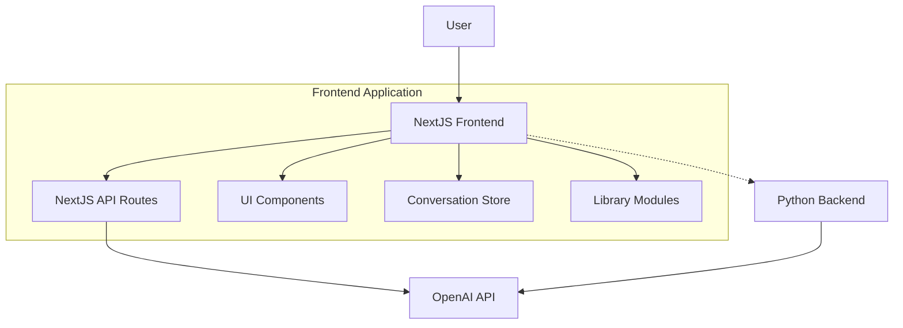
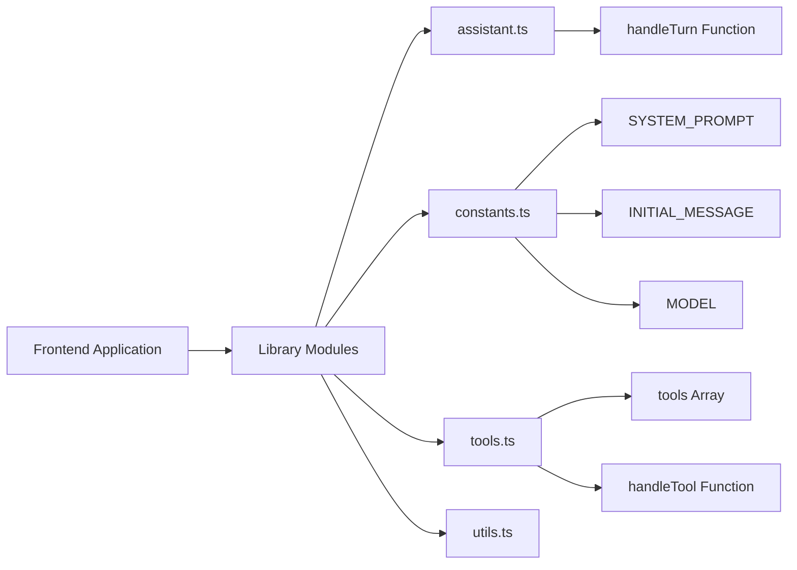
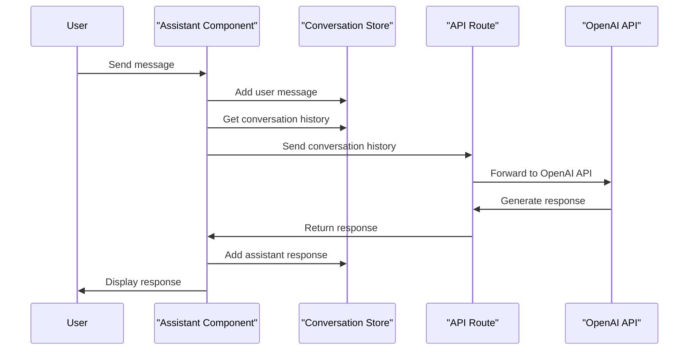

<!-- source: DeepWiki mcp.deepwiki.com · repo openai/openai-builder-lab-solution · page 1 Overview · fetched 2026-10-26 -->

# Overview

Relevant source files

The following files were used as context for generating this wiki page:

- [README.md](README.md)

This document provides an introduction to the OpenAI Builder Lab solution, a starter project designed to help users complete Builder Lab challenges efficiently. The solution consists of a NextJS frontend application with an optional Python backend, enabling seamless integration with OpenAI's APIs.

For detailed information about the system architecture, see [System Architecture](#1.1).
For setup instructions, see [Getting Started](#1.2).

## Purpose and Scope

The OpenAI Builder Lab solution serves as a foundation for building AI-powered applications using OpenAI's APIs. It provides:

1. A pre-configured NextJS frontend with UI components
2. State management for conversations
3. API integration with OpenAI
4. An optional Python backend alternative

This overview covers the high-level components, their interactions, and the overall structure of the codebase.

Sources: [README.md:1-99]()

## System Components

The solution consists of the following main components:

**Key Components:**
- **NextJS Frontend**: The main user interface
- **UI Components**: Reusable interface elements
- **Conversation Store**: State management for chat messages
- **Library Modules**: Core business logic
- **API Routes**: Communication with OpenAI
- **Python Backend (Optional)**: Alternative backend implementation

Sources: [README.md:70-90]()

## Code Organization

The codebase is organized into several key directories:

| Directory | Purpose |
|-----------|---------|
| `frontend/components` | UI components for the application interface |
| `frontend/lib` | Core business logic for the assistant functionality |
| `frontend/stores` | State management for conversations |
| `frontend/app/api` | NextJS API routes for backend communication |
| `python-backend` | Optional Python backend implementation |

The library modules in `frontend/lib` contain the core functionality:

Sources: [README.md:72-89]()

## Data Flow

The following diagram illustrates the data flow when a user interacts with the application:

This sequence shows how user messages flow through the system:
1. User sends a message via the UI
2. The message is stored in the conversation store
3. The conversation history is sent to the API route
4. The API route forwards the request to OpenAI
5. OpenAI generates a response
6. The response is returned to the frontend
7. The response is displayed to the user

Sources: [README.md:78-89]()

## Key Features

The OpenAI Builder Lab solution provides several key features:

1. **Conversation Management**: Handles the flow of messages between the user and the assistant
2. **OpenAI Integration**: Pre-configured connection to OpenAI's API
3. **Tools System**: Framework for implementing assistant tools
4. **State Management**: Centralized store for conversation state
5. **Responsive UI**: Ready-to-use interface components

Sources: [README.md:70-96]()

## Extension Points

The solution is designed to be extended in several ways:

1. **UI Customization**: Modify or add components in `frontend/components`
2. **Business Logic**: Extend functionality in `frontend/lib`
3. **API Routes**: Add new routes in `frontend/app/api`
4. **Tools**: Implement new tools in `frontend/lib/tools.ts`
5. **Backend Logic**: Modify or extend the Python backend in `python-backend`

For more detailed information on extending the application, see [Extending the Application](#6).

Sources: [README.md:65-96]()

## Summary

The OpenAI Builder Lab solution provides a solid foundation for building AI-powered applications with OpenAI's APIs. It includes a NextJS frontend with pre-configured components, state management, and API integration, as well as an optional Python backend. This structure allows users to focus on implementing the specific functionality required for their Builder Lab challenges without having to set up the basic infrastructure.

Sources: [README.md:1-10]()

---

