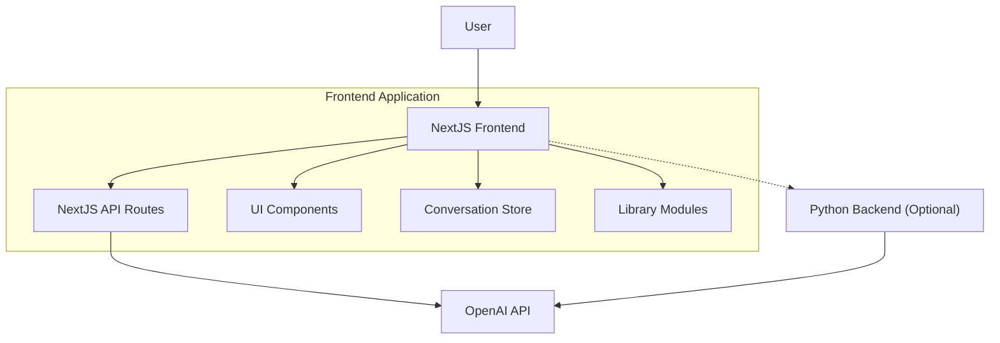
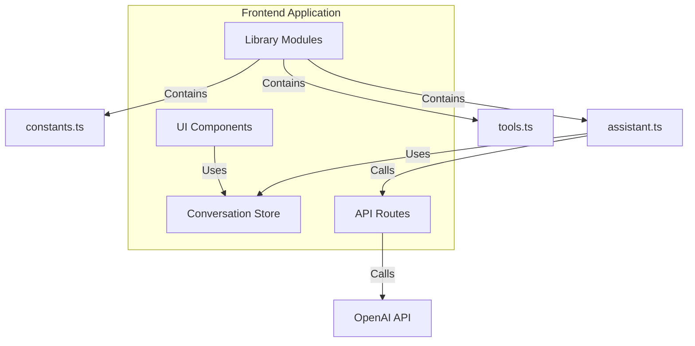
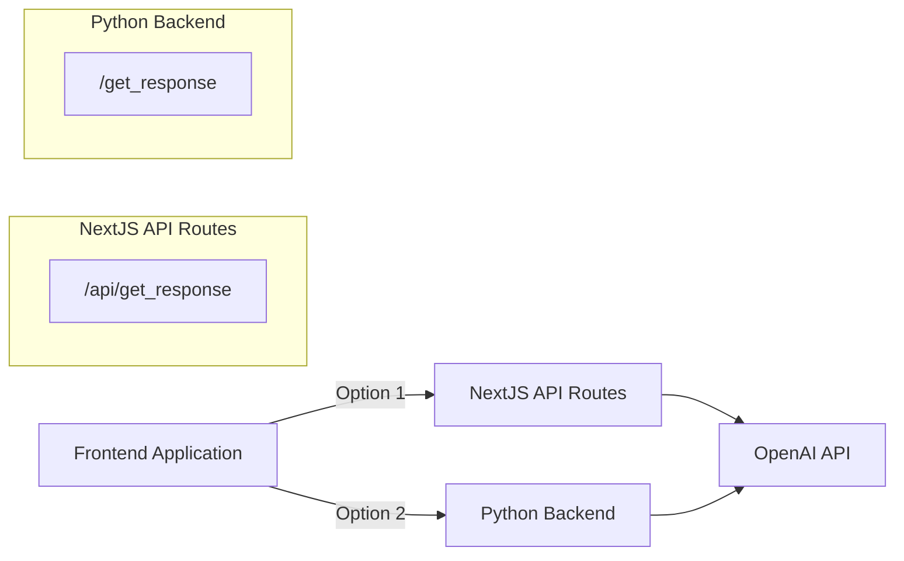
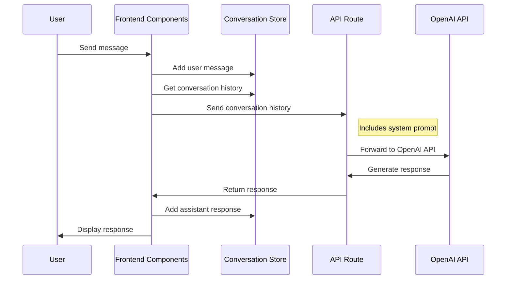
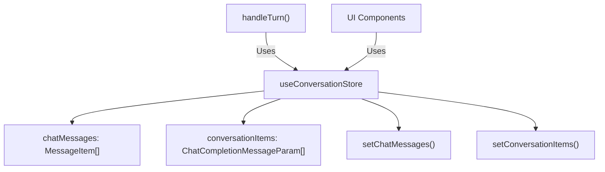
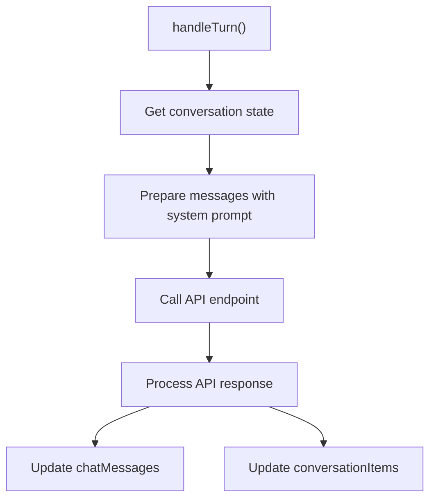
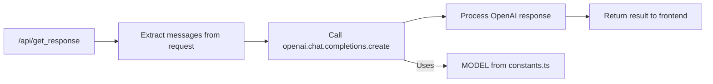

<!-- source: DeepWiki mcp.deepwiki.com · repo openai/openai-builder-lab-solution · page 1.1 System Architecture · fetched 2026-10-26 -->

# System Architecture

Relevant source files

The following files were used as context for generating this wiki page:

- [README.md](README.md)
- [challenge1/frontend/app/api/get_response/route.ts](challenge1/frontend/app/api/get_response/route.ts)
- [challenge1/frontend/lib/assistant.ts](challenge1/frontend/lib/assistant.ts)

This document provides an overview of the high-level architecture of the OpenAI Builder Lab solution, explaining the core components and how they interact with each other. It covers both the frontend and backend components, their responsibilities, and the data flow between them.

For information on how to set up and run the project, see [Getting Started](#1.2).

## Overview

The OpenAI Builder Lab solution is a starter project designed to help users quickly build AI applications using OpenAI's APIs. The system consists of a NextJS frontend application with an optional Python backend.

Sources: [README.md:1-99](), [challenge1/frontend/app/api/get_response/route.ts:1-25](), [challenge1/frontend/lib/assistant.ts:1-69]()

## Core Components

### Frontend Application

The frontend application is built with NextJS and contains the following key components:

1. **UI Components**: Located in the `frontend/components` directory, these handle the user interface rendering.
2. **Library Modules**: Located in the `frontend/lib` directory, these contain the core business logic.
3. **Conversation Store**: Located in `frontend/stores/useConversationStore.ts`, this manages the application state.
4. **API Routes**: Located in `frontend/app/api`, these handle communication with external services.

Sources: [README.md:70-90](), [challenge1/frontend/lib/assistant.ts:1-69]()

### Backend Options

The system offers two backend options:

1. **NextJS API Routes**: Built-in backend routes in the NextJS application.
2. **Python Backend**: An optional Python backend for users who prefer Python.

Both backends serve the same purpose: to communicate with external APIs, particularly OpenAI's API.

Sources: [README.md:91-98](), [challenge1/frontend/app/api/get_response/route.ts:1-25]()

## Data Flow

The following diagram illustrates the data flow when a user interacts with the application:

Sources: [challenge1/frontend/lib/assistant.ts:23-69](), [challenge1/frontend/app/api/get_response/route.ts:5-25]()

## Key Components in Detail

### Conversation Store

The conversation store manages two main state variables:

1. **chatMessages**: Used for UI rendering
2. **conversationItems**: Used for API communication

Sources: [challenge1/frontend/lib/assistant.ts:23-69](), [README.md:89]()

### Message Handling

The `handleTurn` function in `assistant.ts` is responsible for processing user messages and getting responses from the OpenAI API:

Sources: [challenge1/frontend/lib/assistant.ts:23-69]()

### API Route

The `/api/get_response` route handles communication with the OpenAI API:

Sources: [challenge1/frontend/app/api/get_response/route.ts:1-25]()

## Message Types and Data Structures

The application uses the following main data structures:

| Type | Description | Used For |
|------|-------------|----------|
| `MessageItem` | Represents a chat message with role and content | UI rendering |
| `FunctionCallItem` | Represents a function call with status and arguments | Tool calls |
| `ChatCompletionMessageParam` | OpenAI API message format | API communication |

Sources: [challenge1/frontend/lib/assistant.ts:5-21]()

## Configuration

The system uses several configuration constants defined in `constants.ts`:

1. **SYSTEM_PROMPT**: The initial instructions for the AI assistant
2. **MODEL**: The OpenAI model to use for generating responses

These constants are used throughout the application to maintain consistent behavior.

Sources: [challenge1/frontend/lib/assistant.ts:2](), [challenge1/frontend/app/api/get_response/route.ts:1](), [README.md:85]()

## Summary

The OpenAI Builder Lab solution provides a well-structured architecture for building AI applications with OpenAI's APIs. The system separates concerns between UI components, business logic, and API communication, making it easy to extend and customize for specific use cases.

The NextJS frontend with an optional Python backend offers flexibility for developers with different preferences, while the conversation store provides a centralized state management solution for the application.

---

