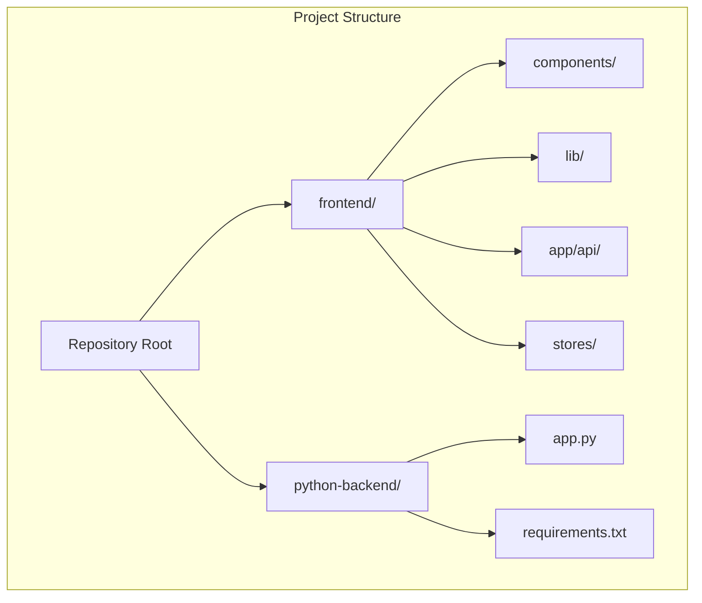
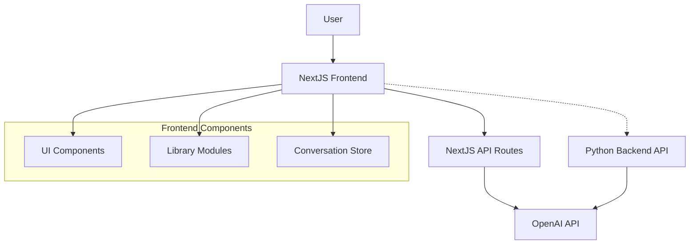
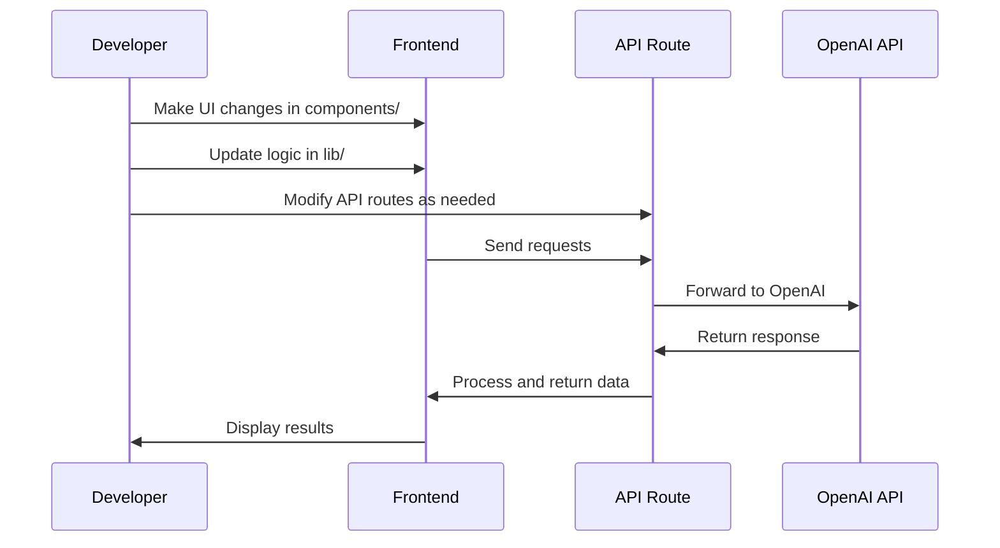

<!-- source: DeepWiki mcp.deepwiki.com · repo openai/openai-builder-lab-solution · page 1.2 Getting Started · fetched 2026-10-26 -->

# Getting Started

<details>
<summary>Relevant source files</summary>

The following files were used as context for generating this wiki page:

- [README.md](README.md)
- [challenge1/frontend/next.config.mjs](challenge1/frontend/next.config.mjs)
- [challenge1/frontend/package.json](challenge1/frontend/package.json)

</details>


This document provides instructions for setting up and running the OpenAI Builder Lab solution. It covers environment configuration, dependencies, and how to start both the frontend and optional Python backend components.

For information about the overall system architecture, see [System Architecture](#1.1).

## Prerequisites

Before getting started, ensure you have the following installed:

- Node.js (version 18 or higher recommended)
- npm (comes with Node.js)
- Git
- Python 3.8+ (optional, only if using the Python backend)

## Project Setup

The project consists of two main components:
1. A NextJS frontend application
2. An optional Python backend



Sources: [README.md:1-99]()

## Installation Steps

### 1. Clone the Repository

First, clone the repository to your local machine:

```bash
git clone https://github.com/openai/openai-builder-lab.git
```

### 2. Set Up the Frontend

Navigate to the frontend directory:

```bash
cd starting_point/frontend
```

Install the required dependencies:

```bash
npm install
```

Sources: [README.md:10-37](), [challenge1/frontend/package.json:1-43]()

### 3. Configure OpenAI API Key

You need to set your OpenAI API key to use the application. You have two options:

1. Set the `OPENAI_API_KEY` environment variable globally in your system
2. Create a `.env` file in the root of the frontend directory with the following content:

```
OPENAI_API_KEY=<your_api_key>
```

Sources: [README.md:22-31]()

## Running the Application

### Starting the Frontend

To start the NextJS frontend application:

```bash
npm run dev
```

This will start the development server, typically on http://localhost:3000.

Sources: [README.md:39-43](), [challenge1/frontend/package.json:5-10]()

### Starting the Python Backend (Optional)

If you prefer to use the Python backend instead of the built-in NextJS API routes:

1. Navigate to the python-backend directory:
   ```bash
   cd ../python-backend
   ```

2. Install the Python dependencies:
   ```bash
   pip install -r requirements.txt
   ```

3. Start the Python backend:
   ```bash
   python app.py
   ```

Sources: [README.md:45-63]()

## Project Structure Overview



Sources: [README.md:70-89]()

### Key Components

| Component | Location | Purpose |
|-----------|----------|---------|
| UI Components | `frontend/components/` | User interface elements |
| Code Logic | `frontend/lib/` | Core application logic |
| Constants | `frontend/lib/constants.ts` | System prompts, initial messages, etc. |
| Tools | `frontend/lib/tools.ts` | Logic for assistant tools |
| Assistant | `frontend/lib/assistant.ts` | API communication logic |
| Conversation Store | `frontend/stores/useConversationStore.ts` | State management |
| API Routes | `frontend/app/api/` or `python-backend/app.py` | Backend endpoints |

Sources: [README.md:72-98]()

## Configuration Files

The project includes several configuration files that you may need to modify:

| File | Purpose |
|------|---------|
| `next.config.mjs` | NextJS configuration |
| `package.json` | Project dependencies and scripts |
| `.env` | Environment variables (you need to create this) |

Sources: [challenge1/frontend/next.config.mjs:1-5](), [challenge1/frontend/package.json:1-43]()

## Dependencies

The project uses several key dependencies:

- **NextJS**: React framework for the frontend
- **OpenAI**: SDK for communicating with OpenAI's API
- **Zustand**: State management library
- **Tailwind CSS**: Utility-first CSS framework
- **React Markdown**: For rendering markdown content

For a complete list of dependencies, refer to the `package.json` file.

Sources: [challenge1/frontend/package.json:11-31]()

## Development Workflow



Sources: [README.md:65-68](), [README.md:72-98]()

## Next Steps

After setting up the project, you can start working on the Builder Lab challenges by:

1. Understanding the existing code structure
2. Making incremental changes to complete each challenge
3. Testing your implementation with the running application

For more information about the frontend application structure, see [Frontend Application](#2).

For details on the core functionality and how to extend it, see [Core Functionality](#3).

Sources: [README.md:65-68]()

---

