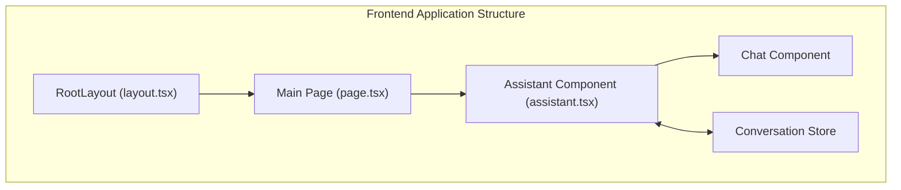
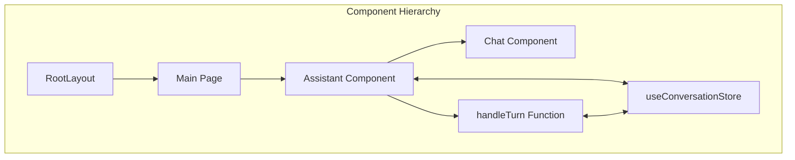
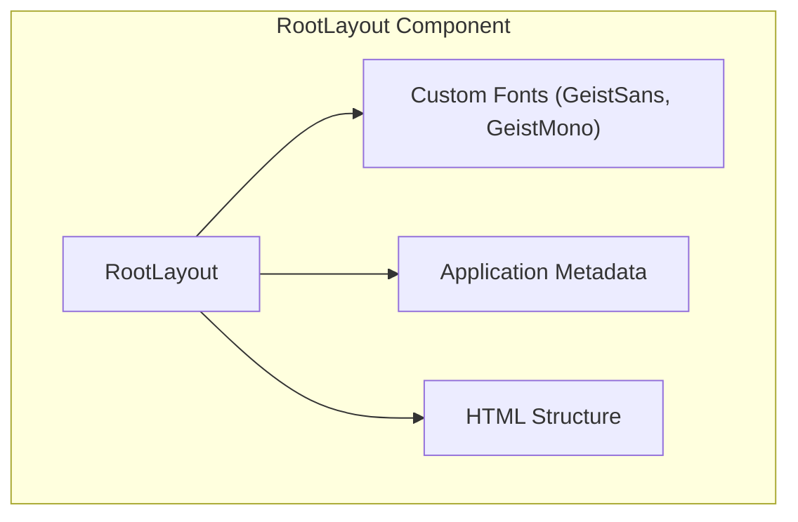
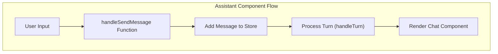
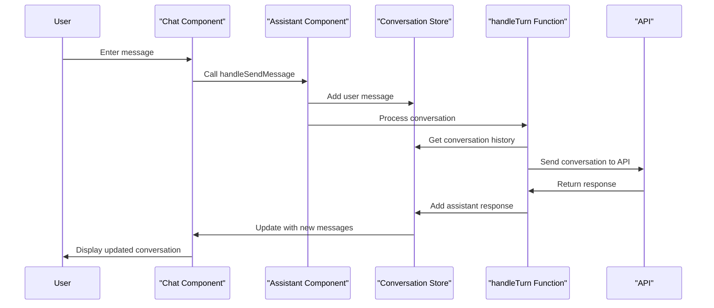
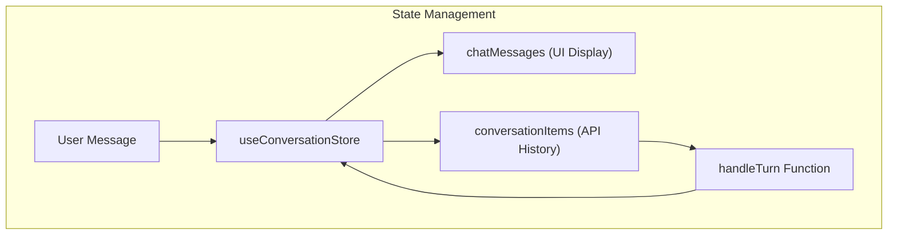

<!-- source: DeepWiki mcp.deepwiki.com · repo openai/openai-builder-lab-solution · page 2 Frontend Application · fetched 2026-10-26 -->

# Frontend Application

Relevant source files

The following files were used as context for generating this wiki page:

- [challenge1/frontend/app/layout.tsx](challenge1/frontend/app/layout.tsx)
- [challenge1/frontend/app/page.tsx](challenge1/frontend/app/page.tsx)
- [challenge1/frontend/components/assistant.tsx](challenge1/frontend/components/assistant.tsx)

This document provides an overview of the NextJS frontend application structure and main components in the OpenAI Builder Lab solution. It covers the application's architecture, component hierarchy, and how these components interact to create a conversational AI interface.

For detailed information about specific UI components, see [UI Components](#2.1). For state management details, see [State Management](#2.2).

## Application Structure

The frontend application is built using Next.js and follows a component-based architecture. The main entry point is the root layout, which sets up the application's base styling and structure, followed by the main page that renders the Assistant component.

Sources: [challenge1/frontend/app/layout.tsx:24-38](), [challenge1/frontend/app/page.tsx:3-11](), [challenge1/frontend/components/assistant.tsx:8-50]()

## Component Hierarchy

The frontend application follows a clear component hierarchy where each component has a specific responsibility:

1. **RootLayout**: Sets up the application's base styling, fonts, and metadata
2. **Main Page**: Renders the Assistant component in a responsive container
3. **Assistant Component**: Manages the conversation flow and state
4. **Chat Component**: Displays the conversation and handles user input

Sources: [challenge1/frontend/app/layout.tsx:24-38](), [challenge1/frontend/app/page.tsx:3-11](), [challenge1/frontend/components/assistant.tsx:8-50]()

## Key Components

### RootLayout

The `RootLayout` component in `layout.tsx` serves as the application's shell. It:
- Imports and configures custom fonts (Geist Sans and Geist Mono)
- Sets up metadata for the application (title, description, icons)
- Provides the base HTML structure with appropriate styling classes

Sources: [challenge1/frontend/app/layout.tsx:1-38]()

### Main Page

The `Main` component in `page.tsx` is a simple component that:
- Creates a responsive container for the Assistant component
- Centers the Assistant component on the page
- Adjusts width based on screen size (full width on mobile, 2/3 width on medium screens and up)

Sources: [challenge1/frontend/app/page.tsx:3-11]()

### Assistant Component

The `Assistant` component in `assistant.tsx` is the core component that:
- Manages the conversation state using the `useConversationStore` hook
- Handles user message submission
- Processes the conversation turn using the `handleTurn` function
- Renders the `Chat` component with appropriate props

Sources: [challenge1/frontend/components/assistant.tsx:8-50]()

## Data Flow

The data flow in the frontend application follows a clear pattern:

1. User enters a message in the Chat component
2. The message is passed to the Assistant component's `handleSendMessage` function
3. The message is added to the conversation store
4. The `handleTurn` function is called to process the conversation
5. The response is added to the conversation store
6. The Chat component re-renders with the updated conversation

Sources: [challenge1/frontend/components/assistant.tsx:13-37]()

## State Management

The Assistant component uses the `useConversationStore` hook to manage the conversation state. This provides:

- `chatMessages`: Array of messages to display in the UI
- `addConversationItem`: Function to add a message to the conversation history
- `addChatMessage`: Function to add a message to the chat display

When a user sends a message, it's added to both the conversation history and the chat display, then the `handleTurn` function is called to process the conversation.

Sources: [challenge1/frontend/components/assistant.tsx:9-11](), [challenge1/frontend/components/assistant.tsx:13-37]()

## Technical Implementation

The Assistant component is implemented as a React functional component with hooks:

- Uses `useState` to track loading state during API calls
- Uses `useConversationStore` to access and update conversation state
- Implements `handleSendMessage` to process user input
- Renders the Chat component with appropriate props

When a user sends a message, the component:
1. Creates a user message object
2. Adds it to the conversation store
3. Calls `handleTurn` to process the conversation
4. Updates loading state accordingly
5. Handles any errors that occur during processing

Sources: [challenge1/frontend/components/assistant.tsx:8-50]()

## Integration with Other Components

The frontend application integrates several components to create a cohesive user experience:

| Component | Purpose | Integration Point |
|-----------|---------|-------------------|
| RootLayout | Application shell | Wraps the entire application |
| Main Page | Container for Assistant | Renders Assistant component |
| Assistant | Conversation management | Uses Conversation Store and Chat component |
| Chat | User interface | Receives props from Assistant |
| Conversation Store | State management | Used by Assistant to track conversation |
| handleTurn | Conversation processing | Called by Assistant to process turns |

Sources: [challenge1/frontend/app/layout.tsx:24-38](), [challenge1/frontend/app/page.tsx:3-11](), [challenge1/frontend/components/assistant.tsx:8-50]()

## Summary

The frontend application provides a clean, component-based architecture for a conversational AI interface. The main components work together to:

1. Render a responsive user interface
2. Manage conversation state
3. Process user input
4. Display assistant responses

This architecture provides a solid foundation for building AI-powered applications with OpenAI's APIs, making it an excellent starting point for Builder Lab challenges.

---

