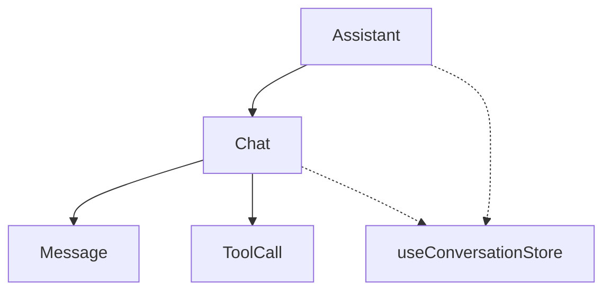
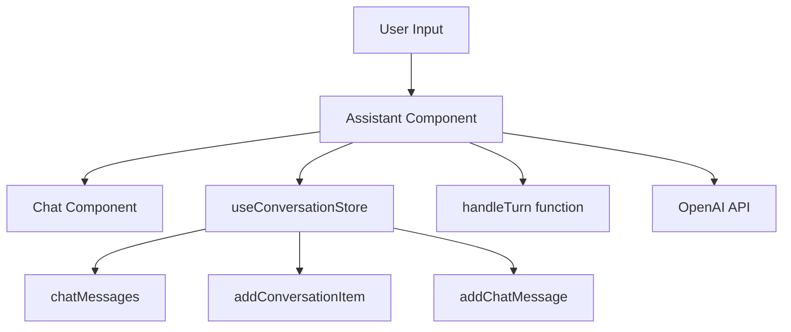
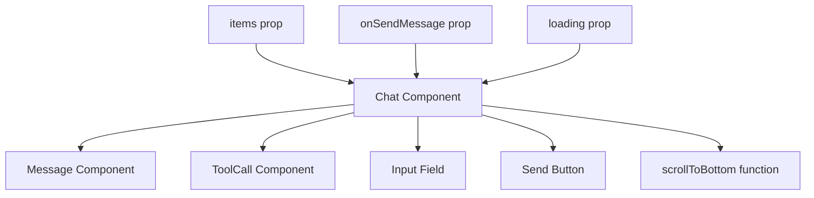
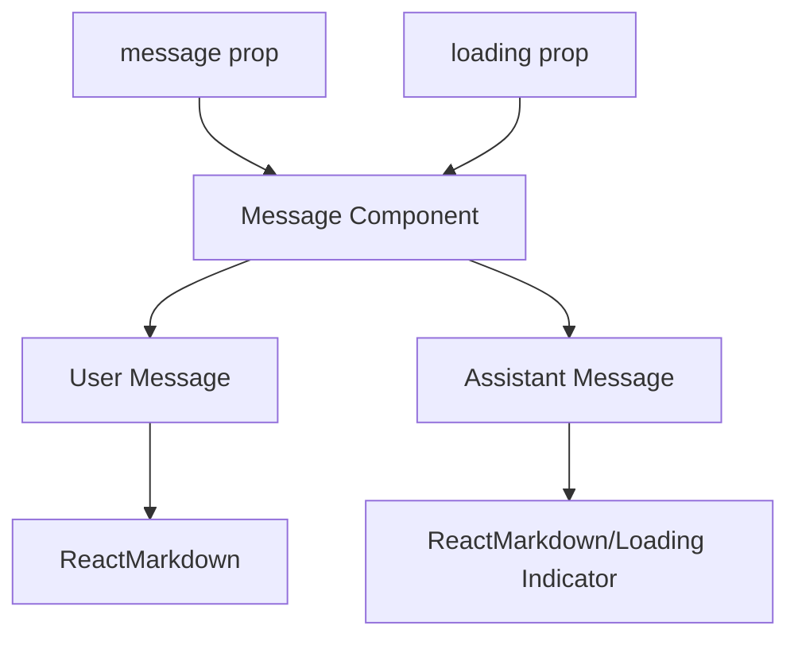
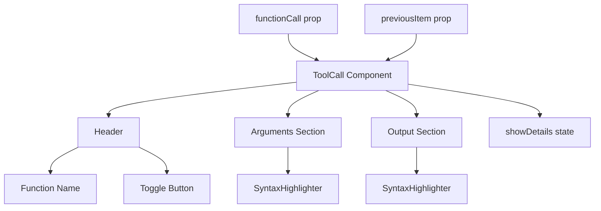
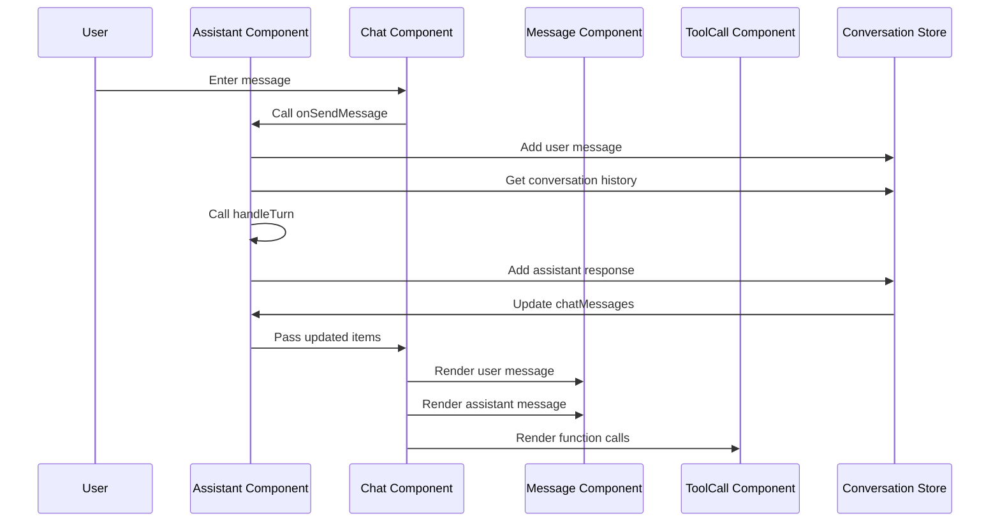
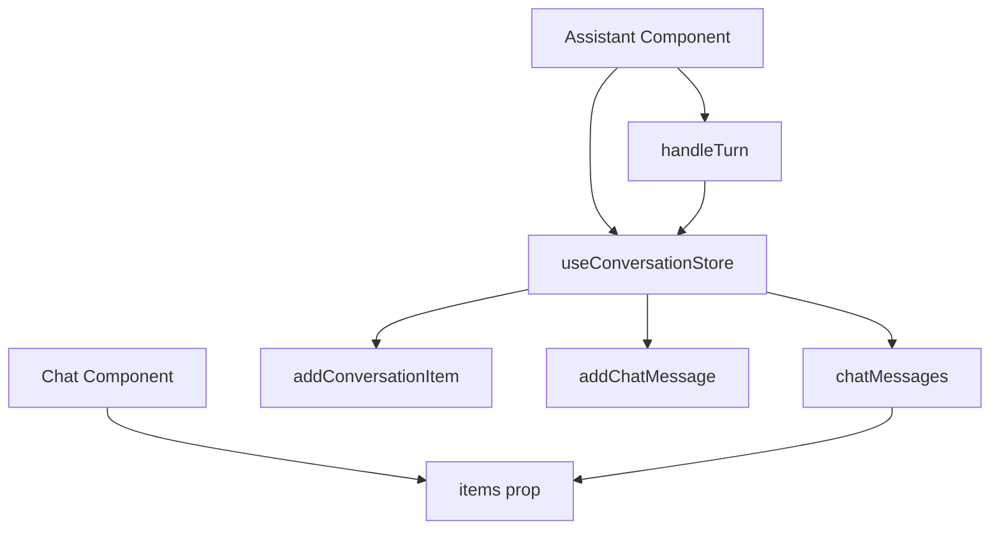

<!-- source: DeepWiki mcp.deepwiki.com · repo openai/openai-builder-lab-solution · page 2.1 UI Components · fetched 2026-10-26 -->

# UI Components

Relevant source files

The following files were used as context for generating this wiki page:

- [challenge1/frontend/components/assistant.tsx](challenge1/frontend/components/assistant.tsx)
- [challenge1/frontend/components/chat.tsx](challenge1/frontend/components/chat.tsx)
- [challenge1/frontend/components/message.tsx](challenge1/frontend/components/message.tsx)
- [challenge1/frontend/components/tool-call.tsx](challenge1/frontend/components/tool-call.tsx)

This document details the UI components used in the OpenAI Builder Lab solution frontend. These components form the visual interface through which users interact with the assistant.

For information about state management, see [State Management](#2.2).

## Component Hierarchy

The UI components in this application follow a hierarchical structure, with parent components rendering child components and passing data between them.

Sources: [frontend/components/assistant.tsx:1-50](), [frontend/components/chat.tsx:1-112](), [frontend/components/message.tsx:1-56](), [frontend/components/tool-call.tsx:1-100]()

## Assistant Component

The `Assistant` component serves as the main container for the chat interface. It manages the loading state and handles sending messages to the assistant.

### Key Responsibilities

- Manages loading state during API calls
- Handles user message submission
- Integrates with the conversation store
- Orchestrates the conversation flow using `handleTurn`

### Component Structure

Sources: [frontend/components/assistant.tsx:1-50]()

### Implementation Details

The `Assistant` component is implemented as a React functional component that:

1. Uses the `useState` hook to track loading state
2. Accesses conversation state via `useConversationStore`
3. Defines a `handleSendMessage` function that:
   - Validates user input
   - Creates message objects
   - Updates the conversation store
   - Calls `handleTurn` to process the conversation
4. Renders the `Chat` component with appropriate props

Sources: [frontend/components/assistant.tsx:8-48]()

## Chat Component

The `Chat` component renders the conversation interface, including message history and the input field for new messages.

### Key Responsibilities

- Displays conversation history
- Provides user input interface
- Handles scrolling behavior
- Renders appropriate component for each message type

### Component Structure

Sources: [frontend/components/chat.tsx:1-112]()

### Implementation Details

The `Chat` component:

1. Accepts `items`, `onSendMessage`, and `loading` props
2. Manages input state with `useState`
3. Implements auto-scrolling with `useRef` and `useEffect`
4. Maps over conversation items to render appropriate components
5. Provides a textarea for user input with keyboard shortcuts
6. Includes a send button with appropriate disabled state

Sources: [frontend/components/chat.tsx:15-109]()

## Message Component

The `Message` component renders individual chat messages with different styling based on the sender (user or assistant).

### Key Responsibilities

- Displays message content with appropriate styling
- Renders markdown content
- Shows loading indicator when appropriate
- Differentiates between user and assistant messages

### Component Structure

Sources: [frontend/components/message.tsx:1-56]()

### Implementation Details

The `Message` component:

1. Accepts `message` and optional `loading` props
2. Uses conditional rendering based on message role
3. Renders user messages with right alignment and white background
4. Renders assistant messages with left alignment and black background
5. Uses `ReactMarkdown` to render formatted message content
6. Shows animated dots loading indicator when in loading state

Sources: [frontend/components/message.tsx:11-52]()

## ToolCall Component

The `ToolCall` component displays function calls made by the assistant, including function name, arguments, and output.

### Key Responsibilities

- Displays function call information
- Provides expandable/collapsible details
- Shows function arguments and output with syntax highlighting
- Indicates relationships between sequential function calls

### Component Structure

Sources: [frontend/components/tool-call.tsx:1-100]()

### Implementation Details

The `ToolCall` component:

1. Accepts `functionCall` and `previousItem` props
2. Manages expandable details with `useState`
3. Formats function name for display
4. Shows a visual connector line between sequential function calls
5. Uses `SyntaxHighlighter` to display JSON arguments and output
6. Implements toggle functionality for showing/hiding details

Sources: [frontend/components/tool-call.tsx:13-97]()

## Component Data Flow

The following diagram illustrates how data flows through the UI components:

Sources: [frontend/components/assistant.tsx:13-37](), [frontend/components/chat.tsx:15-109](), [frontend/components/message.tsx:11-52](), [frontend/components/tool-call.tsx:13-97]()

## Component Props Interface

The following table summarizes the props interfaces for each component:

| Component | Props Interface | Description |
|-----------|----------------|-------------|
| Assistant | None (no props) | Main container component |
| Chat | `items: Item[]` | Array of conversation items to display |
|      | `onSendMessage: (message: string) => void` | Callback for sending messages |
|      | `loading: boolean` | Loading state indicator |
| Message | `message: MessageItem` | Message data to display |
|         | `loading?: boolean` | Optional loading state indicator |
| ToolCall | `functionCall: FunctionCallItem` | Function call data to display |
|          | `previousItem: Item` | Previous conversation item for context |

Sources: [frontend/components/assistant.tsx:8](), [frontend/components/chat.tsx:9-13](), [frontend/components/message.tsx:6-9](), [frontend/components/tool-call.tsx:8-11]()

## Styling Approach

The UI components use a combination of Tailwind CSS classes and custom CSS for styling:

1. **Layout and Positioning**: Tailwind classes for flex layouts, padding, margins, etc.
2. **Colors and Theming**: Tailwind classes for background colors, text colors
3. **Component-specific Styles**: Custom CSS in `message.css` for specialized styling
4. **Responsive Design**: Tailwind responsive classes (e.g., `md:ml-24`)

The styling creates a clear visual distinction between user messages (right-aligned, white background) and assistant messages (left-aligned, black background with white text).

Sources: [frontend/components/message.tsx:1-56](), [frontend/components/message.css](), [frontend/components/chat.tsx:1-112](), [frontend/components/tool-call.tsx:1-100]()

## Loading States

The UI components handle loading states to provide visual feedback during API calls:

1. The `Assistant` component tracks loading state with `useState`
2. The loading state is passed to the `Chat` component
3. The `Chat` component conditionally renders a loading indicator
4. The `Message` component displays animated dots when in loading state

This creates a seamless user experience by providing immediate feedback when messages are being processed.

Sources: [frontend/components/assistant.tsx:9-11](), [frontend/components/chat.tsx:44-49](), [frontend/components/message.tsx:37-42]()

## Component Relationships to State Management

The UI components interact with the application state through the conversation store:

For more details on state management, see [State Management](#2.2).

Sources: [frontend/components/assistant.tsx:4-11](), [frontend/components/chat.tsx:10-11]()

---

