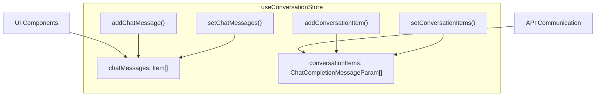
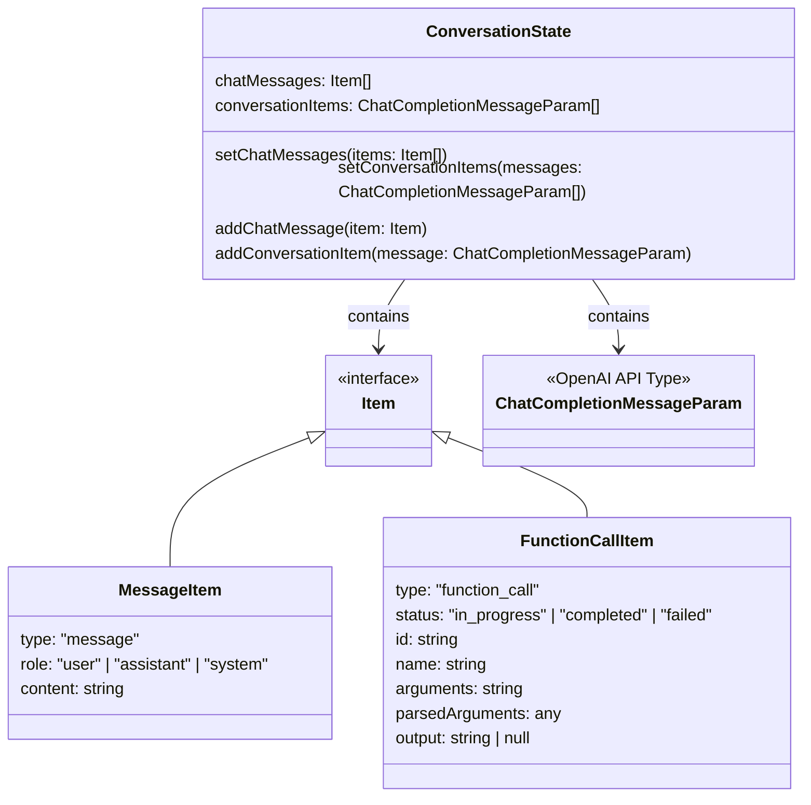
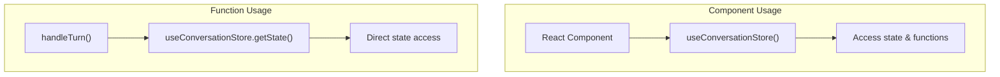
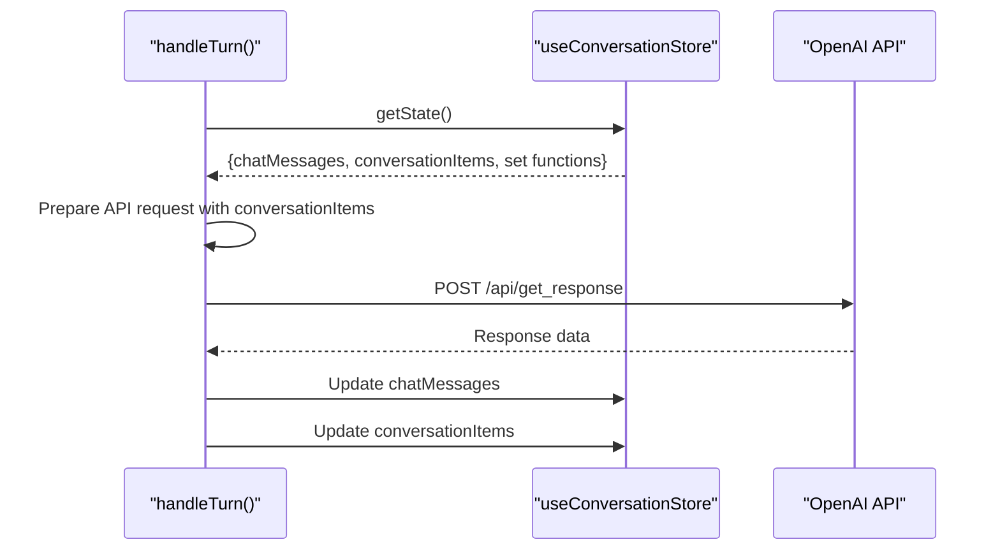
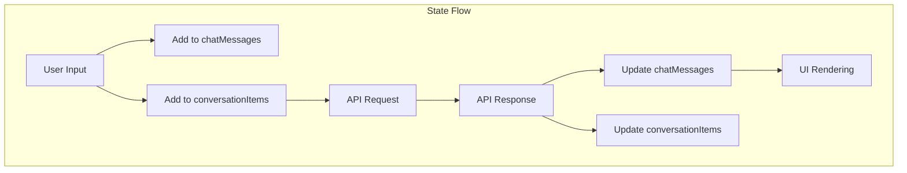

<!-- source: DeepWiki mcp.deepwiki.com · repo openai/openai-builder-lab-solution · page 2.2 State Management · fetched 2026-10-26 -->

# State Management

Relevant source files

The following files were used as context for generating this wiki page:

- [challenge1/frontend/lib/assistant.ts](challenge1/frontend/lib/assistant.ts)
- [challenge1/frontend/stores/useConversationStore.ts](challenge1/frontend/stores/useConversationStore.ts)

This document explains how state is managed in the OpenAI Builder Lab solution, focusing on the conversation store implementation. The state management system is responsible for maintaining the conversation history between the user and the assistant.

For information about UI components that use this state, see [UI Components](#2.1). For details on the conversation flow that manipulates this state, see [Conversation Flow](#3.1).

## Overview

The application uses Zustand, a lightweight state management library, to maintain two primary state collections:

1. `chatMessages`: Items displayed in the UI chat interface
2. `conversationItems`: Messages sent to the OpenAI Chat Completions API

Sources: [challenge1/frontend/stores/useConversationStore.ts:1-35]()

## Store Implementation

The conversation store is implemented using Zustand in `useConversationStore.ts`. It defines a `ConversationState` interface and creates a store with initial values and state manipulation functions.

### State Structure

The store maintains two main state arrays:

Sources: [challenge1/frontend/stores/useConversationStore.ts:6-16](), [challenge1/frontend/lib/assistant.ts:5-21]()

### Store Creation

The store is created with initial values and functions to manipulate the state:

| Function | Purpose |
|----------|---------|
| `setChatMessages` | Replace the entire `chatMessages` array |
| `setConversationItems` | Replace the entire `conversationItems` array |
| `addChatMessage` | Add a single item to the `chatMessages` array |
| `addConversationItem` | Add a single message to the `conversationItems` array |

The store is initialized with an assistant welcome message from the `INITIAL_MESSAGE` constant.

Sources: [challenge1/frontend/stores/useConversationStore.ts:18-33]()

## State Usage

The conversation store is used throughout the application to maintain and update the conversation state.

### Accessing State

Components and functions access the store using the `useConversationStore` hook or by directly accessing the store's state:

Sources: [challenge1/frontend/lib/assistant.ts:23-29]()

### State Manipulation in handleTurn

The `handleTurn` function in `assistant.ts` demonstrates how the conversation store is used to manage the conversation flow:

1. It retrieves the current state using `useConversationStore.getState()`
2. It combines the system prompt with conversation items for the API request
3. After receiving a response, it updates both state arrays:
   - Adds the response to `chatMessages` for UI display
   - Adds the response to `conversationItems` for future API requests

Sources: [challenge1/frontend/lib/assistant.ts:23-69]()

## Dual State Model

The application uses a dual state model to separate UI concerns from API communication:

### chatMessages (UI State)

- Contains `Item` objects which can be either `MessageItem` or `FunctionCallItem`
- Designed for rendering in the UI with different visual representations
- Includes UI-specific properties like function call status

### conversationItems (API State)

- Contains `ChatCompletionMessageParam` objects compatible with OpenAI's API
- Structured specifically for API communication
- Follows OpenAI's message format requirements

Sources: [challenge1/frontend/stores/useConversationStore.ts:7-10](), [challenge1/frontend/lib/assistant.ts:59-65]()

## Benefits of the Approach

The state management approach in this application offers several benefits:

1. **Separation of concerns**: UI state is kept separate from API communication state
2. **Type safety**: Each state collection has specific TypeScript interfaces
3. **Centralized state**: All components access the same state source
4. **Minimal re-renders**: Zustand optimizes component re-renders
5. **Simple API**: The store provides straightforward functions for state manipulation

## Summary

The state management system in the OpenAI Builder Lab solution uses Zustand to maintain two separate state collections: `chatMessages` for UI rendering and `conversationItems` for API communication. This dual-state approach allows the application to efficiently handle both UI concerns and API requirements while maintaining a clean separation of concerns.

The store provides functions to manipulate these state collections, and components can access the state either through the `useConversationStore` hook or by directly accessing the store's state using `getState()`. This approach ensures that all components have access to the same state source, promoting consistency throughout the application.

Sources: [challenge1/frontend/stores/useConversationStore.ts:1-35](), [challenge1/frontend/lib/assistant.ts:23-69]()

---

