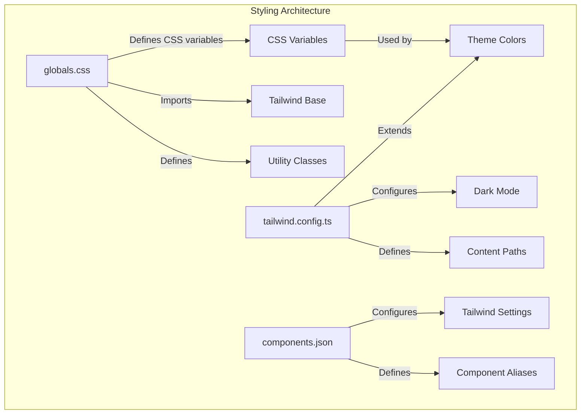
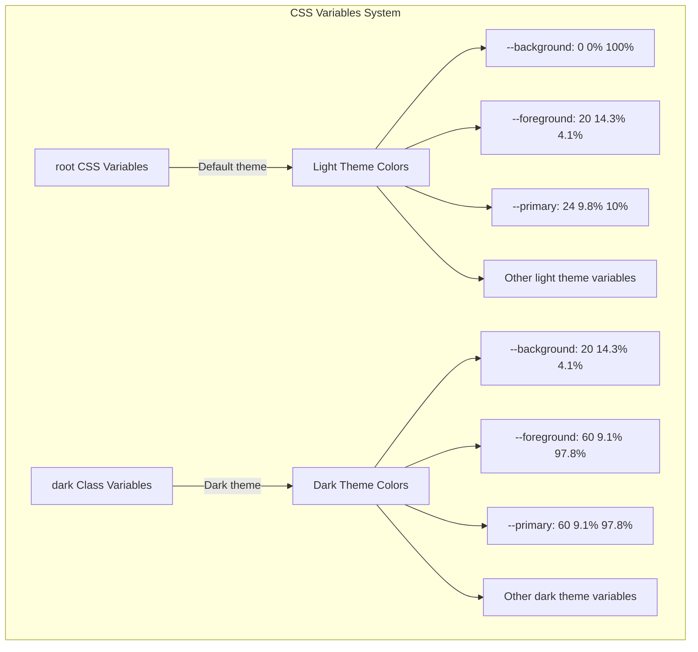
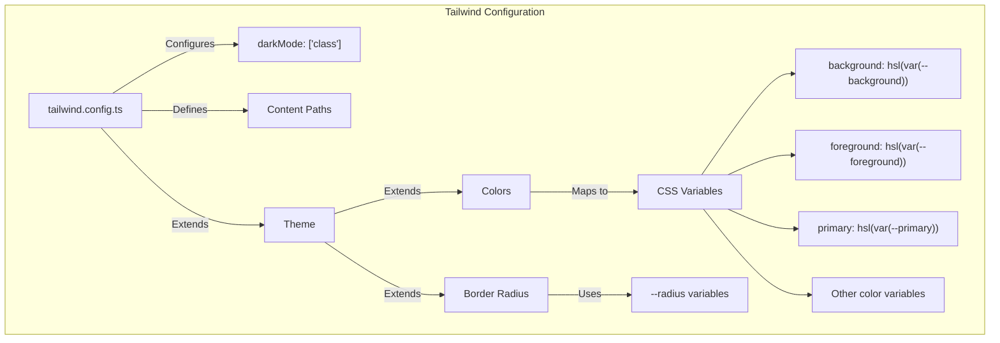
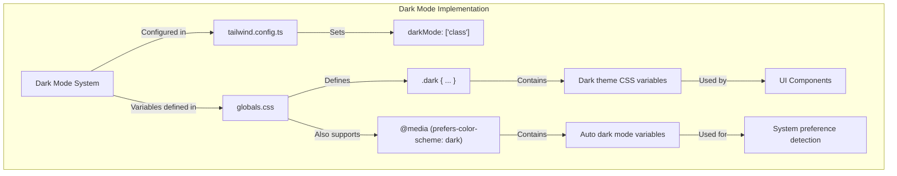
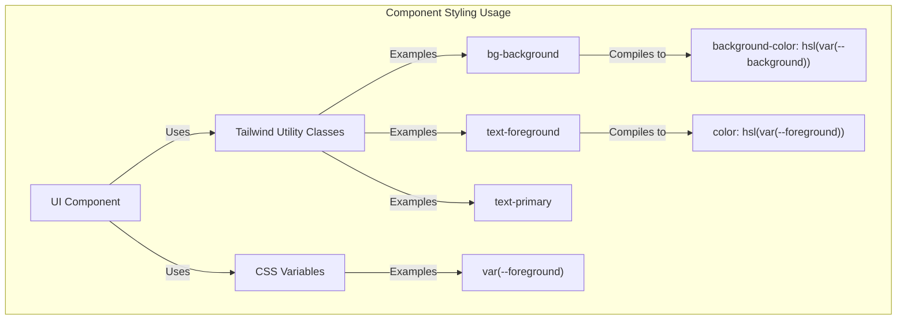
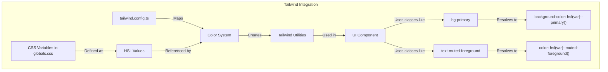

<!-- source: DeepWiki mcp.deepwiki.com · repo openai/openai-builder-lab-solution · page 2.3 Styling and Theming · fetched 2026-10-26 -->

# Styling and Theming

<details>
<summary>Relevant source files</summary>

The following files were used as context for generating this wiki page:

- [challenge1/frontend/app/globals.css](challenge1/frontend/app/globals.css)
- [challenge1/frontend/components.json](challenge1/frontend/components.json)
- [challenge1/frontend/tailwind.config.ts](challenge1/frontend/tailwind.config.ts)

</details>


This document explains the styling and theming approach used in the OpenAI Builder Lab solution. It covers the implementation of Tailwind CSS, CSS variables, and theming capabilities that enable both light and dark mode support in the application.

## Overview

The styling system in this application is built on three main components:

1. Tailwind CSS for utility-based styling
2. CSS variables for theming
3. Dark mode support via CSS classes



Sources: [challenge1/frontend/app/globals.css](), [challenge1/frontend/tailwind.config.ts](), [challenge1/frontend/components.json]()

## CSS Variables System

The application uses CSS variables (custom properties) to define theme colors and other design tokens. These variables are defined in the `globals.css` file and are organized into two main themes: light (default) and dark.



Sources: [challenge1/frontend/app/globals.css:33-87]()

The CSS variables are defined using HSL (Hue, Saturation, Lightness) color format, which makes it easier to create consistent color palettes. For example:

- Light mode background: `--background: 0 0% 100%` (white)
- Dark mode background: `--background: 20 14.3% 4.1%` (near black)

These variables are then used throughout the application to ensure consistent theming.

## Tailwind Configuration

The Tailwind configuration extends the default theme with custom colors based on the CSS variables defined in `globals.css`.



Sources: [challenge1/frontend/tailwind.config.ts:1-77]()

The Tailwind configuration file (`tailwind.config.ts`) does several important things:

1. Sets up dark mode to use the class strategy (`darkMode: ['class']`)
2. Defines content paths for where Tailwind should look for class usage
3. Extends the theme with custom colors that map to CSS variables
4. Adds custom border radius values based on CSS variables

## Components Configuration

The `components.json` file configures the UI component system and Tailwind CSS integration:

```mermaid
graph TD
    subgraph "Components Configuration"
        componentsJson["components.json"]
        
        componentsJson -->|"Defines"| style["style: 'new-york'"]
        componentsJson -->|"Enables"| rsc["rsc: true"]
        componentsJson -->|"Uses"| tsx["tsx: true"]
        
        componentsJson -->|"Configures"| tailwind["tailwind"]
        componentsJson -->|"Defines"| aliases["aliases"]
        
        tailwind -->|"Points to"| config["config: 'tailwind.config.ts'"]
        tailwind -->|"Points to"| css["css: 'app/globals.css'"]
        tailwind -->|"Sets"| baseColor["baseColor: 'stone'"]
        tailwind -->|"Enables"| cssVariables["cssVariables: true"]
        
        aliases -->|"Maps"| components["components: '@/components'"]
        aliases -->|"Maps"| utils["utils: '@/lib/utils'"]
        aliases -->|"Maps"| otherAliases["Other path aliases"]
    end
```

Sources: [challenge1/frontend/components.json:1-20]()

The `components.json` file is used to configure the UI component system (likely using shadcn/ui based on the schema reference) and includes:

1. Style configuration (`new-york` style)
2. React Server Components support (`rsc: true`)
3. TypeScript JSX support (`tsx: true`)
4. Tailwind configuration including:
   - Path to the Tailwind config file
   - Path to the CSS file
   - Base color for the theme (`stone`)
   - CSS variables support
5. Path aliases for imports

## Dark Mode Implementation

The application supports dark mode through a combination of CSS variables and Tailwind's dark mode class strategy.



Sources: [challenge1/frontend/app/globals.css:10-15](), [challenge1/frontend/app/globals.css:61-86](), [challenge1/frontend/tailwind.config.ts:4]()

The dark mode implementation has two parts:

1. **System preference detection**: Using the `@media (prefers-color-scheme: dark)` query to automatically apply dark mode based on system preferences
2. **Class-based toggle**: Using the `.dark` class to manually toggle dark mode

This dual approach allows for both automatic theme switching based on user preferences and manual control through a theme toggle.

## Usage in Components

The styling system is used in components through Tailwind utility classes and direct references to CSS variables.



Sources: [challenge1/frontend/app/globals.css:17-21](), [challenge1/frontend/app/globals.css:93-95]()

In the application, components can use the styling system in two ways:

1. **Tailwind utility classes**: Using classes like `bg-background`, `text-foreground`, etc.
2. **Direct CSS variable references**: Using `var(--variable-name)` in CSS

For example, the body element uses both approaches:

```css
body {
  color: var(--foreground);
  background: var(--background);
  font-family: var(--font-geist-sans);
}
```

And with Tailwind:

```css
body {
  @apply bg-background text-foreground;
}
```

## Color Palette Structure

The application defines a comprehensive color palette with semantic color variables:

| Variable | Purpose | Light Mode | Dark Mode |
|----------|---------|------------|-----------|
| `--background` | Page background | `0 0% 100%` | `20 14.3% 4.1%` |
| `--foreground` | Text color | `20 14.3% 4.1%` | `60 9.1% 97.8%` |
| `--primary` | Primary UI elements | `24 9.8% 10%` | `60 9.1% 97.8%` |
| `--secondary` | Secondary UI elements | `60 4.8% 95.9%` | `12 6.5% 15.1%` |
| `--muted` | Muted/subtle elements | `60 4.8% 95.9%` | `12 6.5% 15.1%` |
| `--accent` | Accent elements | `60 4.8% 95.9%` | `12 6.5% 15.1%` |
| `--destructive` | Error/warning elements | `0 84.2% 60.2%` | `0 62.8% 30.6%` |
| `--border` | Border colors | `20 5.9% 90%` | `12 6.5% 15.1%` |
| `--chart-1` to `--chart-5` | Chart colors | Various | Various |

Sources: [challenge1/frontend/app/globals.css:34-60](), [challenge1/frontend/app/globals.css:61-86]()

## Integration with Tailwind

The Tailwind configuration maps CSS variables to Tailwind color utilities, making them available throughout the application:



Sources: [challenge1/frontend/tailwind.config.ts:12-54]()

The integration between CSS variables and Tailwind is handled in the `tailwind.config.ts` file, which extends the theme with custom colors that reference the CSS variables:

```typescript
colors: {
  background: 'hsl(var(--background))',
  foreground: 'hsl(var(--foreground))',
  primary: {
    DEFAULT: 'hsl(var(--primary))',
    foreground: 'hsl(var(--primary-foreground))'
  },
  // ... other colors
}
```

This mapping allows developers to use semantic color names in Tailwind classes (e.g., `bg-primary`, `text-foreground`) that automatically adapt to the current theme.

## Summary

The styling and theming system in the OpenAI Builder Lab solution provides a flexible and consistent approach to styling the application. Key features include:

1. CSS variables for defining theme colors and design tokens
2. Tailwind CSS for utility-based styling
3. Dark mode support through both system preferences and manual toggling
4. A semantic color system that adapts to the current theme
5. Integration between CSS variables and Tailwind utilities

This approach makes it easy to maintain a consistent design language throughout the application while supporting different themes and user preferences.

---

