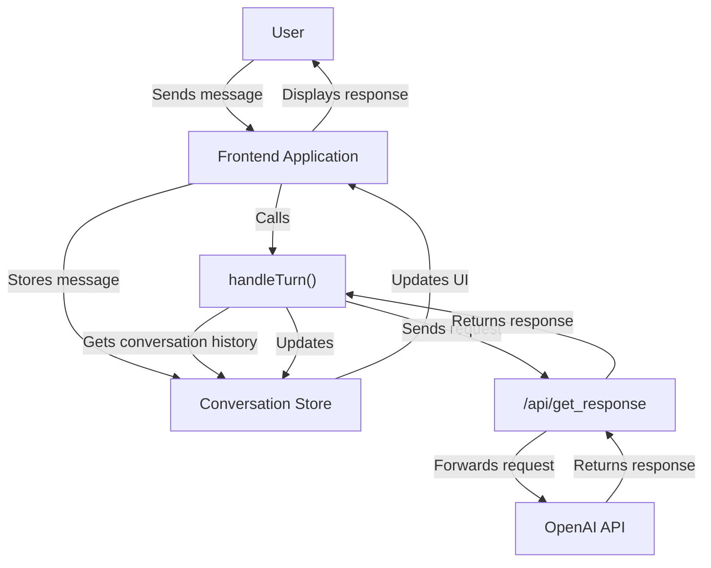
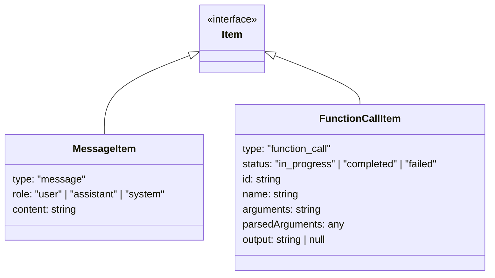
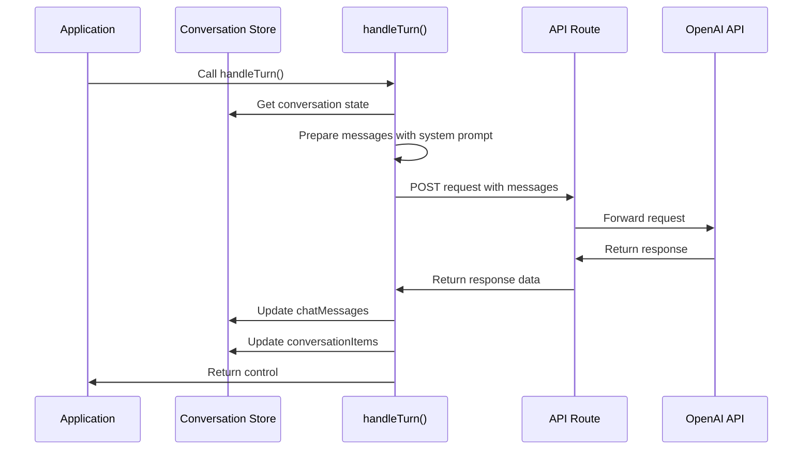
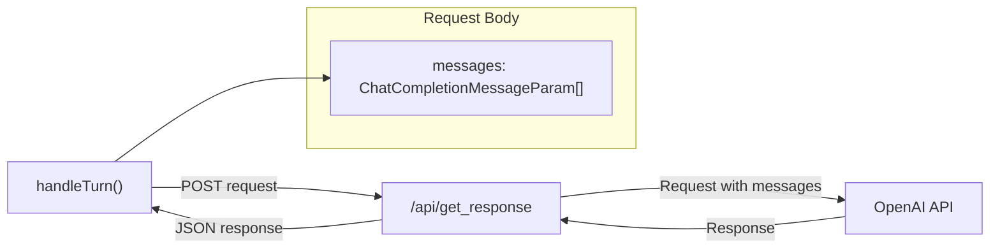
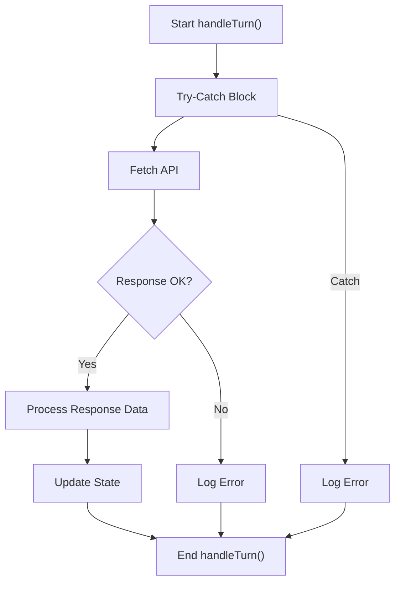
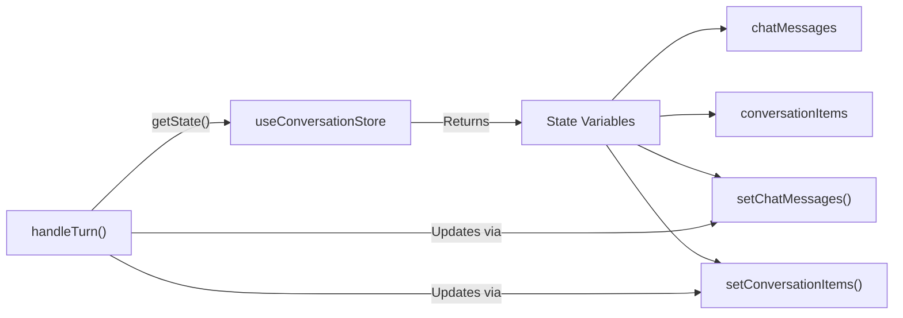

<!-- source: DeepWiki mcp.deepwiki.com · repo openai/openai-builder-lab-solution · page 3 Core Functionality · fetched 2026-10-26 -->

# Core Functionality

<details>
<summary>Relevant source files</summary>

The following files were used as context for generating this wiki page:

- [challenge1/frontend/lib/assistant.ts](challenge1/frontend/lib/assistant.ts)
- [challenge1/frontend/lib/constants.ts](challenge1/frontend/lib/constants.ts)

</details>


This document explains the core functionality of the OpenAI Builder Lab solution, focusing on how the application handles conversations with the OpenAI API. It covers the main components that enable the chat functionality, including message handling, API integration, and the overall conversation flow.

For information about UI components, see [UI Components](#2.1). For details on state management, see [State Management](#2.2).

## Overview of Core Functionality

The core functionality of the application revolves around facilitating conversations between users and an AI assistant powered by OpenAI's models. The system handles user messages, sends them to the OpenAI API, and processes the responses to display them in the chat interface.



Sources: [frontend/lib/assistant.ts:23-69]()

## Message Structure

The application uses two main types of message structures:

1. `MessageItem`: Represents standard chat messages from users, the assistant, or system
2. `FunctionCallItem`: Represents function/tool calls made by the assistant



Sources: [frontend/lib/assistant.ts:5-21]()

## Conversation Handling

The core of the conversation handling is implemented in the `handleTurn` function, which orchestrates the flow of messages between the frontend and the OpenAI API.

### The `handleTurn` Function

The `handleTurn` function is responsible for:

1. Retrieving the current conversation state
2. Preparing the messages to send to the API
3. Making the API request
4. Processing the response
5. Updating the conversation state



Sources: [frontend/lib/assistant.ts:23-69]()

### Message Preparation

Before sending messages to the OpenAI API, the application prepares the conversation by:

1. Adding the system prompt as the first message
2. Including all previous conversation items

```javascript
const allConversationItems: ChatCompletionMessageParam[] = [
  {
    role: 'system',
    content: SYSTEM_PROMPT
  },
  ...conversationItems
]
```

Sources: [frontend/lib/assistant.ts:31-37]()

## System Configuration

The application uses several constants to configure the behavior of the AI assistant:

| Constant | Purpose | Value |
|----------|---------|-------|
| `MODEL` | The OpenAI model to use | `gpt-4o` |
| `SYSTEM_PROMPT` | Instructions for the AI assistant | Defines the assistant as "Wanderlust Concierge" |
| `INITIAL_MESSAGE` | First message shown to the user | Greeting message |

Sources: [frontend/lib/constants.ts:1-13]()

### System Prompt

The system prompt defines the personality and capabilities of the assistant. In this case, it's configured as a travel assistant:

```
You are the Wanderlust Concierge, an AI travel assistant helping users plan their trips.
When users ask for your help, prompt them to understand where they would like to travel and for how long.
You can also make suggestions for destinations, activities, and accommodations.
Make relevant suggestions based on the user's preferences.
```

Sources: [frontend/lib/constants.ts:4-9]()

## API Integration

The application communicates with the OpenAI API through a dedicated API route. The `handleTurn` function makes a POST request to this route with the conversation history.



Sources: [frontend/lib/assistant.ts:40-48]()

### API Request Format

The request to the API route is formatted as a JSON object containing the messages array:

```javascript
{
  method: 'POST',
  headers: {
    'Content-Type': 'application/json'
  },
  body: JSON.stringify({ messages: allConversationItems })
}
```

Sources: [frontend/lib/assistant.ts:42-48]()

## State Updates

After receiving a response from the API, the `handleTurn` function updates two state variables:

1. `chatMessages`: Used for displaying messages in the UI
2. `conversationItems`: Used for maintaining the conversation context for the API

```javascript
// Update chat messages
chatMessages.push(data)
setChatMessages([...chatMessages])

// Update conversation items
conversationItems.push(data)
setConversationItems([...conversationItems])
```

Sources: [frontend/lib/assistant.ts:59-65]()

## Error Handling

The application includes basic error handling for API requests:

1. Checks if the response is successful (`response.ok`)
2. Logs errors to the console
3. Uses a try-catch block to handle exceptions during the process



Sources: [frontend/lib/assistant.ts:39-68]()

## Backend Options

The application supports two backend options for communicating with the OpenAI API:

1. NextJS API route (default): `/api/get_response`
2. Python backend (optional): `http://localhost:8000/get_response`

The choice between these options is made by uncommenting/commenting the appropriate fetch URL in the `handleTurn` function.

Sources: [frontend/lib/assistant.ts:40-42]()

## Integration with State Management

The core functionality integrates with the application's state management system through the `useConversationStore`. The store provides methods to:

1. Access the current conversation state
2. Update the conversation state with new messages



Sources: [frontend/lib/assistant.ts:24-29](), [frontend/lib/assistant.ts:59-65]()

## Summary

The core functionality of the OpenAI Builder Lab solution revolves around the `handleTurn` function, which manages the conversation flow between the user and the OpenAI API. The application uses a well-defined message structure, integrates with a state management system, and provides error handling to ensure a smooth user experience.

The system is designed to be flexible, supporting different backend options and configurable through constants like the system prompt and model selection.

---

