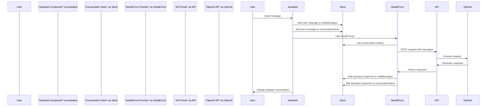
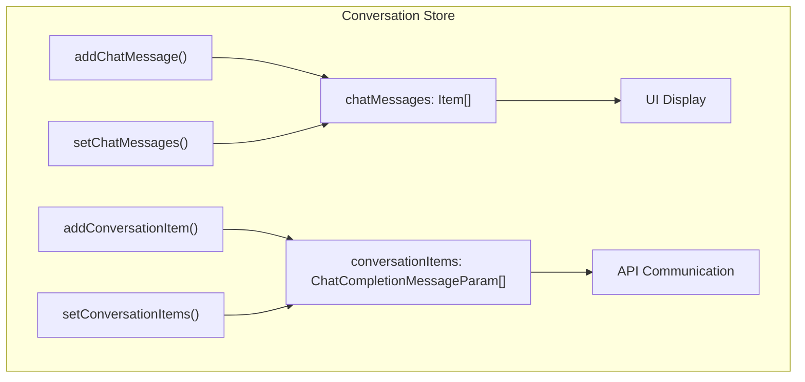
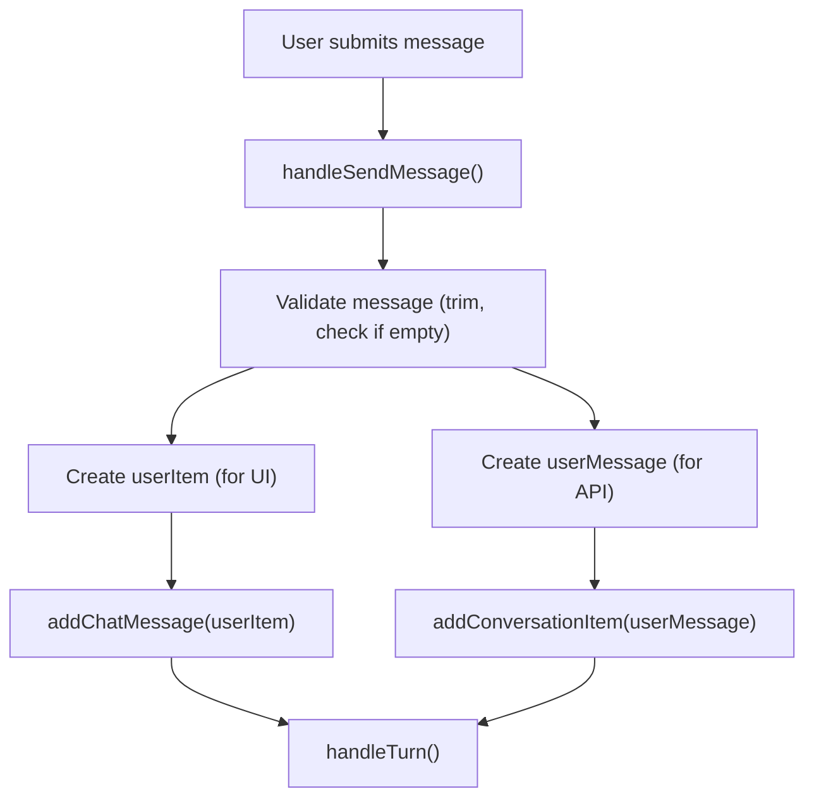
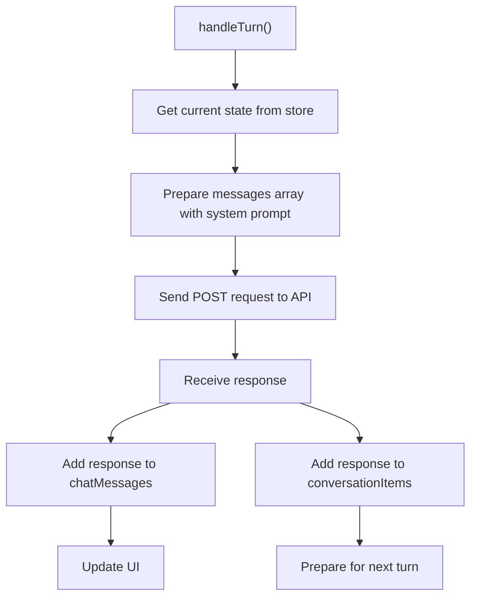
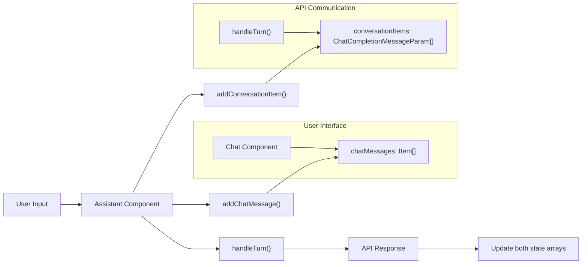

<!-- source: DeepWiki mcp.deepwiki.com · repo openai/openai-builder-lab-solution · page 3.1 Conversation Flow · fetched 2026-10-26 -->

# Conversation Flow

<details>
<summary>Relevant source files</summary>

The following files were used as context for generating this wiki page:

- [challenge1/frontend/components/assistant.tsx](challenge1/frontend/components/assistant.tsx)
- [challenge1/frontend/lib/assistant.ts](challenge1/frontend/lib/assistant.ts)
- [challenge1/frontend/stores/useConversationStore.ts](challenge1/frontend/stores/useConversationStore.ts)

</details>


This document details the conversation flow in the OpenAI Builder Lab solution, explaining how user messages are processed and how assistant responses are generated and displayed. It covers the journey from user input to assistant response, including state management and API communication.

For information about the OpenAI API integration details, see [OpenAI Integration](#3.2). For information about the tools system that allows the assistant to perform actions, see [Tools System](#3.3).

## Overview

The conversation flow in this application follows a structured pattern where user messages are captured, stored, sent to the OpenAI API, and responses are processed and displayed. The flow is managed primarily through the Assistant component, the conversation store, and the `handleTurn` function.



Sources: [frontend/components/assistant.tsx:13-37](), [frontend/lib/assistant.ts:23-69]()

## Key Components

### Conversation Store

The conversation store is implemented using Zustand and maintains two primary state variables:

1. `chatMessages`: An array of `Item` objects displayed in the UI
2. `conversationItems`: An array of `ChatCompletionMessageParam` objects sent to the OpenAI API



The store provides methods to add and update these state variables:

| Method | Purpose |
|--------|---------|
| `setChatMessages` | Replace the entire `chatMessages` array |
| `setConversationItems` | Replace the entire `conversationItems` array |
| `addChatMessage` | Add a single item to `chatMessages` |
| `addConversationItem` | Add a single message to `conversationItems` |

Sources: [frontend/stores/useConversationStore.ts:1-35]()

### Message Types

The application handles different types of items in the conversation:

1. `MessageItem`: Represents a text message from a user, assistant, or system
2. `FunctionCallItem`: Represents a function call made by the assistant

```typescript
interface MessageItem {
  type: 'message'
  role: 'user' | 'assistant' | 'system'
  content: string
}

interface FunctionCallItem {
  type: 'function_call'
  status: 'in_progress' | 'completed' | 'failed'
  id: string
  name: string
  arguments: string
  parsedArguments: any
  output: string | null
}

type Item = MessageItem | FunctionCallItem
```

Sources: [frontend/lib/assistant.ts:5-21]()

## Detailed Flow Process

### 1. User Message Submission

When a user submits a message through the chat interface, the `handleSendMessage` function in the Assistant component is triggered:



The function:
1. Validates the message (checks if it's not empty after trimming)
2. Creates two representations of the message:
   - `userItem`: For display in the UI
   - `userMessage`: For sending to the OpenAI API
3. Adds these to their respective state arrays in the conversation store
4. Calls `handleTurn()` to process the conversation

Sources: [frontend/components/assistant.tsx:13-37]()

### 2. Processing the Conversation Turn

The `handleTurn` function manages the process of sending the conversation to the API and handling the response:



The function:
1. Retrieves the current conversation state from the store
2. Prepares the messages array, including the system prompt
3. Sends a POST request to the API endpoint
4. Processes the response
5. Updates both state arrays with the assistant's response

Sources: [frontend/lib/assistant.ts:23-69]()

### 3. API Communication

The `handleTurn` function communicates with the API endpoint:

```typescript
// To use the python backend, replace by
//const response = await fetch('http://localhost:8000/get_response', {
const response = await fetch('/api/get_response', {
  method: 'POST',
  headers: {
    'Content-Type': 'application/json'
  },
  body: JSON.stringify({ messages: allConversationItems })
})
```

The function can be configured to use either:
- The built-in Next.js API route (`/api/get_response`)
- An optional Python backend (`http://localhost:8000/get_response`)

Sources: [frontend/lib/assistant.ts:40-48]()

### 4. Response Processing

After receiving the response from the API, the function:

1. Parses the JSON response into a `MessageItem`
2. Adds the response to the `chatMessages` array for UI display
3. Adds the response to the `conversationItems` array for future API calls
4. Updates the state in the conversation store

```typescript
// Update chat messages
chatMessages.push(data)
setChatMessages([...chatMessages])

// Update conversation items
conversationItems.push(data)
setConversationItems([...conversationItems])
```

Sources: [frontend/lib/assistant.ts:55-65]()

## State Management

The conversation flow relies on proper state management to maintain the conversation history and display it correctly. The application uses two parallel state arrays:



This dual-state approach allows the application to:
1. Display rich UI elements with different message types
2. Maintain a clean format for API communication

Sources: [frontend/stores/useConversationStore.ts:6-16](), [frontend/components/assistant.tsx:10-11]()

## Initial State

The conversation store is initialized with an initial assistant message defined in the constants:

```typescript
chatMessages: [
  {
    type: 'message',
    role: 'assistant',
    content: INITIAL_MESSAGE
  }
],
conversationItems: [],
```

This ensures that the conversation begins with a greeting or introduction from the assistant.

Sources: [frontend/stores/useConversationStore.ts:18-26]()

## Error Handling

The conversation flow includes error handling at multiple levels:

1. In the Assistant component:
```typescript
try {
  setLoading(true)
  addConversationItem(userMessage)
  addChatMessage(userItem)

  await handleTurn()
} catch (error) {
  console.error('Error processing message:', error)
} finally {
  setLoading(false)
}
```

2. In the `handleTurn` function:
```typescript
if (!response.ok) {
  console.error(`Error: ${response.statusText}`)
  return
}
```

```typescript
try {
  // API communication code
} catch (error) {
  console.error('Error processing messages:', error)
}
```

This ensures that errors are logged and the application continues to function even if there are issues with the API communication.

Sources: [frontend/components/assistant.tsx:26-36](), [frontend/lib/assistant.ts:50-67]()

## Summary

The conversation flow in the OpenAI Builder Lab solution follows a well-structured pattern:

1. User submits a message through the UI
2. The message is added to both state arrays in the conversation store
3. The `handleTurn` function is called to process the conversation
4. The function sends the conversation history to the API
5. The API response is added to both state arrays
6. The UI is updated to display the new message

This architecture provides a clean separation of concerns between UI display and API communication, making it easy to extend and modify the application.

---

