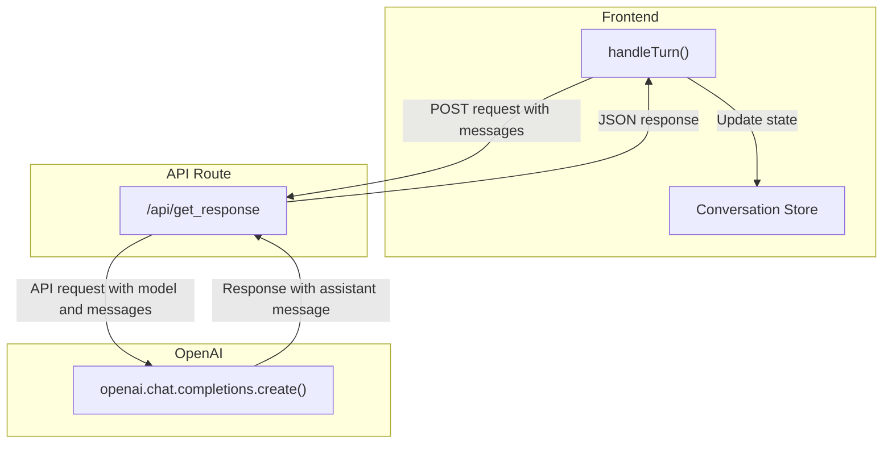
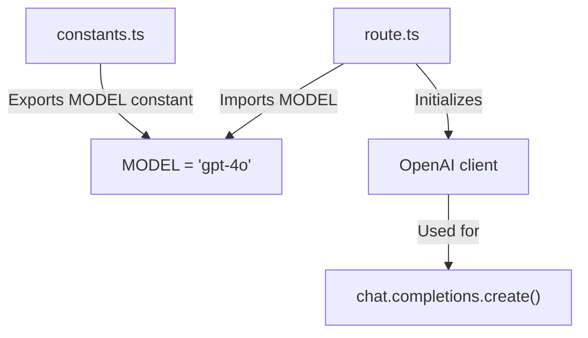
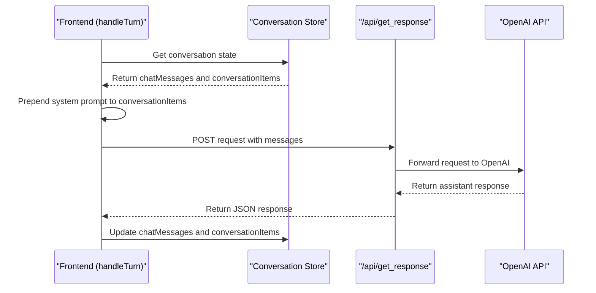
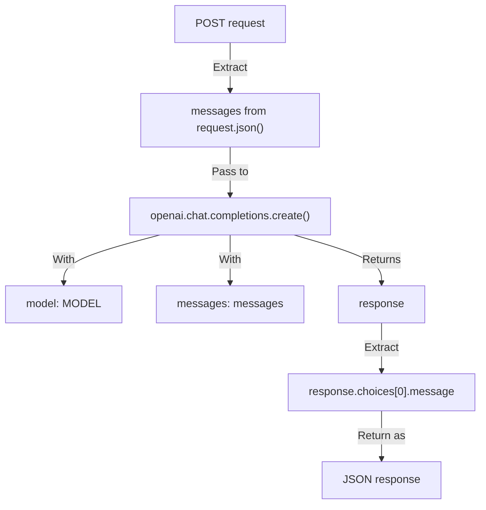
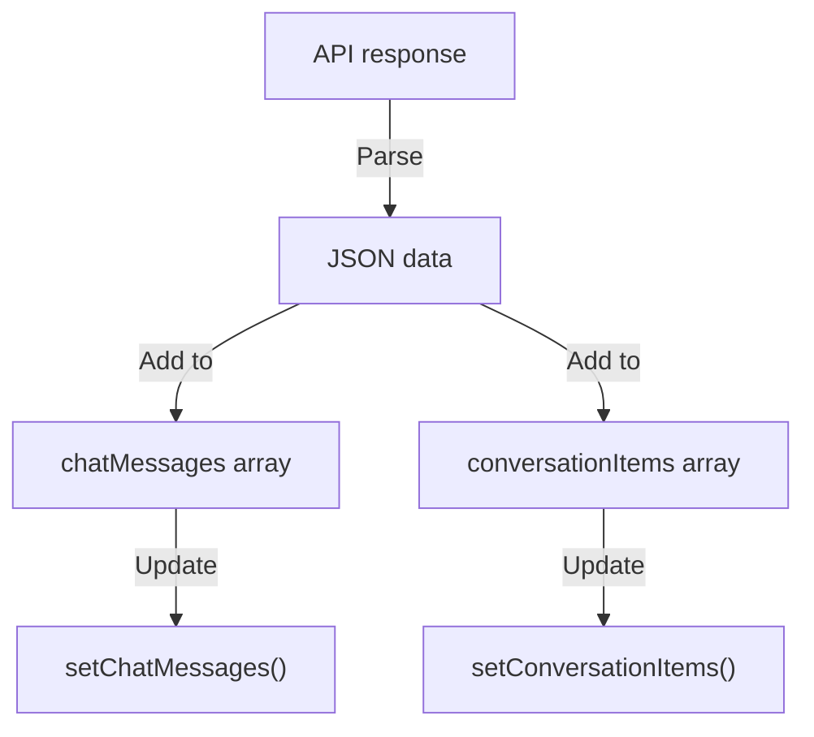
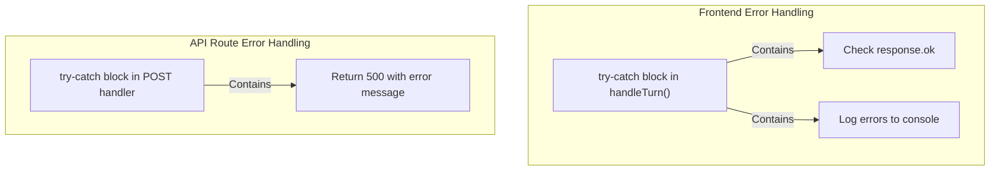
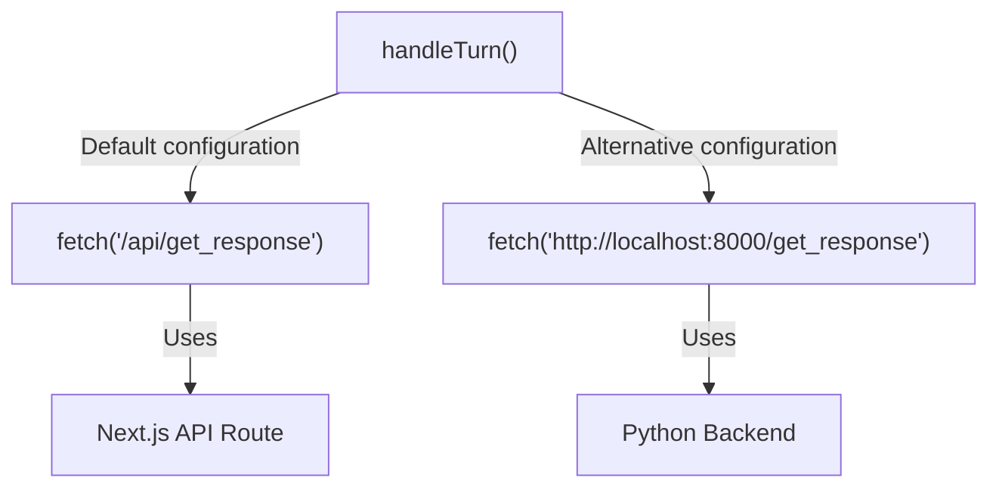

<!-- source: DeepWiki mcp.deepwiki.com · repo openai/openai-builder-lab-solution · page 3.2 OpenAI Integration · fetched 2026-10-26 -->

# OpenAI Integration

<details>
<summary>Relevant source files</summary>

The following files were used as context for generating this wiki page:

- [challenge1/frontend/app/api/get_response/route.ts](challenge1/frontend/app/api/get_response/route.ts)
- [challenge1/frontend/lib/assistant.ts](challenge1/frontend/lib/assistant.ts)
- [challenge1/frontend/lib/constants.ts](challenge1/frontend/lib/constants.ts)

</details>


This document explains how the application integrates with OpenAI's API to power the conversational assistant functionality. It covers the API configuration, request flow, and message handling between the frontend and OpenAI.

For information about the conversation flow implementation, see [Conversation Flow](#3.1). For details on the tools system that extends the assistant's capabilities, see [Tools System](#3.3).

## Overview

The OpenAI integration in this application provides a streamlined way to communicate with OpenAI's chat completions API. The integration consists of:

1. API configuration and initialization
2. Request handling through a dedicated API route
3. Message formatting and processing
4. Response handling and state updates



Sources: [challenge1/frontend/lib/assistant.ts:23-69](), [challenge1/frontend/app/api/get_response/route.ts:5-25]()

## API Configuration

The application initializes the OpenAI client in the API route handler. The model used for chat completions is defined as a constant in the application's configuration.



Sources: [challenge1/frontend/lib/constants.ts:1](), [challenge1/frontend/app/api/get_response/route.ts:1-3]()

## Request Flow

The request flow begins in the frontend's `handleTurn` function, which prepares the conversation history and sends it to the API route.

### Frontend to API Route

1. The `handleTurn` function retrieves the current conversation state
2. It prepends the system prompt to the conversation items
3. It sends a POST request to the API route with the formatted messages



Sources: [challenge1/frontend/lib/assistant.ts:23-69](), [challenge1/frontend/app/api/get_response/route.ts:5-25]()

### Message Structure

The messages sent to the OpenAI API follow this structure:

| Position | Role | Content | Source |
|----------|------|---------|--------|
| First | system | System prompt | constants.ts |
| Subsequent | user/assistant | User and assistant messages | Conversation store |

The system prompt defines the assistant's personality and capabilities:

```
You are the Wanderlust Concierge, an AI travel assistant helping users plan their trips.
When users ask for your help, prompt them to understand where they would like to travel and for how long.
You can also make suggestions for destinations, activities, and accommodations.
Make relevant suggestions based on the user's preferences.
```

Sources: [challenge1/frontend/lib/constants.ts:4-9](), [challenge1/frontend/lib/assistant.ts:31-37]()

## API Route Implementation

The API route handles the communication with OpenAI's API. It:

1. Extracts the messages from the request body
2. Calls OpenAI's chat completions API with the specified model and messages
3. Extracts the assistant's response from the API result
4. Returns the response as JSON



Sources: [challenge1/frontend/app/api/get_response/route.ts:5-25]()

## Response Handling

After receiving the response from the API route, the frontend:

1. Parses the JSON response
2. Adds the assistant's message to the chat messages array
3. Adds the assistant's message to the conversation items array
4. Updates the conversation store with the new arrays

This ensures that the UI is updated with the assistant's response and that the conversation history is maintained for future turns.



Sources: [challenge1/frontend/lib/assistant.ts:55-65]()

## Error Handling

The application includes error handling at multiple levels:

1. In the API route, errors from the OpenAI API are caught and returned as a 500 response with the error message
2. In the frontend, network errors and API errors are caught and logged to the console

This ensures that the application can gracefully handle failures in the OpenAI integration.



Sources: [challenge1/frontend/lib/assistant.ts:39-68](), [challenge1/frontend/app/api/get_response/route.ts:10-24]()

## Alternative Backend Configuration

The application supports an alternative Python backend configuration. To use the Python backend instead of the Next.js API route, the fetch URL in the `handleTurn` function can be changed from `/api/get_response` to `http://localhost:8000/get_response`.



Sources: [challenge1/frontend/lib/assistant.ts:40-42]()

## Summary

The OpenAI integration in this application provides a clean and efficient way to communicate with OpenAI's chat completions API. The integration is implemented through a dedicated API route that handles the communication with OpenAI, while the frontend manages the conversation state and user interface updates.

The system is designed to be flexible, with support for different models and backend configurations. Error handling is implemented at multiple levels to ensure robustness.

---

