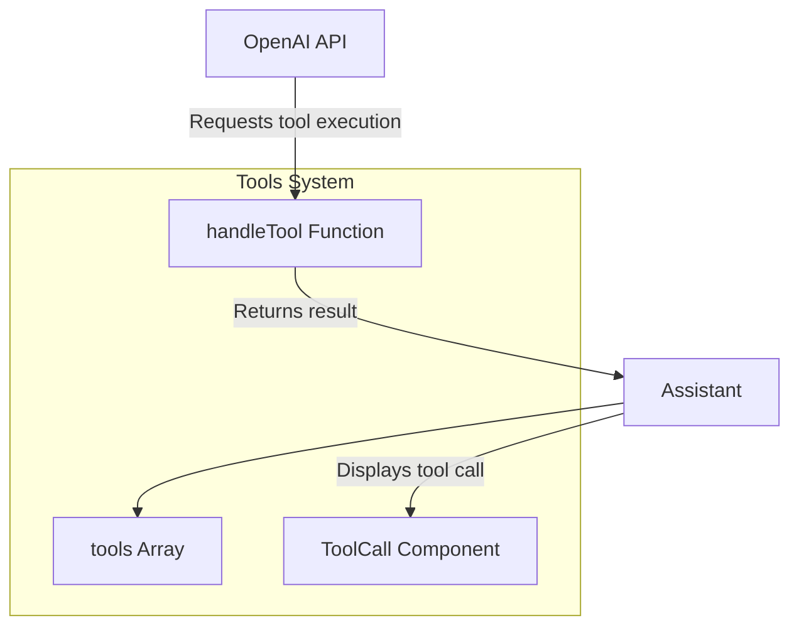
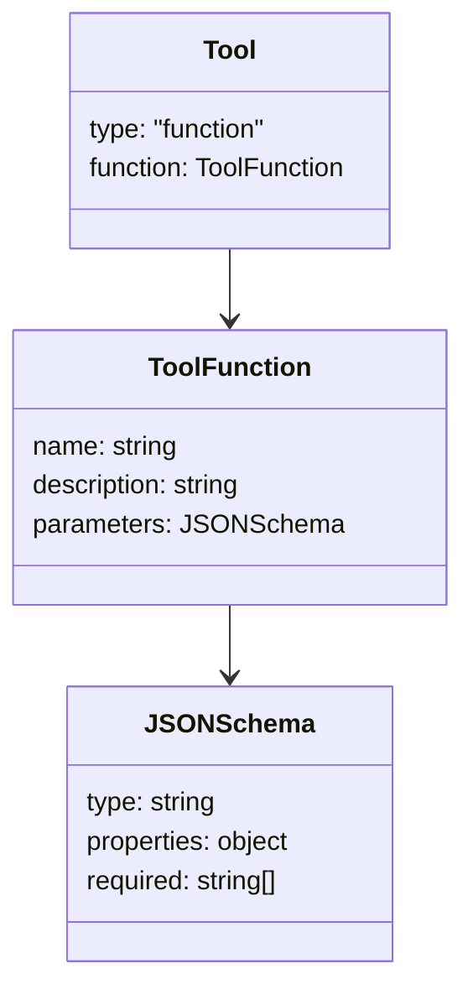
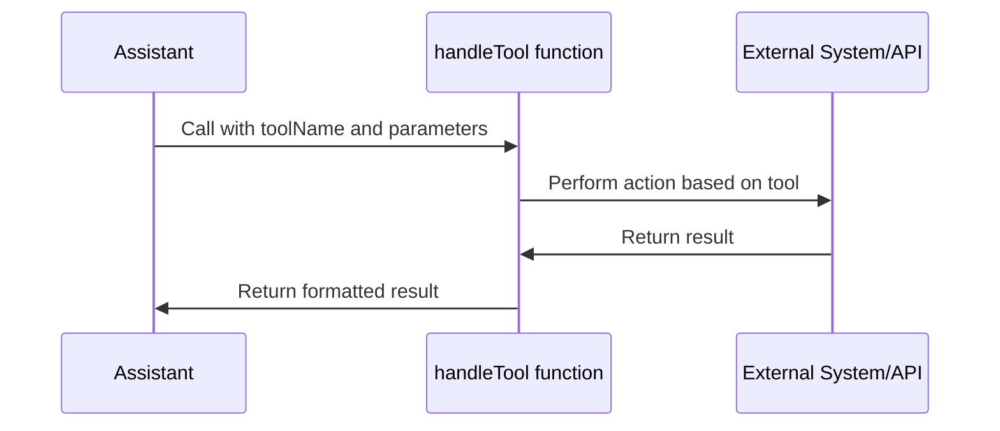
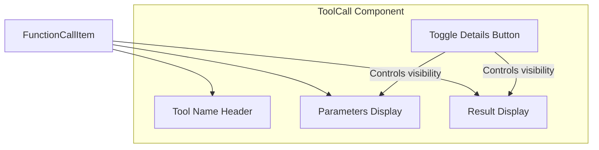
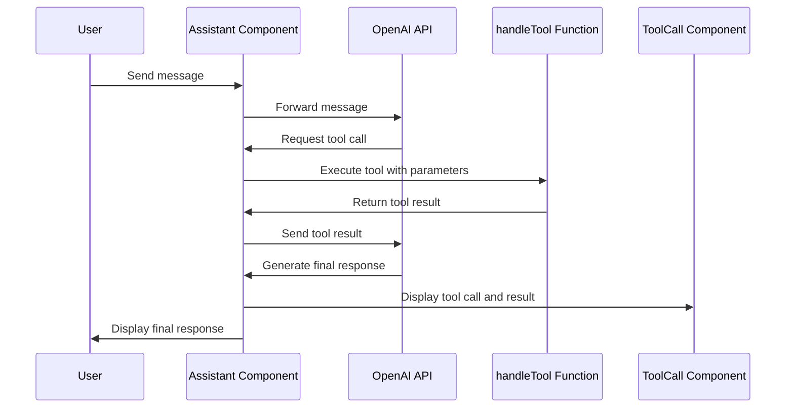
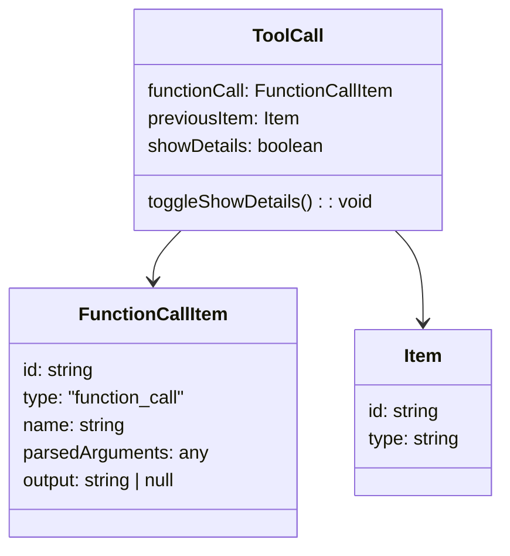
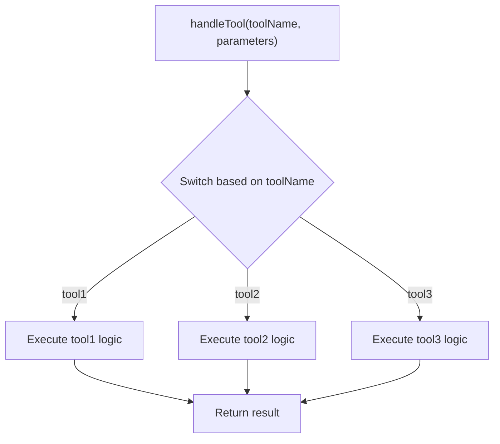
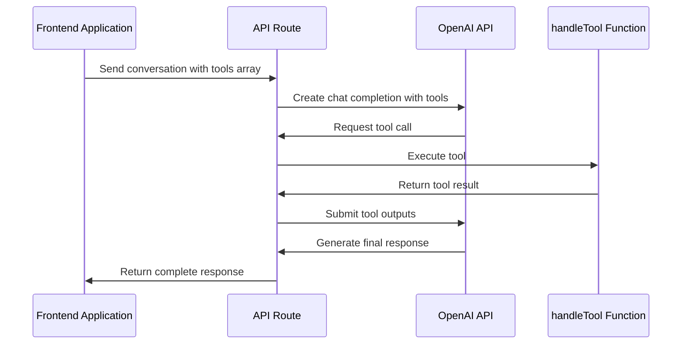

<!-- source: DeepWiki mcp.deepwiki.com · repo openai/openai-builder-lab-solution · page 3.3 Tools System · fetched 2026-10-26 -->

# Tools System

<details>
<summary>Relevant source files</summary>

The following files were used as context for generating this wiki page:

- [challenge1/frontend/components/tool-call.tsx](challenge1/frontend/components/tool-call.tsx)
- [challenge1/frontend/lib/tools.ts](challenge1/frontend/lib/tools.ts)

</details>


This document describes the Tools System in the OpenAI Builder Lab solution, which enables the assistant to perform actions beyond just generating text responses. The Tools System allows the assistant to call functions, process their results, and incorporate them into the conversation flow.

For information about the overall conversation flow, see [Conversation Flow](#3.1). For details on the OpenAI API integration, see [OpenAI Integration](#3.2).

## Purpose and Overview

The Tools System provides a framework for defining, executing, and displaying tool calls made by the assistant. In the context of this application, "tools" refer to functions that the assistant can invoke to perform specific actions, such as retrieving data, performing calculations, or interacting with external systems.



Sources: [challenge1/frontend/lib/tools.ts:1-3]()

## Core Components

The Tools System consists of three main components:

1. **Tools Definition**: An array of tool definitions that specify what tools are available to the assistant
2. **Tool Handler**: A function that executes tool calls and returns results
3. **Tool Call Display**: A component that visualizes tool calls and their results in the UI

### Tools Definition

Tools are defined in the `tools` array in the tools.ts file. Each tool definition includes:

- A name that identifies the tool
- A description of what the tool does
- A schema that defines the parameters the tool accepts



Sources: [challenge1/frontend/lib/tools.ts:3]()

### Tool Handler

The `handleTool` function is responsible for executing tool calls. It takes the tool name and parameters as arguments and returns the result of the tool execution.



Sources: [challenge1/frontend/lib/tools.ts:1]()

### Tool Call Display

The `ToolCall` component visualizes tool calls and their results in the UI. It provides a user-friendly representation of the tool call, including:

- The name of the tool being called
- The parameters passed to the tool
- The result returned by the tool



Sources: [challenge1/frontend/components/tool-call.tsx:13-98]()

## Data Flow

The following diagram illustrates the data flow when a tool is called:



Sources: [challenge1/frontend/lib/tools.ts:1-3](), [challenge1/frontend/components/tool-call.tsx:13-98]()

## Tool Call Component Structure

The `ToolCall` component is responsible for rendering tool calls in the UI. It takes a `FunctionCallItem` and the previous conversation item as props.



The component includes:

1. A header displaying the tool name
2. A toggle button to show/hide details
3. A syntax-highlighted display of the tool parameters
4. A syntax-highlighted display of the tool output

Sources: [challenge1/frontend/components/tool-call.tsx:8-98]()

## UI Representation

The `ToolCall` component renders tool calls with a distinctive visual style:

| Element | Description |
|---------|-------------|
| Header | Shows the tool name with a lightning bolt icon |
| Toggle Button | Chevron icon that rotates when clicked |
| Parameters Section | JSON representation of the parameters |
| Output Section | JSON representation of the tool output |
| Visual Connection | Vertical line connecting related tool calls |

The component uses syntax highlighting to make the JSON parameters and output more readable.

Sources: [challenge1/frontend/components/tool-call.tsx:22-97]()

## Implementation Details

### Tool Call Component

The `ToolCall` component uses React's `useState` hook to manage the visibility of the details section:

```mermaid
stateDiagram-v2
    [*] --> DetailsHidden
    DetailsHidden --> DetailsVisible: User clicks toggle
    DetailsVisible --> DetailsHidden: User clicks toggle
    
    state DetailsHidden {
        ShowHeader: Display tool name and icon
    }
    
    state DetailsVisible {
        ShowHeader: Display tool name and icon
        ShowParameters: Display parameters JSON
        ShowOutput: Display output JSON if available
    }
```

The component formats the tool name by converting snake_case to Title Case for better readability.

Sources: [challenge1/frontend/components/tool-call.tsx:17-20](), [challenge1/frontend/components/tool-call.tsx:36-41]()

### Tool Execution

The `handleTool` function is designed to be asynchronous, allowing it to perform operations that may take time, such as API calls or database queries:



Sources: [challenge1/frontend/lib/tools.ts:1]()

## Integration with OpenAI API

The Tools System integrates with the OpenAI API by:

1. Providing tool definitions to the API when creating a chat completion
2. Handling tool calls requested by the API
3. Sending tool results back to the API for further processing



Sources: [challenge1/frontend/lib/tools.ts:1-3]()

## Extending the Tools System

To add new tools to the system:

1. Add a new tool definition to the `tools` array
2. Implement the tool's logic in the `handleTool` function
3. The UI will automatically handle displaying the tool call and its result

This modular design makes it easy to extend the system with new capabilities without modifying the core conversation flow.

Sources: [challenge1/frontend/lib/tools.ts:1-3]()

## Summary

The Tools System provides a powerful way to extend the assistant's capabilities beyond text generation. By defining tools, implementing their logic, and displaying their results, the system enables the assistant to perform a wide range of actions, making it more useful and versatile.

The system is designed to be:

- **Extensible**: New tools can be added easily
- **Transparent**: Tool calls and their results are clearly displayed in the UI
- **Integrated**: The system works seamlessly with the OpenAI API and the rest of the application

This architecture provides a solid foundation for building AI-powered applications that can perform real-world actions.

---

