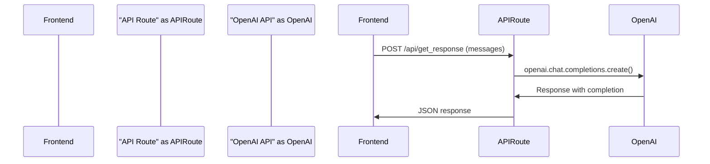
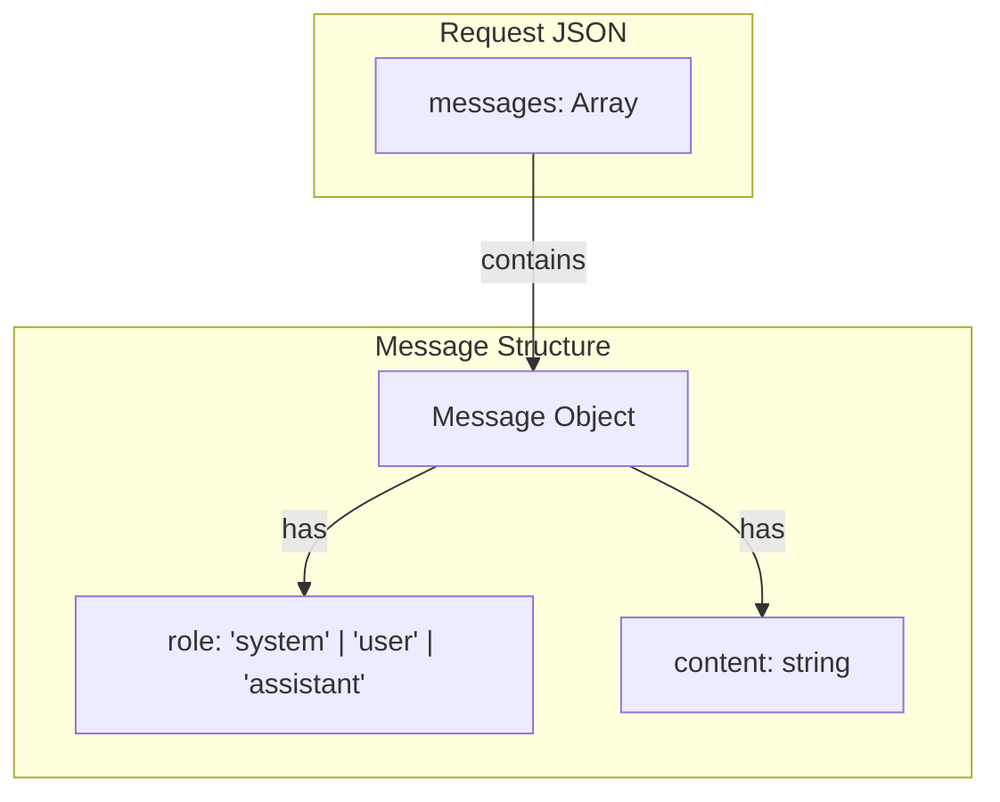
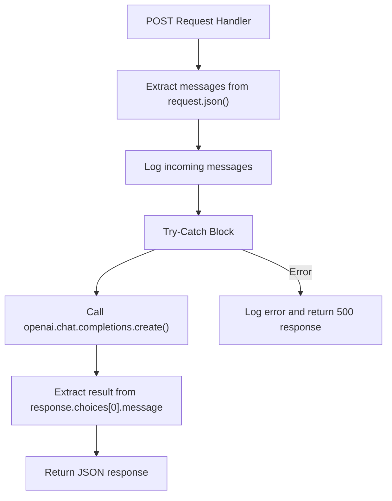
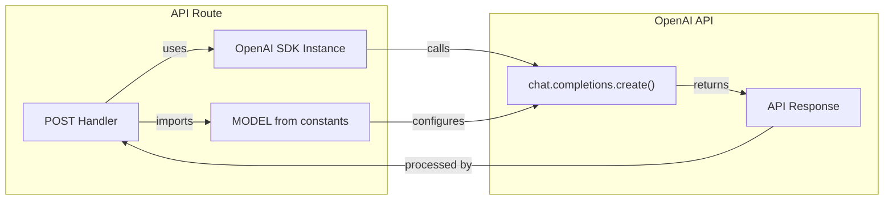
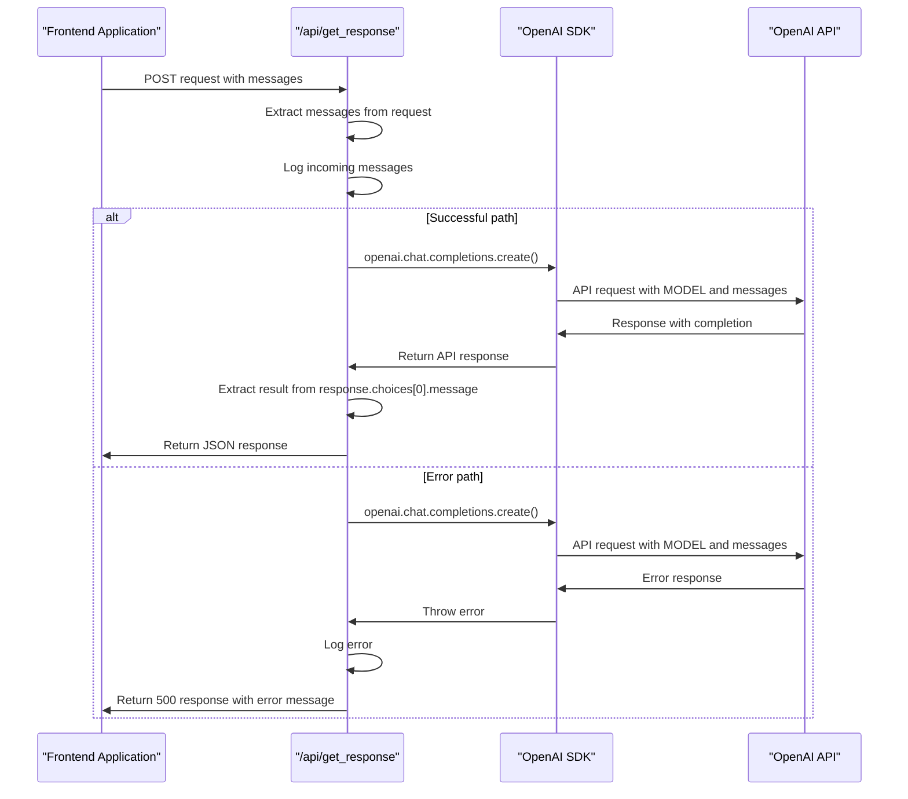
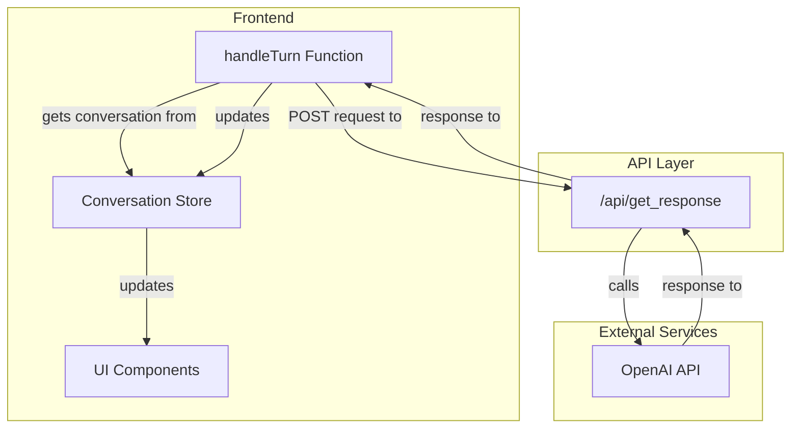

<!-- source: DeepWiki mcp.deepwiki.com · repo openai/openai-builder-lab-solution · page 4 API Routes · fetched 2026-10-26 -->

# API Routes

Relevant source files

The following files were used as context for generating this wiki page:

- [challenge1/frontend/app/api/get_response/route.ts](challenge1/frontend/app/api/get_response/route.ts)

This document explains the API routes in the OpenAI Builder Lab solution, focusing on how the frontend communicates with the OpenAI API. The API routes serve as the intermediary layer that processes requests from the frontend and forwards them to OpenAI's services.

For information about the overall system architecture, see [System Architecture](#1.1). For details on OpenAI integration, see [OpenAI Integration](#3.2).

## Overview

The OpenAI Builder Lab solution uses Next.js API routes to handle communication between the frontend and the OpenAI API. These routes are responsible for:

1. Receiving requests from the frontend
2. Processing and validating the request data
3. Sending requests to the OpenAI API
4. Handling responses and errors
5. Returning formatted responses to the frontend

Sources: [challenge1/frontend/app/api/get_response/route.ts:5-25]()

## API Route Structure

The application currently has one main API route:

| Route | Method | Purpose |
|-------|--------|---------|
| `/api/get_response` | POST | Sends conversation messages to OpenAI and returns the generated response |

Sources: [challenge1/frontend/app/api/get_response/route.ts:5-25]()

## The `get_response` Route

The `get_response` route is the primary endpoint for communication with the OpenAI API. It handles POST requests containing conversation messages and returns the generated response from the OpenAI model.

### Request Format

The route expects a POST request with a JSON body containing a `messages` array. This array follows the OpenAI Chat Completions API format, with each message having a `role` and `content`.

Sources: [challenge1/frontend/app/api/get_response/route.ts:5-6]()

### Implementation Details

The route is implemented as an asynchronous POST handler function in Next.js. Here's how it works:

1. It extracts the `messages` array from the request body
2. It logs the incoming messages for debugging purposes
3. It calls the OpenAI API using the configured model (from constants)
4. It extracts the response from the API result
5. It returns the response as JSON
6. It handles any errors that occur during the process

Sources: [challenge1/frontend/app/api/get_response/route.ts:5-25]()

### OpenAI API Integration

The route uses the OpenAI Node.js SDK to communicate with the OpenAI API. It creates a chat completion request with:

- The model specified in the `MODEL` constant
- The messages array from the request

The model is imported from the constants file, ensuring consistency across the application.

Sources: [challenge1/frontend/app/api/get_response/route.ts:1-3](), [challenge1/frontend/app/api/get_response/route.ts:11-15]()

### Error Handling

The route includes error handling to catch and process any issues that occur during the API call. When an error occurs:

1. The error is logged to the console
2. A 500 status response is returned with the error message

This ensures that the frontend receives meaningful error information rather than a generic failure.

Sources: [challenge1/frontend/app/api/get_response/route.ts:19-24]()

## Data Flow

The following diagram illustrates the complete data flow through the API route:

Sources: [challenge1/frontend/app/api/get_response/route.ts:5-25]()

## Integration with Frontend

The API route is designed to be called from the frontend application, specifically from the `handleTurn` function in the conversation flow. The frontend sends the conversation history to the API route and processes the response to update the UI.

Sources: [challenge1/frontend/app/api/get_response/route.ts:5-25]()

## Summary

The API routes in the OpenAI Builder Lab solution provide a clean interface between the frontend application and the OpenAI API. The `/api/get_response` route handles the core functionality of sending conversation messages to OpenAI and returning the generated responses.

This architecture allows for:

1. Separation of concerns between the frontend and API communication
2. Centralized error handling for API requests
3. Easy configuration of OpenAI API parameters
4. Consistent logging for debugging purposes

For information on how to extend these API routes or add new ones, see [Extending the Application](#6).

Sources: [challenge1/frontend/app/api/get_response/route.ts:1-25]()

---

