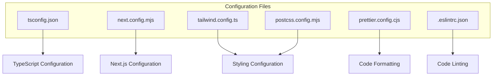
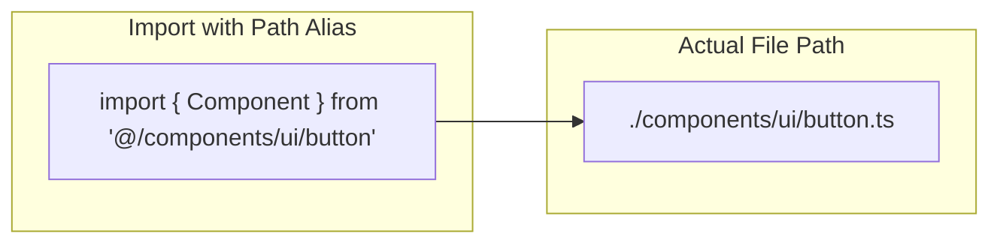
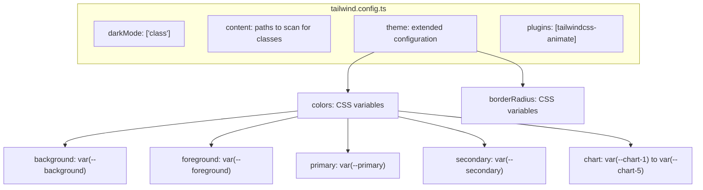
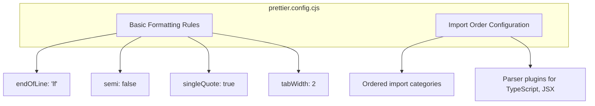
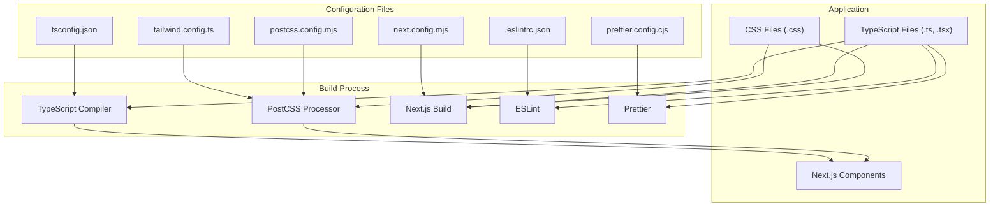

<!-- source: DeepWiki mcp.deepwiki.com · repo openai/openai-builder-lab-solution · page 5 Configuration · fetched 2026-10-26 -->

# Configuration

<details>
<summary>Relevant source files</summary>

The following files were used as context for generating this wiki page:

- [challenge1/frontend/.eslintrc.json](challenge1/frontend/.eslintrc.json)
- [challenge1/frontend/next.config.mjs](challenge1/frontend/next.config.mjs)
- [challenge1/frontend/postcss.config.mjs](challenge1/frontend/postcss.config.mjs)
- [challenge1/frontend/prettier.config.cjs](challenge1/frontend/prettier.config.cjs)
- [challenge1/frontend/tailwind.config.ts](challenge1/frontend/tailwind.config.ts)
- [challenge1/frontend/tsconfig.json](challenge1/frontend/tsconfig.json)

</details>


This page documents the configuration files in the OpenAI Builder Lab solution and explains their purposes. These files control various aspects of the application, including TypeScript settings, code formatting, linting, styling, and Next.js behavior.

For information about extending the application with custom configurations, see [Extending the Application](#6).

## Configuration Overview

The OpenAI Builder Lab solution uses several configuration files to manage different aspects of the application. These files are located in the root directory of the frontend application.



Sources: [challenge1/frontend/tsconfig.json](), [challenge1/frontend/next.config.mjs](), [challenge1/frontend/tailwind.config.ts](), [challenge1/frontend/postcss.config.mjs](), [challenge1/frontend/prettier.config.cjs](), [challenge1/frontend/.eslintrc.json]()

## TypeScript Configuration

The TypeScript configuration is defined in `tsconfig.json` and controls how TypeScript compiles the code.

### Key Settings

| Setting | Value | Purpose |
|---------|-------|---------|
| `lib` | `["dom", "dom.iterable", "esnext"]` | Specifies the library files to include in the compilation |
| `strict` | `true` | Enables strict type checking |
| `jsx` | `"preserve"` | Preserves JSX syntax for Next.js to handle |
| `paths` | `{"@/*": ["./\*"]}` | Configures path aliases for imports |

### Path Aliases

The `paths` configuration allows for cleaner imports using the `@/` prefix:



Sources: [challenge1/frontend/tsconfig.json]()

## Next.js Configuration

The Next.js configuration is defined in `next.config.mjs` and is currently minimal, providing a foundation for extending with custom settings as needed.

```javascript
/** @type {import('next').NextConfig} */
const nextConfig = {};

export default nextConfig;
```

This empty configuration uses Next.js defaults, which is sufficient for the basic application. As the application grows, this file can be extended with custom settings for:

- Environment variables
- Redirects and rewrites
- Image optimization
- Internationalization
- Custom webpack configuration

Sources: [challenge1/frontend/next.config.mjs]()

## Styling Configuration

### Tailwind CSS Configuration

The Tailwind CSS configuration is defined in `tailwind.config.ts` and extends the default Tailwind theme with custom colors and border radius values.



The configuration includes:

1. Dark mode support using the `class` strategy
2. Content paths to scan for Tailwind classes
3. Extended theme with custom colors and border radius values
4. Animation plugin for transitions and animations

Sources: [challenge1/frontend/tailwind.config.ts]()

### PostCSS Configuration

The PostCSS configuration is defined in `postcss.config.mjs` and includes the Tailwind CSS plugin:

```javascript
/** @type {import('postcss-load-config').Config} */
const config = {
  plugins: {
    tailwindcss: {},
  },
};

export default config;
```

This configuration processes CSS files through Tailwind CSS, enabling the use of Tailwind's utility classes throughout the application.

Sources: [challenge1/frontend/postcss.config.mjs]()

## Code Formatting and Linting

### Prettier Configuration

The Prettier configuration is defined in `prettier.config.cjs` and controls code formatting:



Key features:

1. Basic formatting rules (line endings, quotes, tabs)
2. Detailed import order configuration for organized imports
3. Parser plugins for TypeScript, JSX, and decorators

Sources: [challenge1/frontend/prettier.config.cjs]()

### ESLint Configuration

The ESLint configuration is defined in `.eslintrc.json` and extends Next.js core web vitals and TypeScript rules:

```json
{
  "extends": ["next/core-web-vitals", "next/typescript"],
  "rules": {
    "@typescript-eslint/no-explicit-any": "off"
  }
}
```

This configuration:

1. Extends Next.js recommended rules for core web vitals
2. Extends Next.js TypeScript rules
3. Disables the rule that prevents using the `any` type

Sources: [challenge1/frontend/.eslintrc.json]()

## Configuration Relationships

The following diagram illustrates how the different configuration files relate to each other and to the application:



Sources: [challenge1/frontend/tsconfig.json](), [challenge1/frontend/next.config.mjs](), [challenge1/frontend/tailwind.config.ts](), [challenge1/frontend/postcss.config.mjs](), [challenge1/frontend/prettier.config.cjs](), [challenge1/frontend/.eslintrc.json]()

## Configuration Best Practices

When working with the OpenAI Builder Lab solution, consider these best practices for configuration:

1. **Maintain TypeScript Strictness**: Keep the `strict` setting enabled in `tsconfig.json` to catch type errors early.

2. **Extend Tailwind Theme**: Add custom colors and styles by extending the theme in `tailwind.config.ts` rather than overriding it.

3. **Keep Next.js Config Minimal**: Only add settings to `next.config.mjs` when necessary to avoid complexity.

4. **Follow Import Order**: Adhere to the import order defined in `prettier.config.cjs` for consistent code organization.

5. **Use Path Aliases**: Leverage the `@/` path alias configured in `tsconfig.json` for cleaner imports.

## Summary

The configuration files in the OpenAI Builder Lab solution provide a solid foundation for development with TypeScript, Next.js, and Tailwind CSS. They establish conventions for code formatting, linting, and styling that promote consistency and maintainability.

These configurations are designed to work together seamlessly, creating a development environment that balances flexibility with structure. As you extend the application, you can modify these configurations to meet your specific requirements while maintaining the core architecture.

---

