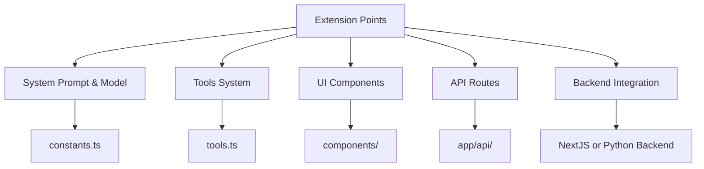
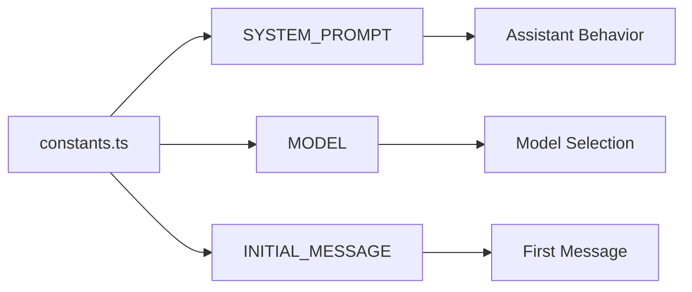
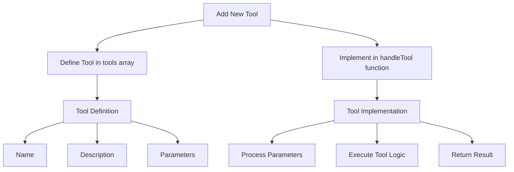
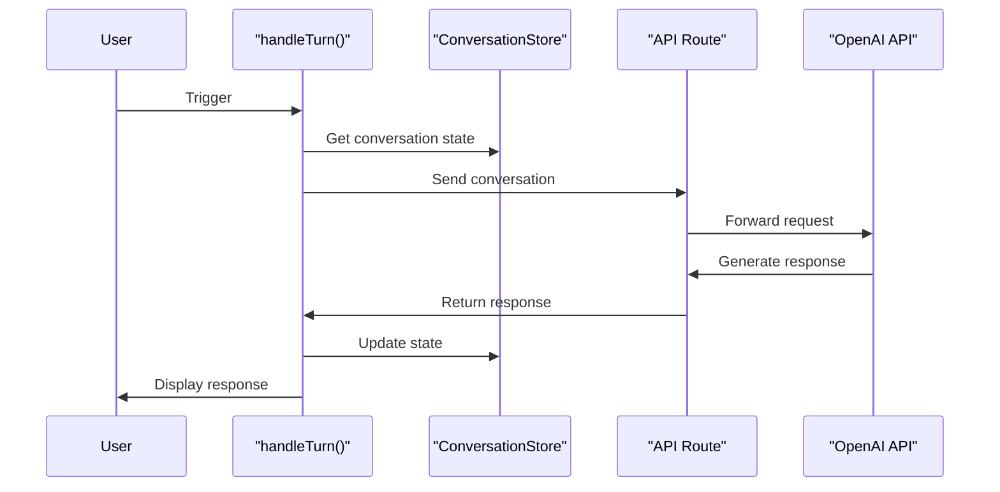
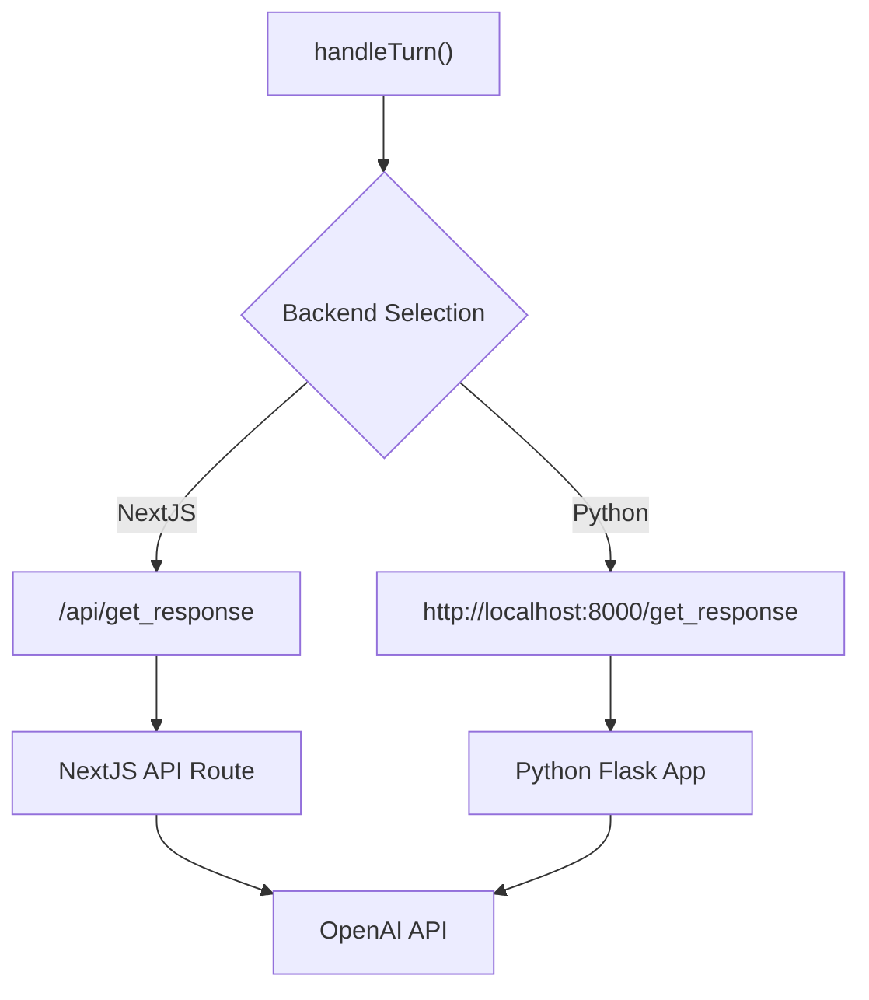
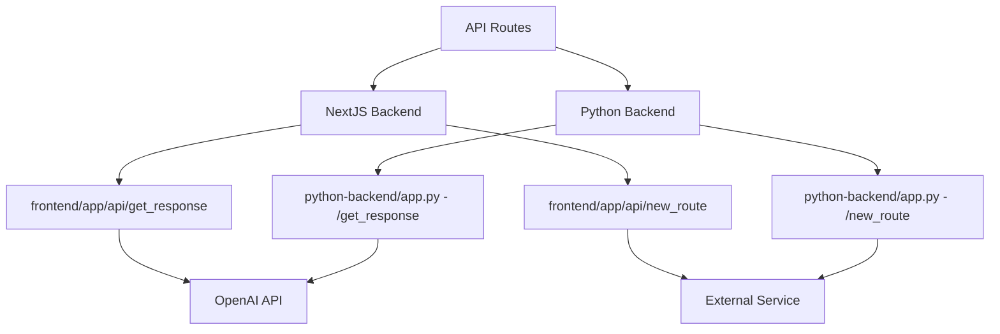
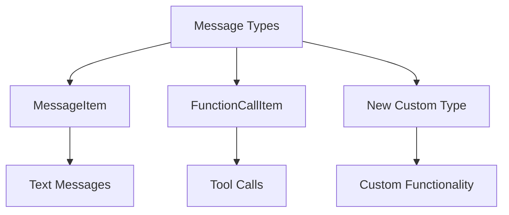
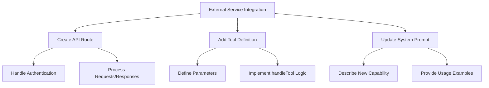
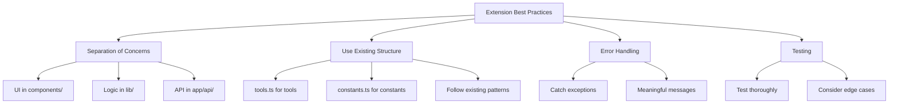

<!-- source: DeepWiki mcp.deepwiki.com · repo openai/openai-builder-lab-solution · page 6 Extending the Application · fetched 2026-10-26 -->

# Extending the Application

Relevant source files

The following files were used as context for generating this wiki page:

- [README.md](README.md)
- [challenge1/frontend/lib/assistant.ts](challenge1/frontend/lib/assistant.ts)
- [challenge1/frontend/lib/constants.ts](challenge1/frontend/lib/constants.ts)
- [challenge1/frontend/lib/tools.ts](challenge1/frontend/lib/tools.ts)

This document provides guidance on how to extend and customize the OpenAI Builder Lab solution for specific use cases. It covers adding new tools, customizing the assistant's behavior, modifying the UI, and integrating with external services.

For information about the core functionality of the application, see [Core Functionality](#3). For details on the API routes, see [API Routes](#4).

## Overview of Extension Points

The OpenAI Builder Lab solution is designed to be easily extensible. The main extension points are:

1. **System Prompt and Model**: Customize the assistant's behavior
2. **Tools System**: Add new capabilities to the assistant
3. **UI Components**: Modify the user interface
4. **API Routes**: Add new backend functionality
5. **Backend Integration**: Switch between NextJS and Python backends

Sources: [README.md:70-98](), [challenge1/frontend/lib/constants.ts:1-13]()

## Customizing the Assistant's Behavior

### Modifying the System Prompt

The system prompt defines the assistant's personality, capabilities, and constraints. To modify it, edit the `SYSTEM_PROMPT` constant in the `constants.ts` file.

For example, to change the assistant from a travel concierge to a coding assistant, you would modify the system prompt:

Sources: [challenge1/frontend/lib/constants.ts:1-13]()

### Changing the Model

The model used by the assistant can be changed by modifying the `MODEL` constant in the `constants.ts` file. This allows you to switch between different OpenAI models based on your requirements.

Sources: [challenge1/frontend/lib/constants.ts:1-13]()

## Adding New Tools

The tools system allows the assistant to perform actions beyond just generating text. Tools are defined in the `tools.ts` file and are processed by the `handleTool` function.

### Tool Definition Structure

To add a new tool, you need to:

1. Define the tool in the `tools` array
2. Implement the tool's functionality in the `handleTool` function

### Example Tool Implementation

A tool implementation typically involves:

1. Extracting parameters from the tool call
2. Performing the required action (e.g., API call, data processing)
3. Returning the result

The `handleTool` function in `tools.ts` is responsible for routing tool calls to the appropriate implementation based on the tool name.

Sources: [challenge1/frontend/lib/tools.ts:1-3]()

## Extending the Conversation Flow

The conversation flow is managed by the `handleTurn` function in `assistant.ts`. This function:

1. Retrieves the current conversation state
2. Sends the conversation to the API
3. Processes the response
4. Updates the conversation state

To extend the conversation flow, you can modify the `handleTurn` function to:

1. Add pre-processing of messages before sending to the API
2. Add post-processing of responses from the API
3. Implement custom error handling
4. Add support for additional message types

Sources: [challenge1/frontend/lib/assistant.ts:23-69]()

## Switching Between Backends

The application supports both a NextJS backend and a Python backend. To switch between them:

1. In `assistant.ts`, modify the fetch URL:
   - For NextJS backend: `/api/get_response`
   - For Python backend: `http://localhost:8000/get_response`

The Python backend provides more flexibility for complex processing or integration with Python libraries, while the NextJS backend is simpler to deploy.

Sources: [challenge1/frontend/lib/assistant.ts:40-42](), [README.md:5-6]()

## Adding New API Routes

To add new API routes:

1. For NextJS backend: Create new files in the `frontend/app/api` directory
2. For Python backend: Add new routes in the `python-backend/app.py` file

New API routes can be used for:
- Integrating with external services
- Implementing complex business logic
- Processing data before or after OpenAI API calls

Sources: [README.md:92-98]()

## Customizing Message Types

The application supports different types of message items:

1. `MessageItem`: Regular text messages
2. `FunctionCallItem`: Function/tool calls with status tracking

To add new message types:

1. Define a new interface in `assistant.ts`
2. Update the `Item` type to include the new message type
3. Modify the `handleTurn` function to process the new message type
4. Update the UI components to display the new message type

Sources: [challenge1/frontend/lib/assistant.ts:5-21]()

## Integration with External Services

To integrate with external services:

1. Create a new API route to handle the external service communication
2. Add a new tool that uses this API route
3. Update the system prompt to inform the assistant about the new capability

This approach keeps sensitive API keys on the server side and allows for more complex processing of external service responses.

Sources: [README.md:92-98](), [challenge1/frontend/lib/tools.ts:1-3]()

## Best Practices for Extension

When extending the application, follow these best practices:

1. **Maintain Separation of Concerns**:
   - Keep UI logic in components
   - Keep business logic in lib files
   - Keep API communication in API routes

2. **Use the Existing Structure**:
   - Add new tools to `tools.ts`
   - Add new constants to `constants.ts`
   - Add new API routes following the existing pattern

3. **Error Handling**:
   - Implement proper error handling in all extensions
   - Provide meaningful error messages to users

4. **Testing**:
   - Test new functionality thoroughly
   - Consider edge cases and failure scenarios

Sources: [README.md:70-98]()

## Summary

The OpenAI Builder Lab solution provides multiple extension points that allow you to customize and enhance the application for specific use cases. By modifying the system prompt, adding new tools, extending the conversation flow, and integrating with external services, you can create a wide range of AI-powered applications.

The modular architecture makes it easy to extend while maintaining a clean separation of concerns between UI components, business logic, and API communication.

Sources: [README.md:3-7](), [challenge1/frontend/lib/assistant.ts:23-69](), [challenge1/frontend/lib/tools.ts:1-3](), [challenge1/frontend/lib/constants.ts:1-13]()