# Page: Overview

# Overview

<details>
<summary>Relevant source files</summary>

The following files were used as context for generating this wiki page:

- [README.md](README.md)

</details>


This document provides an introduction to the OpenAI Builder Lab solution, a starter project designed to help users complete Builder Lab challenges efficiently. The solution consists of a NextJS frontend application with an optional Python backend, enabling seamless integration with OpenAI's APIs.

For detailed information about the system architecture, see [System Architecture](#1.1).
For setup instructions, see [Getting Started](#1.2).

## Purpose and Scope

The OpenAI Builder Lab solution serves as a foundation for building AI-powered applications using OpenAI's APIs. It provides:

1. A pre-configured NextJS frontend with UI components
2. State management for conversations
3. API integration with OpenAI
4. An optional Python backend alternative

This overview covers the high-level components, their interactions, and the overall structure of the codebase.

Sources: [README.md:1-99]()

## System Components

The solution consists of the following main components:

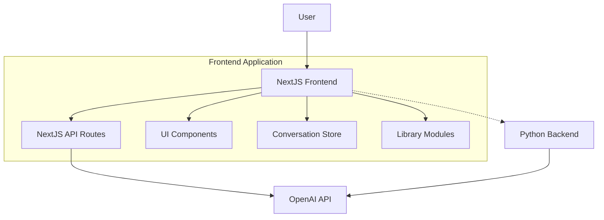

**Key Components:**
- **NextJS Frontend**: The main user interface
- **UI Components**: Reusable interface elements
- **Conversation Store**: State management for chat messages
- **Library Modules**: Core business logic
- **API Routes**: Communication with OpenAI
- **Python Backend (Optional)**: Alternative backend implementation

Sources: [README.md:70-90]()

## Code Organization

The codebase is organized into several key directories:

| Directory | Purpose |
|-----------|---------|
| `frontend/components` | UI components for the application interface |
| `frontend/lib` | Core business logic for the assistant functionality |
| `frontend/stores` | State management for conversations |
| `frontend/app/api` | NextJS API routes for backend communication |
| `python-backend` | Optional Python backend implementation |

The library modules in `frontend/lib` contain the core functionality:

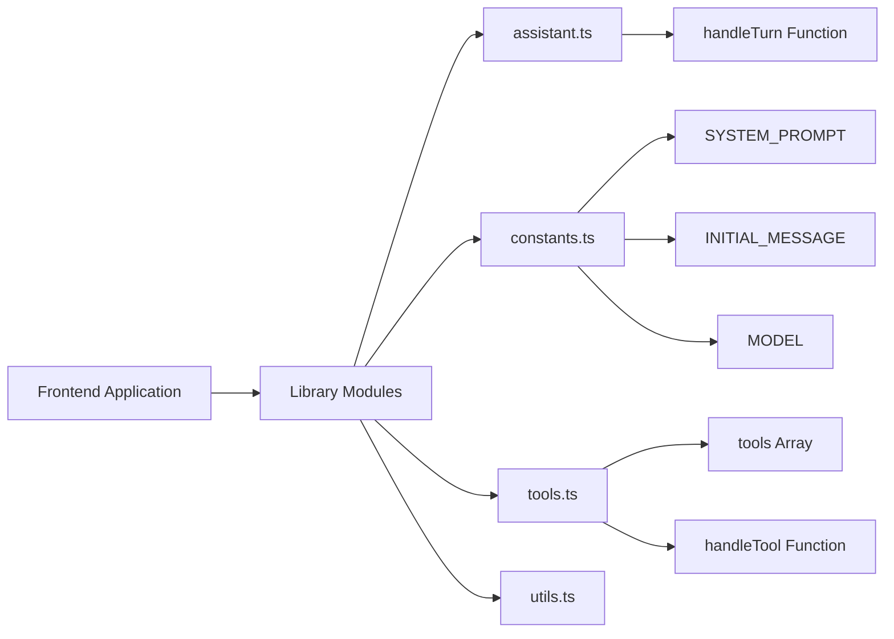

Sources: [README.md:72-89]()

## Data Flow

The following diagram illustrates the data flow when a user interacts with the application:

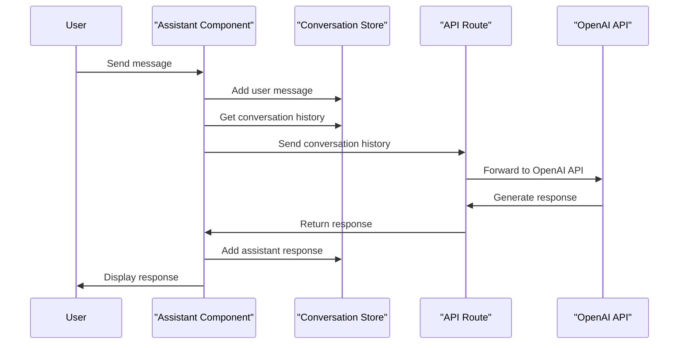

This sequence shows how user messages flow through the system:
1. User sends a message via the UI
2. The message is stored in the conversation store
3. The conversation history is sent to the API route
4. The API route forwards the request to OpenAI
5. OpenAI generates a response
6. The response is returned to the frontend
7. The response is displayed to the user

Sources: [README.md:78-89]()

## Key Features

The OpenAI Builder Lab solution provides several key features:

1. **Conversation Management**: Handles the flow of messages between the user and the assistant
2. **OpenAI Integration**: Pre-configured connection to OpenAI's API
3. **Tools System**: Framework for implementing assistant tools
4. **State Management**: Centralized store for conversation state
5. **Responsive UI**: Ready-to-use interface components

Sources: [README.md:70-96]()

## Extension Points

The solution is designed to be extended in several ways:

1. **UI Customization**: Modify or add components in `frontend/components`
2. **Business Logic**: Extend functionality in `frontend/lib`
3. **API Routes**: Add new routes in `frontend/app/api`
4. **Tools**: Implement new tools in `frontend/lib/tools.ts`
5. **Backend Logic**: Modify or extend the Python backend in `python-backend`

For more detailed information on extending the application, see [Extending the Application](#6).

Sources: [README.md:65-96]()

## Summary

The OpenAI Builder Lab solution provides a solid foundation for building AI-powered applications with OpenAI's APIs. It includes a NextJS frontend with pre-configured components, state management, and API integration, as well as an optional Python backend. This structure allows users to focus on implementing the specific functionality required for their Builder Lab challenges without having to set up the basic infrastructure.

Sources: [README.md:1-10]()

---

# Page: System Architecture

# System Architecture

<details>
<summary>Relevant source files</summary>

The following files were used as context for generating this wiki page:

- [README.md](README.md)
- [challenge1/frontend/app/api/get_response/route.ts](challenge1/frontend/app/api/get_response/route.ts)
- [challenge1/frontend/lib/assistant.ts](challenge1/frontend/lib/assistant.ts)

</details>


This document provides an overview of the high-level architecture of the OpenAI Builder Lab solution, explaining the core components and how they interact with each other. It covers both the frontend and backend components, their responsibilities, and the data flow between them.

For information on how to set up and run the project, see [Getting Started](#1.2).

## Overview

The OpenAI Builder Lab solution is a starter project designed to help users quickly build AI applications using OpenAI's APIs. The system consists of a NextJS frontend application with an optional Python backend.

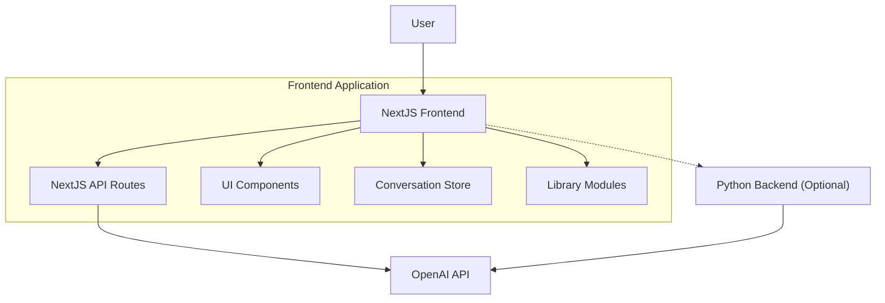

Sources: [README.md:1-99](), [challenge1/frontend/app/api/get_response/route.ts:1-25](), [challenge1/frontend/lib/assistant.ts:1-69]()

## Core Components

### Frontend Application

The frontend application is built with NextJS and contains the following key components:

1. **UI Components**: Located in the `frontend/components` directory, these handle the user interface rendering.
2. **Library Modules**: Located in the `frontend/lib` directory, these contain the core business logic.
3. **Conversation Store**: Located in `frontend/stores/useConversationStore.ts`, this manages the application state.
4. **API Routes**: Located in `frontend/app/api`, these handle communication with external services.

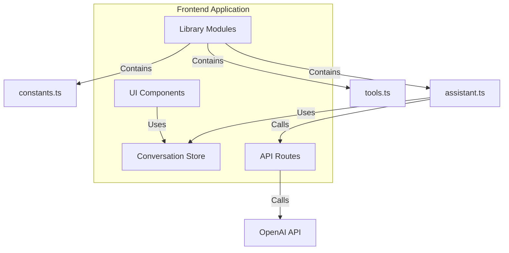

Sources: [README.md:70-90](), [challenge1/frontend/lib/assistant.ts:1-69]()

### Backend Options

The system offers two backend options:

1. **NextJS API Routes**: Built-in backend routes in the NextJS application.
2. **Python Backend**: An optional Python backend for users who prefer Python.

Both backends serve the same purpose: to communicate with external APIs, particularly OpenAI's API.

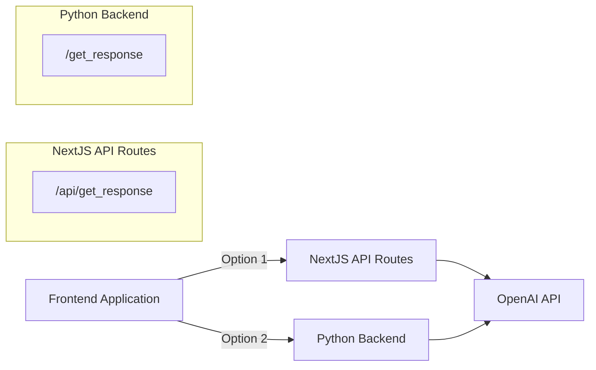

Sources: [README.md:91-98](), [challenge1/frontend/app/api/get_response/route.ts:1-25]()

## Data Flow

The following diagram illustrates the data flow when a user interacts with the application:

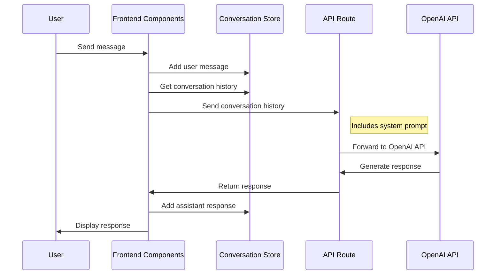

Sources: [challenge1/frontend/lib/assistant.ts:23-69](), [challenge1/frontend/app/api/get_response/route.ts:5-25]()

## Key Components in Detail

### Conversation Store

The conversation store manages two main state variables:

1. **chatMessages**: Used for UI rendering
2. **conversationItems**: Used for API communication

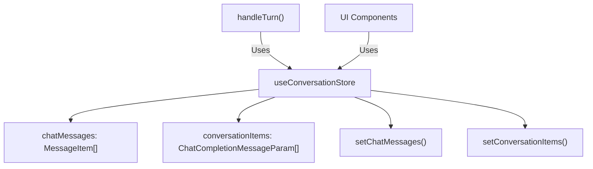

Sources: [challenge1/frontend/lib/assistant.ts:23-69](), [README.md:89]()

### Message Handling

The `handleTurn` function in `assistant.ts` is responsible for processing user messages and getting responses from the OpenAI API:

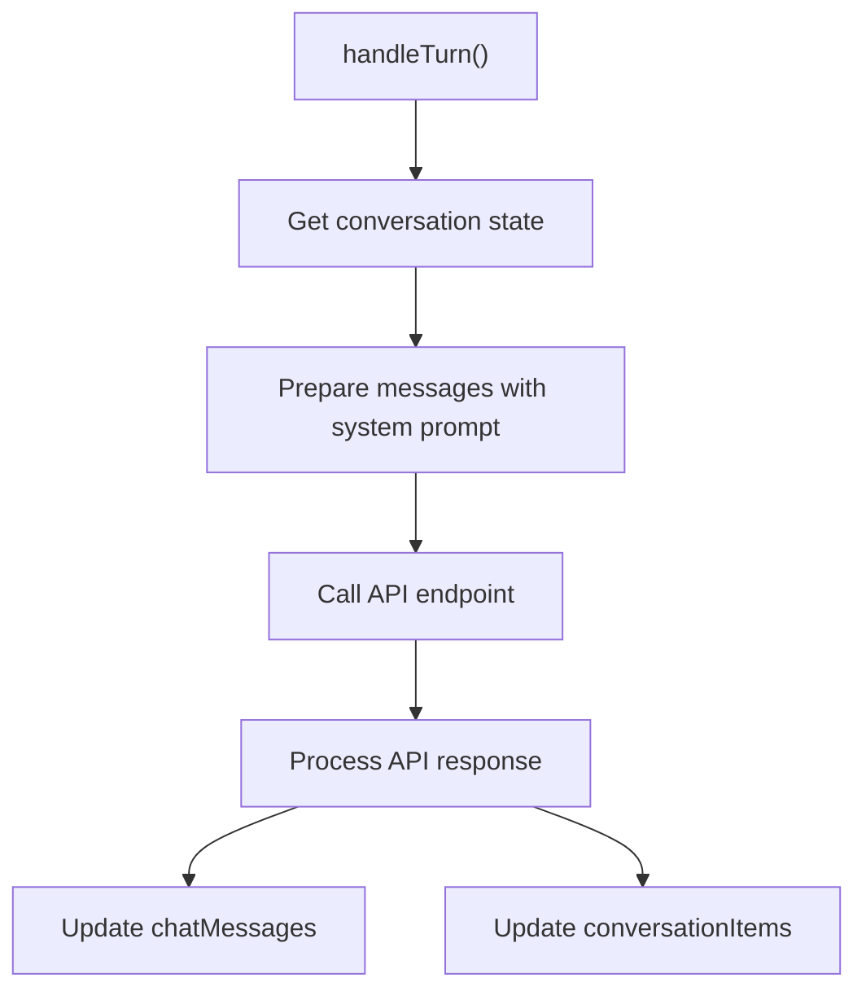

Sources: [challenge1/frontend/lib/assistant.ts:23-69]()

### API Route

The `/api/get_response` route handles communication with the OpenAI API:

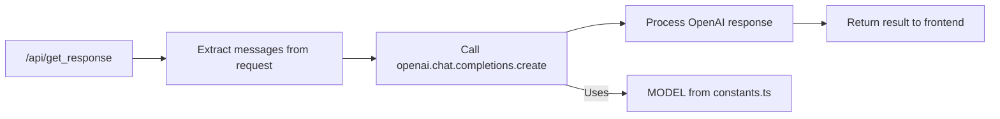

Sources: [challenge1/frontend/app/api/get_response/route.ts:1-25]()

## Message Types and Data Structures

The application uses the following main data structures:

| Type | Description | Used For |
|------|-------------|----------|
| `MessageItem` | Represents a chat message with role and content | UI rendering |
| `FunctionCallItem` | Represents a function call with status and arguments | Tool calls |
| `ChatCompletionMessageParam` | OpenAI API message format | API communication |

Sources: [challenge1/frontend/lib/assistant.ts:5-21]()

## Configuration

The system uses several configuration constants defined in `constants.ts`:

1. **SYSTEM_PROMPT**: The initial instructions for the AI assistant
2. **MODEL**: The OpenAI model to use for generating responses

These constants are used throughout the application to maintain consistent behavior.

Sources: [challenge1/frontend/lib/assistant.ts:2](), [challenge1/frontend/app/api/get_response/route.ts:1](), [README.md:85]()

## Summary

The OpenAI Builder Lab solution provides a well-structured architecture for building AI applications with OpenAI's APIs. The system separates concerns between UI components, business logic, and API communication, making it easy to extend and customize for specific use cases.

The NextJS frontend with an optional Python backend offers flexibility for developers with different preferences, while the conversation store provides a centralized state management solution for the application.

---

# Page: Getting Started

# Getting Started

<details>
<summary>Relevant source files</summary>

The following files were used as context for generating this wiki page:

- [README.md](README.md)
- [challenge1/frontend/next.config.mjs](challenge1/frontend/next.config.mjs)
- [challenge1/frontend/package.json](challenge1/frontend/package.json)

</details>


This document provides instructions for setting up and running the OpenAI Builder Lab solution. It covers environment configuration, dependencies, and how to start both the frontend and optional Python backend components.

For information about the overall system architecture, see [System Architecture](#1.1).

## Prerequisites

Before getting started, ensure you have the following installed:

- Node.js (version 18 or higher recommended)
- npm (comes with Node.js)
- Git
- Python 3.8+ (optional, only if using the Python backend)

## Project Setup

The project consists of two main components:
1. A NextJS frontend application
2. An optional Python backend

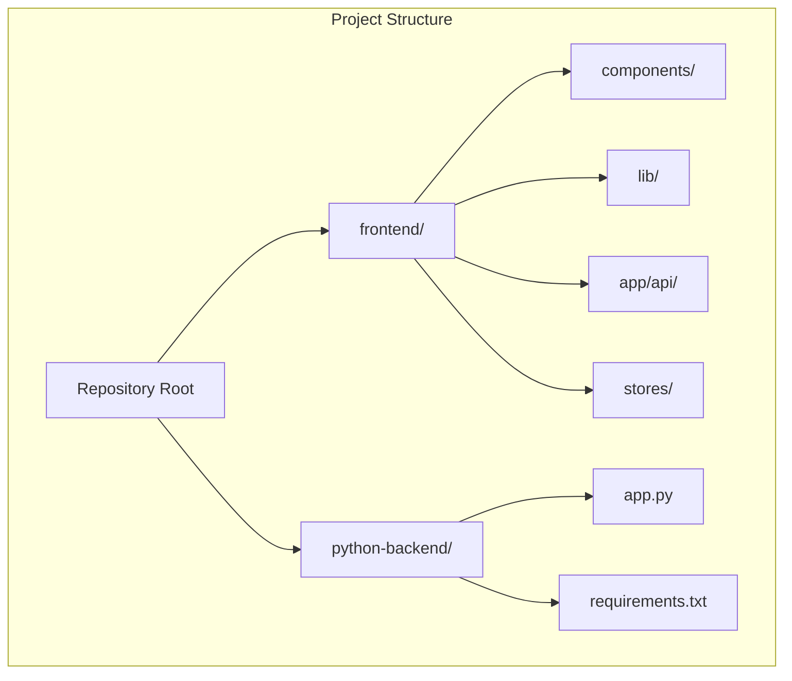

Sources: [README.md:1-99]()

## Installation Steps

### 1. Clone the Repository

First, clone the repository to your local machine:

```bash
git clone https://github.com/openai/openai-builder-lab.git
```

### 2. Set Up the Frontend

Navigate to the frontend directory:

```bash
cd starting_point/frontend
```

Install the required dependencies:

```bash
npm install
```

Sources: [README.md:10-37](), [challenge1/frontend/package.json:1-43]()

### 3. Configure OpenAI API Key

You need to set your OpenAI API key to use the application. You have two options:

1. Set the `OPENAI_API_KEY` environment variable globally in your system
2. Create a `.env` file in the root of the frontend directory with the following content:

```
OPENAI_API_KEY=<your_api_key>
```

Sources: [README.md:22-31]()

## Running the Application

### Starting the Frontend

To start the NextJS frontend application:

```bash
npm run dev
```

This will start the development server, typically on http://localhost:3000.

Sources: [README.md:39-43](), [challenge1/frontend/package.json:5-10]()

### Starting the Python Backend (Optional)

If you prefer to use the Python backend instead of the built-in NextJS API routes:

1. Navigate to the python-backend directory:
   ```bash
   cd ../python-backend
   ```

2. Install the Python dependencies:
   ```bash
   pip install -r requirements.txt
   ```

3. Start the Python backend:
   ```bash
   python app.py
   ```

Sources: [README.md:45-63]()

## Project Structure Overview

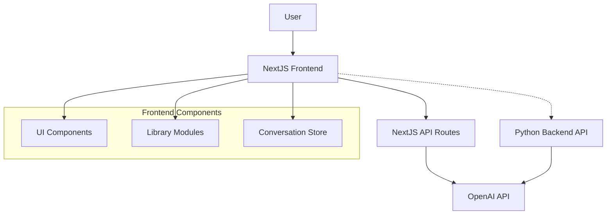

Sources: [README.md:70-89]()

### Key Components

| Component | Location | Purpose |
|-----------|----------|---------|
| UI Components | `frontend/components/` | User interface elements |
| Code Logic | `frontend/lib/` | Core application logic |
| Constants | `frontend/lib/constants.ts` | System prompts, initial messages, etc. |
| Tools | `frontend/lib/tools.ts` | Logic for assistant tools |
| Assistant | `frontend/lib/assistant.ts` | API communication logic |
| Conversation Store | `frontend/stores/useConversationStore.ts` | State management |
| API Routes | `frontend/app/api/` or `python-backend/app.py` | Backend endpoints |

Sources: [README.md:72-98]()

## Configuration Files

The project includes several configuration files that you may need to modify:

| File | Purpose |
|------|---------|
| `next.config.mjs` | NextJS configuration |
| `package.json` | Project dependencies and scripts |
| `.env` | Environment variables (you need to create this) |

Sources: [challenge1/frontend/next.config.mjs:1-5](), [challenge1/frontend/package.json:1-43]()

## Dependencies

The project uses several key dependencies:

- **NextJS**: React framework for the frontend
- **OpenAI**: SDK for communicating with OpenAI's API
- **Zustand**: State management library
- **Tailwind CSS**: Utility-first CSS framework
- **React Markdown**: For rendering markdown content

For a complete list of dependencies, refer to the `package.json` file.

Sources: [challenge1/frontend/package.json:11-31]()

## Development Workflow

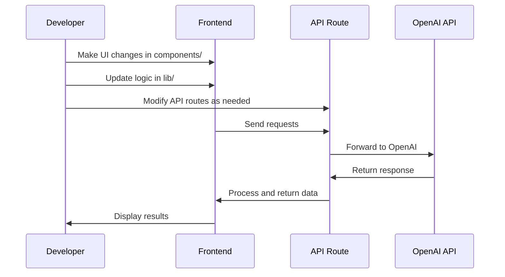

Sources: [README.md:65-68](), [README.md:72-98]()

## Next Steps

After setting up the project, you can start working on the Builder Lab challenges by:

1. Understanding the existing code structure
2. Making incremental changes to complete each challenge
3. Testing your implementation with the running application

For more information about the frontend application structure, see [Frontend Application](#2).

For details on the core functionality and how to extend it, see [Core Functionality](#3).

Sources: [README.md:65-68]()

---

# Page: Frontend Application

# Frontend Application

<details>
<summary>Relevant source files</summary>

The following files were used as context for generating this wiki page:

- [challenge1/frontend/app/layout.tsx](challenge1/frontend/app/layout.tsx)
- [challenge1/frontend/app/page.tsx](challenge1/frontend/app/page.tsx)
- [challenge1/frontend/components/assistant.tsx](challenge1/frontend/components/assistant.tsx)

</details>


This document provides an overview of the NextJS frontend application structure and main components in the OpenAI Builder Lab solution. It covers the application's architecture, component hierarchy, and how these components interact to create a conversational AI interface.

For detailed information about specific UI components, see [UI Components](#2.1). For state management details, see [State Management](#2.2).

## Application Structure

The frontend application is built using Next.js and follows a component-based architecture. The main entry point is the root layout, which sets up the application's base styling and structure, followed by the main page that renders the Assistant component.

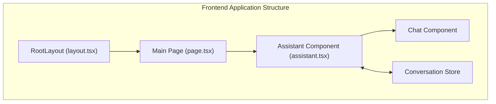

Sources: [challenge1/frontend/app/layout.tsx:24-38](), [challenge1/frontend/app/page.tsx:3-11](), [challenge1/frontend/components/assistant.tsx:8-50]()

## Component Hierarchy

The frontend application follows a clear component hierarchy where each component has a specific responsibility:

1. **RootLayout**: Sets up the application's base styling, fonts, and metadata
2. **Main Page**: Renders the Assistant component in a responsive container
3. **Assistant Component**: Manages the conversation flow and state
4. **Chat Component**: Displays the conversation and handles user input

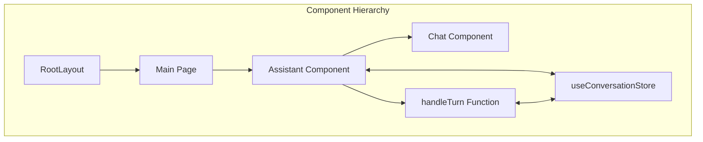

Sources: [challenge1/frontend/app/layout.tsx:24-38](), [challenge1/frontend/app/page.tsx:3-11](), [challenge1/frontend/components/assistant.tsx:8-50]()

## Key Components

### RootLayout

The `RootLayout` component in `layout.tsx` serves as the application's shell. It:
- Imports and configures custom fonts (Geist Sans and Geist Mono)
- Sets up metadata for the application (title, description, icons)
- Provides the base HTML structure with appropriate styling classes

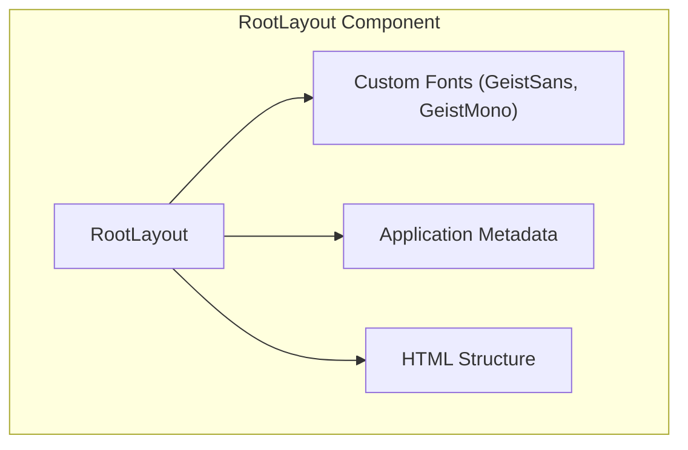

Sources: [challenge1/frontend/app/layout.tsx:1-38]()

### Main Page

The `Main` component in `page.tsx` is a simple component that:
- Creates a responsive container for the Assistant component
- Centers the Assistant component on the page
- Adjusts width based on screen size (full width on mobile, 2/3 width on medium screens and up)

Sources: [challenge1/frontend/app/page.tsx:3-11]()

### Assistant Component

The `Assistant` component in `assistant.tsx` is the core component that:
- Manages the conversation state using the `useConversationStore` hook
- Handles user message submission
- Processes the conversation turn using the `handleTurn` function
- Renders the `Chat` component with appropriate props

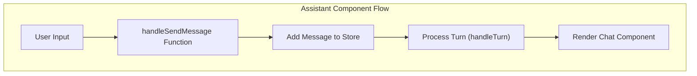

Sources: [challenge1/frontend/components/assistant.tsx:8-50]()

## Data Flow

The data flow in the frontend application follows a clear pattern:

1. User enters a message in the Chat component
2. The message is passed to the Assistant component's `handleSendMessage` function
3. The message is added to the conversation store
4. The `handleTurn` function is called to process the conversation
5. The response is added to the conversation store
6. The Chat component re-renders with the updated conversation

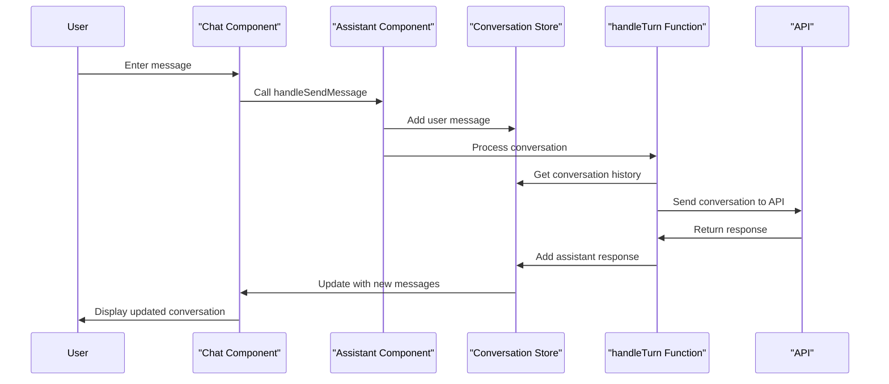

Sources: [challenge1/frontend/components/assistant.tsx:13-37]()

## State Management

The Assistant component uses the `useConversationStore` hook to manage the conversation state. This provides:

- `chatMessages`: Array of messages to display in the UI
- `addConversationItem`: Function to add a message to the conversation history
- `addChatMessage`: Function to add a message to the chat display

When a user sends a message, it's added to both the conversation history and the chat display, then the `handleTurn` function is called to process the conversation.

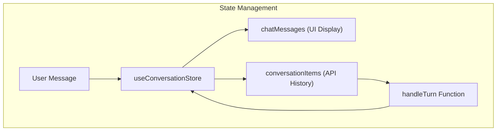

Sources: [challenge1/frontend/components/assistant.tsx:9-11](), [challenge1/frontend/components/assistant.tsx:13-37]()

## Technical Implementation

The Assistant component is implemented as a React functional component with hooks:

- Uses `useState` to track loading state during API calls
- Uses `useConversationStore` to access and update conversation state
- Implements `handleSendMessage` to process user input
- Renders the Chat component with appropriate props

When a user sends a message, the component:
1. Creates a user message object
2. Adds it to the conversation store
3. Calls `handleTurn` to process the conversation
4. Updates loading state accordingly
5. Handles any errors that occur during processing

Sources: [challenge1/frontend/components/assistant.tsx:8-50]()

## Integration with Other Components

The frontend application integrates several components to create a cohesive user experience:

| Component | Purpose | Integration Point |
|-----------|---------|-------------------|
| RootLayout | Application shell | Wraps the entire application |
| Main Page | Container for Assistant | Renders Assistant component |
| Assistant | Conversation management | Uses Conversation Store and Chat component |
| Chat | User interface | Receives props from Assistant |
| Conversation Store | State management | Used by Assistant to track conversation |
| handleTurn | Conversation processing | Called by Assistant to process turns |

Sources: [challenge1/frontend/app/layout.tsx:24-38](), [challenge1/frontend/app/page.tsx:3-11](), [challenge1/frontend/components/assistant.tsx:8-50]()

## Summary

The frontend application provides a clean, component-based architecture for a conversational AI interface. The main components work together to:

1. Render a responsive user interface
2. Manage conversation state
3. Process user input
4. Display assistant responses

This architecture provides a solid foundation for building AI-powered applications with OpenAI's APIs, making it an excellent starting point for Builder Lab challenges.

---

# Page: UI Components

# UI Components

<details>
<summary>Relevant source files</summary>

The following files were used as context for generating this wiki page:

- [challenge1/frontend/components/assistant.tsx](challenge1/frontend/components/assistant.tsx)
- [challenge1/frontend/components/chat.tsx](challenge1/frontend/components/chat.tsx)
- [challenge1/frontend/components/message.tsx](challenge1/frontend/components/message.tsx)
- [challenge1/frontend/components/tool-call.tsx](challenge1/frontend/components/tool-call.tsx)

</details>


This document details the UI components used in the OpenAI Builder Lab solution frontend. These components form the visual interface through which users interact with the assistant.

For information about state management, see [State Management](#2.2).

## Component Hierarchy

The UI components in this application follow a hierarchical structure, with parent components rendering child components and passing data between them.

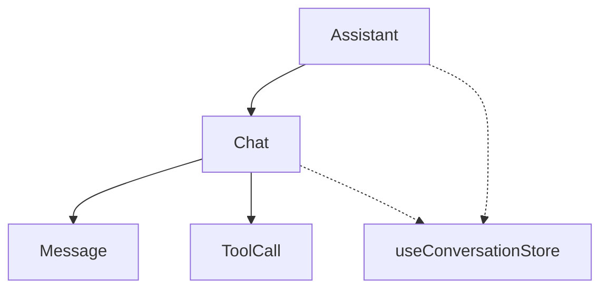

Sources: [frontend/components/assistant.tsx:1-50](), [frontend/components/chat.tsx:1-112](), [frontend/components/message.tsx:1-56](), [frontend/components/tool-call.tsx:1-100]()

## Assistant Component

The `Assistant` component serves as the main container for the chat interface. It manages the loading state and handles sending messages to the assistant.

### Key Responsibilities

- Manages loading state during API calls
- Handles user message submission
- Integrates with the conversation store
- Orchestrates the conversation flow using `handleTurn`

### Component Structure

```mermaid
graph TD
    A["Assistant Component"] --> B["Chat Component"]
    A --> C["useConversationStore"]
    A --> D["handleTurn function"]
    
    C --> E["chatMessages"]
    C --> F["addConversationItem"]
    C --> G["addChatMessage"]
    
    H["User Input"] --> A
    A --> I["OpenAI API"]
```

Sources: [frontend/components/assistant.tsx:1-50]()

### Implementation Details

The `Assistant` component is implemented as a React functional component that:

1. Uses the `useState` hook to track loading state
2. Accesses conversation state via `useConversationStore`
3. Defines a `handleSendMessage` function that:
   - Validates user input
   - Creates message objects
   - Updates the conversation store
   - Calls `handleTurn` to process the conversation
4. Renders the `Chat` component with appropriate props

Sources: [frontend/components/assistant.tsx:8-48]()

## Chat Component

The `Chat` component renders the conversation interface, including message history and the input field for new messages.

### Key Responsibilities

- Displays conversation history
- Provides user input interface
- Handles scrolling behavior
- Renders appropriate component for each message type

### Component Structure

```mermaid
graph TD
    A["Chat Component"] --> B["Message Component"]
    A["Chat Component"] --> C["ToolCall Component"]
    A --> D["Input Field"]
    A --> E["Send Button"]
    
    F["items prop"] --> A
    G["onSendMessage prop"] --> A
    H["loading prop"] --> A
    
    A --> I["scrollToBottom function"]
```

Sources: [frontend/components/chat.tsx:1-112]()

### Implementation Details

The `Chat` component:

1. Accepts `items`, `onSendMessage`, and `loading` props
2. Manages input state with `useState`
3. Implements auto-scrolling with `useRef` and `useEffect`
4. Maps over conversation items to render appropriate components
5. Provides a textarea for user input with keyboard shortcuts
6. Includes a send button with appropriate disabled state

Sources: [frontend/components/chat.tsx:15-109]()

## Message Component

The `Message` component renders individual chat messages with different styling based on the sender (user or assistant).

### Key Responsibilities

- Displays message content with appropriate styling
- Renders markdown content
- Shows loading indicator when appropriate
- Differentiates between user and assistant messages

### Component Structure

```mermaid
graph TD
    A["Message Component"] --> B["User Message"]
    A --> C["Assistant Message"]
    
    B --> D["ReactMarkdown"]
    C --> E["ReactMarkdown/Loading Indicator"]
    
    F["message prop"] --> A
    G["loading prop"] --> A
```

Sources: [frontend/components/message.tsx:1-56]()

### Implementation Details

The `Message` component:

1. Accepts `message` and optional `loading` props
2. Uses conditional rendering based on message role
3. Renders user messages with right alignment and white background
4. Renders assistant messages with left alignment and black background
5. Uses `ReactMarkdown` to render formatted message content
6. Shows animated dots loading indicator when in loading state

Sources: [frontend/components/message.tsx:11-52]()

## ToolCall Component

The `ToolCall` component displays function calls made by the assistant, including function name, arguments, and output.

### Key Responsibilities

- Displays function call information
- Provides expandable/collapsible details
- Shows function arguments and output with syntax highlighting
- Indicates relationships between sequential function calls

### Component Structure

```mermaid
graph TD
    A["ToolCall Component"] --> B["Header"]
    A --> C["Arguments Section"]
    A --> D["Output Section"]
    
    B --> E["Function Name"]
    B --> F["Toggle Button"]
    
    C --> G["SyntaxHighlighter"]
    D --> H["SyntaxHighlighter"]
    
    I["functionCall prop"] --> A
    J["previousItem prop"] --> A
    
    A --> K["showDetails state"]
```

Sources: [frontend/components/tool-call.tsx:1-100]()

### Implementation Details

The `ToolCall` component:

1. Accepts `functionCall` and `previousItem` props
2. Manages expandable details with `useState`
3. Formats function name for display
4. Shows a visual connector line between sequential function calls
5. Uses `SyntaxHighlighter` to display JSON arguments and output
6. Implements toggle functionality for showing/hiding details

Sources: [frontend/components/tool-call.tsx:13-97]()

## Component Data Flow

The following diagram illustrates how data flows through the UI components:

```mermaid
sequenceDiagram
    participant User
    participant Assistant as Assistant Component
    participant Chat as Chat Component
    participant Message as Message Component
    participant ToolCall as ToolCall Component
    participant Store as Conversation Store
    
    User->>Chat: Enter message
    Chat->>Assistant: Call onSendMessage
    Assistant->>Store: Add user message
    Assistant->>Store: Get conversation history
    Assistant->>Assistant: Call handleTurn
    Assistant->>Store: Add assistant response
    Store->>Assistant: Update chatMessages
    Assistant->>Chat: Pass updated items
    Chat->>Message: Render user message
    Chat->>Message: Render assistant message
    Chat->>ToolCall: Render function calls
```

Sources: [frontend/components/assistant.tsx:13-37](), [frontend/components/chat.tsx:15-109](), [frontend/components/message.tsx:11-52](), [frontend/components/tool-call.tsx:13-97]()

## Component Props Interface

The following table summarizes the props interfaces for each component:

| Component | Props Interface | Description |
|-----------|----------------|-------------|
| Assistant | None (no props) | Main container component |
| Chat | `items: Item[]` | Array of conversation items to display |
|      | `onSendMessage: (message: string) => void` | Callback for sending messages |
|      | `loading: boolean` | Loading state indicator |
| Message | `message: MessageItem` | Message data to display |
|         | `loading?: boolean` | Optional loading state indicator |
| ToolCall | `functionCall: FunctionCallItem` | Function call data to display |
|          | `previousItem: Item` | Previous conversation item for context |

Sources: [frontend/components/assistant.tsx:8](), [frontend/components/chat.tsx:9-13](), [frontend/components/message.tsx:6-9](), [frontend/components/tool-call.tsx:8-11]()

## Styling Approach

The UI components use a combination of Tailwind CSS classes and custom CSS for styling:

1. **Layout and Positioning**: Tailwind classes for flex layouts, padding, margins, etc.
2. **Colors and Theming**: Tailwind classes for background colors, text colors
3. **Component-specific Styles**: Custom CSS in `message.css` for specialized styling
4. **Responsive Design**: Tailwind responsive classes (e.g., `md:ml-24`)

The styling creates a clear visual distinction between user messages (right-aligned, white background) and assistant messages (left-aligned, black background with white text).

Sources: [frontend/components/message.tsx:1-56](), [frontend/components/message.css](), [frontend/components/chat.tsx:1-112](), [frontend/components/tool-call.tsx:1-100]()

## Loading States

The UI components handle loading states to provide visual feedback during API calls:

1. The `Assistant` component tracks loading state with `useState`
2. The loading state is passed to the `Chat` component
3. The `Chat` component conditionally renders a loading indicator
4. The `Message` component displays animated dots when in loading state

This creates a seamless user experience by providing immediate feedback when messages are being processed.

Sources: [frontend/components/assistant.tsx:9-11](), [frontend/components/chat.tsx:44-49](), [frontend/components/message.tsx:37-42]()

## Component Relationships to State Management

The UI components interact with the application state through the conversation store:

```mermaid
graph TD
    A["Assistant Component"] --> B["useConversationStore"]
    B --> C["chatMessages"]
    B --> D["addConversationItem"]
    B --> E["addChatMessage"]
    
    A --> F["handleTurn"]
    F --> B
    
    G["Chat Component"] --> H["items prop"]
    C --> H
```

For more details on state management, see [State Management](#2.2).

Sources: [frontend/components/assistant.tsx:4-11](), [frontend/components/chat.tsx:10-11]()

---

# Page: State Management

# State Management

<details>
<summary>Relevant source files</summary>

The following files were used as context for generating this wiki page:

- [challenge1/frontend/lib/assistant.ts](challenge1/frontend/lib/assistant.ts)
- [challenge1/frontend/stores/useConversationStore.ts](challenge1/frontend/stores/useConversationStore.ts)

</details>


This document explains how state is managed in the OpenAI Builder Lab solution, focusing on the conversation store implementation. The state management system is responsible for maintaining the conversation history between the user and the assistant.

For information about UI components that use this state, see [UI Components](#2.1). For details on the conversation flow that manipulates this state, see [Conversation Flow](#3.1).

## Overview

The application uses Zustand, a lightweight state management library, to maintain two primary state collections:

1. `chatMessages`: Items displayed in the UI chat interface
2. `conversationItems`: Messages sent to the OpenAI Chat Completions API

```mermaid
graph TD
    subgraph "useConversationStore"
        chatMessages["chatMessages: Item[]"]
        conversationItems["conversationItems: ChatCompletionMessageParam[]"]
        
        addChatMessage["addChatMessage()"]
        addConversationItem["addConversationItem()"]
        setChatMessages["setChatMessages()"]
        setConversationItems["setConversationItems()"]
    end
    
    UI["UI Components"] --> chatMessages
    API["API Communication"] --> conversationItems
    
    addChatMessage --> chatMessages
    addConversationItem --> conversationItems
    setChatMessages --> chatMessages
    setConversationItems --> conversationItems
```

Sources: [challenge1/frontend/stores/useConversationStore.ts:1-35]()

## Store Implementation

The conversation store is implemented using Zustand in `useConversationStore.ts`. It defines a `ConversationState` interface and creates a store with initial values and state manipulation functions.

### State Structure

The store maintains two main state arrays:

```mermaid
classDiagram
    class ConversationState {
        chatMessages: Item[]
        conversationItems: ChatCompletionMessageParam[]
        setChatMessages(items: Item[])
        setConversationItems(messages: ChatCompletionMessageParam[])
        addChatMessage(item: Item)
        addConversationItem(message: ChatCompletionMessageParam)
    }
    
    class Item {
        <<interface>>
    }
    
    class MessageItem {
        type: "message"
        role: "user" | "assistant" | "system"
        content: string
    }
    
    class FunctionCallItem {
        type: "function_call"
        status: "in_progress" | "completed" | "failed"
        id: string
        name: string
        arguments: string
        parsedArguments: any
        output: string | null
    }
    
    class ChatCompletionMessageParam {
        <<OpenAI API Type>>
    }
    
    Item <|-- MessageItem
    Item <|-- FunctionCallItem
    ConversationState --> Item : contains
    ConversationState --> ChatCompletionMessageParam : contains
```

Sources: [challenge1/frontend/stores/useConversationStore.ts:6-16](), [challenge1/frontend/lib/assistant.ts:5-21]()

### Store Creation

The store is created with initial values and functions to manipulate the state:

| Function | Purpose |
|----------|---------|
| `setChatMessages` | Replace the entire `chatMessages` array |
| `setConversationItems` | Replace the entire `conversationItems` array |
| `addChatMessage` | Add a single item to the `chatMessages` array |
| `addConversationItem` | Add a single message to the `conversationItems` array |

The store is initialized with an assistant welcome message from the `INITIAL_MESSAGE` constant.

Sources: [challenge1/frontend/stores/useConversationStore.ts:18-33]()

## State Usage

The conversation store is used throughout the application to maintain and update the conversation state.

### Accessing State

Components and functions access the store using the `useConversationStore` hook or by directly accessing the store's state:

```mermaid
flowchart TD
    subgraph "Component Usage"
        Component["React Component"] --> useStore["useConversationStore()"]
        useStore --> State["Access state & functions"]
    end
    
    subgraph "Function Usage"
        Function["handleTurn()"] --> getState["useConversationStore.getState()"]
        getState --> DirectAccess["Direct state access"]
    end
```

Sources: [challenge1/frontend/lib/assistant.ts:23-29]()

### State Manipulation in handleTurn

The `handleTurn` function in `assistant.ts` demonstrates how the conversation store is used to manage the conversation flow:

1. It retrieves the current state using `useConversationStore.getState()`
2. It combines the system prompt with conversation items for the API request
3. After receiving a response, it updates both state arrays:
   - Adds the response to `chatMessages` for UI display
   - Adds the response to `conversationItems` for future API requests

```mermaid
sequenceDiagram
    participant handleTurn as "handleTurn()"
    participant Store as "useConversationStore"
    participant API as "OpenAI API"
    
    handleTurn->>Store: getState()
    Store-->>handleTurn: {chatMessages, conversationItems, set functions}
    
    handleTurn->>handleTurn: Prepare API request with conversationItems
    handleTurn->>API: POST /api/get_response
    API-->>handleTurn: Response data
    
    handleTurn->>Store: Update chatMessages
    handleTurn->>Store: Update conversationItems
```

Sources: [challenge1/frontend/lib/assistant.ts:23-69]()

## Dual State Model

The application uses a dual state model to separate UI concerns from API communication:

### chatMessages (UI State)

- Contains `Item` objects which can be either `MessageItem` or `FunctionCallItem`
- Designed for rendering in the UI with different visual representations
- Includes UI-specific properties like function call status

### conversationItems (API State)

- Contains `ChatCompletionMessageParam` objects compatible with OpenAI's API
- Structured specifically for API communication
- Follows OpenAI's message format requirements

```mermaid
graph TD
    subgraph "State Flow"
        UserInput["User Input"] --> AddChatMessage["Add to chatMessages"]
        UserInput --> AddConversationItem["Add to conversationItems"]
        
        AddConversationItem --> APIRequest["API Request"]
        APIRequest --> APIResponse["API Response"]
        
        APIResponse --> UpdateChatMessages["Update chatMessages"]
        APIResponse --> UpdateConversationItems["Update conversationItems"]
        
        UpdateChatMessages --> UIRender["UI Rendering"]
    end
```

Sources: [challenge1/frontend/stores/useConversationStore.ts:7-10](), [challenge1/frontend/lib/assistant.ts:59-65]()

## Benefits of the Approach

The state management approach in this application offers several benefits:

1. **Separation of concerns**: UI state is kept separate from API communication state
2. **Type safety**: Each state collection has specific TypeScript interfaces
3. **Centralized state**: All components access the same state source
4. **Minimal re-renders**: Zustand optimizes component re-renders
5. **Simple API**: The store provides straightforward functions for state manipulation

## Summary

The state management system in the OpenAI Builder Lab solution uses Zustand to maintain two separate state collections: `chatMessages` for UI rendering and `conversationItems` for API communication. This dual-state approach allows the application to efficiently handle both UI concerns and API requirements while maintaining a clean separation of concerns.

The store provides functions to manipulate these state collections, and components can access the state either through the `useConversationStore` hook or by directly accessing the store's state using `getState()`. This approach ensures that all components have access to the same state source, promoting consistency throughout the application.

Sources: [challenge1/frontend/stores/useConversationStore.ts:1-35](), [challenge1/frontend/lib/assistant.ts:23-69]()

---

# Page: Styling and Theming

# Styling and Theming

<details>
<summary>Relevant source files</summary>

The following files were used as context for generating this wiki page:

- [challenge1/frontend/app/globals.css](challenge1/frontend/app/globals.css)
- [challenge1/frontend/components.json](challenge1/frontend/components.json)
- [challenge1/frontend/tailwind.config.ts](challenge1/frontend/tailwind.config.ts)

</details>


This document explains the styling and theming approach used in the OpenAI Builder Lab solution. It covers the implementation of Tailwind CSS, CSS variables, and theming capabilities that enable both light and dark mode support in the application.

## Overview

The styling system in this application is built on three main components:

1. Tailwind CSS for utility-based styling
2. CSS variables for theming
3. Dark mode support via CSS classes

```mermaid
graph TD
    subgraph "Styling Architecture"
        globals["globals.css"]
        tailwind["tailwind.config.ts"]
        components["components.json"]
        
        globals -->|"Defines CSS variables"| cssVars["CSS Variables"]
        globals -->|"Imports"| tailwindBase["Tailwind Base"]
        globals -->|"Defines"| utilityClasses["Utility Classes"]
        
        tailwind -->|"Extends"| themeColors["Theme Colors"]
        tailwind -->|"Configures"| darkMode["Dark Mode"]
        tailwind -->|"Defines"| contentPaths["Content Paths"]
        
        components -->|"Configures"| tailwindSettings["Tailwind Settings"]
        components -->|"Defines"| aliases["Component Aliases"]
        
        cssVars -->|"Used by"| themeColors
    end
```

Sources: [challenge1/frontend/app/globals.css](), [challenge1/frontend/tailwind.config.ts](), [challenge1/frontend/components.json]()

## CSS Variables System

The application uses CSS variables (custom properties) to define theme colors and other design tokens. These variables are defined in the `globals.css` file and are organized into two main themes: light (default) and dark.

```mermaid
graph TD
    subgraph "CSS Variables System"
        root["root CSS Variables"]
        darkClass["dark Class Variables"]
        
        root -->|"Default theme"| lightTheme["Light Theme Colors"]
        darkClass -->|"Dark theme"| darkTheme["Dark Theme Colors"]
        
        lightTheme --> background["--background: 0 0% 100%"]
        lightTheme --> foreground["--foreground: 20 14.3% 4.1%"]
        lightTheme --> primary["--primary: 24 9.8% 10%"]
        lightTheme --> otherLight["Other light theme variables"]
        
        darkTheme --> darkBackground["--background: 20 14.3% 4.1%"]
        darkTheme --> darkForeground["--foreground: 60 9.1% 97.8%"]
        darkTheme --> darkPrimary["--primary: 60 9.1% 97.8%"]
        darkTheme --> otherDark["Other dark theme variables"]
    end
```

Sources: [challenge1/frontend/app/globals.css:33-87]()

The CSS variables are defined using HSL (Hue, Saturation, Lightness) color format, which makes it easier to create consistent color palettes. For example:

- Light mode background: `--background: 0 0% 100%` (white)
- Dark mode background: `--background: 20 14.3% 4.1%` (near black)

These variables are then used throughout the application to ensure consistent theming.

## Tailwind Configuration

The Tailwind configuration extends the default theme with custom colors based on the CSS variables defined in `globals.css`.

```mermaid
graph TD
    subgraph "Tailwind Configuration"
        config["tailwind.config.ts"]
        
        config -->|"Configures"| darkMode["darkMode: ['class']"]
        config -->|"Defines"| content["Content Paths"]
        config -->|"Extends"| theme["Theme"]
        
        theme -->|"Extends"| colors["Colors"]
        theme -->|"Extends"| borderRadius["Border Radius"]
        
        colors -->|"Maps to"| cssVars["CSS Variables"]
        
        cssVars --> background["background: hsl(var(--background))"]
        cssVars --> foreground["foreground: hsl(var(--foreground))"]
        cssVars --> primary["primary: hsl(var(--primary))"]
        cssVars --> otherColors["Other color variables"]
        
        borderRadius -->|"Uses"| radiusVars["--radius variables"]
    end
```

Sources: [challenge1/frontend/tailwind.config.ts:1-77]()

The Tailwind configuration file (`tailwind.config.ts`) does several important things:

1. Sets up dark mode to use the class strategy (`darkMode: ['class']`)
2. Defines content paths for where Tailwind should look for class usage
3. Extends the theme with custom colors that map to CSS variables
4. Adds custom border radius values based on CSS variables

## Components Configuration

The `components.json` file configures the UI component system and Tailwind CSS integration:

```mermaid
graph TD
    subgraph "Components Configuration"
        componentsJson["components.json"]
        
        componentsJson -->|"Defines"| style["style: 'new-york'"]
        componentsJson -->|"Enables"| rsc["rsc: true"]
        componentsJson -->|"Uses"| tsx["tsx: true"]
        
        componentsJson -->|"Configures"| tailwind["tailwind"]
        componentsJson -->|"Defines"| aliases["aliases"]
        
        tailwind -->|"Points to"| config["config: 'tailwind.config.ts'"]
        tailwind -->|"Points to"| css["css: 'app/globals.css'"]
        tailwind -->|"Sets"| baseColor["baseColor: 'stone'"]
        tailwind -->|"Enables"| cssVariables["cssVariables: true"]
        
        aliases -->|"Maps"| components["components: '@/components'"]
        aliases -->|"Maps"| utils["utils: '@/lib/utils'"]
        aliases -->|"Maps"| otherAliases["Other path aliases"]
    end
```

Sources: [challenge1/frontend/components.json:1-20]()

The `components.json` file is used to configure the UI component system (likely using shadcn/ui based on the schema reference) and includes:

1. Style configuration (`new-york` style)
2. React Server Components support (`rsc: true`)
3. TypeScript JSX support (`tsx: true`)
4. Tailwind configuration including:
   - Path to the Tailwind config file
   - Path to the CSS file
   - Base color for the theme (`stone`)
   - CSS variables support
5. Path aliases for imports

## Dark Mode Implementation

The application supports dark mode through a combination of CSS variables and Tailwind's dark mode class strategy.

```mermaid
graph TD
    subgraph "Dark Mode Implementation"
        darkMode["Dark Mode System"]
        
        darkMode -->|"Configured in"| tailwindConfig["tailwind.config.ts"]
        darkMode -->|"Variables defined in"| globals["globals.css"]
        
        tailwindConfig -->|"Sets"| classStrategy["darkMode: ['class']"]
        
        globals -->|"Defines"| darkClass[".dark { ... }"]
        globals -->|"Also supports"| mediaQuery["@media (prefers-color-scheme: dark)"]
        
        darkClass -->|"Contains"| darkVars["Dark theme CSS variables"]
        mediaQuery -->|"Contains"| autoVars["Auto dark mode variables"]
        
        darkVars -->|"Used by"| components["UI Components"]
        autoVars -->|"Used for"| autoTheme["System preference detection"]
    end
```

Sources: [challenge1/frontend/app/globals.css:10-15](), [challenge1/frontend/app/globals.css:61-86](), [challenge1/frontend/tailwind.config.ts:4]()

The dark mode implementation has two parts:

1. **System preference detection**: Using the `@media (prefers-color-scheme: dark)` query to automatically apply dark mode based on system preferences
2. **Class-based toggle**: Using the `.dark` class to manually toggle dark mode

This dual approach allows for both automatic theme switching based on user preferences and manual control through a theme toggle.

## Usage in Components

The styling system is used in components through Tailwind utility classes and direct references to CSS variables.

```mermaid
graph TD
    subgraph "Component Styling Usage"
        component["UI Component"]
        
        component -->|"Uses"| tailwindClasses["Tailwind Utility Classes"]
        component -->|"Uses"| cssVars["CSS Variables"]
        
        tailwindClasses -->|"Examples"| bgClass["bg-background"]
        tailwindClasses -->|"Examples"| textClass["text-foreground"]
        tailwindClasses -->|"Examples"| primaryClass["text-primary"]
        
        cssVars -->|"Examples"| varUsage["var(--foreground)"]
        
        bgClass -->|"Compiles to"| bgCompiled["background-color: hsl(var(--background))"]
        textClass -->|"Compiles to"| textCompiled["color: hsl(var(--foreground))"]
    end
```

Sources: [challenge1/frontend/app/globals.css:17-21](), [challenge1/frontend/app/globals.css:93-95]()

In the application, components can use the styling system in two ways:

1. **Tailwind utility classes**: Using classes like `bg-background`, `text-foreground`, etc.
2. **Direct CSS variable references**: Using `var(--variable-name)` in CSS

For example, the body element uses both approaches:

```css
body {
  color: var(--foreground);
  background: var(--background);
  font-family: var(--font-geist-sans);
}
```

And with Tailwind:

```css
body {
  @apply bg-background text-foreground;
}
```

## Color Palette Structure

The application defines a comprehensive color palette with semantic color variables:

| Variable | Purpose | Light Mode | Dark Mode |
|----------|---------|------------|-----------|
| `--background` | Page background | `0 0% 100%` | `20 14.3% 4.1%` |
| `--foreground` | Text color | `20 14.3% 4.1%` | `60 9.1% 97.8%` |
| `--primary` | Primary UI elements | `24 9.8% 10%` | `60 9.1% 97.8%` |
| `--secondary` | Secondary UI elements | `60 4.8% 95.9%` | `12 6.5% 15.1%` |
| `--muted` | Muted/subtle elements | `60 4.8% 95.9%` | `12 6.5% 15.1%` |
| `--accent` | Accent elements | `60 4.8% 95.9%` | `12 6.5% 15.1%` |
| `--destructive` | Error/warning elements | `0 84.2% 60.2%` | `0 62.8% 30.6%` |
| `--border` | Border colors | `20 5.9% 90%` | `12 6.5% 15.1%` |
| `--chart-1` to `--chart-5` | Chart colors | Various | Various |

Sources: [challenge1/frontend/app/globals.css:34-60](), [challenge1/frontend/app/globals.css:61-86]()

## Integration with Tailwind

The Tailwind configuration maps CSS variables to Tailwind color utilities, making them available throughout the application:

```mermaid
graph TD
    subgraph "Tailwind Integration"
        cssVars["CSS Variables in globals.css"]
        tailwindConfig["tailwind.config.ts"]
        component["UI Component"]
        
        cssVars -->|"Defined as"| hslValues["HSL Values"]
        tailwindConfig -->|"Maps"| colorSystem["Color System"]
        
        hslValues -->|"Referenced by"| colorSystem
        colorSystem -->|"Creates"| utilities["Tailwind Utilities"]
        
        utilities -->|"Used in"| component
        
        component -->|"Uses classes like"| bgClass["bg-primary"]
        component -->|"Uses classes like"| textClass["text-muted-foreground"]
        
        bgClass -->|"Resolves to"| bgValue["background-color: hsl(var(--primary))"]
        textClass -->|"Resolves to"| textValue["color: hsl(var(--muted-foreground))"]
    end
```

Sources: [challenge1/frontend/tailwind.config.ts:12-54]()

The integration between CSS variables and Tailwind is handled in the `tailwind.config.ts` file, which extends the theme with custom colors that reference the CSS variables:

```typescript
colors: {
  background: 'hsl(var(--background))',
  foreground: 'hsl(var(--foreground))',
  primary: {
    DEFAULT: 'hsl(var(--primary))',
    foreground: 'hsl(var(--primary-foreground))'
  },
  // ... other colors
}
```

This mapping allows developers to use semantic color names in Tailwind classes (e.g., `bg-primary`, `text-foreground`) that automatically adapt to the current theme.

## Summary

The styling and theming system in the OpenAI Builder Lab solution provides a flexible and consistent approach to styling the application. Key features include:

1. CSS variables for defining theme colors and design tokens
2. Tailwind CSS for utility-based styling
3. Dark mode support through both system preferences and manual toggling
4. A semantic color system that adapts to the current theme
5. Integration between CSS variables and Tailwind utilities

This approach makes it easy to maintain a consistent design language throughout the application while supporting different themes and user preferences.

---

# Page: Core Functionality

# Core Functionality

<details>
<summary>Relevant source files</summary>

The following files were used as context for generating this wiki page:

- [challenge1/frontend/lib/assistant.ts](challenge1/frontend/lib/assistant.ts)
- [challenge1/frontend/lib/constants.ts](challenge1/frontend/lib/constants.ts)

</details>


This document explains the core functionality of the OpenAI Builder Lab solution, focusing on how the application handles conversations with the OpenAI API. It covers the main components that enable the chat functionality, including message handling, API integration, and the overall conversation flow.

For information about UI components, see [UI Components](#2.1). For details on state management, see [State Management](#2.2).

## Overview of Core Functionality

The core functionality of the application revolves around facilitating conversations between users and an AI assistant powered by OpenAI's models. The system handles user messages, sends them to the OpenAI API, and processes the responses to display them in the chat interface.

```mermaid
flowchart TD
    User["User"] --> |"Sends message"| Frontend["Frontend Application"]
    Frontend --> |"Stores message"| ConversationStore["Conversation Store"]
    Frontend --> |"Calls"| HandleTurn["handleTurn()"]
    HandleTurn --> |"Gets conversation history"| ConversationStore
    HandleTurn --> |"Sends request"| APIRoute["/api/get_response"]
    APIRoute --> |"Forwards request"| OpenAI["OpenAI API"]
    OpenAI --> |"Returns response"| APIRoute
    APIRoute --> |"Returns response"| HandleTurn
    HandleTurn --> |"Updates"| ConversationStore
    ConversationStore --> |"Updates UI"| Frontend
    Frontend --> |"Displays response"| User
```

Sources: [frontend/lib/assistant.ts:23-69]()

## Message Structure

The application uses two main types of message structures:

1. `MessageItem`: Represents standard chat messages from users, the assistant, or system
2. `FunctionCallItem`: Represents function/tool calls made by the assistant

```mermaid
classDiagram
    class Item {
        <<interface>>
    }
    
    class MessageItem {
        type: "message"
        role: "user" | "assistant" | "system"
        content: string
    }
    
    class FunctionCallItem {
        type: "function_call"
        status: "in_progress" | "completed" | "failed"
        id: string
        name: string
        arguments: string
        parsedArguments: any
        output: string | null
    }
    
    Item <|-- MessageItem
    Item <|-- FunctionCallItem
```

Sources: [frontend/lib/assistant.ts:5-21]()

## Conversation Handling

The core of the conversation handling is implemented in the `handleTurn` function, which orchestrates the flow of messages between the frontend and the OpenAI API.

### The `handleTurn` Function

The `handleTurn` function is responsible for:

1. Retrieving the current conversation state
2. Preparing the messages to send to the API
3. Making the API request
4. Processing the response
5. Updating the conversation state

```mermaid
sequenceDiagram
    participant App as Application
    participant Store as Conversation Store
    participant HandleTurn as handleTurn()
    participant API as API Route
    participant OpenAI as OpenAI API
    
    App->>HandleTurn: Call handleTurn()
    HandleTurn->>Store: Get conversation state
    HandleTurn->>HandleTurn: Prepare messages with system prompt
    HandleTurn->>API: POST request with messages
    API->>OpenAI: Forward request
    OpenAI->>API: Return response
    API->>HandleTurn: Return response data
    HandleTurn->>Store: Update chatMessages
    HandleTurn->>Store: Update conversationItems
    HandleTurn->>App: Return control
```

Sources: [frontend/lib/assistant.ts:23-69]()

### Message Preparation

Before sending messages to the OpenAI API, the application prepares the conversation by:

1. Adding the system prompt as the first message
2. Including all previous conversation items

```javascript
const allConversationItems: ChatCompletionMessageParam[] = [
  {
    role: 'system',
    content: SYSTEM_PROMPT
  },
  ...conversationItems
]
```

Sources: [frontend/lib/assistant.ts:31-37]()

## System Configuration

The application uses several constants to configure the behavior of the AI assistant:

| Constant | Purpose | Value |
|----------|---------|-------|
| `MODEL` | The OpenAI model to use | `gpt-4o` |
| `SYSTEM_PROMPT` | Instructions for the AI assistant | Defines the assistant as "Wanderlust Concierge" |
| `INITIAL_MESSAGE` | First message shown to the user | Greeting message |

Sources: [frontend/lib/constants.ts:1-13]()

### System Prompt

The system prompt defines the personality and capabilities of the assistant. In this case, it's configured as a travel assistant:

```
You are the Wanderlust Concierge, an AI travel assistant helping users plan their trips.
When users ask for your help, prompt them to understand where they would like to travel and for how long.
You can also make suggestions for destinations, activities, and accommodations.
Make relevant suggestions based on the user's preferences.
```

Sources: [frontend/lib/constants.ts:4-9]()

## API Integration

The application communicates with the OpenAI API through a dedicated API route. The `handleTurn` function makes a POST request to this route with the conversation history.

```mermaid
flowchart LR
    HandleTurn["handleTurn()"] --> |"POST request"| APIRoute["/api/get_response"]
    APIRoute --> |"Request with messages"| OpenAI["OpenAI API"]
    OpenAI --> |"Response"| APIRoute
    APIRoute --> |"JSON response"| HandleTurn
    
    subgraph "Request Body"
        Messages["messages: ChatCompletionMessageParam[]"]
    end
    
    HandleTurn --> Messages
```

Sources: [frontend/lib/assistant.ts:40-48]()

### API Request Format

The request to the API route is formatted as a JSON object containing the messages array:

```javascript
{
  method: 'POST',
  headers: {
    'Content-Type': 'application/json'
  },
  body: JSON.stringify({ messages: allConversationItems })
}
```

Sources: [frontend/lib/assistant.ts:42-48]()

## State Updates

After receiving a response from the API, the `handleTurn` function updates two state variables:

1. `chatMessages`: Used for displaying messages in the UI
2. `conversationItems`: Used for maintaining the conversation context for the API

```javascript
// Update chat messages
chatMessages.push(data)
setChatMessages([...chatMessages])

// Update conversation items
conversationItems.push(data)
setConversationItems([...conversationItems])
```

Sources: [frontend/lib/assistant.ts:59-65]()

## Error Handling

The application includes basic error handling for API requests:

1. Checks if the response is successful (`response.ok`)
2. Logs errors to the console
3. Uses a try-catch block to handle exceptions during the process

```mermaid
flowchart TD
    Start["Start handleTurn()"] --> TryCatch["Try-Catch Block"]
    TryCatch --> FetchAPI["Fetch API"]
    FetchAPI --> CheckResponse{"Response OK?"}
    CheckResponse -->|"Yes"| ProcessData["Process Response Data"]
    CheckResponse -->|"No"| LogError1["Log Error"]
    ProcessData --> UpdateState["Update State"]
    UpdateState --> End["End handleTurn()"]
    TryCatch --> |"Catch"| LogError2["Log Error"]
    LogError1 --> End
    LogError2 --> End
```

Sources: [frontend/lib/assistant.ts:39-68]()

## Backend Options

The application supports two backend options for communicating with the OpenAI API:

1. NextJS API route (default): `/api/get_response`
2. Python backend (optional): `http://localhost:8000/get_response`

The choice between these options is made by uncommenting/commenting the appropriate fetch URL in the `handleTurn` function.

Sources: [frontend/lib/assistant.ts:40-42]()

## Integration with State Management

The core functionality integrates with the application's state management system through the `useConversationStore`. The store provides methods to:

1. Access the current conversation state
2. Update the conversation state with new messages

```mermaid
flowchart LR
    HandleTurn["handleTurn()"] --> |"getState()"| ConversationStore["useConversationStore"]
    ConversationStore --> |"Returns"| State["State Variables"]
    State --> ChatMessages["chatMessages"]
    State --> ConversationItems["conversationItems"]
    State --> SetChatMessages["setChatMessages()"]
    State --> SetConversationItems["setConversationItems()"]
    HandleTurn --> |"Updates via"| SetChatMessages
    HandleTurn --> |"Updates via"| SetConversationItems
```

Sources: [frontend/lib/assistant.ts:24-29](), [frontend/lib/assistant.ts:59-65]()

## Summary

The core functionality of the OpenAI Builder Lab solution revolves around the `handleTurn` function, which manages the conversation flow between the user and the OpenAI API. The application uses a well-defined message structure, integrates with a state management system, and provides error handling to ensure a smooth user experience.

The system is designed to be flexible, supporting different backend options and configurable through constants like the system prompt and model selection.

---

# Page: Conversation Flow

# Conversation Flow

<details>
<summary>Relevant source files</summary>

The following files were used as context for generating this wiki page:

- [challenge1/frontend/components/assistant.tsx](challenge1/frontend/components/assistant.tsx)
- [challenge1/frontend/lib/assistant.ts](challenge1/frontend/lib/assistant.ts)
- [challenge1/frontend/stores/useConversationStore.ts](challenge1/frontend/stores/useConversationStore.ts)

</details>


This document details the conversation flow in the OpenAI Builder Lab solution, explaining how user messages are processed and how assistant responses are generated and displayed. It covers the journey from user input to assistant response, including state management and API communication.

For information about the OpenAI API integration details, see [OpenAI Integration](#3.2). For information about the tools system that allows the assistant to perform actions, see [Tools System](#3.3).

## Overview

The conversation flow in this application follows a structured pattern where user messages are captured, stored, sent to the OpenAI API, and responses are processed and displayed. The flow is managed primarily through the Assistant component, the conversation store, and the `handleTurn` function.

```mermaid
sequenceDiagram
    participant "User" as User
    participant "Assistant Component" as Assistant
    participant "Conversation Store" as Store
    participant "handleTurn Function" as HandleTurn
    participant "API Route" as API
    participant "OpenAI API" as OpenAI

    User->>Assistant: Send message
    Assistant->>Store: Add user message to chatMessages
    Assistant->>Store: Add user message to conversationItems
    Assistant->>HandleTurn: Call handleTurn()
    HandleTurn->>Store: Get conversation history
    HandleTurn->>API: POST request with messages
    API->>OpenAI: Forward request
    OpenAI->>API: Generate response
    API->>HandleTurn: Return response
    HandleTurn->>Store: Add assistant response to chatMessages
    HandleTurn->>Store: Add assistant response to conversationItems
    Assistant->>User: Display updated conversation
```

Sources: [frontend/components/assistant.tsx:13-37](), [frontend/lib/assistant.ts:23-69]()

## Key Components

### Conversation Store

The conversation store is implemented using Zustand and maintains two primary state variables:

1. `chatMessages`: An array of `Item` objects displayed in the UI
2. `conversationItems`: An array of `ChatCompletionMessageParam` objects sent to the OpenAI API

```mermaid
graph TD
    subgraph "Conversation Store"
        A["chatMessages: Item[]"] --> B["UI Display"]
        C["conversationItems: ChatCompletionMessageParam[]"] --> D["API Communication"]
        
        E["addChatMessage()"] --> A
        F["addConversationItem()"] --> C
        G["setChatMessages()"] --> A
        H["setConversationItems()"] --> C
    end
```

The store provides methods to add and update these state variables:

| Method | Purpose |
|--------|---------|
| `setChatMessages` | Replace the entire `chatMessages` array |
| `setConversationItems` | Replace the entire `conversationItems` array |
| `addChatMessage` | Add a single item to `chatMessages` |
| `addConversationItem` | Add a single message to `conversationItems` |

Sources: [frontend/stores/useConversationStore.ts:1-35]()

### Message Types

The application handles different types of items in the conversation:

1. `MessageItem`: Represents a text message from a user, assistant, or system
2. `FunctionCallItem`: Represents a function call made by the assistant

```typescript
interface MessageItem {
  type: 'message'
  role: 'user' | 'assistant' | 'system'
  content: string
}

interface FunctionCallItem {
  type: 'function_call'
  status: 'in_progress' | 'completed' | 'failed'
  id: string
  name: string
  arguments: string
  parsedArguments: any
  output: string | null
}

type Item = MessageItem | FunctionCallItem
```

Sources: [frontend/lib/assistant.ts:5-21]()

## Detailed Flow Process

### 1. User Message Submission

When a user submits a message through the chat interface, the `handleSendMessage` function in the Assistant component is triggered:

```mermaid
graph TD
    A["User submits message"] --> B["handleSendMessage()"]
    B --> C["Validate message (trim, check if empty)"]
    C --> D["Create userItem (for UI)"]
    C --> E["Create userMessage (for API)"]
    D --> F["addChatMessage(userItem)"]
    E --> G["addConversationItem(userMessage)"]
    F --> H["handleTurn()"]
    G --> H
```

The function:
1. Validates the message (checks if it's not empty after trimming)
2. Creates two representations of the message:
   - `userItem`: For display in the UI
   - `userMessage`: For sending to the OpenAI API
3. Adds these to their respective state arrays in the conversation store
4. Calls `handleTurn()` to process the conversation

Sources: [frontend/components/assistant.tsx:13-37]()

### 2. Processing the Conversation Turn

The `handleTurn` function manages the process of sending the conversation to the API and handling the response:

```mermaid
graph TD
    A["handleTurn()"] --> B["Get current state from store"]
    B --> C["Prepare messages array with system prompt"]
    C --> D["Send POST request to API"]
    D --> E["Receive response"]
    E --> F["Add response to chatMessages"]
    E --> G["Add response to conversationItems"]
    F --> H["Update UI"]
    G --> I["Prepare for next turn"]
```

The function:
1. Retrieves the current conversation state from the store
2. Prepares the messages array, including the system prompt
3. Sends a POST request to the API endpoint
4. Processes the response
5. Updates both state arrays with the assistant's response

Sources: [frontend/lib/assistant.ts:23-69]()

### 3. API Communication

The `handleTurn` function communicates with the API endpoint:

```typescript
// To use the python backend, replace by
//const response = await fetch('http://localhost:8000/get_response', {
const response = await fetch('/api/get_response', {
  method: 'POST',
  headers: {
    'Content-Type': 'application/json'
  },
  body: JSON.stringify({ messages: allConversationItems })
})
```

The function can be configured to use either:
- The built-in Next.js API route (`/api/get_response`)
- An optional Python backend (`http://localhost:8000/get_response`)

Sources: [frontend/lib/assistant.ts:40-48]()

### 4. Response Processing

After receiving the response from the API, the function:

1. Parses the JSON response into a `MessageItem`
2. Adds the response to the `chatMessages` array for UI display
3. Adds the response to the `conversationItems` array for future API calls
4. Updates the state in the conversation store

```typescript
// Update chat messages
chatMessages.push(data)
setChatMessages([...chatMessages])

// Update conversation items
conversationItems.push(data)
setConversationItems([...conversationItems])
```

Sources: [frontend/lib/assistant.ts:55-65]()

## State Management

The conversation flow relies on proper state management to maintain the conversation history and display it correctly. The application uses two parallel state arrays:

```mermaid
graph LR
    subgraph "User Interface"
        A["Chat Component"] --> B["chatMessages: Item[]"]
    end
    
    subgraph "API Communication"
        C["handleTurn()"] --> D["conversationItems: ChatCompletionMessageParam[]"]
    end
    
    E["User Input"] --> F["Assistant Component"]
    F --> G["addChatMessage()"]
    F --> H["addConversationItem()"]
    G --> B
    H --> D
    F --> I["handleTurn()"]
    I --> J["API Response"]
    J --> K["Update both state arrays"]
```

This dual-state approach allows the application to:
1. Display rich UI elements with different message types
2. Maintain a clean format for API communication

Sources: [frontend/stores/useConversationStore.ts:6-16](), [frontend/components/assistant.tsx:10-11]()

## Initial State

The conversation store is initialized with an initial assistant message defined in the constants:

```typescript
chatMessages: [
  {
    type: 'message',
    role: 'assistant',
    content: INITIAL_MESSAGE
  }
],
conversationItems: [],
```

This ensures that the conversation begins with a greeting or introduction from the assistant.

Sources: [frontend/stores/useConversationStore.ts:18-26]()

## Error Handling

The conversation flow includes error handling at multiple levels:

1. In the Assistant component:
```typescript
try {
  setLoading(true)
  addConversationItem(userMessage)
  addChatMessage(userItem)

  await handleTurn()
} catch (error) {
  console.error('Error processing message:', error)
} finally {
  setLoading(false)
}
```

2. In the `handleTurn` function:
```typescript
if (!response.ok) {
  console.error(`Error: ${response.statusText}`)
  return
}
```

```typescript
try {
  // API communication code
} catch (error) {
  console.error('Error processing messages:', error)
}
```

This ensures that errors are logged and the application continues to function even if there are issues with the API communication.

Sources: [frontend/components/assistant.tsx:26-36](), [frontend/lib/assistant.ts:50-67]()

## Summary

The conversation flow in the OpenAI Builder Lab solution follows a well-structured pattern:

1. User submits a message through the UI
2. The message is added to both state arrays in the conversation store
3. The `handleTurn` function is called to process the conversation
4. The function sends the conversation history to the API
5. The API response is added to both state arrays
6. The UI is updated to display the new message

This architecture provides a clean separation of concerns between UI display and API communication, making it easy to extend and modify the application.

---

# Page: OpenAI Integration

# OpenAI Integration

<details>
<summary>Relevant source files</summary>

The following files were used as context for generating this wiki page:

- [challenge1/frontend/app/api/get_response/route.ts](challenge1/frontend/app/api/get_response/route.ts)
- [challenge1/frontend/lib/assistant.ts](challenge1/frontend/lib/assistant.ts)
- [challenge1/frontend/lib/constants.ts](challenge1/frontend/lib/constants.ts)

</details>


This document explains how the application integrates with OpenAI's API to power the conversational assistant functionality. It covers the API configuration, request flow, and message handling between the frontend and OpenAI.

For information about the conversation flow implementation, see [Conversation Flow](#3.1). For details on the tools system that extends the assistant's capabilities, see [Tools System](#3.3).

## Overview

The OpenAI integration in this application provides a streamlined way to communicate with OpenAI's chat completions API. The integration consists of:

1. API configuration and initialization
2. Request handling through a dedicated API route
3. Message formatting and processing
4. Response handling and state updates

```mermaid
flowchart TD
    subgraph "Frontend"
        A["handleTurn()"]
        B["Conversation Store"]
    end
    
    subgraph "API Route"
        C["/api/get_response"]
    end
    
    subgraph "OpenAI"
        D["openai.chat.completions.create()"]
    end
    
    A -->|"POST request with messages"| C
    C -->|"API request with model and messages"| D
    D -->|"Response with assistant message"| C
    C -->|"JSON response"| A
    A -->|"Update state"| B
```

Sources: [challenge1/frontend/lib/assistant.ts:23-69](), [challenge1/frontend/app/api/get_response/route.ts:5-25]()

## API Configuration

The application initializes the OpenAI client in the API route handler. The model used for chat completions is defined as a constant in the application's configuration.

```mermaid
graph TD
    A["constants.ts"] -->|"Exports MODEL constant"| B["MODEL = 'gpt-4o'"]
    C["route.ts"] -->|"Imports MODEL"| B
    C -->|"Initializes"| D["OpenAI client"]
    D -->|"Used for"| E["chat.completions.create()"]
```

Sources: [challenge1/frontend/lib/constants.ts:1](), [challenge1/frontend/app/api/get_response/route.ts:1-3]()

## Request Flow

The request flow begins in the frontend's `handleTurn` function, which prepares the conversation history and sends it to the API route.

### Frontend to API Route

1. The `handleTurn` function retrieves the current conversation state
2. It prepends the system prompt to the conversation items
3. It sends a POST request to the API route with the formatted messages

```mermaid
sequenceDiagram
    participant Frontend as "Frontend (handleTurn)"
    participant Store as "Conversation Store"
    participant API as "/api/get_response"
    participant OpenAI as "OpenAI API"
    
    Frontend->>Store: Get conversation state
    Store-->>Frontend: Return chatMessages and conversationItems
    Frontend->>Frontend: Prepend system prompt to conversationItems
    Frontend->>API: POST request with messages
    API->>OpenAI: Forward request to OpenAI
    OpenAI-->>API: Return assistant response
    API-->>Frontend: Return JSON response
    Frontend->>Store: Update chatMessages and conversationItems
```

Sources: [challenge1/frontend/lib/assistant.ts:23-69](), [challenge1/frontend/app/api/get_response/route.ts:5-25]()

### Message Structure

The messages sent to the OpenAI API follow this structure:

| Position | Role | Content | Source |
|----------|------|---------|--------|
| First | system | System prompt | constants.ts |
| Subsequent | user/assistant | User and assistant messages | Conversation store |

The system prompt defines the assistant's personality and capabilities:

```
You are the Wanderlust Concierge, an AI travel assistant helping users plan their trips.
When users ask for your help, prompt them to understand where they would like to travel and for how long.
You can also make suggestions for destinations, activities, and accommodations.
Make relevant suggestions based on the user's preferences.
```

Sources: [challenge1/frontend/lib/constants.ts:4-9](), [challenge1/frontend/lib/assistant.ts:31-37]()

## API Route Implementation

The API route handles the communication with OpenAI's API. It:

1. Extracts the messages from the request body
2. Calls OpenAI's chat completions API with the specified model and messages
3. Extracts the assistant's response from the API result
4. Returns the response as JSON

```mermaid
graph TD
    A["POST request"] -->|"Extract"| B["messages from request.json()"]
    B -->|"Pass to"| C["openai.chat.completions.create()"]
    C -->|"With"| D["model: MODEL"]
    C -->|"With"| E["messages: messages"]
    C -->|"Returns"| F["response"]
    F -->|"Extract"| G["response.choices[0].message"]
    G -->|"Return as"| H["JSON response"]
```

Sources: [challenge1/frontend/app/api/get_response/route.ts:5-25]()

## Response Handling

After receiving the response from the API route, the frontend:

1. Parses the JSON response
2. Adds the assistant's message to the chat messages array
3. Adds the assistant's message to the conversation items array
4. Updates the conversation store with the new arrays

This ensures that the UI is updated with the assistant's response and that the conversation history is maintained for future turns.

```mermaid
graph TD
    A["API response"] -->|"Parse"| B["JSON data"]
    B -->|"Add to"| C["chatMessages array"]
    B -->|"Add to"| D["conversationItems array"]
    C -->|"Update"| E["setChatMessages()"]
    D -->|"Update"| F["setConversationItems()"]
```

Sources: [challenge1/frontend/lib/assistant.ts:55-65]()

## Error Handling

The application includes error handling at multiple levels:

1. In the API route, errors from the OpenAI API are caught and returned as a 500 response with the error message
2. In the frontend, network errors and API errors are caught and logged to the console

This ensures that the application can gracefully handle failures in the OpenAI integration.

```mermaid
graph TD
    subgraph "Frontend Error Handling"
        A["try-catch block in handleTurn()"]
        B["Check response.ok"]
        C["Log errors to console"]
    end
    
    subgraph "API Route Error Handling"
        D["try-catch block in POST handler"]
        E["Return 500 with error message"]
    end
    
    A -->|"Contains"| B
    A -->|"Contains"| C
    D -->|"Contains"| E
```

Sources: [challenge1/frontend/lib/assistant.ts:39-68](), [challenge1/frontend/app/api/get_response/route.ts:10-24]()

## Alternative Backend Configuration

The application supports an alternative Python backend configuration. To use the Python backend instead of the Next.js API route, the fetch URL in the `handleTurn` function can be changed from `/api/get_response` to `http://localhost:8000/get_response`.

```mermaid
graph TD
    A["handleTurn()"] -->|"Default configuration"| B["fetch('/api/get_response')"]
    A -->|"Alternative configuration"| C["fetch('http://localhost:8000/get_response')"]
    B -->|"Uses"| D["Next.js API Route"]
    C -->|"Uses"| E["Python Backend"]
```

Sources: [challenge1/frontend/lib/assistant.ts:40-42]()

## Summary

The OpenAI integration in this application provides a clean and efficient way to communicate with OpenAI's chat completions API. The integration is implemented through a dedicated API route that handles the communication with OpenAI, while the frontend manages the conversation state and user interface updates.

The system is designed to be flexible, with support for different models and backend configurations. Error handling is implemented at multiple levels to ensure robustness.

---

# Page: Tools System

# Tools System

<details>
<summary>Relevant source files</summary>

The following files were used as context for generating this wiki page:

- [challenge1/frontend/components/tool-call.tsx](challenge1/frontend/components/tool-call.tsx)
- [challenge1/frontend/lib/tools.ts](challenge1/frontend/lib/tools.ts)

</details>


This document describes the Tools System in the OpenAI Builder Lab solution, which enables the assistant to perform actions beyond just generating text responses. The Tools System allows the assistant to call functions, process their results, and incorporate them into the conversation flow.

For information about the overall conversation flow, see [Conversation Flow](#3.1). For details on the OpenAI API integration, see [OpenAI Integration](#3.2).

## Purpose and Overview

The Tools System provides a framework for defining, executing, and displaying tool calls made by the assistant. In the context of this application, "tools" refer to functions that the assistant can invoke to perform specific actions, such as retrieving data, performing calculations, or interacting with external systems.

```mermaid
graph TD
    subgraph "Tools System"
        ToolsArray["tools Array"]
        HandleTool["handleTool Function"]
        ToolCallComponent["ToolCall Component"]
    end
    
    Assistant["Assistant"] --> ToolsArray
    OpenAI["OpenAI API"] --> |"Requests tool execution"| HandleTool
    HandleTool --> |"Returns result"| Assistant
    Assistant --> |"Displays tool call"| ToolCallComponent
```

Sources: [challenge1/frontend/lib/tools.ts:1-3]()

## Core Components

The Tools System consists of three main components:

1. **Tools Definition**: An array of tool definitions that specify what tools are available to the assistant
2. **Tool Handler**: A function that executes tool calls and returns results
3. **Tool Call Display**: A component that visualizes tool calls and their results in the UI

### Tools Definition

Tools are defined in the `tools` array in the tools.ts file. Each tool definition includes:

- A name that identifies the tool
- A description of what the tool does
- A schema that defines the parameters the tool accepts

```mermaid
classDiagram
    class Tool {
        type: "function"
        function: ToolFunction
    }
    
    class ToolFunction {
        name: string
        description: string
        parameters: JSONSchema
    }
    
    class JSONSchema {
        type: string
        properties: object
        required: string[]
    }
    
    Tool --> ToolFunction
    ToolFunction --> JSONSchema
```

Sources: [challenge1/frontend/lib/tools.ts:3]()

### Tool Handler

The `handleTool` function is responsible for executing tool calls. It takes the tool name and parameters as arguments and returns the result of the tool execution.

```mermaid
sequenceDiagram
    participant Assistant
    participant HandleTool as handleTool function
    participant ExternalSystem as External System/API
    
    Assistant->>HandleTool: Call with toolName and parameters
    HandleTool->>ExternalSystem: Perform action based on tool
    ExternalSystem->>HandleTool: Return result
    HandleTool->>Assistant: Return formatted result
```

Sources: [challenge1/frontend/lib/tools.ts:1]()

### Tool Call Display

The `ToolCall` component visualizes tool calls and their results in the UI. It provides a user-friendly representation of the tool call, including:

- The name of the tool being called
- The parameters passed to the tool
- The result returned by the tool

```mermaid
graph TD
    subgraph "ToolCall Component"
        ToolCallHeader["Tool Name Header"]
        ParametersDisplay["Parameters Display"]
        ResultDisplay["Result Display"]
        ToggleDetails["Toggle Details Button"]
    end
    
    ToggleDetails --> |"Controls visibility"| ParametersDisplay
    ToggleDetails --> |"Controls visibility"| ResultDisplay
    FunctionCallItem["FunctionCallItem"] --> ToolCallHeader
    FunctionCallItem --> ParametersDisplay
    FunctionCallItem --> ResultDisplay
```

Sources: [challenge1/frontend/components/tool-call.tsx:13-98]()

## Data Flow

The following diagram illustrates the data flow when a tool is called:

```mermaid
sequenceDiagram
    participant User
    participant Assistant as Assistant Component
    participant OpenAI as OpenAI API
    participant HandleTool as handleTool Function
    participant ToolCall as ToolCall Component
    
    User->>Assistant: Send message
    Assistant->>OpenAI: Forward message
    OpenAI->>Assistant: Request tool call
    Assistant->>HandleTool: Execute tool with parameters
    HandleTool->>Assistant: Return tool result
    Assistant->>OpenAI: Send tool result
    OpenAI->>Assistant: Generate final response
    Assistant->>ToolCall: Display tool call and result
    Assistant->>User: Display final response
```

Sources: [challenge1/frontend/lib/tools.ts:1-3](), [challenge1/frontend/components/tool-call.tsx:13-98]()

## Tool Call Component Structure

The `ToolCall` component is responsible for rendering tool calls in the UI. It takes a `FunctionCallItem` and the previous conversation item as props.

```mermaid
classDiagram
    class ToolCall {
        functionCall: FunctionCallItem
        previousItem: Item
        showDetails: boolean
        toggleShowDetails(): void
    }
    
    class FunctionCallItem {
        id: string
        type: "function_call"
        name: string
        parsedArguments: any
        output: string | null
    }
    
    class Item {
        id: string
        type: string
    }
    
    ToolCall --> FunctionCallItem
    ToolCall --> Item
```

The component includes:

1. A header displaying the tool name
2. A toggle button to show/hide details
3. A syntax-highlighted display of the tool parameters
4. A syntax-highlighted display of the tool output

Sources: [challenge1/frontend/components/tool-call.tsx:8-98]()

## UI Representation

The `ToolCall` component renders tool calls with a distinctive visual style:

| Element | Description |
|---------|-------------|
| Header | Shows the tool name with a lightning bolt icon |
| Toggle Button | Chevron icon that rotates when clicked |
| Parameters Section | JSON representation of the parameters |
| Output Section | JSON representation of the tool output |
| Visual Connection | Vertical line connecting related tool calls |

The component uses syntax highlighting to make the JSON parameters and output more readable.

Sources: [challenge1/frontend/components/tool-call.tsx:22-97]()

## Implementation Details

### Tool Call Component

The `ToolCall` component uses React's `useState` hook to manage the visibility of the details section:

```mermaid
stateDiagram-v2
    [*] --> DetailsHidden
    DetailsHidden --> DetailsVisible: User clicks toggle
    DetailsVisible --> DetailsHidden: User clicks toggle
    
    state DetailsHidden {
        ShowHeader: Display tool name and icon
    }
    
    state DetailsVisible {
        ShowHeader: Display tool name and icon
        ShowParameters: Display parameters JSON
        ShowOutput: Display output JSON if available
    }
```

The component formats the tool name by converting snake_case to Title Case for better readability.

Sources: [challenge1/frontend/components/tool-call.tsx:17-20](), [challenge1/frontend/components/tool-call.tsx:36-41]()

### Tool Execution

The `handleTool` function is designed to be asynchronous, allowing it to perform operations that may take time, such as API calls or database queries:

```mermaid
flowchart TD
    A["handleTool(toolName, parameters)"] --> B{"Switch based on toolName"}
    B -->|"tool1"| C["Execute tool1 logic"]
    B -->|"tool2"| D["Execute tool2 logic"]
    B -->|"tool3"| E["Execute tool3 logic"]
    C --> F["Return result"]
    D --> F
    E --> F
```

Sources: [challenge1/frontend/lib/tools.ts:1]()

## Integration with OpenAI API

The Tools System integrates with the OpenAI API by:

1. Providing tool definitions to the API when creating a chat completion
2. Handling tool calls requested by the API
3. Sending tool results back to the API for further processing

```mermaid
sequenceDiagram
    participant Frontend as Frontend Application
    participant API as API Route
    participant OpenAI as OpenAI API
    participant ToolHandler as handleTool Function
    
    Frontend->>API: Send conversation with tools array
    API->>OpenAI: Create chat completion with tools
    OpenAI->>API: Request tool call
    API->>ToolHandler: Execute tool
    ToolHandler->>API: Return tool result
    API->>OpenAI: Submit tool outputs
    OpenAI->>API: Generate final response
    API->>Frontend: Return complete response
```

Sources: [challenge1/frontend/lib/tools.ts:1-3]()

## Extending the Tools System

To add new tools to the system:

1. Add a new tool definition to the `tools` array
2. Implement the tool's logic in the `handleTool` function
3. The UI will automatically handle displaying the tool call and its result

This modular design makes it easy to extend the system with new capabilities without modifying the core conversation flow.

Sources: [challenge1/frontend/lib/tools.ts:1-3]()

## Summary

The Tools System provides a powerful way to extend the assistant's capabilities beyond text generation. By defining tools, implementing their logic, and displaying their results, the system enables the assistant to perform a wide range of actions, making it more useful and versatile.

The system is designed to be:

- **Extensible**: New tools can be added easily
- **Transparent**: Tool calls and their results are clearly displayed in the UI
- **Integrated**: The system works seamlessly with the OpenAI API and the rest of the application

This architecture provides a solid foundation for building AI-powered applications that can perform real-world actions.

---

# Page: API Routes

# API Routes

<details>
<summary>Relevant source files</summary>

The following files were used as context for generating this wiki page:

- [challenge1/frontend/app/api/get_response/route.ts](challenge1/frontend/app/api/get_response/route.ts)

</details>


This document explains the API routes in the OpenAI Builder Lab solution, focusing on how the frontend communicates with the OpenAI API. The API routes serve as the intermediary layer that processes requests from the frontend and forwards them to OpenAI's services.

For information about the overall system architecture, see [System Architecture](#1.1). For details on OpenAI integration, see [OpenAI Integration](#3.2).

## Overview

The OpenAI Builder Lab solution uses Next.js API routes to handle communication between the frontend and the OpenAI API. These routes are responsible for:

1. Receiving requests from the frontend
2. Processing and validating the request data
3. Sending requests to the OpenAI API
4. Handling responses and errors
5. Returning formatted responses to the frontend

```mermaid
sequenceDiagram
    participant "Frontend" as Frontend
    participant "API Route" as APIRoute
    participant "OpenAI API" as OpenAI
    
    Frontend->>APIRoute: POST /api/get_response (messages)
    APIRoute->>OpenAI: openai.chat.completions.create()
    OpenAI->>APIRoute: Response with completion
    APIRoute->>Frontend: JSON response
```

Sources: [challenge1/frontend/app/api/get_response/route.ts:5-25]()

## API Route Structure

The application currently has one main API route:

| Route | Method | Purpose |
|-------|--------|---------|
| `/api/get_response` | POST | Sends conversation messages to OpenAI and returns the generated response |

Sources: [challenge1/frontend/app/api/get_response/route.ts:5-25]()

## The `get_response` Route

The `get_response` route is the primary endpoint for communication with the OpenAI API. It handles POST requests containing conversation messages and returns the generated response from the OpenAI model.

### Request Format

The route expects a POST request with a JSON body containing a `messages` array. This array follows the OpenAI Chat Completions API format, with each message having a `role` and `content`.

```mermaid
graph TD
    subgraph "Request JSON"
        Messages["messages: Array"]
    end
    
    subgraph "Message Structure"
        Role["role: 'system' | 'user' | 'assistant'"]
        Content["content: string"]
        Message["Message Object"]
    end
    
    Messages -->|"contains"| Message
    Message -->|"has"| Role
    Message -->|"has"| Content
```

Sources: [challenge1/frontend/app/api/get_response/route.ts:5-6]()

### Implementation Details

The route is implemented as an asynchronous POST handler function in Next.js. Here's how it works:

1. It extracts the `messages` array from the request body
2. It logs the incoming messages for debugging purposes
3. It calls the OpenAI API using the configured model (from constants)
4. It extracts the response from the API result
5. It returns the response as JSON
6. It handles any errors that occur during the process

```mermaid
flowchart TD
    Start["POST Request Handler"] --> ExtractJSON["Extract messages from request.json()"]
    ExtractJSON --> LogMessages["Log incoming messages"]
    LogMessages --> TryCatch["Try-Catch Block"]
    
    TryCatch --> OpenAICall["Call openai.chat.completions.create()"]
    OpenAICall --> ExtractResult["Extract result from response.choices[0].message"]
    ExtractResult --> ReturnJSON["Return JSON response"]
    
    TryCatch -->|"Error"| HandleError["Log error and return 500 response"]
```

Sources: [challenge1/frontend/app/api/get_response/route.ts:5-25]()

### OpenAI API Integration

The route uses the OpenAI Node.js SDK to communicate with the OpenAI API. It creates a chat completion request with:

- The model specified in the `MODEL` constant
- The messages array from the request

The model is imported from the constants file, ensuring consistency across the application.

```mermaid
graph LR
    subgraph "API Route"
        Handler["POST Handler"]
        OpenAISDK["OpenAI SDK Instance"]
        ModelConstant["MODEL from constants"]
    end
    
    subgraph "OpenAI API"
        ChatCompletions["chat.completions.create()"]
        Response["API Response"]
    end
    
    Handler -->|"uses"| OpenAISDK
    Handler -->|"imports"| ModelConstant
    OpenAISDK -->|"calls"| ChatCompletions
    ModelConstant -->|"configures"| ChatCompletions
    ChatCompletions -->|"returns"| Response
    Response -->|"processed by"| Handler
```

Sources: [challenge1/frontend/app/api/get_response/route.ts:1-3](), [challenge1/frontend/app/api/get_response/route.ts:11-15]()

### Error Handling

The route includes error handling to catch and process any issues that occur during the API call. When an error occurs:

1. The error is logged to the console
2. A 500 status response is returned with the error message

This ensures that the frontend receives meaningful error information rather than a generic failure.

Sources: [challenge1/frontend/app/api/get_response/route.ts:19-24]()

## Data Flow

The following diagram illustrates the complete data flow through the API route:

```mermaid
sequenceDiagram
    participant Frontend as "Frontend Application"
    participant APIRoute as "/api/get_response"
    participant OpenAISDK as "OpenAI SDK"
    participant OpenAIAPI as "OpenAI API"
    
    Frontend->>APIRoute: POST request with messages
    APIRoute->>APIRoute: Extract messages from request
    APIRoute->>APIRoute: Log incoming messages
    
    alt Successful path
        APIRoute->>OpenAISDK: openai.chat.completions.create()
        OpenAISDK->>OpenAIAPI: API request with MODEL and messages
        OpenAIAPI->>OpenAISDK: Response with completion
        OpenAISDK->>APIRoute: Return API response
        APIRoute->>APIRoute: Extract result from response.choices[0].message
        APIRoute->>Frontend: Return JSON response
    else Error path
        APIRoute->>OpenAISDK: openai.chat.completions.create()
        OpenAISDK->>OpenAIAPI: API request with MODEL and messages
        OpenAIAPI->>OpenAISDK: Error response
        OpenAISDK->>APIRoute: Throw error
        APIRoute->>APIRoute: Log error
        APIRoute->>Frontend: Return 500 response with error message
    end
```

Sources: [challenge1/frontend/app/api/get_response/route.ts:5-25]()

## Integration with Frontend

The API route is designed to be called from the frontend application, specifically from the `handleTurn` function in the conversation flow. The frontend sends the conversation history to the API route and processes the response to update the UI.

```mermaid
graph TD
    subgraph "Frontend"
        HandleTurn["handleTurn Function"]
        ConversationStore["Conversation Store"]
        UIComponents["UI Components"]
    end
    
    subgraph "API Layer"
        GetResponse["/api/get_response"]
    end
    
    subgraph "External Services"
        OpenAI["OpenAI API"]
    end
    
    HandleTurn -->|"gets conversation from"| ConversationStore
    HandleTurn -->|"POST request to"| GetResponse
    GetResponse -->|"calls"| OpenAI
    OpenAI -->|"response to"| GetResponse
    GetResponse -->|"response to"| HandleTurn
    HandleTurn -->|"updates"| ConversationStore
    ConversationStore -->|"updates"| UIComponents
```

Sources: [challenge1/frontend/app/api/get_response/route.ts:5-25]()

## Summary

The API routes in the OpenAI Builder Lab solution provide a clean interface between the frontend application and the OpenAI API. The `/api/get_response` route handles the core functionality of sending conversation messages to OpenAI and returning the generated responses.

This architecture allows for:

1. Separation of concerns between the frontend and API communication
2. Centralized error handling for API requests
3. Easy configuration of OpenAI API parameters
4. Consistent logging for debugging purposes

For information on how to extend these API routes or add new ones, see [Extending the Application](#6).

Sources: [challenge1/frontend/app/api/get_response/route.ts:1-25]()

---

# Page: Configuration

# Configuration

<details>
<summary>Relevant source files</summary>

The following files were used as context for generating this wiki page:

- [challenge1/frontend/.eslintrc.json](challenge1/frontend/.eslintrc.json)
- [challenge1/frontend/next.config.mjs](challenge1/frontend/next.config.mjs)
- [challenge1/frontend/postcss.config.mjs](challenge1/frontend/postcss.config.mjs)
- [challenge1/frontend/prettier.config.cjs](challenge1/frontend/prettier.config.cjs)
- [challenge1/frontend/tailwind.config.ts](challenge1/frontend/tailwind.config.ts)
- [challenge1/frontend/tsconfig.json](challenge1/frontend/tsconfig.json)

</details>


This page documents the configuration files in the OpenAI Builder Lab solution and explains their purposes. These files control various aspects of the application, including TypeScript settings, code formatting, linting, styling, and Next.js behavior.

For information about extending the application with custom configurations, see [Extending the Application](#6).

## Configuration Overview

The OpenAI Builder Lab solution uses several configuration files to manage different aspects of the application. These files are located in the root directory of the frontend application.

```mermaid
graph TD
    subgraph "Configuration Files"
        tsconfig["tsconfig.json"]
        nextconfig["next.config.mjs"]
        tailwindconfig["tailwind.config.ts"]
        postcssconfig["postcss.config.mjs"]
        prettierconfig["prettier.config.cjs"]
        eslintconfig[".eslintrc.json"]
    end

    tsconfig --> TypeScript["TypeScript Configuration"]
    nextconfig --> NextJS["Next.js Configuration"]
    tailwindconfig --> Styling["Styling Configuration"]
    postcssconfig --> Styling
    prettierconfig --> CodeFormatting["Code Formatting"]
    eslintconfig --> Linting["Code Linting"]
```

Sources: [challenge1/frontend/tsconfig.json](), [challenge1/frontend/next.config.mjs](), [challenge1/frontend/tailwind.config.ts](), [challenge1/frontend/postcss.config.mjs](), [challenge1/frontend/prettier.config.cjs](), [challenge1/frontend/.eslintrc.json]()

## TypeScript Configuration

The TypeScript configuration is defined in `tsconfig.json` and controls how TypeScript compiles the code.

### Key Settings

| Setting | Value | Purpose |
|---------|-------|---------|
| `lib` | `["dom", "dom.iterable", "esnext"]` | Specifies the library files to include in the compilation |
| `strict` | `true` | Enables strict type checking |
| `jsx` | `"preserve"` | Preserves JSX syntax for Next.js to handle |
| `paths` | `{"@/*": ["./\*"]}` | Configures path aliases for imports |

### Path Aliases

The `paths` configuration allows for cleaner imports using the `@/` prefix:

```mermaid
graph LR
    subgraph "Import with Path Alias"
        ImportStatement["import { Component } from '@/components/ui/button'"]
    end

    subgraph "Actual File Path"
        FilePath["./components/ui/button.ts"]
    end

    ImportStatement --> FilePath
```

Sources: [challenge1/frontend/tsconfig.json]()

## Next.js Configuration

The Next.js configuration is defined in `next.config.mjs` and is currently minimal, providing a foundation for extending with custom settings as needed.

```javascript
/** @type {import('next').NextConfig} */
const nextConfig = {};

export default nextConfig;
```

This empty configuration uses Next.js defaults, which is sufficient for the basic application. As the application grows, this file can be extended with custom settings for:

- Environment variables
- Redirects and rewrites
- Image optimization
- Internationalization
- Custom webpack configuration

Sources: [challenge1/frontend/next.config.mjs]()

## Styling Configuration

### Tailwind CSS Configuration

The Tailwind CSS configuration is defined in `tailwind.config.ts` and extends the default Tailwind theme with custom colors and border radius values.

```mermaid
graph TD
    subgraph "tailwind.config.ts"
        darkMode["darkMode: ['class']"]
        content["content: paths to scan for classes"]
        theme["theme: extended configuration"]
        plugins["plugins: [tailwindcss-animate]"]
    end

    theme --> Colors["colors: CSS variables"]
    theme --> BorderRadius["borderRadius: CSS variables"]

    Colors --> Background["background: var(--background)"]
    Colors --> Foreground["foreground: var(--foreground)"]
    Colors --> Primary["primary: var(--primary)"]
    Colors --> Secondary["secondary: var(--secondary)"]
    Colors --> Chart["chart: var(--chart-1) to var(--chart-5)"]
```

The configuration includes:

1. Dark mode support using the `class` strategy
2. Content paths to scan for Tailwind classes
3. Extended theme with custom colors and border radius values
4. Animation plugin for transitions and animations

Sources: [challenge1/frontend/tailwind.config.ts]()

### PostCSS Configuration

The PostCSS configuration is defined in `postcss.config.mjs` and includes the Tailwind CSS plugin:

```javascript
/** @type {import('postcss-load-config').Config} */
const config = {
  plugins: {
    tailwindcss: {},
  },
};

export default config;
```

This configuration processes CSS files through Tailwind CSS, enabling the use of Tailwind's utility classes throughout the application.

Sources: [challenge1/frontend/postcss.config.mjs]()

## Code Formatting and Linting

### Prettier Configuration

The Prettier configuration is defined in `prettier.config.cjs` and controls code formatting:

```mermaid
graph TD
    subgraph "prettier.config.cjs"
        formatting["Basic Formatting Rules"]
        importOrder["Import Order Configuration"]
    end

    formatting --> EndOfLine["endOfLine: 'lf'"]
    formatting --> Semi["semi: false"]
    formatting --> SingleQuote["singleQuote: true"]
    formatting --> TabWidth["tabWidth: 2"]

    importOrder --> OrderRules["Ordered import categories"]
    importOrder --> ImportPlugins["Parser plugins for TypeScript, JSX"]
```

Key features:

1. Basic formatting rules (line endings, quotes, tabs)
2. Detailed import order configuration for organized imports
3. Parser plugins for TypeScript, JSX, and decorators

Sources: [challenge1/frontend/prettier.config.cjs]()

### ESLint Configuration

The ESLint configuration is defined in `.eslintrc.json` and extends Next.js core web vitals and TypeScript rules:

```json
{
  "extends": ["next/core-web-vitals", "next/typescript"],
  "rules": {
    "@typescript-eslint/no-explicit-any": "off"
  }
}
```

This configuration:

1. Extends Next.js recommended rules for core web vitals
2. Extends Next.js TypeScript rules
3. Disables the rule that prevents using the `any` type

Sources: [challenge1/frontend/.eslintrc.json]()

## Configuration Relationships

The following diagram illustrates how the different configuration files relate to each other and to the application:

```mermaid
graph TD
    subgraph "Application"
        TSFiles["TypeScript Files (.ts, .tsx)"]
        CSSFiles["CSS Files (.css)"]
        NextComponents["Next.js Components"]
    end

    subgraph "Build Process"
        TSCompiler["TypeScript Compiler"]
        PostCSSProcessor["PostCSS Processor"]
        NextJSBuild["Next.js Build"]
        Linter["ESLint"]
        Formatter["Prettier"]
    end

    subgraph "Configuration Files"
        TSConfig["tsconfig.json"]
        NextConfig["next.config.mjs"]
        TailwindConfig["tailwind.config.ts"]
        PostCSSConfig["postcss.config.mjs"]
        PrettierConfig["prettier.config.cjs"]
        ESLintConfig[".eslintrc.json"]
    end

    TSFiles --> TSCompiler
    CSSFiles --> PostCSSProcessor
    TSFiles --> NextJSBuild
    CSSFiles --> NextJSBuild
    TSFiles --> Linter
    TSFiles --> Formatter

    TSConfig --> TSCompiler
    NextConfig --> NextJSBuild
    TailwindConfig --> PostCSSProcessor
    PostCSSConfig --> PostCSSProcessor
    PrettierConfig --> Formatter
    ESLintConfig --> Linter

    TSCompiler --> NextComponents
    PostCSSProcessor --> NextComponents
```

Sources: [challenge1/frontend/tsconfig.json](), [challenge1/frontend/next.config.mjs](), [challenge1/frontend/tailwind.config.ts](), [challenge1/frontend/postcss.config.mjs](), [challenge1/frontend/prettier.config.cjs](), [challenge1/frontend/.eslintrc.json]()

## Configuration Best Practices

When working with the OpenAI Builder Lab solution, consider these best practices for configuration:

1. **Maintain TypeScript Strictness**: Keep the `strict` setting enabled in `tsconfig.json` to catch type errors early.

2. **Extend Tailwind Theme**: Add custom colors and styles by extending the theme in `tailwind.config.ts` rather than overriding it.

3. **Keep Next.js Config Minimal**: Only add settings to `next.config.mjs` when necessary to avoid complexity.

4. **Follow Import Order**: Adhere to the import order defined in `prettier.config.cjs` for consistent code organization.

5. **Use Path Aliases**: Leverage the `@/` path alias configured in `tsconfig.json` for cleaner imports.

## Summary

The configuration files in the OpenAI Builder Lab solution provide a solid foundation for development with TypeScript, Next.js, and Tailwind CSS. They establish conventions for code formatting, linting, and styling that promote consistency and maintainability.

These configurations are designed to work together seamlessly, creating a development environment that balances flexibility with structure. As you extend the application, you can modify these configurations to meet your specific requirements while maintaining the core architecture.

---

# Page: Extending the Application

# Extending the Application

<details>
<summary>Relevant source files</summary>

The following files were used as context for generating this wiki page:

- [README.md](README.md)
- [challenge1/frontend/lib/assistant.ts](challenge1/frontend/lib/assistant.ts)
- [challenge1/frontend/lib/constants.ts](challenge1/frontend/lib/constants.ts)
- [challenge1/frontend/lib/tools.ts](challenge1/frontend/lib/tools.ts)

</details>


This document provides guidance on how to extend and customize the OpenAI Builder Lab solution for specific use cases. It covers adding new tools, customizing the assistant's behavior, modifying the UI, and integrating with external services.

For information about the core functionality of the application, see [Core Functionality](#3). For details on the API routes, see [API Routes](#4).

## Overview of Extension Points

The OpenAI Builder Lab solution is designed to be easily extensible. The main extension points are:

1. **System Prompt and Model**: Customize the assistant's behavior
2. **Tools System**: Add new capabilities to the assistant
3. **UI Components**: Modify the user interface
4. **API Routes**: Add new backend functionality
5. **Backend Integration**: Switch between NextJS and Python backends

```mermaid
graph TD
    A["Extension Points"] --> B["System Prompt & Model"]
    A --> C["Tools System"]
    A --> D["UI Components"]
    A --> E["API Routes"]
    A --> F["Backend Integration"]
    
    B --> B1["constants.ts"]
    C --> C1["tools.ts"]
    D --> D1["components/"]
    E --> E1["app/api/"]
    F --> F1["NextJS or Python Backend"]
```

Sources: [README.md:70-98](), [challenge1/frontend/lib/constants.ts:1-13]()

## Customizing the Assistant's Behavior

### Modifying the System Prompt

The system prompt defines the assistant's personality, capabilities, and constraints. To modify it, edit the `SYSTEM_PROMPT` constant in the `constants.ts` file.

```mermaid
graph LR
    A["constants.ts"] --> B["SYSTEM_PROMPT"]
    A --> C["MODEL"]
    A --> D["INITIAL_MESSAGE"]
    
    B --> E["Assistant Behavior"]
    C --> F["Model Selection"]
    D --> G["First Message"]
```

For example, to change the assistant from a travel concierge to a coding assistant, you would modify the system prompt:

Sources: [challenge1/frontend/lib/constants.ts:1-13]()

### Changing the Model

The model used by the assistant can be changed by modifying the `MODEL` constant in the `constants.ts` file. This allows you to switch between different OpenAI models based on your requirements.

Sources: [challenge1/frontend/lib/constants.ts:1-13]()

## Adding New Tools

The tools system allows the assistant to perform actions beyond just generating text. Tools are defined in the `tools.ts` file and are processed by the `handleTool` function.

### Tool Definition Structure

To add a new tool, you need to:

1. Define the tool in the `tools` array
2. Implement the tool's functionality in the `handleTool` function

```mermaid
flowchart TD
    A["Add New Tool"] --> B["Define Tool in tools array"]
    A --> C["Implement in handleTool function"]
    
    B --> D["Tool Definition"]
    C --> E["Tool Implementation"]
    
    D --> F["Name"]
    D --> G["Description"]
    D --> H["Parameters"]
    
    E --> I["Process Parameters"]
    E --> J["Execute Tool Logic"]
    E --> K["Return Result"]
```

### Example Tool Implementation

A tool implementation typically involves:

1. Extracting parameters from the tool call
2. Performing the required action (e.g., API call, data processing)
3. Returning the result

The `handleTool` function in `tools.ts` is responsible for routing tool calls to the appropriate implementation based on the tool name.

Sources: [challenge1/frontend/lib/tools.ts:1-3]()

## Extending the Conversation Flow

The conversation flow is managed by the `handleTurn` function in `assistant.ts`. This function:

1. Retrieves the current conversation state
2. Sends the conversation to the API
3. Processes the response
4. Updates the conversation state

```mermaid
sequenceDiagram
    participant User
    participant handleTurn as "handleTurn()"
    participant Store as "ConversationStore"
    participant API as "API Route"
    participant OpenAI as "OpenAI API"
    
    User->>handleTurn: Trigger
    handleTurn->>Store: Get conversation state
    handleTurn->>API: Send conversation
    API->>OpenAI: Forward request
    OpenAI->>API: Generate response
    API->>handleTurn: Return response
    handleTurn->>Store: Update state
    handleTurn->>User: Display response
```

To extend the conversation flow, you can modify the `handleTurn` function to:

1. Add pre-processing of messages before sending to the API
2. Add post-processing of responses from the API
3. Implement custom error handling
4. Add support for additional message types

Sources: [challenge1/frontend/lib/assistant.ts:23-69]()

## Switching Between Backends

The application supports both a NextJS backend and a Python backend. To switch between them:

1. In `assistant.ts`, modify the fetch URL:
   - For NextJS backend: `/api/get_response`
   - For Python backend: `http://localhost:8000/get_response`

```mermaid
graph TD
    A["handleTurn()"] --> B{"Backend Selection"}
    B -->|NextJS| C["/api/get_response"]
    B -->|Python| D["http://localhost:8000/get_response"]
    
    C --> E["NextJS API Route"]
    D --> F["Python Flask App"]
    
    E --> G["OpenAI API"]
    F --> G
```

The Python backend provides more flexibility for complex processing or integration with Python libraries, while the NextJS backend is simpler to deploy.

Sources: [challenge1/frontend/lib/assistant.ts:40-42](), [README.md:5-6]()

## Adding New API Routes

To add new API routes:

1. For NextJS backend: Create new files in the `frontend/app/api` directory
2. For Python backend: Add new routes in the `python-backend/app.py` file

New API routes can be used for:
- Integrating with external services
- Implementing complex business logic
- Processing data before or after OpenAI API calls

```mermaid
graph TD
    A["API Routes"] --> B["NextJS Backend"]
    A --> C["Python Backend"]
    
    B --> D["frontend/app/api/get_response"]
    B --> E["frontend/app/api/new_route"]
    
    C --> F["python-backend/app.py - /get_response"]
    C --> G["python-backend/app.py - /new_route"]
    
    D --> H["OpenAI API"]
    E --> I["External Service"]
    F --> H
    G --> I
```

Sources: [README.md:92-98]()

## Customizing Message Types

The application supports different types of message items:

1. `MessageItem`: Regular text messages
2. `FunctionCallItem`: Function/tool calls with status tracking

To add new message types:

1. Define a new interface in `assistant.ts`
2. Update the `Item` type to include the new message type
3. Modify the `handleTurn` function to process the new message type
4. Update the UI components to display the new message type

```mermaid
graph TD
    A["Message Types"] --> B["MessageItem"]
    A --> C["FunctionCallItem"]
    A --> D["New Custom Type"]
    
    B --> E["Text Messages"]
    C --> F["Tool Calls"]
    D --> G["Custom Functionality"]
```

Sources: [challenge1/frontend/lib/assistant.ts:5-21]()

## Integration with External Services

To integrate with external services:

1. Create a new API route to handle the external service communication
2. Add a new tool that uses this API route
3. Update the system prompt to inform the assistant about the new capability

This approach keeps sensitive API keys on the server side and allows for more complex processing of external service responses.

```mermaid
flowchart TD
    A["External Service Integration"] --> B["Create API Route"]
    A --> C["Add Tool Definition"]
    A --> D["Update System Prompt"]
    
    B --> E["Handle Authentication"]
    B --> F["Process Requests/Responses"]
    
    C --> G["Define Parameters"]
    C --> H["Implement handleTool Logic"]
    
    D --> I["Describe New Capability"]
    D --> J["Provide Usage Examples"]
```

Sources: [README.md:92-98](), [challenge1/frontend/lib/tools.ts:1-3]()

## Best Practices for Extension

When extending the application, follow these best practices:

1. **Maintain Separation of Concerns**:
   - Keep UI logic in components
   - Keep business logic in lib files
   - Keep API communication in API routes

2. **Use the Existing Structure**:
   - Add new tools to `tools.ts`
   - Add new constants to `constants.ts`
   - Add new API routes following the existing pattern

3. **Error Handling**:
   - Implement proper error handling in all extensions
   - Provide meaningful error messages to users

4. **Testing**:
   - Test new functionality thoroughly
   - Consider edge cases and failure scenarios

```mermaid
graph TD
    A["Extension Best Practices"] --> B["Separation of Concerns"]
    A --> C["Use Existing Structure"]
    A --> D["Error Handling"]
    A --> E["Testing"]
    
    B --> B1["UI in components/"]
    B --> B2["Logic in lib/"]
    B --> B3["API in app/api/"]
    
    C --> C1["tools.ts for tools"]
    C --> C2["constants.ts for constants"]
    C --> C3["Follow existing patterns"]
    
    D --> D1["Catch exceptions"]
    D --> D2["Meaningful messages"]
    
    E --> E1["Test thoroughly"]
    E --> E2["Consider edge cases"]
```

Sources: [README.md:70-98]()

## Summary

The OpenAI Builder Lab solution provides multiple extension points that allow you to customize and enhance the application for specific use cases. By modifying the system prompt, adding new tools, extending the conversation flow, and integrating with external services, you can create a wide range of AI-powered applications.

The modular architecture makes it easy to extend while maintaining a clean separation of concerns between UI components, business logic, and API communication.

Sources: [README.md:3-7](), [challenge1/frontend/lib/assistant.ts:23-69](), [challenge1/frontend/lib/tools.ts:1-3](), [challenge1/frontend/lib/constants.ts:1-13]()