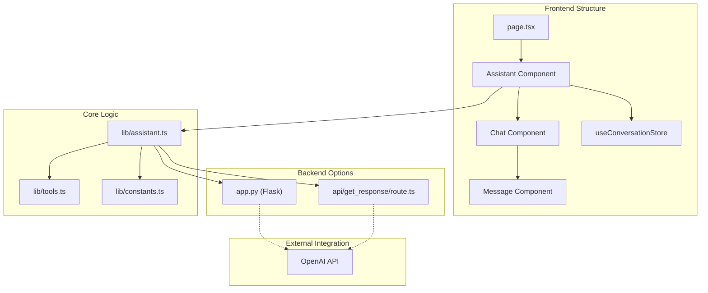
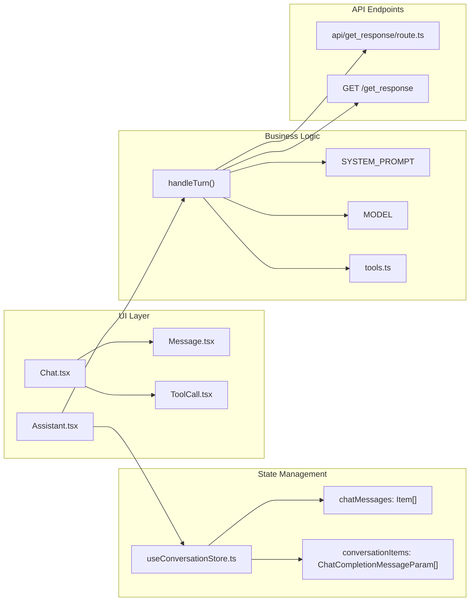
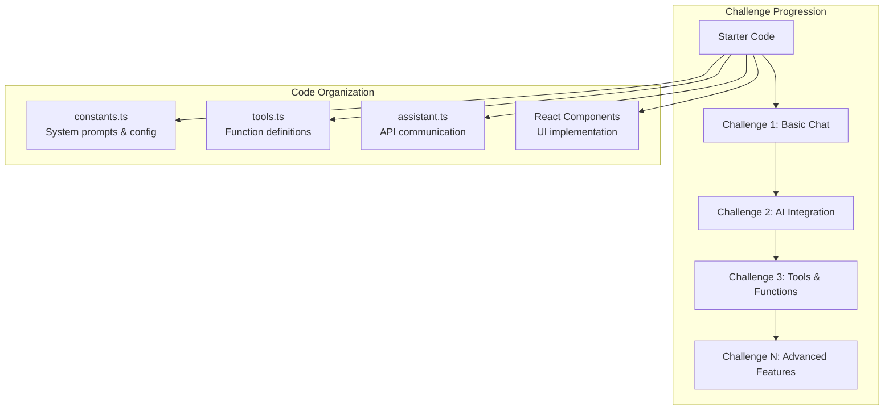

<!-- source: DeepWiki mcp.deepwiki.com · repo openai/openai-builder-lab · page 1 Overview · fetched 2026-10-26 -->

# Overview

Relevant source files

The following files were used as context for generating this wiki page:

- [README.md](README.md)
- [license.txt](license.txt)

## Purpose and Scope

The OpenAI Builder Lab is a starter project designed to help developers learn to build chat assistant applications through hands-on challenges. This tutorial project provides a complete foundation with dual backend options, modern frontend architecture, and integration points for OpenAI APIs.

This document provides a high-level overview of the project structure, core architecture, and key technologies. For detailed setup instructions, see [Getting Started](#2). For specific backend implementation details, see [Backend Systems](#3). For frontend component documentation, see [Frontend Application](#4).

## Project Architecture Overview

The Builder Lab follows a modular architecture with clear separation between frontend presentation, backend API handling, and external service integration:

**Sources:** [README.md:1-99](), [frontend/app/page.tsx](), [frontend/components/Assistant.tsx](), [frontend/lib/assistant.ts](), [python-backend/app.py]()

## Core System Components

The application implements a conversation-driven architecture where user interactions flow through React components to business logic handlers and backend API endpoints:

**Sources:** [frontend/components/Assistant.tsx](), [frontend/stores/useConversationStore.ts](), [frontend/lib/assistant.ts](), [frontend/lib/constants.ts](), [frontend/lib/tools.ts](), [frontend/app/api/get_response/route.ts](), [python-backend/app.py]()

## Technology Stack

The project uses modern web development technologies optimized for AI application development:

| Component | Technology | Purpose |
|-----------|------------|---------|
| **Frontend Framework** | Next.js 14 | React-based full-stack framework |
| **UI Components** | React + TypeScript | Type-safe component development |
| **State Management** | Zustand | Lightweight state management |
| **Styling** | Tailwind CSS | Utility-first CSS framework |
| **Backend Options** | Flask (Python) / Next.js API | Dual backend architecture |
| **AI Integration** | OpenAI API | GPT-4o model integration |
| **Development Tools** | ESLint, Prettier | Code quality and formatting |

**Sources:** [README.md:1-99](), [package.json](), [requirements.txt](), [frontend/lib/constants.ts]()

## Development Approach

The Builder Lab follows a challenge-based learning approach where developers progressively add functionality:

### Starting Point Structure

**Sources:** [README.md:65-99](), [frontend/lib/constants.ts](), [frontend/lib/tools.ts](), [frontend/lib/assistant.ts]()

## Backend Flexibility

The project provides two backend options to accommodate different developer preferences and learning objectives:

- **Flask Backend (`python-backend/app.py`)**: Primary focus for Python developers, designed for OpenAI API integration
- **Next.js API Routes (`frontend/app/api/`)**: Alternative for JavaScript developers, provides same functionality

Both backends implement the same `/get_response` endpoint interface, allowing seamless switching between implementations during development.

**Sources:** [README.md:45-63](), [python-backend/app.py](), [frontend/app/api/get_response/route.ts]()

## License and Usage

The project is dual-licensed to support both software development and font assets:

- **Software**: MIT License for maximum flexibility in educational and commercial use
- **Fonts**: SIL Open Font License 1.1 for the included Geist and Geist Mono fonts

For complete licensing details, see [Licensing](#6).

**Sources:** [license.txt:1-118]()

---

