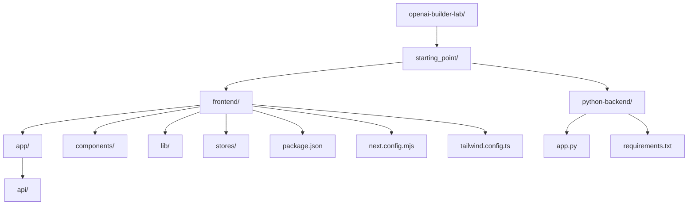
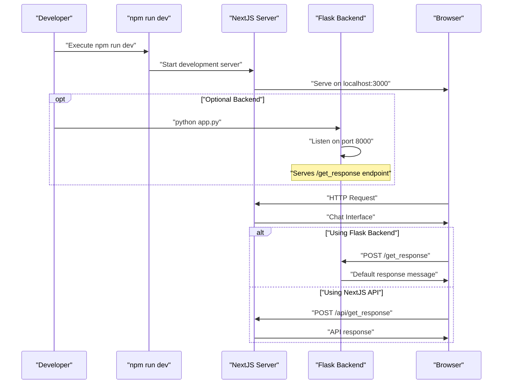
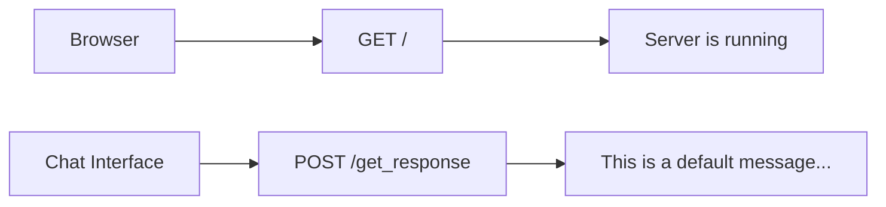

<!-- source: DeepWiki mcp.deepwiki.com · repo openai/openai-builder-lab · page 2 Getting Started · fetched 2026-10-26 -->

# Getting Started

<details>
<summary>Relevant source files</summary>

The following files were used as context for generating this wiki page:

- [README.md](README.md)
- [starting_point/frontend/package.json](starting_point/frontend/package.json)
- [starting_point/python-backend/app.py](starting_point/python-backend/app.py)

</details>


This document provides step-by-step instructions for setting up and running the OpenAI Builder Lab tutorial application. It covers installation, configuration, and initial startup procedures for both the NextJS frontend and optional Python Flask backend.

For detailed information about the backend systems architecture, see [Backend Systems](#3). For frontend application structure and components, see [Frontend Application](#4).

## Prerequisites

Before getting started, ensure you have the following installed on your system:

| Requirement | Version | Purpose |
|-------------|---------|---------|
| Node.js | 18+ | Frontend development and package management |
| npm | Latest | Package manager for JavaScript dependencies |
| Python | 3.8+ | Optional backend development |
| pip | Latest | Package manager for Python dependencies |
| OpenAI API Key | Valid | Required for AI functionality |

## Project Structure Overview

The Builder Lab project follows a dual-backend architecture with clear separation between frontend and backend components.

**Project Structure Diagram**


**Sources:** [README.md:70-99](), [starting_point/frontend/package.json:1-43](), [starting_point/python-backend/app.py:1-30]()

## Installation Process

### Step 1: Clone Repository

Clone the OpenAI Builder Lab repository to your local machine:

```bash
git clone https://github.com/openai/openai-builder-lab.git
cd openai-builder-lab
```

### Step 2: Navigate to Frontend Directory

```bash
cd starting_point/frontend
```

### Step 3: Configure OpenAI API Key

You have two options for setting your OpenAI API key:

**Option A: Global Environment Variable**
Set the `OPENAI_API_KEY` environment variable globally in your system.

**Option B: Project-Specific Configuration**
Create a `.env` file at the root of the project:

```bash
# In starting_point/frontend/.env
OPENAI_API_KEY=your_api_key_here
```

### Step 4: Install Frontend Dependencies

Install the required npm packages defined in `package.json`:

```bash
npm install
```

The key dependencies installed include:

| Package | Purpose |
|---------|---------|
| `next` | React framework for frontend |
| `react` | UI library |
| `zustand` | State management |
| `openai` | OpenAI API client |
| `tailwindcss` | CSS framework |

**Sources:** [README.md:10-43](), [starting_point/frontend/package.json:11-30]()

## Running the Application

### Frontend Development Server

Start the NextJS development server:

```bash
npm run dev
```

The application will be available at `http://localhost:3000`.

### Optional: Python Backend Setup

If you prefer using the Python Flask backend instead of the built-in NextJS API routes:

1. **Navigate to Python Backend Directory:**
   ```bash
   cd ../python-backend
   ```

2. **Install Python Dependencies:**
   ```bash
   pip install -r requirements.txt
   ```

3. **Start Flask Server:**
   ```bash
   python app.py
   ```

The Flask backend will run on `http://localhost:8000`.

**Application Startup Flow**


**Sources:** [README.md:39-63](), [starting_point/python-backend/app.py:27-29](), [starting_point/frontend/package.json:5-9]()

## Verification Steps

### 1. Frontend Verification

After starting the development server, verify the application is running:

- Open `http://localhost:3000` in your browser
- You should see a chat interface
- The application should load without console errors

### 2. Backend Verification

**For Flask Backend:**
- Navigate to `http://localhost:8000`
- You should see: "Server is running"
- The `/get_response` endpoint should be available

**Flask Backend Status Check**


### 3. Integration Verification

Test the connection between frontend and backend:

1. Type a message in the chat interface
2. Send the message
3. Verify you receive a response (default placeholder message initially)

The default response from the Flask backend is configured in [starting_point/python-backend/app.py:22-25]().

**Sources:** [starting_point/python-backend/app.py:12-25](), [README.md:65-68]()

## Next Steps

Once the application is successfully running:

1. **Explore the Application Structure:** Review the frontend components in `starting_point/frontend/components/` and business logic in `starting_point/frontend/lib/`

2. **Review Backend Options:** Examine both the Flask backend [starting_point/python-backend/app.py]() and NextJS API routes for implementation approaches

3. **Begin Development:** Start implementing OpenAI API integration to replace the placeholder responses

4. **Follow Tutorial Challenges:** Progress through the Builder Lab challenges by gradually adding functionality

For detailed information about the application architecture, see [Core Architecture](#4.1). For backend implementation details, see [Python Flask Backend](#3.1) or [NextJS API Routes](#3.2).

**Sources:** [README.md:65-99](), [starting_point/python-backend/app.py:1-30](), [starting_point/frontend/package.json:1-43]()

---

