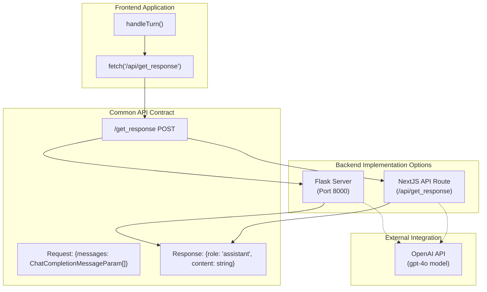
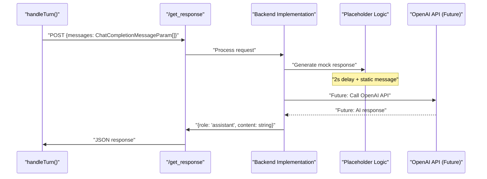

<!-- source: DeepWiki mcp.deepwiki.com · repo openai/openai-builder-lab · page 3 Backend Systems · fetched 2026-10-26 -->

# Backend Systems

<details>
<summary>Relevant source files</summary>

The following files were used as context for generating this wiki page:

- [starting_point/frontend/app/api/get_response/route.ts](starting_point/frontend/app/api/get_response/route.ts)
- [starting_point/python-backend/app.py](starting_point/python-backend/app.py)

</details>


## Purpose and Scope

This document provides an overview of the dual backend architecture implemented in the OpenAI Builder Lab tutorial project. The system offers two backend implementation options: a Python Flask server and NextJS API routes, both designed to handle chat completion requests and integrate with the OpenAI API.

For detailed implementation specifics of the Flask backend, see [Python Flask Backend](#3.1). For NextJS API route implementation details, see [NextJS API Routes](#3.2).

## Dual Backend Architecture

The system implements a flexible backend architecture that allows developers to choose between two different backend approaches based on their preferences and deployment requirements.

### Backend Options Overview



**Sources:** [starting_point/python-backend/app.py:16-25](), [starting_point/frontend/app/api/get_response/route.ts:1-21]()

### Backend Comparison

| Aspect | Flask Backend | NextJS API Routes |
|--------|---------------|-------------------|
| **Language** | Python | TypeScript |
| **Port** | 8000 | Same as frontend (3000) |
| **CORS** | Explicit CORS configuration | Handled by Next.js |
| **Deployment** | Separate server process | Integrated with frontend |
| **Development Focus** | Primary learning target | Alternative approach |
| **File Location** | `starting_point/python-backend/app.py` | `starting_point/frontend/app/api/get_response/route.ts` |

**Sources:** [starting_point/python-backend/app.py:7-8](), [starting_point/frontend/app/api/get_response/route.ts:1]()

## API Contract Implementation

Both backend options implement the same API contract to ensure frontend compatibility. The contract defines a single endpoint that accepts conversation messages and returns assistant responses.

### Request/Response Flow



**Sources:** [starting_point/python-backend/app.py:16-25](), [starting_point/frontend/app/api/get_response/route.ts:1-21]()

### Shared Response Format

Both implementations return identical response structures:

```typescript
{
  role: "assistant",
  content: "This is a default message, update the backend to get a response from the OpenAI API instead."
}
```

The placeholder message explicitly indicates where OpenAI integration should be implemented, serving as a clear development checkpoint.

**Sources:** [starting_point/python-backend/app.py:22-25](), [starting_point/frontend/app/api/get_response/route.ts:8-14]()

## Backend Selection Strategy

### Flask Backend (Primary)
- **Use Case**: Learning Python web development, separate service architecture
- **Advantages**: Language flexibility, independent scaling, explicit CORS control
- **Configuration**: Runs on port 8000 with debug mode enabled
- **Model**: Uses `MODEL = "gpt-4o"` constant for future OpenAI integration

### NextJS API Routes (Alternative)
- **Use Case**: Full-stack TypeScript development, simplified deployment
- **Advantages**: Single deployment unit, automatic TypeScript integration
- **Configuration**: Integrated with frontend server
- **Error Handling**: Includes try-catch with 500 status responses

**Sources:** [starting_point/python-backend/app.py:10](), [starting_point/python-backend/app.py:28-29](), [starting_point/frontend/app/api/get_response/route.ts:15-20]()

## Development Implementation Status

Both backend implementations currently provide placeholder responses with a 2-second delay to simulate API latency. This design pattern allows developers to:

1. Test the complete request/response cycle
2. Verify frontend integration
3. Experience realistic response timing
4. Identify integration points for OpenAI API implementation

The consistent placeholder message across both backends ensures that switching between implementations doesn't affect frontend behavior during development.

**Sources:** [starting_point/python-backend/app.py:21-24](), [starting_point/frontend/app/api/get_response/route.ts:7-12]()

---

