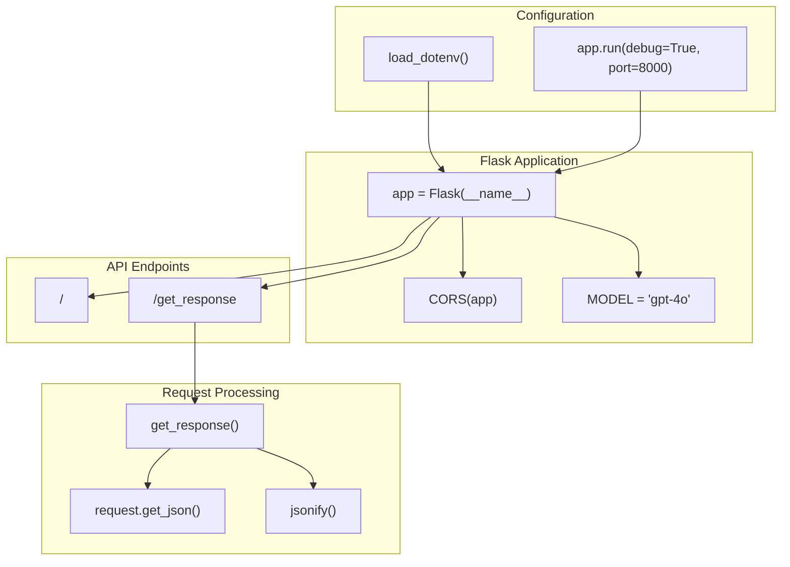
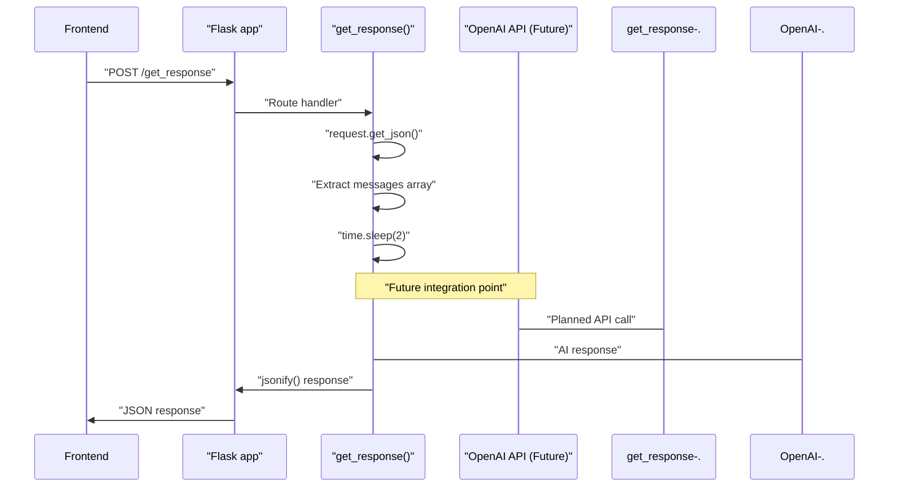

<!-- source: DeepWiki mcp.deepwiki.com · repo openai/openai-builder-lab · page 3.1 Python Flask Backend · fetched 2026-10-26 -->

# Python Flask Backend

<details>
<summary>Relevant source files</summary>

The following files were used as context for generating this wiki page:

- [starting_point/python-backend/app.py](starting_point/python-backend/app.py)

</details>


## Purpose and Scope

This document covers the Python Flask backend implementation, which serves as the primary backend option for the OpenAI Builder Lab tutorial project. The Flask backend provides HTTP API endpoints for the frontend chat interface and is structured to integrate with the OpenAI API for generating AI assistant responses.

For information about the alternative NextJS API backend option, see [NextJS API Routes](#3.2). For details about the frontend application that consumes this backend, see [Frontend Application](#4).

## Architecture Overview

The Flask backend is a lightweight HTTP server that provides REST API endpoints for the chat application. It uses Flask-CORS to handle cross-origin requests from the frontend and is configured with environment variable support for production deployment.

### Core Flask Application Structure



**Sources:** [starting_point/python-backend/app.py:1-30]()

### Request-Response Flow



**Sources:** [starting_point/python-backend/app.py:16-25]()

## API Endpoints

### Health Check Endpoint

| Method | Route | Purpose | Response |
|--------|-------|---------|----------|
| GET | `/` | Server health check | Plain text: "Server is running" |

The home endpoint provides a simple way to verify that the Flask server is running and accessible.

**Sources:** [starting_point/python-backend/app.py:12-14]()

### Chat Response Endpoint

| Method | Route | Purpose | Request Body | Response |
|--------|-------|---------|--------------|----------|
| POST | `/get_response` | Generate chat assistant response | `{"messages": [...]}` | `{"role": "assistant", "content": "..."}` |

The primary API endpoint accepts a JSON payload containing a `messages` array and returns an assistant response. Currently returns a placeholder message but is structured for OpenAI API integration.

#### Request Format
The endpoint expects a JSON object with a `messages` field containing conversation history:
```json
{
  "messages": [
    {"role": "user", "content": "Hello"},
    {"role": "assistant", "content": "Hi there!"}
  ]
}
```

#### Response Format  
Returns a JSON object matching OpenAI's message format:
```json
{
  "role": "assistant", 
  "content": "This is a default message, update the backend to get a response from the OpenAI API instead."
}
```

**Sources:** [starting_point/python-backend/app.py:16-25]()

## Configuration and Environment

### Dependencies and Imports

The Flask backend uses several key dependencies:

| Package | Purpose | Import Statement |
|---------|---------|------------------|
| `flask` | Web framework | `from flask import Flask, request, jsonify` |
| `flask-cors` | Cross-origin request handling | `from flask_cors import CORS` |
| `python-dotenv` | Environment variable loading | `from dotenv import load_dotenv` |

**Sources:** [starting_point/python-backend/app.py:1-4]()

### Application Configuration

The Flask application is configured with the following settings:

- **CORS**: Enabled for all routes to allow frontend requests from different origins
- **Debug Mode**: Enabled for development (`debug=True`)
- **Port**: Runs on port 8000
- **Model**: Configured to use `gpt-4o` model for OpenAI integration

**Sources:** [starting_point/python-backend/app.py:7-10, 27-29]()

### Environment Variables

The application loads environment variables using `load_dotenv()`, preparing for configuration values like:
- OpenAI API keys
- Model preferences
- Production vs development settings

**Sources:** [starting_point/python-backend/app.py:5]()

## OpenAI Integration Preparation

### Model Configuration

The backend is pre-configured with the OpenAI model specification:

```python
MODEL = "gpt-4o"
```

This constant defines which OpenAI model will be used when the integration is implemented.

**Sources:** [starting_point/python-backend/app.py:10]()

### Integration Points

The current implementation includes placeholder logic that demonstrates the integration pattern:

1. **Message Processing**: The `get_response` function extracts the `messages` array from the request
2. **Logging**: Prints incoming messages for debugging: `print("Incoming messages", messages)`  
3. **Response Structure**: Returns responses in OpenAI's expected format with `role` and `content` fields
4. **Simulated Delay**: Uses `time.sleep(2)` to simulate API call latency

**Sources:** [starting_point/python-backend/app.py:18-24]()

### Future Implementation

To complete the OpenAI integration, the placeholder response logic should be replaced with:
- OpenAI client initialization using environment variables
- API calls to OpenAI's chat completions endpoint
- Error handling for API failures
- Token usage tracking and management

## Development and Deployment

### Running the Development Server

The Flask application is configured to run in development mode:

```python
if __name__ == '__main__':
    app.run(debug=True, port=8000)
```

This configuration:
- Enables debug mode for detailed error messages
- Runs on port 8000 to avoid conflicts with the frontend (typically port 3000)
- Provides hot reloading during development

**Sources:** [starting_point/python-backend/app.py:27-29]()

### Production Considerations

The code includes a comment noting that debug mode should be disabled in production environments. Additional production considerations include:
- Setting `debug=False`
- Using a production WSGI server (e.g., Gunicorn)
- Implementing proper error handling and logging
- Securing environment variables and API keys

**Sources:** [starting_point/python-backend/app.py:28]()

---

