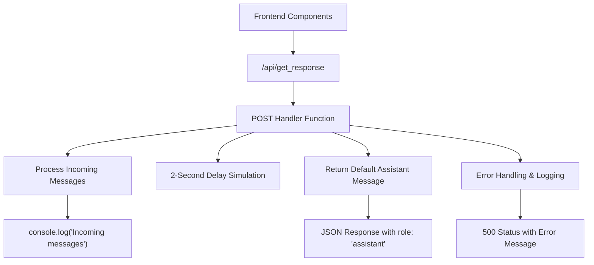
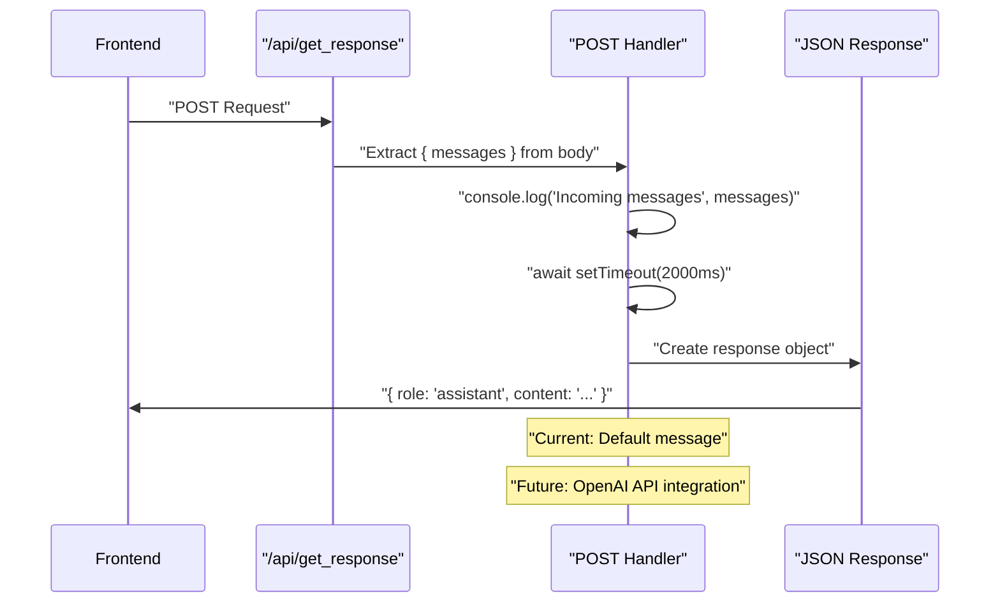
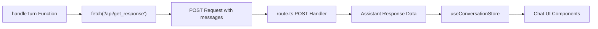
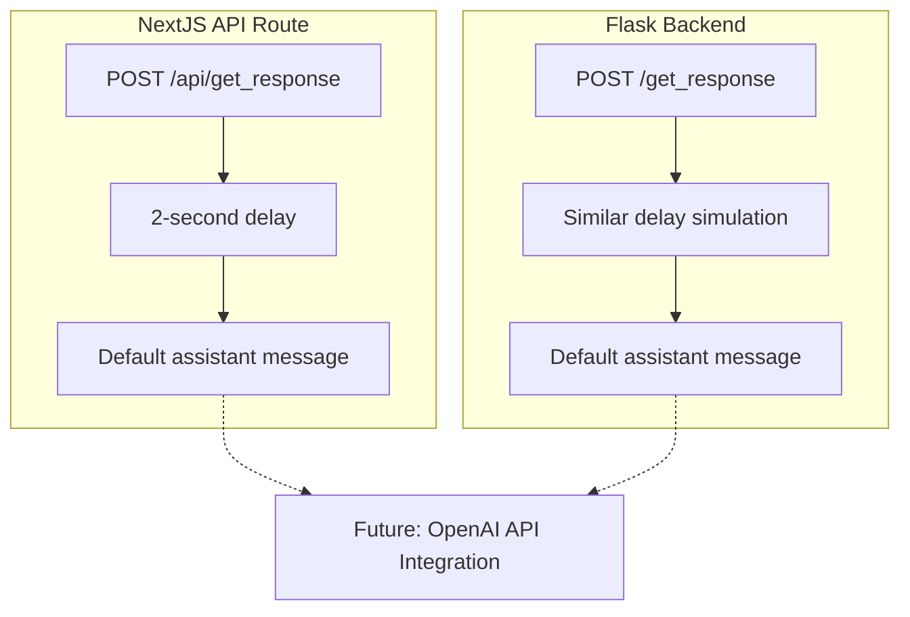
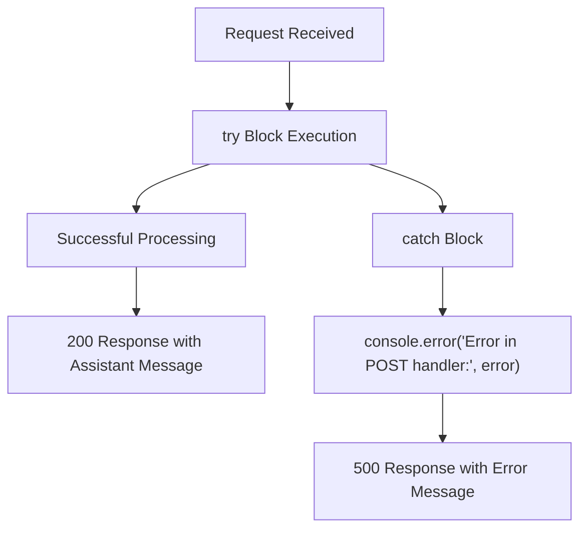

<!-- source: DeepWiki mcp.deepwiki.com · repo openai/openai-builder-lab · page 3.2 NextJS API Routes · fetched 2026-10-26 -->

# NextJS API Routes

Relevant source files

The following files were used as context for generating this wiki page:

- [starting_point/frontend/app/api/get_response/route.ts](starting_point/frontend/app/api/get_response/route.ts)

This document covers the NextJS API Routes backend implementation, which serves as an alternative to the Python Flask backend for the OpenAI Builder Lab tutorial project. This system provides a JavaScript/TypeScript-based backend option that runs within the NextJS application framework.

For information about the primary Python Flask backend, see [Python Flask Backend](#3.1). For details about the frontend architecture that consumes these API routes, see [Frontend Application](#4).

## Purpose and Architecture

The NextJS API Routes backend provides a streamlined alternative to the Flask backend, allowing developers to maintain a single-language codebase entirely in TypeScript. This approach eliminates the need to run separate backend processes and simplifies deployment by leveraging NextJS's built-in API route functionality.

The current implementation serves as a foundation for OpenAI API integration while providing placeholder responses for development and testing purposes.

## Route Structure and Implementation

### API Route Definition

The backend consists of a single API route that handles chat completion requests from the frontend:

**Sources:** [starting_point/frontend/app/api/get_response/route.ts:1-21]()

### Request Processing Flow

The API route implements a straightforward request-response pattern:

| Component | Function | Implementation Detail |
|-----------|----------|----------------------|
| `POST` function | Main request handler | Extracts messages from request body |
| Message logging | Debug functionality | Logs incoming messages to console |
| Delay simulation | Development feature | 2-second setTimeout to simulate API latency |
| Response formatting | Data structure | Returns object with `role` and `content` fields |
| Error handling | Fault tolerance | Catches exceptions and returns 500 status |

**Sources:** [starting_point/frontend/app/api/get_response/route.ts:1-21]()

## API Contract and Data Flow

### Request Format

The API route expects POST requests with the following structure:

**Sources:** [starting_point/frontend/app/api/get_response/route.ts:2-14]()

### Response Format

The API consistently returns responses in the OpenAI API message format:

| Field | Type | Purpose | Current Value |
|-------|------|---------|---------------|
| `role` | string | Message sender identification | `"assistant"` |
| `content` | string | Message text content | Default placeholder message |

**Sources:** [starting_point/frontend/app/api/get_response/route.ts:9-14]()

## Integration with Frontend Components

### Connection Points

The NextJS API route integrates with the frontend through the following connection points:

**Sources:** [starting_point/frontend/app/api/get_response/route.ts:1-21]()

### Data Transformation

The API route receives conversation messages in the OpenAI API format and returns responses in the same format, maintaining consistency with the expected data structure throughout the application.

## Comparison with Flask Backend

### Architectural Differences

| Aspect | NextJS API Routes | Flask Backend |
|--------|------------------|---------------|
| Language | TypeScript | Python |
| Process Model | Single NextJS process | Separate Flask process |
| Deployment | Integrated with frontend | Independent service |
| Development Setup | `npm run dev` only | Requires separate `python app.py` |
| CORS Handling | Built-in NextJS support | Requires Flask-CORS |
| Environment Variables | NextJS `.env` support | python-dotenv |

### Current Implementation Status

Both backends currently implement placeholder responses with identical functionality:

**Sources:** [starting_point/frontend/app/api/get_response/route.ts:7-14]()

## Error Handling and Logging

### Error Management Strategy

The API route implements basic error handling with console logging and appropriate HTTP status codes:

**Sources:** [starting_point/frontend/app/api/get_response/route.ts:15-20]()

## Future OpenAI Integration Points

### Planned Enhancement Areas

The current implementation provides the foundation for OpenAI API integration:

| Integration Point | Current State | Future Enhancement |
|------------------|---------------|-------------------|
| Message Processing | Logs incoming messages | Process for OpenAI API format |
| API Communication | Simulated delay | Actual OpenAI API calls |
| Response Handling | Static default message | Dynamic AI-generated responses |
| Error Management | Basic try-catch | OpenAI-specific error handling |
| Authentication | None | OpenAI API key management |

The route structure aligns with OpenAI's expected message format, requiring minimal changes to integrate with the actual API service.

**Sources:** [starting_point/frontend/app/api/get_response/route.ts:1-21]()

---

