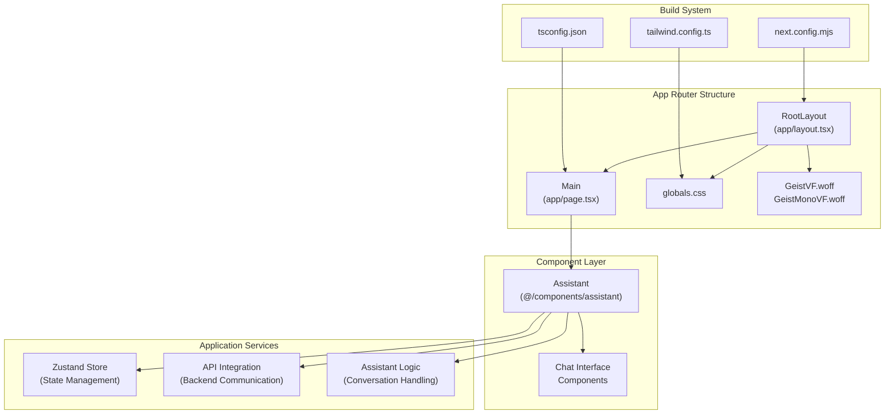
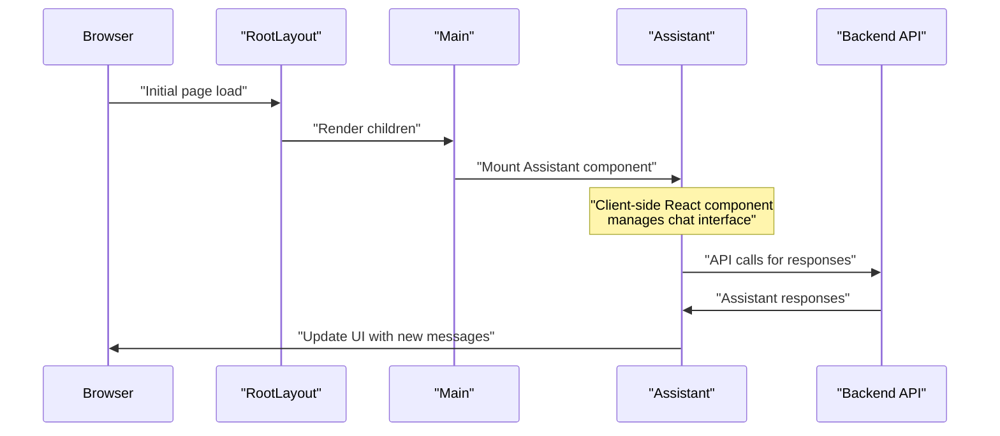
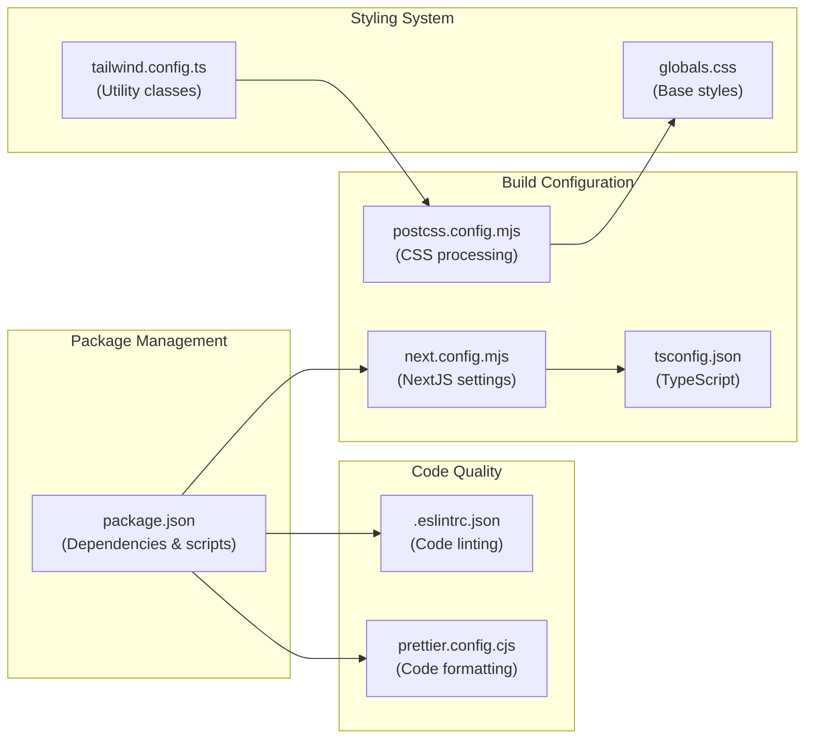
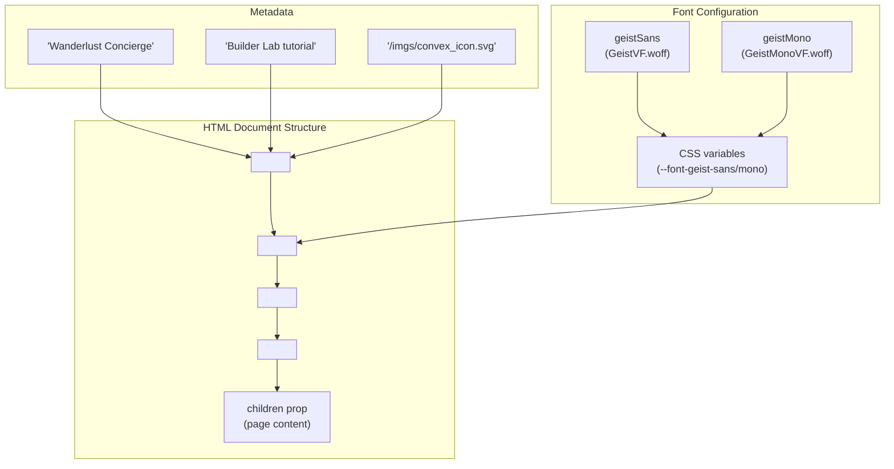

<!-- source: DeepWiki mcp.deepwiki.com · repo openai/openai-builder-lab · page 4 Frontend Application · fetched 2026-10-26 -->

# Frontend Application

Relevant source files

The following files were used as context for generating this wiki page:

- [starting_point/frontend/app/layout.tsx](starting_point/frontend/app/layout.tsx)
- [starting_point/frontend/app/page.tsx](starting_point/frontend/app/page.tsx)
- [starting_point/frontend/package.json](starting_point/frontend/package.json)

## Purpose and Scope

This section documents the NextJS frontend application that provides the user interface for the OpenAI Builder Lab chat assistant. The frontend is built with React components, uses Zustand for state management, and provides a responsive chat interface for interacting with AI assistants.

For detailed information about specific aspects of the frontend, see:
- Core architecture and routing: [Core Architecture](#4.1)
- React component structure: [Chat Interface Components](#4.2) 
- Assistant logic and conversation handling: [Business Logic](#4.3)
- State management patterns: [State Management](#4.4)
- Styling system and assets: [Styling and Assets](#4.5)

For backend integration details, see [Backend Systems](#3).

## Application Architecture Overview

The frontend application follows a modern NextJS architecture with React Server Components, TypeScript, and utility-first CSS styling.

**Frontend Application Structure**

Sources: [starting_point/frontend/app/layout.tsx:1-39](), [starting_point/frontend/app/page.tsx:1-12]()

## Technology Stack

The frontend leverages modern web development technologies with a focus on developer experience and type safety.

| Category | Technology | Version | Purpose |
|----------|------------|---------|---------|
| Framework | Next.js | 14.2.11 | React framework with App Router |
| UI Library | React | ^18 | Component-based UI development |
| Language | TypeScript | ^5.6.2 | Type safety and developer experience |
| State Management | Zustand | ^5.0.2 | Lightweight state management |
| Styling | Tailwind CSS | ^3.4.1 | Utility-first CSS framework |
| Icons | Lucide React | ^0.441.0 | Icon library |
| Markdown | React Markdown | ^9.0.1 | Content rendering |
| API Client | OpenAI | ^4.61.0 | AI service integration |

Sources: [starting_point/frontend/package.json:11-43]()

## Core Application Flow

The application implements a single-page chat interface with server-side rendering and client-side interactivity.

**Request Flow and Component Hierarchy**

Sources: [starting_point/frontend/app/layout.tsx:24-38](), [starting_point/frontend/app/page.tsx:3-11]()

## Application Configuration

The frontend uses several configuration files to manage build processes, styling, and development tools.

**Configuration Dependencies**

Sources: [starting_point/frontend/package.json:1-43]()

## Development Scripts

The application provides standard NextJS development commands for building and running the frontend.

| Script | Command | Purpose |
|--------|---------|---------|
| `dev` | `next dev` | Start development server with hot reload |
| `build` | `next build` | Create production build |
| `start` | `next start` | Start production server |
| `lint` | `next lint` | Run ESLint code quality checks |

Sources: [starting_point/frontend/package.json:5-10]()

## Root Layout Structure

The `RootLayout` component establishes the foundational HTML structure and global styling for the entire application.

**Root Layout Architecture**

Sources: [starting_point/frontend/app/layout.tsx:5-38]()

The layout establishes a full-screen container with responsive design classes and loads custom Geist fonts with variable weight support. The application title "Wanderlust Concierge" suggests a travel-focused AI assistant interface.

---

