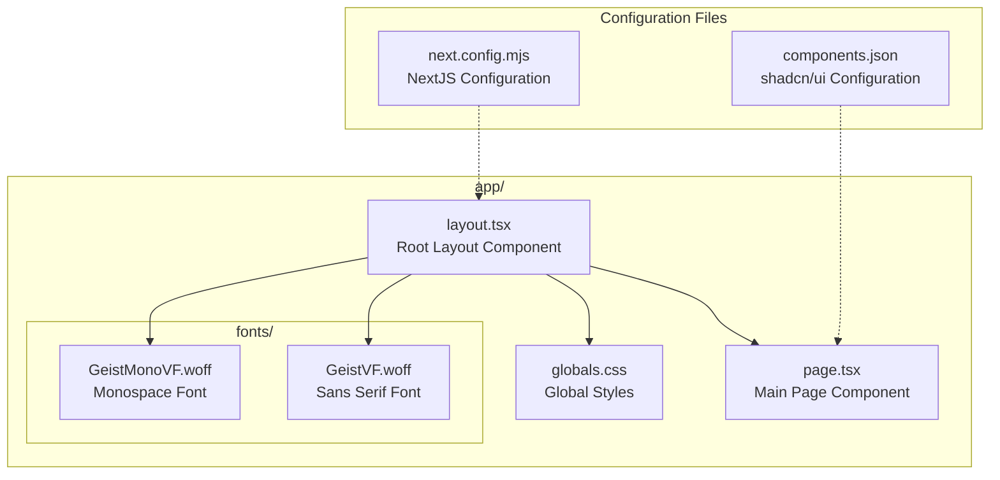
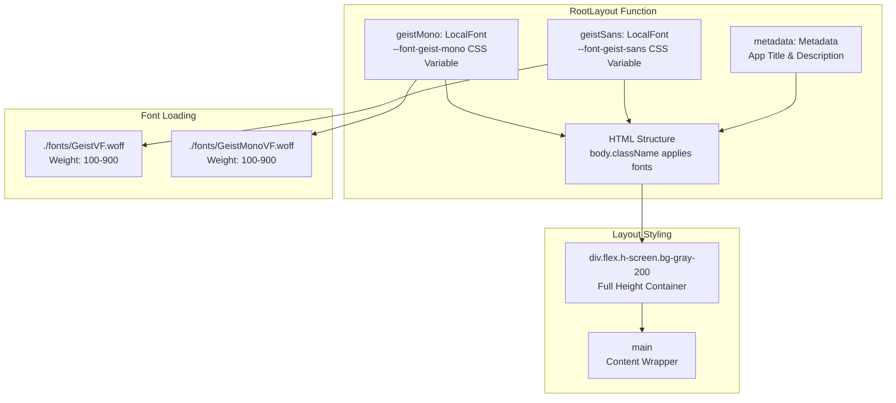
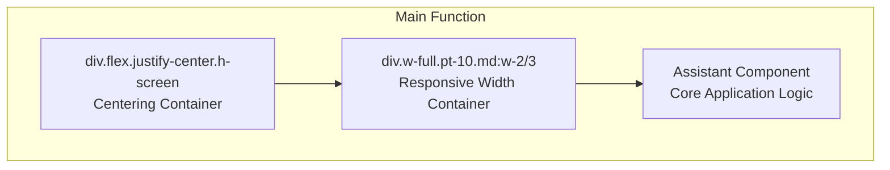
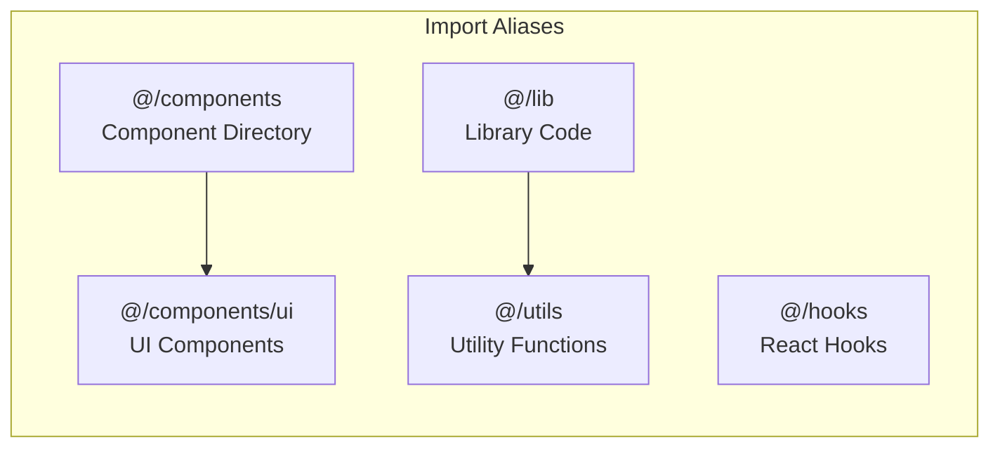
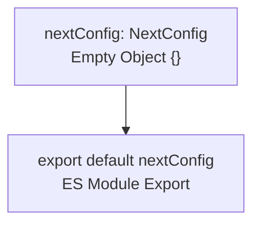

<!-- source: DeepWiki mcp.deepwiki.com · repo openai/openai-builder-lab · page 4.1 Core Architecture · fetched 2026-10-26 -->

# Core Architecture

Relevant source files

The following files were used as context for generating this wiki page:

- [starting_point/frontend/app/layout.tsx](starting_point/frontend/app/layout.tsx)
- [starting_point/frontend/app/page.tsx](starting_point/frontend/app/page.tsx)
- [starting_point/frontend/components.json](starting_point/frontend/components.json)
- [starting_point/frontend/next.config.mjs](starting_point/frontend/next.config.mjs)

This document covers the fundamental NextJS application structure, routing, layout, and configuration that forms the foundation of the OpenAI Builder Lab frontend application. For information about the specific chat interface components, see [Chat Interface Components](#4.2). For business logic and conversation handling, see [Business Logic](#4.3).

## Application Structure and Routing

The application uses NextJS 14's App Router with file-based routing. The core structure follows the standard NextJS app directory convention where the file system defines the application routes.

### File System Architecture

Sources: [starting_point/frontend/app/layout.tsx:1-38](), [starting_point/frontend/app/page.tsx:1-11](), [starting_point/frontend/next.config.mjs:1-4](), [starting_point/frontend/components.json:1-20]()

## Root Layout Component

The `RootLayout` function in `layout.tsx` serves as the foundational wrapper for the entire application. It configures typography, metadata, and provides the base HTML structure.

### Layout Configuration

The layout implements several key architectural patterns:

| Component | Configuration | Purpose |
|-----------|---------------|---------|
| `geistSans` | Variable font, 100-900 weight | Primary typography using CSS custom property `--font-geist-sans` |
| `geistMono` | Variable font, 100-900 weight | Monospace typography using CSS custom property `--font-geist-mono` |
| `metadata` | Title: "Wanderlust Concierge" | SEO and browser tab configuration |
| Base container | `flex h-screen bg-gray-200 w-full flex-col text-stone-900` | Full-screen layout with consistent styling |

Sources: [starting_point/frontend/app/layout.tsx:5-14](), [starting_point/frontend/app/layout.tsx:16-22](), [starting_point/frontend/app/layout.tsx:32-34]()

## Main Page Component

The `Main` function in `page.tsx` represents the application's root route (`/`) and serves as the entry point for the user interface. It implements a responsive layout pattern that centers the main content.

### Page Structure

The page implements a responsive design pattern:
- **Mobile**: Full width (`w-full`)
- **Desktop**: Two-thirds width (`md:w-2/3`)
- **Vertical spacing**: Top padding of 2.5rem (`pt-10`)

Sources: [starting_point/frontend/app/page.tsx:3-10]()

## Component System Configuration

The `components.json` file configures the shadcn/ui component library integration, establishing path aliases and styling conventions used throughout the application.

### Configuration Structure

| Setting | Value | Purpose |
|---------|-------|---------|
| `style` | "new-york" | shadcn/ui style variant |
| `rsc` | `true` | React Server Components support |
| `tsx` | `true` | TypeScript JSX support |
| `tailwind.config` | "tailwind.config.ts" | Tailwind configuration path |
| `tailwind.css` | "app/globals.css" | Global CSS file path |
| `tailwind.baseColor` | "stone" | Default color palette |
| `tailwind.cssVariables` | `true` | CSS custom properties support |

### Path Aliases

The configuration establishes TypeScript path mapping for clean imports:

These aliases enable clean import statements like `import Assistant from '@/components/assistant'` instead of relative paths.

Sources: [starting_point/frontend/components.json:6-12](), [starting_point/frontend/components.json:13-19]()

## NextJS Configuration

The `next.config.mjs` file contains the NextJS application configuration. Currently, it uses the default empty configuration, indicating a minimal setup approach.

### Configuration Object

The minimal configuration suggests the application relies on NextJS defaults for:
- Build optimization
- Routing behavior  
- Development server settings
- Production build configuration

Sources: [starting_point/frontend/next.config.mjs:1-4]()

## Architecture Summary

The core architecture establishes a clean, minimal foundation with:

1. **File-based routing** using NextJS App Router
2. **Typography system** with Geist variable fonts
3. **Responsive layout** with Tailwind CSS utility classes
4. **Component library integration** via shadcn/ui
5. **Clean import paths** through TypeScript aliases
6. **Minimal configuration** leveraging NextJS defaults

This foundation provides the structural base upon which the chat interface components ([Chat Interface Components](#4.2)) and business logic ([Business Logic](#4.3)) are built.

---

