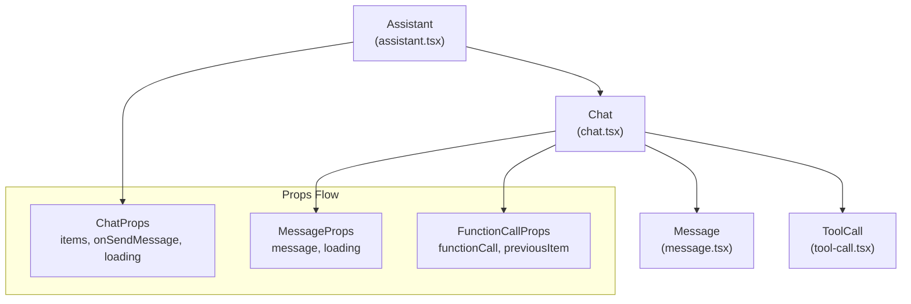
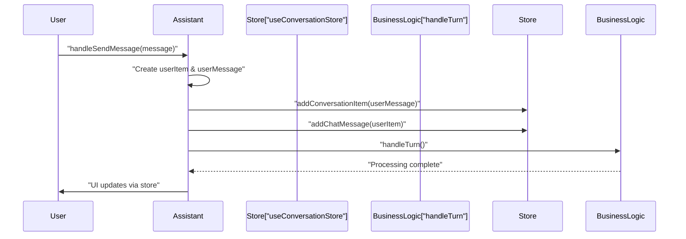
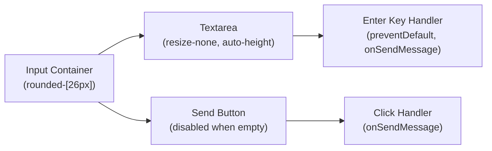
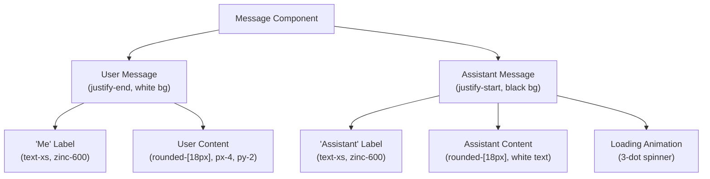
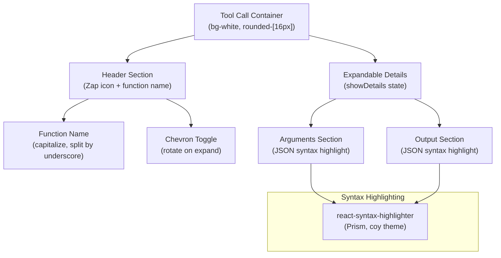
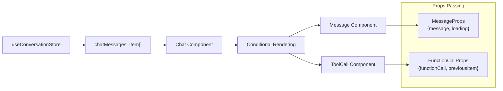

<!-- source: DeepWiki mcp.deepwiki.com · repo openai/openai-builder-lab · page 4.2 Chat Interface Components · fetched 2026-10-26 -->

# Chat Interface Components

Relevant source files

The following files were used as context for generating this wiki page:

- [starting_point/frontend/components/assistant.tsx](starting_point/frontend/components/assistant.tsx)
- [starting_point/frontend/components/chat.tsx](starting_point/frontend/components/chat.tsx)
- [starting_point/frontend/components/message.tsx](starting_point/frontend/components/message.tsx)
- [starting_point/frontend/components/tool-call.tsx](starting_point/frontend/components/tool-call.tsx)

This document covers the React components that compose the chat interface of the OpenAI Builder Lab application. These components handle the display of conversations, user input, message rendering, and tool call visualization.

For information about the underlying business logic and conversation handling, see [Business Logic](#4.3). For state management patterns, see [State Management](#4.4).

## Component Architecture

The chat interface is built using a hierarchical component structure where the `Assistant` component serves as the main orchestrator, delegating display responsibilities to specialized child components.

### Component Hierarchy

Sources: [starting_point/frontend/components/assistant.tsx:1-51](), [starting_point/frontend/components/chat.tsx:1-113](), [starting_point/frontend/components/message.tsx:1-56](), [starting_point/frontend/components/tool-call.tsx:1-101]()

## Assistant Component

The `Assistant` component acts as the primary orchestrator for the chat interface, managing the conversation flow and coordinating between the UI components and business logic.

### Key Responsibilities

| Responsibility | Implementation |
|---|---|
| Message Handling | Processes user input through `handleSendMessage` function |
| State Management | Integrates with `useConversationStore` for conversation state |
| Loading States | Manages loading state during message processing |
| Business Logic Integration | Calls `handleTurn` function to process conversations |

### Message Processing Flow

The component creates two data structures for each user message: an `Item` for UI display and a `ChatCompletionMessageParam` for API communication.

Sources: [starting_point/frontend/components/assistant.tsx:13-37]()

## Chat Component

The `Chat` component handles the primary display logic for conversations, including message rendering, input management, and auto-scrolling behavior.

### Core Features

| Feature | Implementation Details |
|---|---|
| Message Display | Renders `items` array using conditional rendering for different types |
| Input Handling | Manages textarea input with Enter key submission |
| Auto-scrolling | Automatically scrolls to bottom when new messages arrive |
| Loading States | Shows loading indicator during message processing |

### Input Interface Design

The chat input is implemented as a rounded textarea with an integrated send button:

### Message Type Rendering Logic

The component uses conditional rendering to handle different message types:

- **Function Calls**: Rendered using `ToolCall` component with previous item context
- **Regular Messages**: Rendered using `Message` component  
- **Loading States**: Shows special loading message for assistant responses

Sources: [starting_point/frontend/components/chat.tsx:32-43](), [starting_point/frontend/components/chat.tsx:54-106]()

## Message Component

The `Message` component handles the display of individual chat messages with role-based styling and markdown rendering.

### Message Styling Patterns

### Markdown Integration

Both user and assistant messages use `ReactMarkdown` for content rendering, enabling rich text formatting within the chat interface.

Sources: [starting_point/frontend/components/message.tsx:14-50](), [starting_point/frontend/components/message.css:1-8]()

## ToolCall Component

The `ToolCall` component provides an expandable interface for displaying function call details with syntax highlighting.

### ToolCall Display Structure

### Visual Connection System

The component includes a visual connection system that draws lines between consecutive function calls to show execution flow.

Sources: [starting_point/frontend/components/tool-call.tsx:23-96](), [starting_point/frontend/components/tool-call.tsx:54-91]()

## Data Flow Integration

### Item Type Handling

The chat interface handles multiple item types defined in the assistant library:

| Item Type | Component | Key Properties |
|---|---|---|
| `message` | `Message` | `role`, `content` |
| `function_call` | `ToolCall` | `name`, `parsedArguments`, `output` |

### State Integration Patterns

The components integrate with the Zustand store through the `Assistant` component, which passes the `chatMessages` array down to the `Chat` component for rendering.

Sources: [starting_point/frontend/components/assistant.tsx:10-11](), [starting_point/frontend/components/chat.tsx:15]()

## Styling and Layout

### CSS Integration

The chat interface uses a combination of Tailwind CSS classes and custom CSS for specialized styling:

- **Layout**: Flexbox-based responsive design with maximum width constraints
- **Scrolling**: Custom scrollable areas with overflow handling  
- **Animation**: CSS-based loading animations for message processing states
- **Typography**: Consistent font sizing and color schemes across components

### Responsive Design Patterns

The interface adapts to different screen sizes using responsive margins and padding:
- Desktop: `md:ml-24` and `md:mr-24` for wider message containers
- Mobile: Standard margins for compact display

Sources: [starting_point/frontend/components/chat.tsx:28-31](), [starting_point/frontend/components/message.tsx:20](), [starting_point/frontend/components/message.tsx:35]()

---

