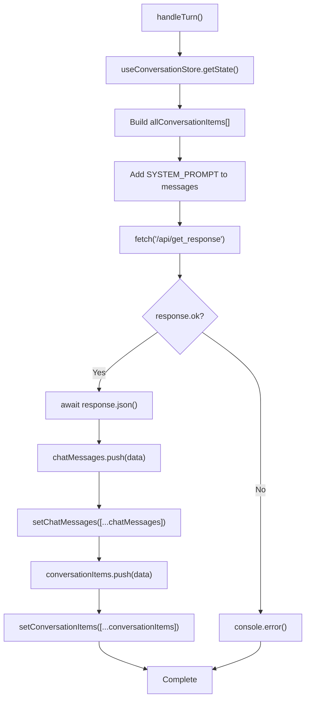
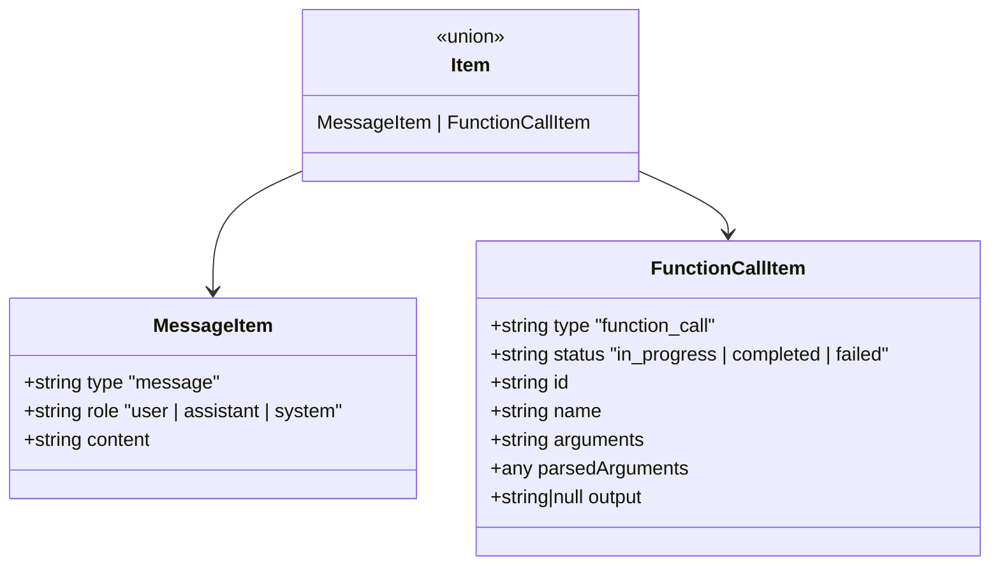
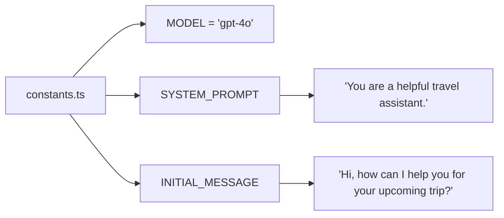
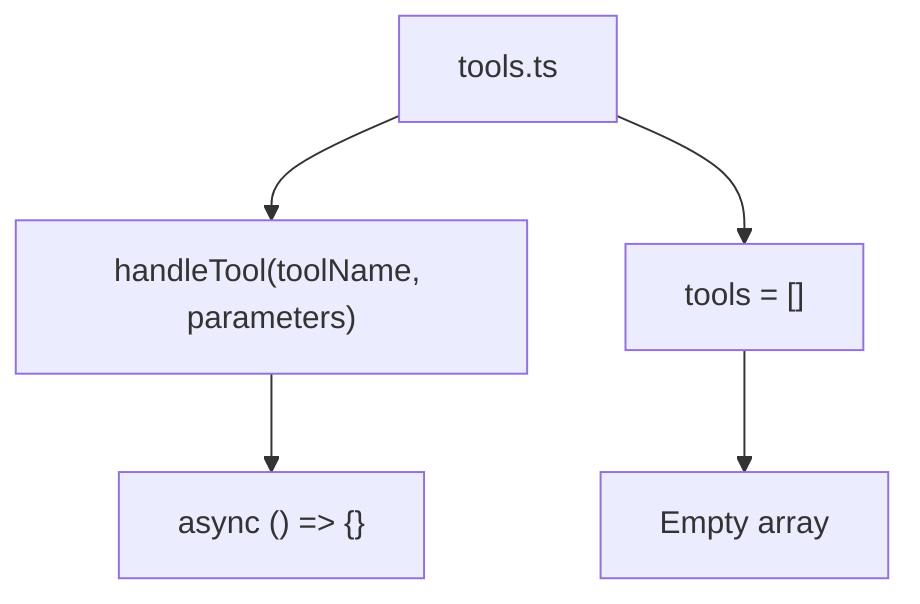
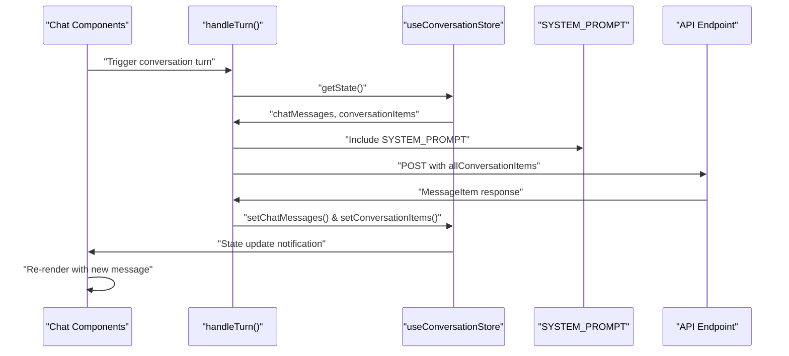

<!-- source: DeepWiki mcp.deepwiki.com · repo openai/openai-builder-lab · page 4.3 Business Logic · fetched 2026-10-26 -->

# Business Logic

<details>
<summary>Relevant source files</summary>

The following files were used as context for generating this wiki page:

- [starting_point/frontend/lib/assistant.ts](starting_point/frontend/lib/assistant.ts)
- [starting_point/frontend/lib/constants.ts](starting_point/frontend/lib/constants.ts)
- [starting_point/frontend/lib/tools.ts](starting_point/frontend/lib/tools.ts)
- [starting_point/frontend/lib/utils.ts](starting_point/frontend/lib/utils.ts)

</details>


This section documents the core business logic that powers the chat assistant application, including conversation handling, message processing, system configuration, and tools integration. The business logic layer serves as the bridge between the frontend components and backend services.

For information about the React components that use this business logic, see [Chat Interface Components](#4.2). For details about the state management integration, see [State Management](#4.4).

## Core Conversation Processing

The primary business logic is implemented in the `handleTurn` function, which orchestrates the conversation flow between the user interface and backend services. This function manages the complete lifecycle of a conversation turn, from gathering conversation history to updating the application state with the response.

### handleTurn Function Flow



The function performs these key operations:

1. **State Retrieval**: Accesses current conversation state via `useConversationStore.getState()`
2. **Message Preparation**: Constructs the complete conversation context including system prompt
3. **Backend Communication**: Sends POST request to either NextJS API routes or Flask backend
4. **Response Processing**: Parses the response and updates application state
5. **Error Handling**: Logs errors and prevents application crashes

**Sources**: [starting_point/frontend/lib/assistant.ts:23-69]()

### Backend Integration Options

The system supports dual backend integration through configurable endpoints:

| Backend Type | Endpoint | Configuration |
|--------------|----------|---------------|
| NextJS API Routes | `/api/get_response` | Default configuration [starting_point/frontend/lib/assistant.ts:42]() |
| Python Flask | `http://localhost:8000/get_response` | Alternative configuration [starting_point/frontend/lib/assistant.ts:41]() |

**Sources**: [starting_point/frontend/lib/assistant.ts:40-48]()

## Message and Data Types

The business logic defines a comprehensive type system for handling different kinds of conversation elements and function calls.

### Core Message Types



The type system supports:

- **MessageItem**: Standard chat messages with role-based content [starting_point/frontend/lib/assistant.ts:5-9]()
- **FunctionCallItem**: Tool/function invocations with execution status and results [starting_point/frontend/lib/assistant.ts:11-19]()
- **Item**: Union type encompassing all conversation elements [starting_point/frontend/lib/assistant.ts:21]()

**Sources**: [starting_point/frontend/lib/assistant.ts:5-21]()

### OpenAI Integration Types

The system imports `ChatCompletionMessageParam` from the OpenAI SDK to ensure compatibility with OpenAI's chat completion API format [starting_point/frontend/lib/assistant.ts:1](). This allows seamless integration with OpenAI services while maintaining type safety.

**Sources**: [starting_point/frontend/lib/assistant.ts:1]()

## System Configuration and Constants

The application's behavior is controlled through centralized configuration constants that define the AI model, system personality, and user experience.

### Core Configuration Constants



| Constant | Value | Purpose |
|----------|-------|---------|
| `MODEL` | `'gpt-4o'` | Specifies the OpenAI model for chat completions |
| `SYSTEM_PROMPT` | Travel assistant persona | Defines the AI's role and behavior |
| `INITIAL_MESSAGE` | Welcome greeting | Sets the conversation tone and context |

The system prompt establishes the assistant's identity as a travel helper, while the initial message provides a welcoming user experience focused on trip planning assistance.

**Sources**: [starting_point/frontend/lib/constants.ts:1-11]()

## Tools System

The application includes a placeholder tools system designed for future function calling capabilities. Currently, the tools infrastructure is minimal but provides the foundation for extensible functionality.

### Current Tools Implementation



The tools system consists of:

- **handleTool Function**: Placeholder for tool execution logic [starting_point/frontend/lib/tools.ts:1]()
- **tools Array**: Empty array ready for tool definitions [starting_point/frontend/lib/tools.ts:3]()

This structure allows for future expansion with actual tool implementations such as flight search, hotel booking, or weather queries.

**Sources**: [starting_point/frontend/lib/tools.ts:1-3]()

## Utility Functions

The business logic layer includes utility functions that support the main conversation processing.

### CSS Class Management

The `cn` function provides optimized CSS class concatenation using `clsx` and `tailwind-merge`:

```typescript
export function cn(...inputs: ClassValue[]) {
  return twMerge(clsx(inputs))
}
```

This utility ensures proper Tailwind CSS class merging and prevents style conflicts in the chat interface components.

**Sources**: [starting_point/frontend/lib/utils.ts:4-6]()

## Business Logic Integration Flow

The following diagram illustrates how the business logic integrates with the broader application architecture:



This flow demonstrates the complete conversation processing cycle, from user interaction through backend communication to state updates and UI re-rendering.

**Sources**: [starting_point/frontend/lib/assistant.ts:23-69](), [starting_point/frontend/lib/constants.ts:4-6]()

---

