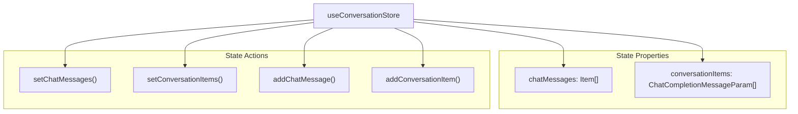
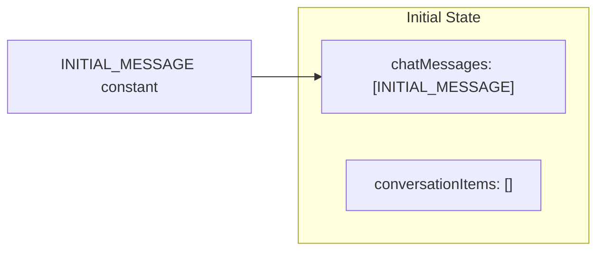
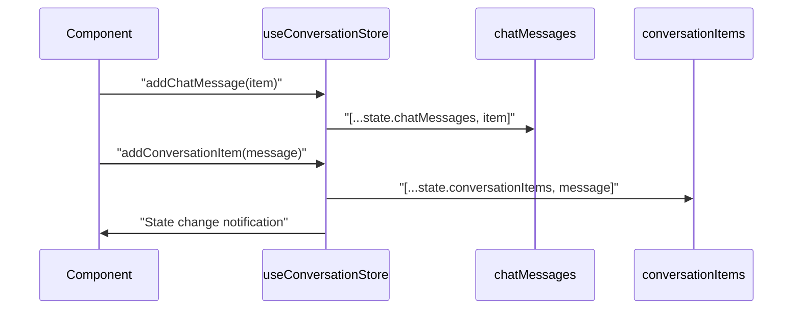

<!-- source: DeepWiki mcp.deepwiki.com · repo openai/openai-builder-lab · page 4.4 State Management · fetched 2026-10-26 -->

# State Management

Relevant source files

The following files were used as context for generating this wiki page:

- [starting_point/frontend/stores/useConversationStore.ts](starting_point/frontend/stores/useConversationStore.ts)

This document covers the state management system used in the OpenAI Builder Lab frontend application. It focuses specifically on the Zustand-based conversation store that manages chat interface state and conversation data flow. For information about the overall frontend architecture, see [Core Architecture](#4.1). For details about how this state integrates with chat components, see [Chat Interface Components](#4.2).

## Purpose and Scope

The state management system handles two distinct but related data streams: chat messages displayed in the UI and conversation items sent to backend APIs. This dual-state approach allows the frontend to maintain rich UI-specific data while keeping API payloads clean and standardized.

## Store Architecture

The application uses Zustand for state management, implemented in a single conversation store that centralizes all chat-related state.

### Core State Structure

**Sources:** [starting_point/frontend/stores/useConversationStore.ts:6-16]()

## State Data Types

The store maintains two parallel arrays with different data structures optimized for their respective use cases:

| State Array | Type | Purpose | Usage |
|-------------|------|---------|--------|
| `chatMessages` | `Item[]` | UI display data | Rendered in chat interface components |
| `conversationItems` | `ChatCompletionMessageParam[]` | API communication | Sent to backend endpoints |

### chatMessages Structure

The `chatMessages` array contains `Item` objects designed for UI rendering. These items include rich metadata needed for proper display formatting and component rendering.

**Sources:** [starting_point/frontend/stores/useConversationStore.ts:8]()

### conversationItems Structure

The `conversationItems` array contains `ChatCompletionMessageParam` objects that conform to OpenAI's Chat Completions API specification. This ensures clean API communication without UI-specific metadata.

**Sources:** [starting_point/frontend/stores/useConversationStore.ts:10]()

## Store Actions

The store provides four primary actions for state manipulation:

### Bulk Update Actions

- `setChatMessages(items: Item[])` - Replaces entire chat messages array
- `setConversationItems(messages: ChatCompletionMessageParam[])` - Replaces entire conversation items array

### Incremental Update Actions

- `addChatMessage(item: Item)` - Appends single item to chat messages
- `addConversationItem(message: ChatCompletionMessageParam)` - Appends single message to conversation items

**Sources:** [starting_point/frontend/stores/useConversationStore.ts:12-15](), [starting_point/frontend/stores/useConversationStore.ts:27-32]()

## State Initialization

The store initializes with a welcome message in the `chatMessages` array and an empty `conversationItems` array:

**Sources:** [starting_point/frontend/stores/useConversationStore.ts:19-26]()

## State Update Patterns

The store implements immutable update patterns using spread operators to ensure proper state change detection:

### Data Flow Through State Updates

**Sources:** [starting_point/frontend/stores/useConversationStore.ts:29-32]()

## Integration with Components

Components access the conversation store using the standard Zustand hook pattern. The store automatically triggers re-renders when state changes occur, ensuring the UI stays synchronized with the underlying data.

### Typical Usage Pattern

Components typically interact with both state arrays during conversation turns:
1. Add user message to both `chatMessages` and `conversationItems`
2. Process conversation using `conversationItems` for API calls
3. Add assistant response to both arrays upon completion

**Sources:** [starting_point/frontend/stores/useConversationStore.ts:18-35]()

## Store Export

The store is exported as the default export from the module, following standard Zustand conventions for easy import and usage across components.

**Sources:** [starting_point/frontend/stores/useConversationStore.ts:35]()

---

