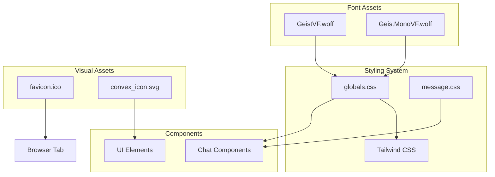
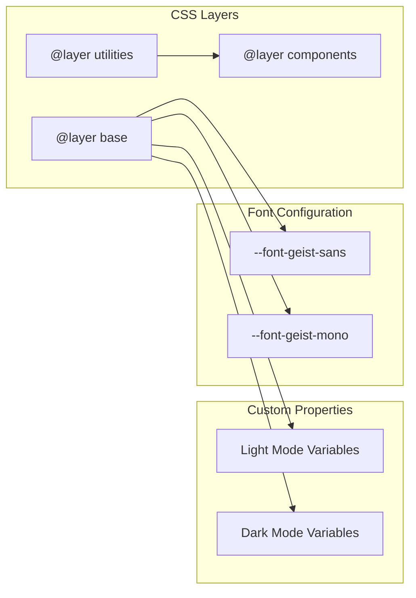
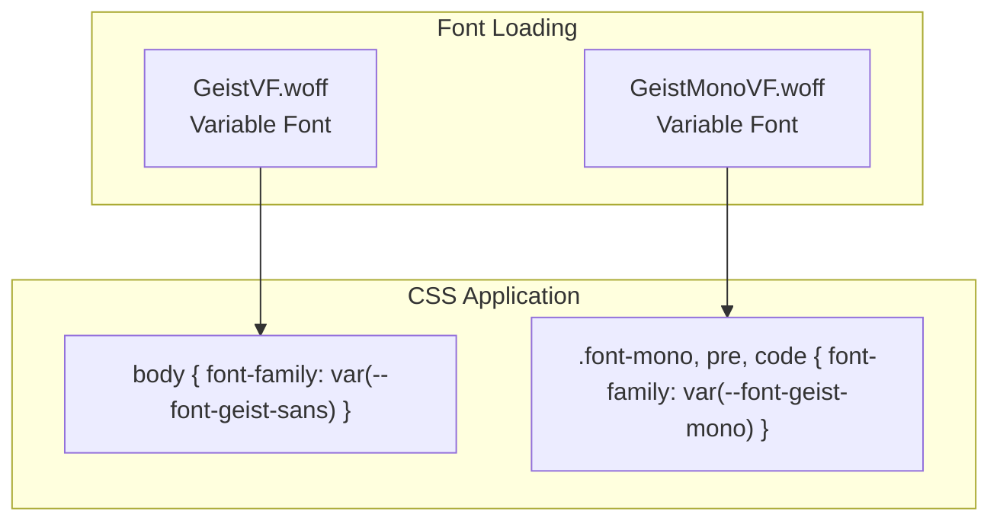
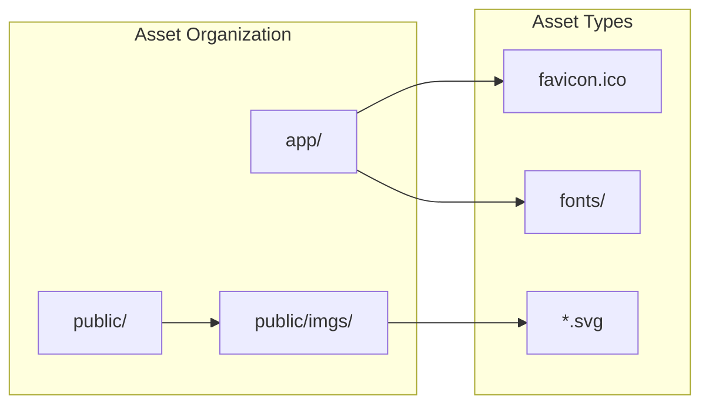
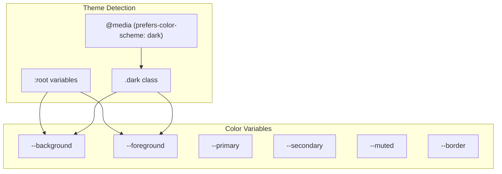
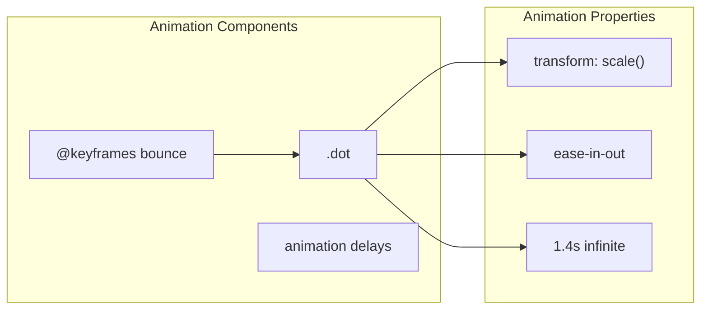

<!-- source: DeepWiki mcp.deepwiki.com · repo openai/openai-builder-lab · page 4.5 Styling and Assets · fetched 2026-10-26 -->

# Styling and Assets

<details>
<summary>Relevant source files</summary>

The following files were used as context for generating this wiki page:

- [starting_point/frontend/app/favicon.ico](starting_point/frontend/app/favicon.ico)
- [starting_point/frontend/app/fonts/GeistMonoVF.woff](starting_point/frontend/app/fonts/GeistMonoVF.woff)
- [starting_point/frontend/app/fonts/GeistVF.woff](starting_point/frontend/app/fonts/GeistVF.woff)
- [starting_point/frontend/app/globals.css](starting_point/frontend/app/globals.css)
- [starting_point/frontend/components/message.css](starting_point/frontend/components/message.css)
- [starting_point/frontend/public/imgs/convex_icon.svg](starting_point/frontend/public/imgs/convex_icon.svg)

</details>


This document covers the styling system, typography configuration, visual assets, and theming implementation used throughout the frontend application. It details the integration of Tailwind CSS with custom CSS, font loading, icon assets, and the light/dark mode theming system.

For information about the overall frontend architecture, see [Core Architecture](#4.1). For details about specific UI components that use these styles, see [Chat Interface Components](#4.2).

## Overview

The application uses a modern CSS architecture combining Tailwind CSS utility classes with custom CSS properties for theming and component-specific animations. The styling system supports automatic light/dark mode switching and uses the Geist font family for consistent typography.



**Sources:** [starting_point/frontend/app/globals.css:1-97](), [starting_point/frontend/components/message.css:1-29]()

## CSS System Architecture

The styling system is built on Tailwind CSS with custom CSS variables for theming and component-specific styles for animations.



The main styling configuration is defined in `globals.css` which includes:

- **Tailwind Directives**: Base utility framework [starting_point/frontend/app/globals.css:1-3]()
- **CSS Custom Properties**: Theme variables for colors and spacing [starting_point/frontend/app/globals.css:5-8]()
- **Media Query Theming**: Automatic dark mode detection [starting_point/frontend/app/globals.css:10-15]()
- **Font Family Assignment**: Geist font configuration [starting_point/frontend/app/globals.css:17-25]()

**Sources:** [starting_point/frontend/app/globals.css:1-97]()

## Typography Configuration

The application uses the Geist font family with separate variants for sans-serif and monospace text.

| Font Type | File | Usage | CSS Variable |
|-----------|------|-------|-------------|
| Sans-serif | `GeistVF.woff` | Body text, UI elements | `--font-geist-sans` |
| Monospace | `GeistMonoVF.woff` | Code blocks, preformatted text | `--font-geist-mono` |



The font configuration applies different font families based on element type:
- **Default body text**: Uses Geist Sans via `--font-geist-sans` [starting_point/frontend/app/globals.css:20]()
- **Code elements**: Forces Geist Mono for `.font-mono`, `pre`, and `code` elements [starting_point/frontend/app/globals.css:23-25]()

**Sources:** [starting_point/frontend/app/fonts/GeistVF.woff](), [starting_point/frontend/app/fonts/GeistMonoVF.woff](), [starting_point/frontend/app/globals.css:20-25]()

## Visual Assets

### Favicon
The application includes a custom favicon that appears in browser tabs and bookmarks.

- **File**: `favicon.ico` in the app directory [starting_point/frontend/app/favicon.ico]()
- **Format**: ICO format with multiple resolutions embedded
- **Placement**: Automatically detected by Next.js when placed in the app directory

### Icons and Graphics
The application includes vector graphics for UI elements:

- **Convex Logo**: SVG icon for integration branding [starting_point/frontend/public/imgs/convex_icon.svg]()
  - Dimensions: 40x40 viewBox
  - Color: `#18181B` (dark gray)
  - Usage: Can be imported and used in React components



**Sources:** [starting_point/frontend/app/favicon.ico](), [starting_point/frontend/public/imgs/convex_icon.svg:1-4]()

## Theming System

The application implements a comprehensive light/dark mode theming system using CSS custom properties.



### Theme Variable Structure

The theming system defines comprehensive color palettes for both light and dark modes:

**Base Theme Variables** [starting_point/frontend/app/globals.css:34-60]():
- `--background`, `--foreground`: Main background and text colors
- `--card`, `--card-foreground`: Card component colors  
- `--primary`, `--primary-foreground`: Primary action colors
- `--secondary`, `--muted`: Secondary and muted element colors
- `--destructive`: Error and warning colors
- `--border`, `--input`, `--ring`: Form and interaction colors

**Dark Mode Overrides** [starting_point/frontend/app/globals.css:61-86]():
- Automatically applied via `.dark` class
- Inverted color relationships for dark mode compatibility
- Adjusted contrast ratios for accessibility

### Utility Integration

The theme system integrates with Tailwind's utility classes through the base layer [starting_point/frontend/app/globals.css:89-96]():

```css
@layer base {
  * {
    @apply border-border;
  }
  body {
    @apply bg-background text-foreground;
  }
}
```

**Sources:** [starting_point/frontend/app/globals.css:5-96]()

## Component-Specific Styles

### Message Loading Animation

The chat interface includes a custom CSS animation for message loading indicators defined in a separate stylesheet.



**Animation Implementation** [starting_point/frontend/components/message.css:1-28]():
- **Bounce keyframes**: Scale animation from 0 to 1 [starting_point/frontend/components/message.css:1-10]()
- **Dot styling**: 5px circular indicators with white background [starting_point/frontend/components/message.css:12-20]()
- **Staggered timing**: Sequential animation delays for wave effect [starting_point/frontend/components/message.css:22-28]()

### Utility Extensions

The styling system includes custom utility classes for enhanced text rendering:

- **Text Balance**: `text-wrap: balance` for improved line breaking [starting_point/frontend/app/globals.css:27-31]()

**Sources:** [starting_point/frontend/components/message.css:1-29](), [starting_point/frontend/app/globals.css:27-31]()

---

