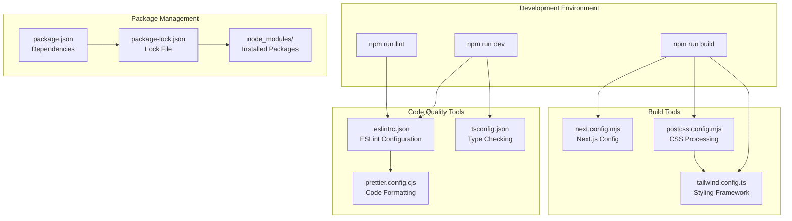
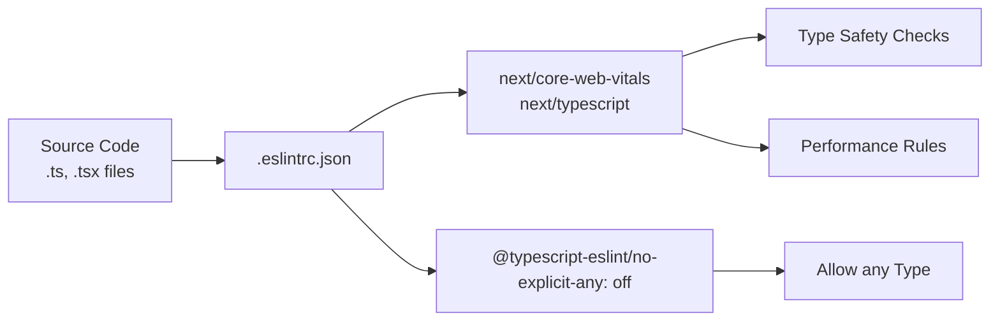
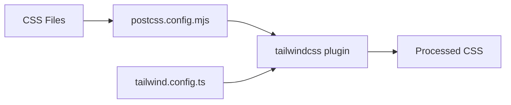
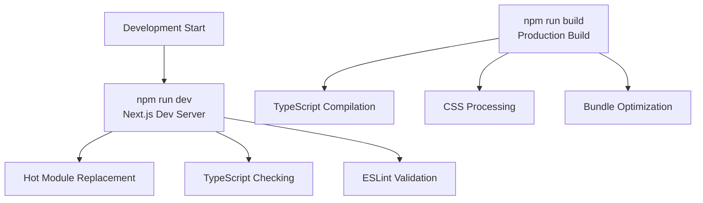
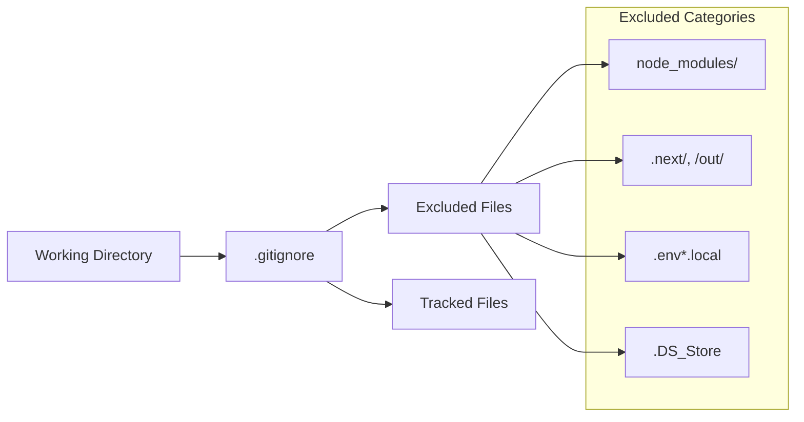

<!-- source: DeepWiki mcp.deepwiki.com · repo openai/openai-builder-lab · page 5 Development Workflow · fetched 2026-10-26 -->

# Development Workflow

<details>
<summary>Relevant source files</summary>

The following files were used as context for generating this wiki page:

- [starting_point/frontend/.eslintrc.json](starting_point/frontend/.eslintrc.json)
- [starting_point/frontend/.gitignore](starting_point/frontend/.gitignore)
- [starting_point/frontend/package-lock.json](starting_point/frontend/package-lock.json)
- [starting_point/frontend/postcss.config.mjs](starting_point/frontend/postcss.config.mjs)
- [starting_point/frontend/prettier.config.cjs](starting_point/frontend/prettier.config.cjs)

</details>


This document covers the development tools, configuration files, code quality systems, and build processes used in the OpenAI Builder Lab tutorial project. It explains how to set up a productive development environment and maintain code quality standards throughout the development lifecycle.

For information about running the application in development mode, see [Getting Started](#2). For details about the frontend build architecture, see [Frontend Application](#4).

## Development Tools Overview

The project uses a modern JavaScript/TypeScript development stack with comprehensive tooling for code quality, formatting, and build optimization.

### Development Stack Architecture



**Sources:** [starting_point/frontend/.eslintrc.json:1-6](), [starting_point/frontend/prettier.config.cjs:1-34](), [starting_point/frontend/postcss.config.mjs:1-8](), [starting_point/frontend/package-lock.json:1-50]()

### Core Development Dependencies

| Tool | Version | Purpose |
|------|---------|---------|
| `next` | 14.2.11 | React framework and build system |
| `typescript` | ^5.6.2 | Type checking and compilation |
| `eslint` | ^9.13.0 | Code linting and quality enforcement |
| `tailwindcss` | ^3.4.1 | Utility-first CSS framework |
| `postcss` | ^8 | CSS transformation and processing |

**Sources:** [starting_point/frontend/package-lock.json:17-40]()

## Code Quality and Formatting

### ESLint Configuration

The project uses ESLint with Next.js and TypeScript presets for comprehensive code quality enforcement.



The ESLint configuration extends Next.js recommended rules and disables strict `any` type checking:

- **Extends**: `next/core-web-vitals`, `next/typescript`
- **Custom Rules**: Disables `@typescript-eslint/no-explicit-any` for development flexibility

**Sources:** [starting_point/frontend/.eslintrc.json:1-6]()

### Prettier Code Formatting

Prettier enforces consistent code formatting across the entire codebase with specific configuration for import ordering and styling preferences.

#### Formatting Rules

| Setting | Value | Purpose |
|---------|-------|---------|
| `semi` | `false` | No semicolons |
| `singleQuote` | `true` | Use single quotes |
| `tabWidth` | `2` | 2-space indentation |
| `trailingComma` | `'none'` | No trailing commas |
| `endOfLine` | `'lf'` | Unix line endings |

#### Import Organization

The configuration includes sophisticated import ordering rules that organize imports into logical groups:

1. React imports
2. Next.js imports  
3. Third-party modules
4. Type imports
5. Internal modules (config, lib, hooks, components)
6. Relative imports

**Sources:** [starting_point/frontend/prettier.config.cjs:1-34]()

## Build and Compilation Process

### PostCSS and Tailwind Integration

The build system processes CSS through PostCSS with Tailwind CSS integration for utility-first styling.



The PostCSS configuration is minimal and focused, using only the Tailwind CSS plugin for processing:

```javascript
const config = {
  plugins: {
    tailwindcss: {},
  },
};
```

**Sources:** [starting_point/frontend/postcss.config.mjs:1-8]()

### Development Workflow Commands



**Sources:** [starting_point/frontend/package-lock.json:7-41]()

## Package Management

### Dependency Management Strategy

The project uses npm with a lockfile to ensure reproducible builds across different environments.

#### Production Dependencies

Key runtime dependencies include:

- **React ecosystem**: `react@^18`, `react-dom@^18`, `next@14.2.11`
- **State management**: `zustand@^5.0.2`
- **UI components**: `lucide-react@^0.441.0`, various Radix UI components
- **Markdown rendering**: `react-markdown@^9.0.1`
- **API integration**: `openai@^4.61.0`

#### Development Dependencies

Development tooling includes:

- **TypeScript**: `typescript@^5.6.2`, `@types/node@^20.16.10`, `@types/react@^18.3.10`
- **Linting**: `eslint@^9.13.0`, `eslint-config-next@^15.0.1`
- **Styling**: `tailwindcss@^3.4.1`, `postcss@^8`

**Sources:** [starting_point/frontend/package-lock.json:10-41]()

### Git Workflow Integration

The `.gitignore` file ensures that development artifacts and sensitive files are excluded from version control:



Key exclusions include:
- **Dependencies**: `node_modules/`, `.pnp.js`
- **Build outputs**: `.next/`, `/out/`, `/build`
- **Environment files**: `.env*.local`, `.env`
- **Development artifacts**: `*.tsbuildinfo`, `next-env.d.ts`
- **Platform files**: `.DS_Store`, `.vercel`

**Sources:** [starting_point/frontend/.gitignore:1-38]()

## Development Best Practices

### Code Quality Enforcement

The development workflow enforces quality through multiple layers:

1. **TypeScript compilation** catches type errors at build time
2. **ESLint** validates code patterns and Next.js best practices  
3. **Prettier** ensures consistent formatting across the codebase
4. **Git hooks** (implied by the sophisticated tooling setup) likely run these checks pre-commit

### Import Organization Standards

The Prettier configuration enforces a specific import order that promotes clean, readable code:

```typescript
// 1. React imports
import React from 'react'
import { useState } from 'react'

// 2. Next.js imports  
import Link from 'next/link'

// 3. Third-party modules
import { create } from 'zustand'

// 4. Type imports
import type { ChatCompletionMessageParam } from 'openai/resources/chat/completions'

// 5. Internal imports (config, lib, hooks, components)
import { Button } from '@/components/ui/button'

// 6. Relative imports
import './styles.css'
```

This organization makes it easy to understand dependencies and maintain clean module boundaries.

**Sources:** [starting_point/frontend/prettier.config.cjs:10-33]()

---

