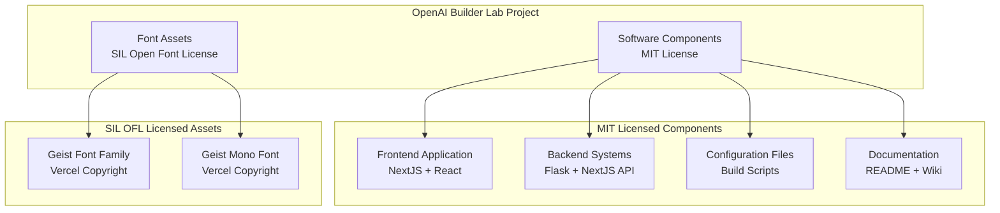
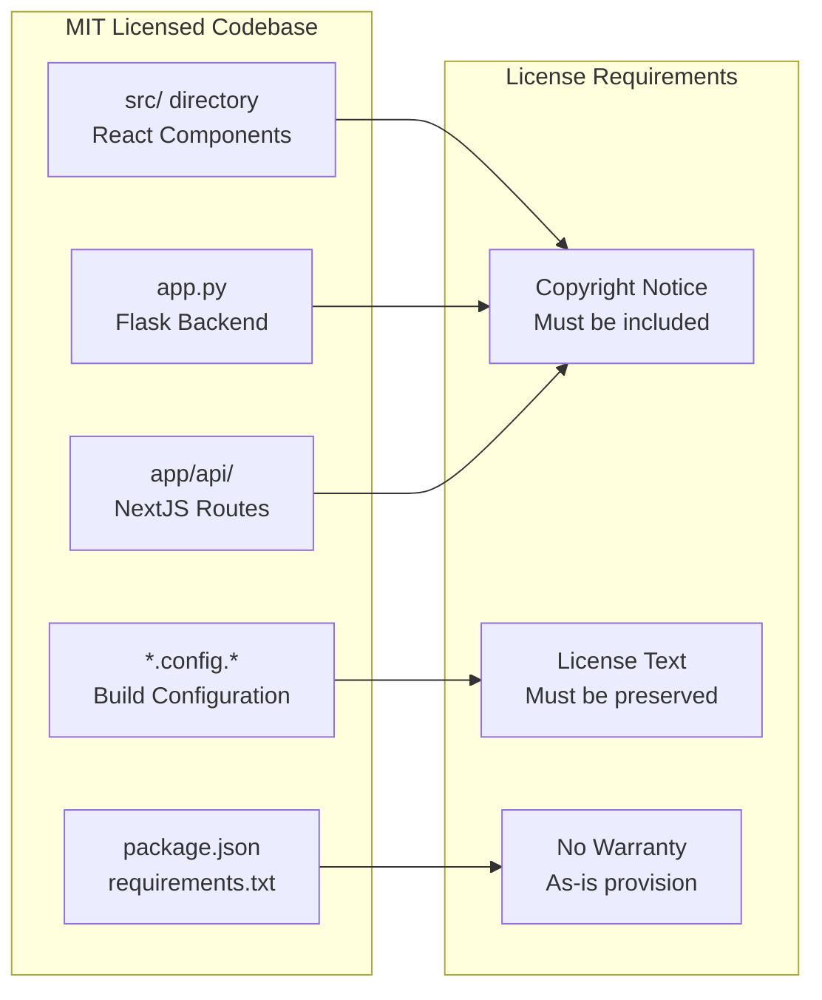
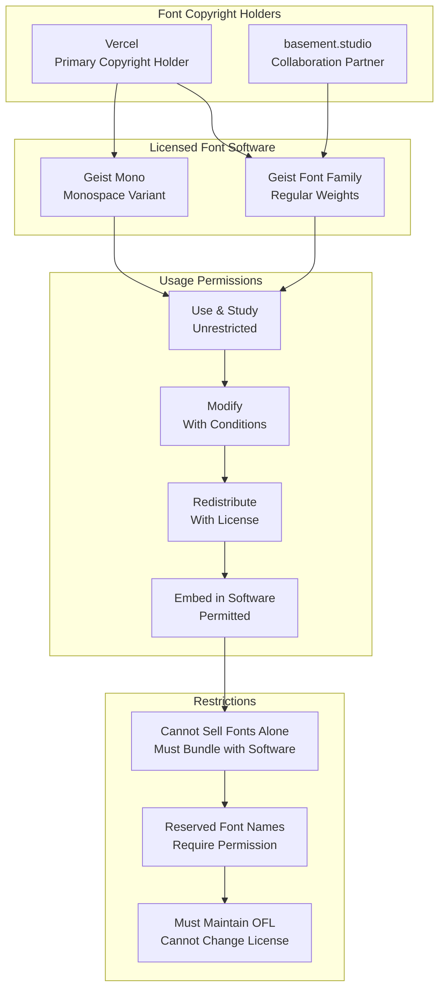
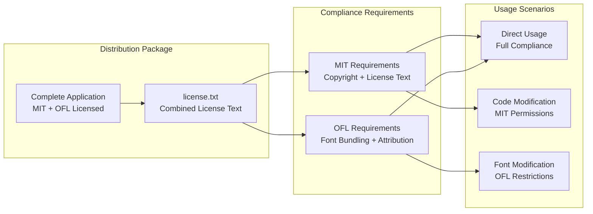

<!-- source: DeepWiki mcp.deepwiki.com · repo openai/openai-builder-lab · page 6 Licensing · fetched 2026-10-26 -->

# Licensing

Relevant source files

The following files were used as context for generating this wiki page:

- [license.txt](license.txt)

This document outlines the licensing terms that govern the OpenAI Builder Lab project, including the dual licensing structure that covers both the software components and font assets. Understanding these terms is essential for proper usage, modification, and distribution of the project.

## Overview

The OpenAI Builder Lab project operates under a dual licensing structure that separates software components from font assets. This approach ensures appropriate licensing for different types of intellectual property while maintaining open-source accessibility.

Sources: [license.txt:1-118]()

## MIT License for Software Components

The primary software components of the OpenAI Builder Lab are licensed under the MIT License, providing broad permissions for use, modification, and distribution.

### License Terms

| Aspect | Permission |
|--------|------------|
| **Use** | Unrestricted commercial and personal use |
| **Modify** | Full modification rights |
| **Distribute** | Redistribution permitted |
| **Sublicense** | Sublicensing allowed |
| **Sell** | Commercial sale permitted |

### Covered Components

The MIT License applies to all software components including:

### Copyright Notice

The copyright holder is OpenAI (2025), and the license requires preservation of the copyright notice and license text in all copies or substantial portions of the software.

Sources: [license.txt:1-20]()

## SIL Open Font License for Typography

The Geist font family used throughout the application is licensed under the SIL Open Font License (OFL) Version 1.1, which has different terms than the MIT License.

### Font License Structure

### Key OFL Provisions

| Provision | Requirement |
|-----------|-------------|
| **Bundling** | Fonts may be bundled with software but not sold independently |
| **Attribution** | Copyright notice must be preserved |
| **License Continuity** | Derivative fonts must remain under OFL |
| **Reserved Names** | "Geist" name cannot be used for modified versions without permission |
| **No Endorsement** | Copyright holders' names cannot be used for promotion without permission |

Sources: [license.txt:23-116]()

## License Compliance Guidelines

### For Software Distribution

When distributing or modifying the OpenAI Builder Lab software:

1. **Include License Text**: The MIT license text must be included in all distributions
2. **Preserve Copyright**: Maintain the OpenAI copyright notice
3. **No Attribution Requirements**: No specific attribution required beyond copyright notice

### For Font Usage

When using or distributing the Geist fonts:

1. **Bundle Requirement**: Fonts cannot be distributed separately from software
2. **License Inclusion**: SIL OFL license text must be included
3. **Name Restrictions**: Cannot use "Geist" name for modified versions
4. **Copyright Preservation**: Vercel copyright notice must be maintained

### Integration Considerations

Sources: [license.txt:1-118]()

## License File Location

The complete licensing information is maintained in [license.txt:1-118](), which contains both the MIT License for software components and the full SIL Open Font License text for the Geist font family. This file serves as the authoritative source for all licensing terms and must be preserved in any distribution of the project.

Sources: [license.txt:1-118]()