# Page: Overview

# Overview

<details>
<summary>Relevant source files</summary>

The following files were used as context for generating this wiki page:

- [README.md](README.md)
- [license.txt](license.txt)

</details>


## Purpose and Scope

The OpenAI Builder Lab is a starter project designed to help developers learn to build chat assistant applications through hands-on challenges. This tutorial project provides a complete foundation with dual backend options, modern frontend architecture, and integration points for OpenAI APIs.

This document provides a high-level overview of the project structure, core architecture, and key technologies. For detailed setup instructions, see [Getting Started](#2). For specific backend implementation details, see [Backend Systems](#3). For frontend component documentation, see [Frontend Application](#4).

## Project Architecture Overview

The Builder Lab follows a modular architecture with clear separation between frontend presentation, backend API handling, and external service integration:

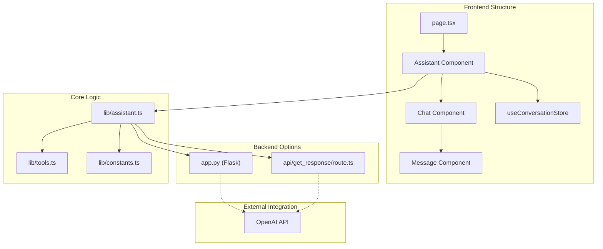

**Sources:** [README.md:1-99](), [frontend/app/page.tsx](), [frontend/components/Assistant.tsx](), [frontend/lib/assistant.ts](), [python-backend/app.py]()

## Core System Components

The application implements a conversation-driven architecture where user interactions flow through React components to business logic handlers and backend API endpoints:

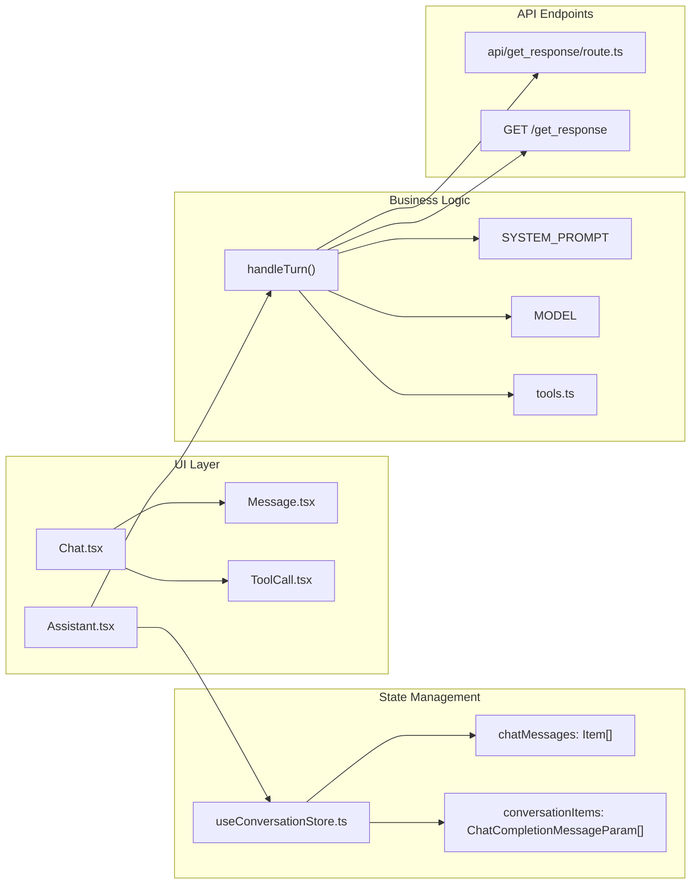

**Sources:** [frontend/components/Assistant.tsx](), [frontend/stores/useConversationStore.ts](), [frontend/lib/assistant.ts](), [frontend/lib/constants.ts](), [frontend/lib/tools.ts](), [frontend/app/api/get_response/route.ts](), [python-backend/app.py]()

## Technology Stack

The project uses modern web development technologies optimized for AI application development:

| Component | Technology | Purpose |
|-----------|------------|---------|
| **Frontend Framework** | Next.js 14 | React-based full-stack framework |
| **UI Components** | React + TypeScript | Type-safe component development |
| **State Management** | Zustand | Lightweight state management |
| **Styling** | Tailwind CSS | Utility-first CSS framework |
| **Backend Options** | Flask (Python) / Next.js API | Dual backend architecture |
| **AI Integration** | OpenAI API | GPT-4o model integration |
| **Development Tools** | ESLint, Prettier | Code quality and formatting |

**Sources:** [README.md:1-99](), [package.json](), [requirements.txt](), [frontend/lib/constants.ts]()

## Development Approach

The Builder Lab follows a challenge-based learning approach where developers progressively add functionality:

### Starting Point Structure

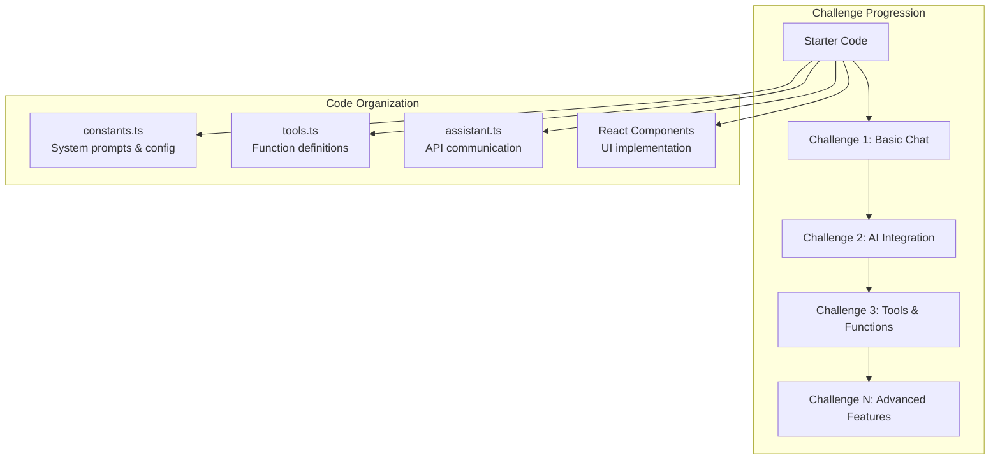

**Sources:** [README.md:65-99](), [frontend/lib/constants.ts](), [frontend/lib/tools.ts](), [frontend/lib/assistant.ts]()

## Backend Flexibility

The project provides two backend options to accommodate different developer preferences and learning objectives:

- **Flask Backend (`python-backend/app.py`)**: Primary focus for Python developers, designed for OpenAI API integration
- **Next.js API Routes (`frontend/app/api/`)**: Alternative for JavaScript developers, provides same functionality

Both backends implement the same `/get_response` endpoint interface, allowing seamless switching between implementations during development.

**Sources:** [README.md:45-63](), [python-backend/app.py](), [frontend/app/api/get_response/route.ts]()

## License and Usage

The project is dual-licensed to support both software development and font assets:

- **Software**: MIT License for maximum flexibility in educational and commercial use
- **Fonts**: SIL Open Font License 1.1 for the included Geist and Geist Mono fonts

For complete licensing details, see [Licensing](#6).

**Sources:** [license.txt:1-118]()

---

# Page: Getting Started

# Getting Started

<details>
<summary>Relevant source files</summary>

The following files were used as context for generating this wiki page:

- [README.md](README.md)
- [starting_point/frontend/package.json](starting_point/frontend/package.json)
- [starting_point/python-backend/app.py](starting_point/python-backend/app.py)

</details>


This document provides step-by-step instructions for setting up and running the OpenAI Builder Lab tutorial application. It covers installation, configuration, and initial startup procedures for both the NextJS frontend and optional Python Flask backend.

For detailed information about the backend systems architecture, see [Backend Systems](#3). For frontend application structure and components, see [Frontend Application](#4).

## Prerequisites

Before getting started, ensure you have the following installed on your system:

| Requirement | Version | Purpose |
|-------------|---------|---------|
| Node.js | 18+ | Frontend development and package management |
| npm | Latest | Package manager for JavaScript dependencies |
| Python | 3.8+ | Optional backend development |
| pip | Latest | Package manager for Python dependencies |
| OpenAI API Key | Valid | Required for AI functionality |

## Project Structure Overview

The Builder Lab project follows a dual-backend architecture with clear separation between frontend and backend components.

**Project Structure Diagram**
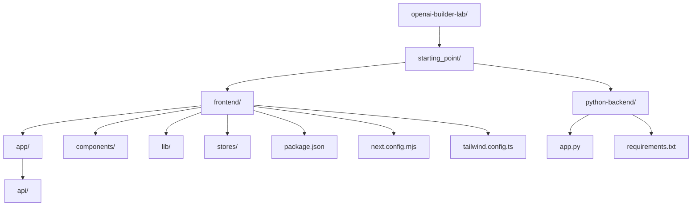

**Sources:** [README.md:70-99](), [starting_point/frontend/package.json:1-43](), [starting_point/python-backend/app.py:1-30]()

## Installation Process

### Step 1: Clone Repository

Clone the OpenAI Builder Lab repository to your local machine:

```bash
git clone https://github.com/openai/openai-builder-lab.git
cd openai-builder-lab
```

### Step 2: Navigate to Frontend Directory

```bash
cd starting_point/frontend
```

### Step 3: Configure OpenAI API Key

You have two options for setting your OpenAI API key:

**Option A: Global Environment Variable**
Set the `OPENAI_API_KEY` environment variable globally in your system.

**Option B: Project-Specific Configuration**
Create a `.env` file at the root of the project:

```bash
# In starting_point/frontend/.env
OPENAI_API_KEY=your_api_key_here
```

### Step 4: Install Frontend Dependencies

Install the required npm packages defined in `package.json`:

```bash
npm install
```

The key dependencies installed include:

| Package | Purpose |
|---------|---------|
| `next` | React framework for frontend |
| `react` | UI library |
| `zustand` | State management |
| `openai` | OpenAI API client |
| `tailwindcss` | CSS framework |

**Sources:** [README.md:10-43](), [starting_point/frontend/package.json:11-30]()

## Running the Application

### Frontend Development Server

Start the NextJS development server:

```bash
npm run dev
```

The application will be available at `http://localhost:3000`.

### Optional: Python Backend Setup

If you prefer using the Python Flask backend instead of the built-in NextJS API routes:

1. **Navigate to Python Backend Directory:**
   ```bash
   cd ../python-backend
   ```

2. **Install Python Dependencies:**
   ```bash
   pip install -r requirements.txt
   ```

3. **Start Flask Server:**
   ```bash
   python app.py
   ```

The Flask backend will run on `http://localhost:8000`.

**Application Startup Flow**
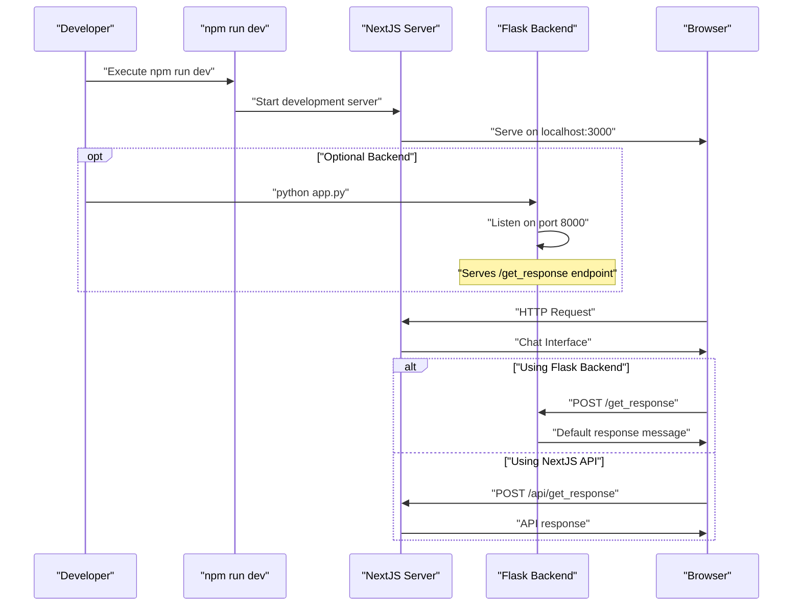

**Sources:** [README.md:39-63](), [starting_point/python-backend/app.py:27-29](), [starting_point/frontend/package.json:5-9]()

## Verification Steps

### 1. Frontend Verification

After starting the development server, verify the application is running:

- Open `http://localhost:3000` in your browser
- You should see a chat interface
- The application should load without console errors

### 2. Backend Verification

**For Flask Backend:**
- Navigate to `http://localhost:8000`
- You should see: "Server is running"
- The `/get_response` endpoint should be available

**Flask Backend Status Check**
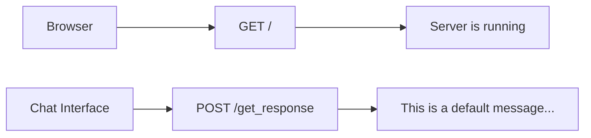

### 3. Integration Verification

Test the connection between frontend and backend:

1. Type a message in the chat interface
2. Send the message
3. Verify you receive a response (default placeholder message initially)

The default response from the Flask backend is configured in [starting_point/python-backend/app.py:22-25]().

**Sources:** [starting_point/python-backend/app.py:12-25](), [README.md:65-68]()

## Next Steps

Once the application is successfully running:

1. **Explore the Application Structure:** Review the frontend components in `starting_point/frontend/components/` and business logic in `starting_point/frontend/lib/`

2. **Review Backend Options:** Examine both the Flask backend [starting_point/python-backend/app.py]() and NextJS API routes for implementation approaches

3. **Begin Development:** Start implementing OpenAI API integration to replace the placeholder responses

4. **Follow Tutorial Challenges:** Progress through the Builder Lab challenges by gradually adding functionality

For detailed information about the application architecture, see [Core Architecture](#4.1). For backend implementation details, see [Python Flask Backend](#3.1) or [NextJS API Routes](#3.2).

**Sources:** [README.md:65-99](), [starting_point/python-backend/app.py:1-30](), [starting_point/frontend/package.json:1-43]()

---

# Page: Backend Systems

# Backend Systems

<details>
<summary>Relevant source files</summary>

The following files were used as context for generating this wiki page:

- [starting_point/frontend/app/api/get_response/route.ts](starting_point/frontend/app/api/get_response/route.ts)
- [starting_point/python-backend/app.py](starting_point/python-backend/app.py)

</details>


## Purpose and Scope

This document provides an overview of the dual backend architecture implemented in the OpenAI Builder Lab tutorial project. The system offers two backend implementation options: a Python Flask server and NextJS API routes, both designed to handle chat completion requests and integrate with the OpenAI API.

For detailed implementation specifics of the Flask backend, see [Python Flask Backend](#3.1). For NextJS API route implementation details, see [NextJS API Routes](#3.2).

## Dual Backend Architecture

The system implements a flexible backend architecture that allows developers to choose between two different backend approaches based on their preferences and deployment requirements.

### Backend Options Overview

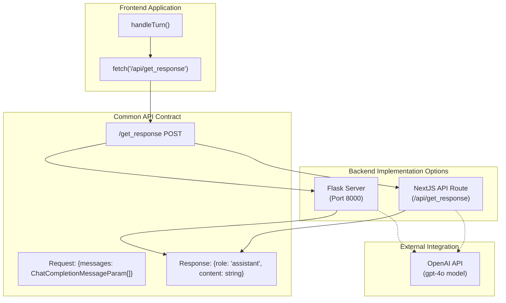

**Sources:** [starting_point/python-backend/app.py:16-25](), [starting_point/frontend/app/api/get_response/route.ts:1-21]()

### Backend Comparison

| Aspect | Flask Backend | NextJS API Routes |
|--------|---------------|-------------------|
| **Language** | Python | TypeScript |
| **Port** | 8000 | Same as frontend (3000) |
| **CORS** | Explicit CORS configuration | Handled by Next.js |
| **Deployment** | Separate server process | Integrated with frontend |
| **Development Focus** | Primary learning target | Alternative approach |
| **File Location** | `starting_point/python-backend/app.py` | `starting_point/frontend/app/api/get_response/route.ts` |

**Sources:** [starting_point/python-backend/app.py:7-8](), [starting_point/frontend/app/api/get_response/route.ts:1]()

## API Contract Implementation

Both backend options implement the same API contract to ensure frontend compatibility. The contract defines a single endpoint that accepts conversation messages and returns assistant responses.

### Request/Response Flow

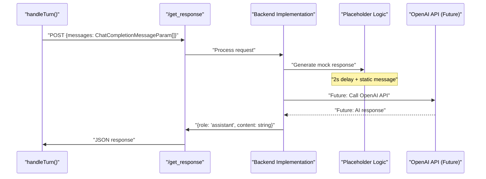

**Sources:** [starting_point/python-backend/app.py:16-25](), [starting_point/frontend/app/api/get_response/route.ts:1-21]()

### Shared Response Format

Both implementations return identical response structures:

```typescript
{
  role: "assistant",
  content: "This is a default message, update the backend to get a response from the OpenAI API instead."
}
```

The placeholder message explicitly indicates where OpenAI integration should be implemented, serving as a clear development checkpoint.

**Sources:** [starting_point/python-backend/app.py:22-25](), [starting_point/frontend/app/api/get_response/route.ts:8-14]()

## Backend Selection Strategy

### Flask Backend (Primary)
- **Use Case**: Learning Python web development, separate service architecture
- **Advantages**: Language flexibility, independent scaling, explicit CORS control
- **Configuration**: Runs on port 8000 with debug mode enabled
- **Model**: Uses `MODEL = "gpt-4o"` constant for future OpenAI integration

### NextJS API Routes (Alternative)
- **Use Case**: Full-stack TypeScript development, simplified deployment
- **Advantages**: Single deployment unit, automatic TypeScript integration
- **Configuration**: Integrated with frontend server
- **Error Handling**: Includes try-catch with 500 status responses

**Sources:** [starting_point/python-backend/app.py:10](), [starting_point/python-backend/app.py:28-29](), [starting_point/frontend/app/api/get_response/route.ts:15-20]()

## Development Implementation Status

Both backend implementations currently provide placeholder responses with a 2-second delay to simulate API latency. This design pattern allows developers to:

1. Test the complete request/response cycle
2. Verify frontend integration
3. Experience realistic response timing
4. Identify integration points for OpenAI API implementation

The consistent placeholder message across both backends ensures that switching between implementations doesn't affect frontend behavior during development.

**Sources:** [starting_point/python-backend/app.py:21-24](), [starting_point/frontend/app/api/get_response/route.ts:7-12]()

---

# Page: Python Flask Backend

# Python Flask Backend

<details>
<summary>Relevant source files</summary>

The following files were used as context for generating this wiki page:

- [starting_point/python-backend/app.py](starting_point/python-backend/app.py)

</details>


## Purpose and Scope

This document covers the Python Flask backend implementation, which serves as the primary backend option for the OpenAI Builder Lab tutorial project. The Flask backend provides HTTP API endpoints for the frontend chat interface and is structured to integrate with the OpenAI API for generating AI assistant responses.

For information about the alternative NextJS API backend option, see [NextJS API Routes](#3.2). For details about the frontend application that consumes this backend, see [Frontend Application](#4).

## Architecture Overview

The Flask backend is a lightweight HTTP server that provides REST API endpoints for the chat application. It uses Flask-CORS to handle cross-origin requests from the frontend and is configured with environment variable support for production deployment.

### Core Flask Application Structure

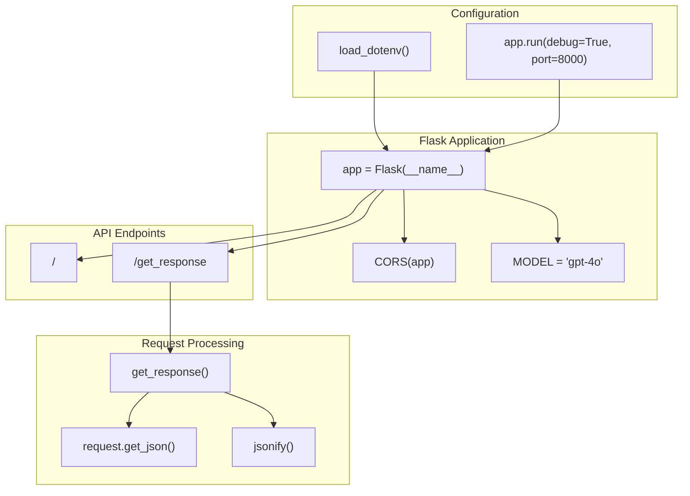

**Sources:** [starting_point/python-backend/app.py:1-30]()

### Request-Response Flow

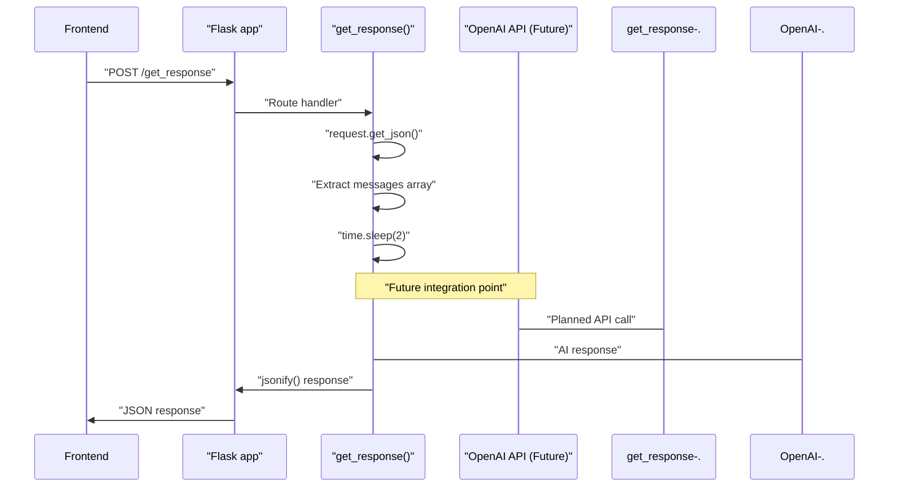

**Sources:** [starting_point/python-backend/app.py:16-25]()

## API Endpoints

### Health Check Endpoint

| Method | Route | Purpose | Response |
|--------|-------|---------|----------|
| GET | `/` | Server health check | Plain text: "Server is running" |

The home endpoint provides a simple way to verify that the Flask server is running and accessible.

**Sources:** [starting_point/python-backend/app.py:12-14]()

### Chat Response Endpoint

| Method | Route | Purpose | Request Body | Response |
|--------|-------|---------|--------------|----------|
| POST | `/get_response` | Generate chat assistant response | `{"messages": [...]}` | `{"role": "assistant", "content": "..."}` |

The primary API endpoint accepts a JSON payload containing a `messages` array and returns an assistant response. Currently returns a placeholder message but is structured for OpenAI API integration.

#### Request Format
The endpoint expects a JSON object with a `messages` field containing conversation history:
```json
{
  "messages": [
    {"role": "user", "content": "Hello"},
    {"role": "assistant", "content": "Hi there!"}
  ]
}
```

#### Response Format  
Returns a JSON object matching OpenAI's message format:
```json
{
  "role": "assistant", 
  "content": "This is a default message, update the backend to get a response from the OpenAI API instead."
}
```

**Sources:** [starting_point/python-backend/app.py:16-25]()

## Configuration and Environment

### Dependencies and Imports

The Flask backend uses several key dependencies:

| Package | Purpose | Import Statement |
|---------|---------|------------------|
| `flask` | Web framework | `from flask import Flask, request, jsonify` |
| `flask-cors` | Cross-origin request handling | `from flask_cors import CORS` |
| `python-dotenv` | Environment variable loading | `from dotenv import load_dotenv` |

**Sources:** [starting_point/python-backend/app.py:1-4]()

### Application Configuration

The Flask application is configured with the following settings:

- **CORS**: Enabled for all routes to allow frontend requests from different origins
- **Debug Mode**: Enabled for development (`debug=True`)
- **Port**: Runs on port 8000
- **Model**: Configured to use `gpt-4o` model for OpenAI integration

**Sources:** [starting_point/python-backend/app.py:7-10, 27-29]()

### Environment Variables

The application loads environment variables using `load_dotenv()`, preparing for configuration values like:
- OpenAI API keys
- Model preferences
- Production vs development settings

**Sources:** [starting_point/python-backend/app.py:5]()

## OpenAI Integration Preparation

### Model Configuration

The backend is pre-configured with the OpenAI model specification:

```python
MODEL = "gpt-4o"
```

This constant defines which OpenAI model will be used when the integration is implemented.

**Sources:** [starting_point/python-backend/app.py:10]()

### Integration Points

The current implementation includes placeholder logic that demonstrates the integration pattern:

1. **Message Processing**: The `get_response` function extracts the `messages` array from the request
2. **Logging**: Prints incoming messages for debugging: `print("Incoming messages", messages)`  
3. **Response Structure**: Returns responses in OpenAI's expected format with `role` and `content` fields
4. **Simulated Delay**: Uses `time.sleep(2)` to simulate API call latency

**Sources:** [starting_point/python-backend/app.py:18-24]()

### Future Implementation

To complete the OpenAI integration, the placeholder response logic should be replaced with:
- OpenAI client initialization using environment variables
- API calls to OpenAI's chat completions endpoint
- Error handling for API failures
- Token usage tracking and management

## Development and Deployment

### Running the Development Server

The Flask application is configured to run in development mode:

```python
if __name__ == '__main__':
    app.run(debug=True, port=8000)
```

This configuration:
- Enables debug mode for detailed error messages
- Runs on port 8000 to avoid conflicts with the frontend (typically port 3000)
- Provides hot reloading during development

**Sources:** [starting_point/python-backend/app.py:27-29]()

### Production Considerations

The code includes a comment noting that debug mode should be disabled in production environments. Additional production considerations include:
- Setting `debug=False`
- Using a production WSGI server (e.g., Gunicorn)
- Implementing proper error handling and logging
- Securing environment variables and API keys

**Sources:** [starting_point/python-backend/app.py:28]()

---

# Page: NextJS API Routes

# NextJS API Routes

<details>
<summary>Relevant source files</summary>

The following files were used as context for generating this wiki page:

- [starting_point/frontend/app/api/get_response/route.ts](starting_point/frontend/app/api/get_response/route.ts)

</details>


This document covers the NextJS API Routes backend implementation, which serves as an alternative to the Python Flask backend for the OpenAI Builder Lab tutorial project. This system provides a JavaScript/TypeScript-based backend option that runs within the NextJS application framework.

For information about the primary Python Flask backend, see [Python Flask Backend](#3.1). For details about the frontend architecture that consumes these API routes, see [Frontend Application](#4).

## Purpose and Architecture

The NextJS API Routes backend provides a streamlined alternative to the Flask backend, allowing developers to maintain a single-language codebase entirely in TypeScript. This approach eliminates the need to run separate backend processes and simplifies deployment by leveraging NextJS's built-in API route functionality.

The current implementation serves as a foundation for OpenAI API integration while providing placeholder responses for development and testing purposes.

## Route Structure and Implementation

### API Route Definition

The backend consists of a single API route that handles chat completion requests from the frontend:

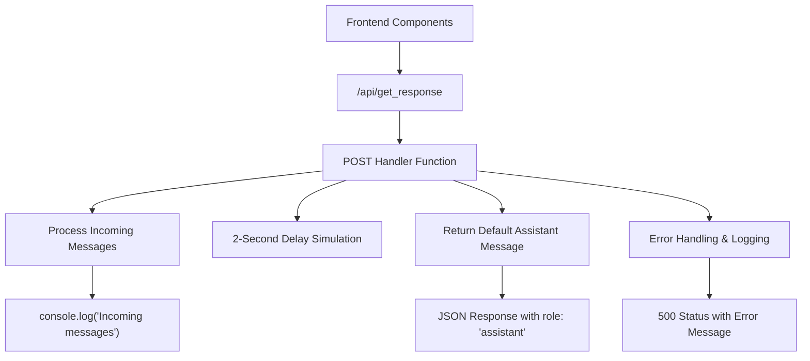

**Sources:** [starting_point/frontend/app/api/get_response/route.ts:1-21]()

### Request Processing Flow

The API route implements a straightforward request-response pattern:

| Component | Function | Implementation Detail |
|-----------|----------|----------------------|
| `POST` function | Main request handler | Extracts messages from request body |
| Message logging | Debug functionality | Logs incoming messages to console |
| Delay simulation | Development feature | 2-second setTimeout to simulate API latency |
| Response formatting | Data structure | Returns object with `role` and `content` fields |
| Error handling | Fault tolerance | Catches exceptions and returns 500 status |

**Sources:** [starting_point/frontend/app/api/get_response/route.ts:1-21]()

## API Contract and Data Flow

### Request Format

The API route expects POST requests with the following structure:

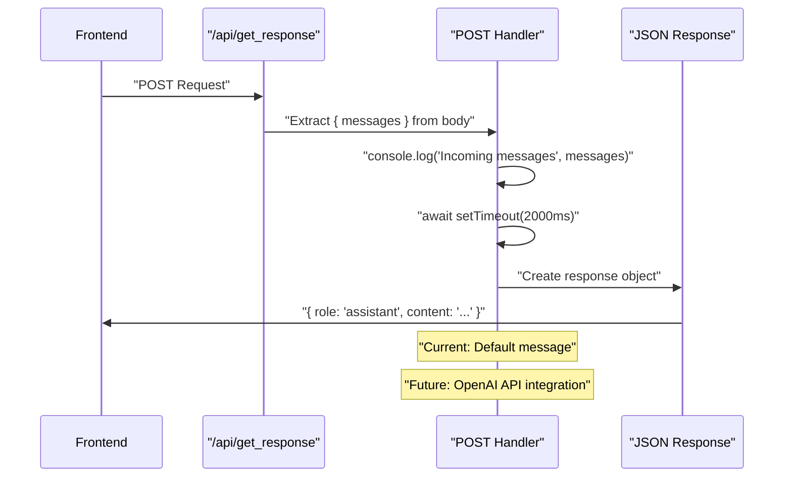

**Sources:** [starting_point/frontend/app/api/get_response/route.ts:2-14]()

### Response Format

The API consistently returns responses in the OpenAI API message format:

| Field | Type | Purpose | Current Value |
|-------|------|---------|---------------|
| `role` | string | Message sender identification | `"assistant"` |
| `content` | string | Message text content | Default placeholder message |

**Sources:** [starting_point/frontend/app/api/get_response/route.ts:9-14]()

## Integration with Frontend Components

### Connection Points

The NextJS API route integrates with the frontend through the following connection points:

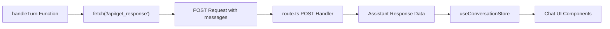

**Sources:** [starting_point/frontend/app/api/get_response/route.ts:1-21]()

### Data Transformation

The API route receives conversation messages in the OpenAI API format and returns responses in the same format, maintaining consistency with the expected data structure throughout the application.

## Comparison with Flask Backend

### Architectural Differences

| Aspect | NextJS API Routes | Flask Backend |
|--------|------------------|---------------|
| Language | TypeScript | Python |
| Process Model | Single NextJS process | Separate Flask process |
| Deployment | Integrated with frontend | Independent service |
| Development Setup | `npm run dev` only | Requires separate `python app.py` |
| CORS Handling | Built-in NextJS support | Requires Flask-CORS |
| Environment Variables | NextJS `.env` support | python-dotenv |

### Current Implementation Status

Both backends currently implement placeholder responses with identical functionality:

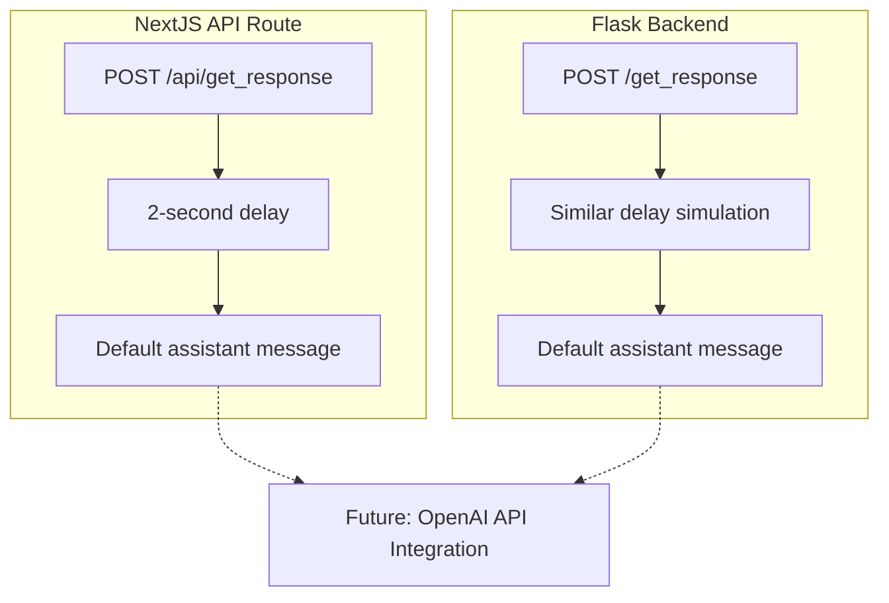

**Sources:** [starting_point/frontend/app/api/get_response/route.ts:7-14]()

## Error Handling and Logging

### Error Management Strategy

The API route implements basic error handling with console logging and appropriate HTTP status codes:

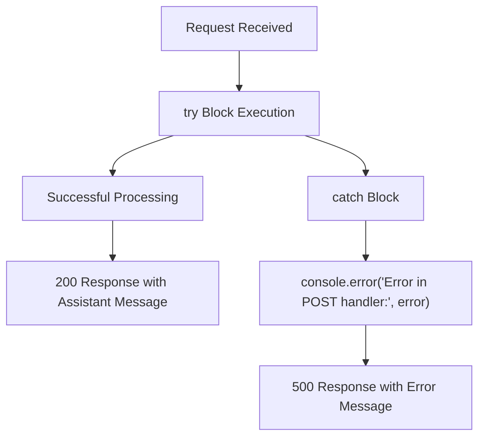

**Sources:** [starting_point/frontend/app/api/get_response/route.ts:15-20]()

## Future OpenAI Integration Points

### Planned Enhancement Areas

The current implementation provides the foundation for OpenAI API integration:

| Integration Point | Current State | Future Enhancement |
|------------------|---------------|-------------------|
| Message Processing | Logs incoming messages | Process for OpenAI API format |
| API Communication | Simulated delay | Actual OpenAI API calls |
| Response Handling | Static default message | Dynamic AI-generated responses |
| Error Management | Basic try-catch | OpenAI-specific error handling |
| Authentication | None | OpenAI API key management |

The route structure aligns with OpenAI's expected message format, requiring minimal changes to integrate with the actual API service.

**Sources:** [starting_point/frontend/app/api/get_response/route.ts:1-21]()

---

# Page: Frontend Application

# Frontend Application

<details>
<summary>Relevant source files</summary>

The following files were used as context for generating this wiki page:

- [starting_point/frontend/app/layout.tsx](starting_point/frontend/app/layout.tsx)
- [starting_point/frontend/app/page.tsx](starting_point/frontend/app/page.tsx)
- [starting_point/frontend/package.json](starting_point/frontend/package.json)

</details>


## Purpose and Scope

This section documents the NextJS frontend application that provides the user interface for the OpenAI Builder Lab chat assistant. The frontend is built with React components, uses Zustand for state management, and provides a responsive chat interface for interacting with AI assistants.

For detailed information about specific aspects of the frontend, see:
- Core architecture and routing: [Core Architecture](#4.1)
- React component structure: [Chat Interface Components](#4.2) 
- Assistant logic and conversation handling: [Business Logic](#4.3)
- State management patterns: [State Management](#4.4)
- Styling system and assets: [Styling and Assets](#4.5)

For backend integration details, see [Backend Systems](#3).

## Application Architecture Overview

The frontend application follows a modern NextJS architecture with React Server Components, TypeScript, and utility-first CSS styling.

**Frontend Application Structure**
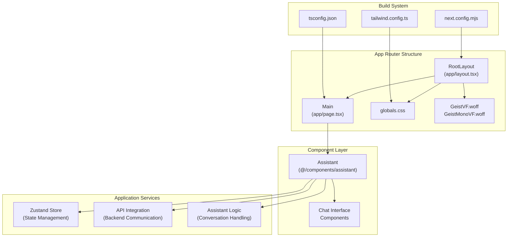

Sources: [starting_point/frontend/app/layout.tsx:1-39](), [starting_point/frontend/app/page.tsx:1-12]()

## Technology Stack

The frontend leverages modern web development technologies with a focus on developer experience and type safety.

| Category | Technology | Version | Purpose |
|----------|------------|---------|---------|
| Framework | Next.js | 14.2.11 | React framework with App Router |
| UI Library | React | ^18 | Component-based UI development |
| Language | TypeScript | ^5.6.2 | Type safety and developer experience |
| State Management | Zustand | ^5.0.2 | Lightweight state management |
| Styling | Tailwind CSS | ^3.4.1 | Utility-first CSS framework |
| Icons | Lucide React | ^0.441.0 | Icon library |
| Markdown | React Markdown | ^9.0.1 | Content rendering |
| API Client | OpenAI | ^4.61.0 | AI service integration |

Sources: [starting_point/frontend/package.json:11-43]()

## Core Application Flow

The application implements a single-page chat interface with server-side rendering and client-side interactivity.

**Request Flow and Component Hierarchy**
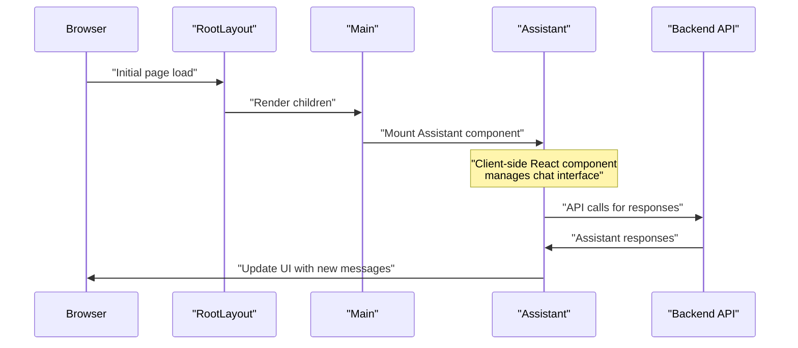

Sources: [starting_point/frontend/app/layout.tsx:24-38](), [starting_point/frontend/app/page.tsx:3-11]()

## Application Configuration

The frontend uses several configuration files to manage build processes, styling, and development tools.

**Configuration Dependencies**
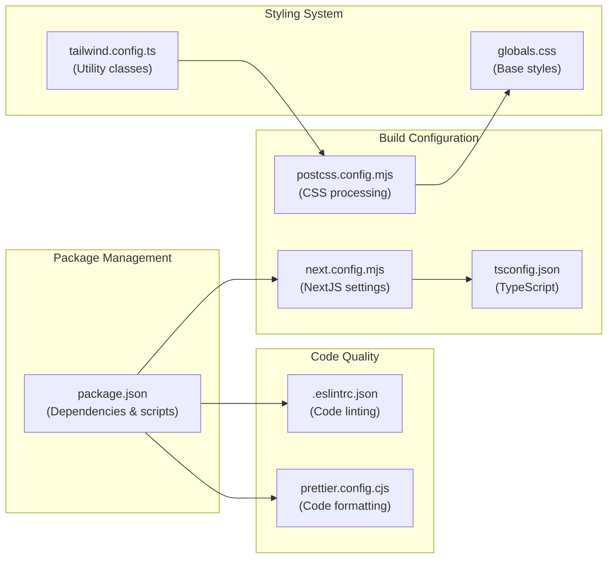

Sources: [starting_point/frontend/package.json:1-43]()

## Development Scripts

The application provides standard NextJS development commands for building and running the frontend.

| Script | Command | Purpose |
|--------|---------|---------|
| `dev` | `next dev` | Start development server with hot reload |
| `build` | `next build` | Create production build |
| `start` | `next start` | Start production server |
| `lint` | `next lint` | Run ESLint code quality checks |

Sources: [starting_point/frontend/package.json:5-10]()

## Root Layout Structure

The `RootLayout` component establishes the foundational HTML structure and global styling for the entire application.

**Root Layout Architecture**
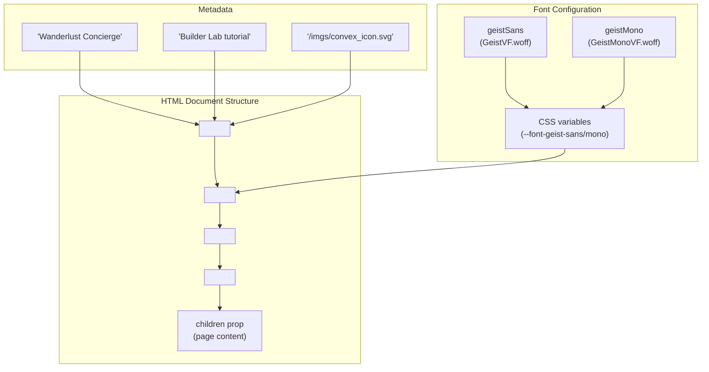

Sources: [starting_point/frontend/app/layout.tsx:5-38]()

The layout establishes a full-screen container with responsive design classes and loads custom Geist fonts with variable weight support. The application title "Wanderlust Concierge" suggests a travel-focused AI assistant interface.

---

# Page: Core Architecture

# Core Architecture

<details>
<summary>Relevant source files</summary>

The following files were used as context for generating this wiki page:

- [starting_point/frontend/app/layout.tsx](starting_point/frontend/app/layout.tsx)
- [starting_point/frontend/app/page.tsx](starting_point/frontend/app/page.tsx)
- [starting_point/frontend/components.json](starting_point/frontend/components.json)
- [starting_point/frontend/next.config.mjs](starting_point/frontend/next.config.mjs)

</details>


This document covers the fundamental NextJS application structure, routing, layout, and configuration that forms the foundation of the OpenAI Builder Lab frontend application. For information about the specific chat interface components, see [Chat Interface Components](#4.2). For business logic and conversation handling, see [Business Logic](#4.3).

## Application Structure and Routing

The application uses NextJS 14's App Router with file-based routing. The core structure follows the standard NextJS app directory convention where the file system defines the application routes.

### File System Architecture

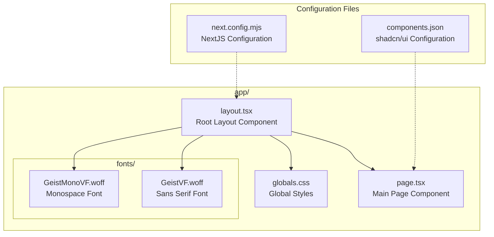

Sources: [starting_point/frontend/app/layout.tsx:1-38](), [starting_point/frontend/app/page.tsx:1-11](), [starting_point/frontend/next.config.mjs:1-4](), [starting_point/frontend/components.json:1-20]()

## Root Layout Component

The `RootLayout` function in `layout.tsx` serves as the foundational wrapper for the entire application. It configures typography, metadata, and provides the base HTML structure.

### Layout Configuration

```mermaid
graph TB
    subgraph "RootLayout Function"
        metadata["metadata: Metadata<br/>App Title & Description"]
        geistSansFont["geistSans: LocalFont<br/>--font-geist-sans CSS Variable"]
        geistMonoFont["geistMono: LocalFont<br/>--font-geist-mono CSS Variable"]
        htmlStructure["HTML Structure<br/>body.className applies fonts"]
    end
    
    subgraph "Font Loading"
        geistVF["./fonts/GeistVF.woff<br/>Weight: 100-900"]
        geistMonoVF["./fonts/GeistMonoVF.woff<br/>Weight: 100-900"]
    end
    
    subgraph "Layout Styling"
        mainDiv["div.flex.h-screen.bg-gray-200<br/>Full Height Container"]
        mainElement["main<br/>Content Wrapper"]
    end
    
    geistSansFont --> geistVF
    geistMonoFont --> geistMonoVF
    htmlStructure --> mainDiv
    mainDiv --> mainElement
    
    metadata --> htmlStructure
    geistSansFont --> htmlStructure
    geistMonoFont --> htmlStructure
```

The layout implements several key architectural patterns:

| Component | Configuration | Purpose |
|-----------|---------------|---------|
| `geistSans` | Variable font, 100-900 weight | Primary typography using CSS custom property `--font-geist-sans` |
| `geistMono` | Variable font, 100-900 weight | Monospace typography using CSS custom property `--font-geist-mono` |
| `metadata` | Title: "Wanderlust Concierge" | SEO and browser tab configuration |
| Base container | `flex h-screen bg-gray-200 w-full flex-col text-stone-900` | Full-screen layout with consistent styling |

Sources: [starting_point/frontend/app/layout.tsx:5-14](), [starting_point/frontend/app/layout.tsx:16-22](), [starting_point/frontend/app/layout.tsx:32-34]()

## Main Page Component

The `Main` function in `page.tsx` represents the application's root route (`/`) and serves as the entry point for the user interface. It implements a responsive layout pattern that centers the main content.

### Page Structure

```mermaid
graph TB
    subgraph "Main Function"
        outerDiv["div.flex.justify-center.h-screen<br/>Centering Container"]
        innerDiv["div.w-full.pt-10.md:w-2/3<br/>Responsive Width Container"]
        assistantComponent["Assistant Component<br/>Core Application Logic"]
    end
    
    outerDiv --> innerDiv
    innerDiv --> assistantComponent
```

The page implements a responsive design pattern:
- **Mobile**: Full width (`w-full`)
- **Desktop**: Two-thirds width (`md:w-2/3`)
- **Vertical spacing**: Top padding of 2.5rem (`pt-10`)

Sources: [starting_point/frontend/app/page.tsx:3-10]()

## Component System Configuration

The `components.json` file configures the shadcn/ui component library integration, establishing path aliases and styling conventions used throughout the application.

### Configuration Structure

| Setting | Value | Purpose |
|---------|-------|---------|
| `style` | "new-york" | shadcn/ui style variant |
| `rsc` | `true` | React Server Components support |
| `tsx` | `true` | TypeScript JSX support |
| `tailwind.config` | "tailwind.config.ts" | Tailwind configuration path |
| `tailwind.css` | "app/globals.css" | Global CSS file path |
| `tailwind.baseColor` | "stone" | Default color palette |
| `tailwind.cssVariables` | `true` | CSS custom properties support |

### Path Aliases

The configuration establishes TypeScript path mapping for clean imports:

```mermaid
graph LR
    subgraph "Import Aliases"
        components["@/components<br/>Component Directory"]
        utils["@/utils<br/>Utility Functions"]  
        ui["@/components/ui<br/>UI Components"]
        lib["@/lib<br/>Library Code"]
        hooks["@/hooks<br/>React Hooks"]
    end
    
    components --> ui
    lib --> utils
```

These aliases enable clean import statements like `import Assistant from '@/components/assistant'` instead of relative paths.

Sources: [starting_point/frontend/components.json:6-12](), [starting_point/frontend/components.json:13-19]()

## NextJS Configuration

The `next.config.mjs` file contains the NextJS application configuration. Currently, it uses the default empty configuration, indicating a minimal setup approach.

### Configuration Object

```mermaid
graph TB
    nextConfig["nextConfig: NextConfig<br/>Empty Object {}"]
    export["export default nextConfig<br/>ES Module Export"]
    
    nextConfig --> export
```

The minimal configuration suggests the application relies on NextJS defaults for:
- Build optimization
- Routing behavior  
- Development server settings
- Production build configuration

Sources: [starting_point/frontend/next.config.mjs:1-4]()

## Architecture Summary

The core architecture establishes a clean, minimal foundation with:

1. **File-based routing** using NextJS App Router
2. **Typography system** with Geist variable fonts
3. **Responsive layout** with Tailwind CSS utility classes
4. **Component library integration** via shadcn/ui
5. **Clean import paths** through TypeScript aliases
6. **Minimal configuration** leveraging NextJS defaults

This foundation provides the structural base upon which the chat interface components ([Chat Interface Components](#4.2)) and business logic ([Business Logic](#4.3)) are built.

---

# Page: Chat Interface Components

# Chat Interface Components

<details>
<summary>Relevant source files</summary>

The following files were used as context for generating this wiki page:

- [starting_point/frontend/components/assistant.tsx](starting_point/frontend/components/assistant.tsx)
- [starting_point/frontend/components/chat.tsx](starting_point/frontend/components/chat.tsx)
- [starting_point/frontend/components/message.tsx](starting_point/frontend/components/message.tsx)
- [starting_point/frontend/components/tool-call.tsx](starting_point/frontend/components/tool-call.tsx)

</details>


This document covers the React components that compose the chat interface of the OpenAI Builder Lab application. These components handle the display of conversations, user input, message rendering, and tool call visualization.

For information about the underlying business logic and conversation handling, see [Business Logic](#4.3). For state management patterns, see [State Management](#4.4).

## Component Architecture

The chat interface is built using a hierarchical component structure where the `Assistant` component serves as the main orchestrator, delegating display responsibilities to specialized child components.

### Component Hierarchy

```mermaid
graph TD
    Assistant["Assistant<br/>(assistant.tsx)"] --> Chat["Chat<br/>(chat.tsx)"]
    Chat --> Message["Message<br/>(message.tsx)"]
    Chat --> ToolCall["ToolCall<br/>(tool-call.tsx)"]
    
    subgraph "Props Flow"
        ChatProps["ChatProps<br/>items, onSendMessage, loading"]
        MessageProps["MessageProps<br/>message, loading"]
        ToolCallProps["FunctionCallProps<br/>functionCall, previousItem"]
    end
    
    Assistant --> ChatProps
    Chat --> MessageProps
    Chat --> ToolCallProps
```

Sources: [starting_point/frontend/components/assistant.tsx:1-51](), [starting_point/frontend/components/chat.tsx:1-113](), [starting_point/frontend/components/message.tsx:1-56](), [starting_point/frontend/components/tool-call.tsx:1-101]()

## Assistant Component

The `Assistant` component acts as the primary orchestrator for the chat interface, managing the conversation flow and coordinating between the UI components and business logic.

### Key Responsibilities

| Responsibility | Implementation |
|---|---|
| Message Handling | Processes user input through `handleSendMessage` function |
| State Management | Integrates with `useConversationStore` for conversation state |
| Loading States | Manages loading state during message processing |
| Business Logic Integration | Calls `handleTurn` function to process conversations |

### Message Processing Flow

```mermaid
sequenceDiagram
    participant User
    participant Assistant
    participant Store["useConversationStore"]
    participant BusinessLogic["handleTurn"]
    
    User->>Assistant: "handleSendMessage(message)"
    Assistant->>Assistant: "Create userItem & userMessage"
    Assistant->>Store: "addConversationItem(userMessage)"
    Assistant->>Store: "addChatMessage(userItem)"
    Assistant->>BusinessLogic: "handleTurn()"
    BusinessLogic-->>Assistant: "Processing complete"
    Assistant->>User: "UI updates via store"
```

The component creates two data structures for each user message: an `Item` for UI display and a `ChatCompletionMessageParam` for API communication.

Sources: [starting_point/frontend/components/assistant.tsx:13-37]()

## Chat Component

The `Chat` component handles the primary display logic for conversations, including message rendering, input management, and auto-scrolling behavior.

### Core Features

| Feature | Implementation Details |
|---|---|
| Message Display | Renders `items` array using conditional rendering for different types |
| Input Handling | Manages textarea input with Enter key submission |
| Auto-scrolling | Automatically scrolls to bottom when new messages arrive |
| Loading States | Shows loading indicator during message processing |

### Input Interface Design

The chat input is implemented as a rounded textarea with an integrated send button:

```mermaid
graph LR
    InputContainer["Input Container<br/>(rounded-[26px])"] --> Textarea["Textarea<br/>(resize-none, auto-height)"]
    InputContainer --> SendButton["Send Button<br/>(disabled when empty)"]
    
    Textarea --> EnterKey["Enter Key Handler<br/>(preventDefault, onSendMessage)"]
    SendButton --> ClickHandler["Click Handler<br/>(onSendMessage)"]
```

### Message Type Rendering Logic

The component uses conditional rendering to handle different message types:

- **Function Calls**: Rendered using `ToolCall` component with previous item context
- **Regular Messages**: Rendered using `Message` component  
- **Loading States**: Shows special loading message for assistant responses

Sources: [starting_point/frontend/components/chat.tsx:32-43](), [starting_point/frontend/components/chat.tsx:54-106]()

## Message Component

The `Message` component handles the display of individual chat messages with role-based styling and markdown rendering.

### Message Styling Patterns

```mermaid
graph TB
    MessageComponent["Message Component"] --> UserMessage["User Message<br/>(justify-end, white bg)"]
    MessageComponent --> AssistantMessage["Assistant Message<br/>(justify-start, black bg)"]
    
    UserMessage --> UserLabel["'Me' Label<br/>(text-xs, zinc-600)"]
    UserMessage --> UserContent["User Content<br/>(rounded-[18px], px-4, py-2)"]
    
    AssistantMessage --> AssistantLabel["'Assistant' Label<br/>(text-xs, zinc-600)"]
    AssistantMessage --> AssistantContent["Assistant Content<br/>(rounded-[18px], white text)"]
    AssistantMessage --> LoadingState["Loading Animation<br/>(3-dot spinner)"]
```

### Markdown Integration

Both user and assistant messages use `ReactMarkdown` for content rendering, enabling rich text formatting within the chat interface.

Sources: [starting_point/frontend/components/message.tsx:14-50](), [starting_point/frontend/components/message.css:1-8]()

## ToolCall Component

The `ToolCall` component provides an expandable interface for displaying function call details with syntax highlighting.

### ToolCall Display Structure

```mermaid
graph TD
    ToolCallContainer["Tool Call Container<br/>(bg-white, rounded-[16px])"] --> Header["Header Section<br/>(Zap icon + function name)"]
    ToolCallContainer --> ExpandableDetails["Expandable Details<br/>(showDetails state)"]
    
    Header --> FunctionName["Function Name<br/>(capitalize, split by underscore)"]
    Header --> ChevronToggle["Chevron Toggle<br/>(rotate on expand)"]
    
    ExpandableDetails --> ArgumentsSection["Arguments Section<br/>(JSON syntax highlight)"]
    ExpandableDetails --> OutputSection["Output Section<br/>(JSON syntax highlight)"]
    
    subgraph "Syntax Highlighting"
        SyntaxHighlighter["react-syntax-highlighter<br/>(Prism, coy theme)"]
    end
    
    ArgumentsSection --> SyntaxHighlighter
    OutputSection --> SyntaxHighlighter
```

### Visual Connection System

The component includes a visual connection system that draws lines between consecutive function calls to show execution flow.

Sources: [starting_point/frontend/components/tool-call.tsx:23-96](), [starting_point/frontend/components/tool-call.tsx:54-91]()

## Data Flow Integration

### Item Type Handling

The chat interface handles multiple item types defined in the assistant library:

| Item Type | Component | Key Properties |
|---|---|---|
| `message` | `Message` | `role`, `content` |
| `function_call` | `ToolCall` | `name`, `parsedArguments`, `output` |

### State Integration Patterns

```mermaid
graph LR
    ConversationStore["useConversationStore"] --> ChatMessages["chatMessages: Item[]"]
    ChatMessages --> ChatComponent["Chat Component"]
    ChatComponent --> ConditionalRender["Conditional Rendering"]
    
    ConditionalRender --> MessageComponent["Message Component"]
    ConditionalRender --> ToolCallComponent["ToolCall Component"]
    
    subgraph "Props Passing"
        MessageProps["MessageProps<br/>{message, loading}"]
        ToolCallProps["FunctionCallProps<br/>{functionCall, previousItem}"]
    end
    
    MessageComponent --> MessageProps
    ToolCallComponent --> ToolCallProps
```

The components integrate with the Zustand store through the `Assistant` component, which passes the `chatMessages` array down to the `Chat` component for rendering.

Sources: [starting_point/frontend/components/assistant.tsx:10-11](), [starting_point/frontend/components/chat.tsx:15]()

## Styling and Layout

### CSS Integration

The chat interface uses a combination of Tailwind CSS classes and custom CSS for specialized styling:

- **Layout**: Flexbox-based responsive design with maximum width constraints
- **Scrolling**: Custom scrollable areas with overflow handling  
- **Animation**: CSS-based loading animations for message processing states
- **Typography**: Consistent font sizing and color schemes across components

### Responsive Design Patterns

The interface adapts to different screen sizes using responsive margins and padding:
- Desktop: `md:ml-24` and `md:mr-24` for wider message containers
- Mobile: Standard margins for compact display

Sources: [starting_point/frontend/components/chat.tsx:28-31](), [starting_point/frontend/components/message.tsx:20](), [starting_point/frontend/components/message.tsx:35]()

---

# Page: Business Logic

# Business Logic

<details>
<summary>Relevant source files</summary>

The following files were used as context for generating this wiki page:

- [starting_point/frontend/lib/assistant.ts](starting_point/frontend/lib/assistant.ts)
- [starting_point/frontend/lib/constants.ts](starting_point/frontend/lib/constants.ts)
- [starting_point/frontend/lib/tools.ts](starting_point/frontend/lib/tools.ts)
- [starting_point/frontend/lib/utils.ts](starting_point/frontend/lib/utils.ts)

</details>


This section documents the core business logic that powers the chat assistant application, including conversation handling, message processing, system configuration, and tools integration. The business logic layer serves as the bridge between the frontend components and backend services.

For information about the React components that use this business logic, see [Chat Interface Components](#4.2). For details about the state management integration, see [State Management](#4.4).

## Core Conversation Processing

The primary business logic is implemented in the `handleTurn` function, which orchestrates the conversation flow between the user interface and backend services. This function manages the complete lifecycle of a conversation turn, from gathering conversation history to updating the application state with the response.

### handleTurn Function Flow

```mermaid
flowchart TD
    Start["handleTurn()"] --> GetState["useConversationStore.getState()"]
    GetState --> BuildMessages["Build allConversationItems[]"]
    BuildMessages --> AddSystem["Add SYSTEM_PROMPT to messages"]
    AddSystem --> FetchAPI["fetch('/api/get_response')"]
    FetchAPI --> CheckResponse{"response.ok?"}
    CheckResponse -->|No| LogError["console.error()"]
    CheckResponse -->|Yes| ParseData["await response.json()"]
    ParseData --> UpdateChat["chatMessages.push(data)"]
    UpdateChat --> SetChat["setChatMessages([...chatMessages])"]
    SetChat --> UpdateConv["conversationItems.push(data)"]
    UpdateConv --> SetConv["setConversationItems([...conversationItems])"]
    SetConv --> End["Complete"]
    LogError --> End
```

The function performs these key operations:

1. **State Retrieval**: Accesses current conversation state via `useConversationStore.getState()`
2. **Message Preparation**: Constructs the complete conversation context including system prompt
3. **Backend Communication**: Sends POST request to either NextJS API routes or Flask backend
4. **Response Processing**: Parses the response and updates application state
5. **Error Handling**: Logs errors and prevents application crashes

**Sources**: [starting_point/frontend/lib/assistant.ts:23-69]()

### Backend Integration Options

The system supports dual backend integration through configurable endpoints:

| Backend Type | Endpoint | Configuration |
|--------------|----------|---------------|
| NextJS API Routes | `/api/get_response` | Default configuration [starting_point/frontend/lib/assistant.ts:42]() |
| Python Flask | `http://localhost:8000/get_response` | Alternative configuration [starting_point/frontend/lib/assistant.ts:41]() |

**Sources**: [starting_point/frontend/lib/assistant.ts:40-48]()

## Message and Data Types

The business logic defines a comprehensive type system for handling different kinds of conversation elements and function calls.

### Core Message Types

```mermaid
classDiagram
    class Item {
        <<union>>
        MessageItem | FunctionCallItem
    }
    
    class MessageItem {
        +string type "message"
        +string role "user | assistant | system"
        +string content
    }
    
    class FunctionCallItem {
        +string type "function_call"
        +string status "in_progress | completed | failed"
        +string id
        +string name
        +string arguments
        +any parsedArguments
        +string|null output
    }
    
    Item --> MessageItem
    Item --> FunctionCallItem
```

The type system supports:

- **MessageItem**: Standard chat messages with role-based content [starting_point/frontend/lib/assistant.ts:5-9]()
- **FunctionCallItem**: Tool/function invocations with execution status and results [starting_point/frontend/lib/assistant.ts:11-19]()
- **Item**: Union type encompassing all conversation elements [starting_point/frontend/lib/assistant.ts:21]()

**Sources**: [starting_point/frontend/lib/assistant.ts:5-21]()

### OpenAI Integration Types

The system imports `ChatCompletionMessageParam` from the OpenAI SDK to ensure compatibility with OpenAI's chat completion API format [starting_point/frontend/lib/assistant.ts:1](). This allows seamless integration with OpenAI services while maintaining type safety.

**Sources**: [starting_point/frontend/lib/assistant.ts:1]()

## System Configuration and Constants

The application's behavior is controlled through centralized configuration constants that define the AI model, system personality, and user experience.

### Core Configuration Constants

```mermaid
graph LR
    Config["constants.ts"] --> Model["MODEL = 'gpt-4o'"]
    Config --> SystemPrompt["SYSTEM_PROMPT"]
    Config --> InitialMsg["INITIAL_MESSAGE"]
    
    SystemPrompt --> TravelAssistant["'You are a helpful travel assistant.'"]
    InitialMsg --> Greeting["'Hi, how can I help you for your upcoming trip?'"]
```

| Constant | Value | Purpose |
|----------|-------|---------|
| `MODEL` | `'gpt-4o'` | Specifies the OpenAI model for chat completions |
| `SYSTEM_PROMPT` | Travel assistant persona | Defines the AI's role and behavior |
| `INITIAL_MESSAGE` | Welcome greeting | Sets the conversation tone and context |

The system prompt establishes the assistant's identity as a travel helper, while the initial message provides a welcoming user experience focused on trip planning assistance.

**Sources**: [starting_point/frontend/lib/constants.ts:1-11]()

## Tools System

The application includes a placeholder tools system designed for future function calling capabilities. Currently, the tools infrastructure is minimal but provides the foundation for extensible functionality.

### Current Tools Implementation

```mermaid
graph TB
    ToolsModule["tools.ts"] --> HandleTool["handleTool(toolName, parameters)"]
    ToolsModule --> ToolsArray["tools = []"]
    
    HandleTool --> EmptyImpl["async () => {}"]
    ToolsArray --> EmptyArray["Empty array"]
```

The tools system consists of:

- **handleTool Function**: Placeholder for tool execution logic [starting_point/frontend/lib/tools.ts:1]()
- **tools Array**: Empty array ready for tool definitions [starting_point/frontend/lib/tools.ts:3]()

This structure allows for future expansion with actual tool implementations such as flight search, hotel booking, or weather queries.

**Sources**: [starting_point/frontend/lib/tools.ts:1-3]()

## Utility Functions

The business logic layer includes utility functions that support the main conversation processing.

### CSS Class Management

The `cn` function provides optimized CSS class concatenation using `clsx` and `tailwind-merge`:

```typescript
export function cn(...inputs: ClassValue[]) {
  return twMerge(clsx(inputs))
}
```

This utility ensures proper Tailwind CSS class merging and prevents style conflicts in the chat interface components.

**Sources**: [starting_point/frontend/lib/utils.ts:4-6]()

## Business Logic Integration Flow

The following diagram illustrates how the business logic integrates with the broader application architecture:

```mermaid
sequenceDiagram
    participant UI as "Chat Components"
    participant BL as "handleTurn()"
    participant Store as "useConversationStore"
    participant Constants as "SYSTEM_PROMPT"
    participant Backend as "API Endpoint"
    
    UI->>BL: "Trigger conversation turn"
    BL->>Store: "getState()"
    Store->>BL: "chatMessages, conversationItems"
    BL->>Constants: "Include SYSTEM_PROMPT"
    BL->>Backend: "POST with allConversationItems"
    Backend->>BL: "MessageItem response"
    BL->>Store: "setChatMessages() & setConversationItems()"
    Store->>UI: "State update notification"
    UI->>UI: "Re-render with new message"
```

This flow demonstrates the complete conversation processing cycle, from user interaction through backend communication to state updates and UI re-rendering.

**Sources**: [starting_point/frontend/lib/assistant.ts:23-69](), [starting_point/frontend/lib/constants.ts:4-6]()

---

# Page: State Management

# State Management

<details>
<summary>Relevant source files</summary>

The following files were used as context for generating this wiki page:

- [starting_point/frontend/stores/useConversationStore.ts](starting_point/frontend/stores/useConversationStore.ts)

</details>


This document covers the state management system used in the OpenAI Builder Lab frontend application. It focuses specifically on the Zustand-based conversation store that manages chat interface state and conversation data flow. For information about the overall frontend architecture, see [Core Architecture](#4.1). For details about how this state integrates with chat components, see [Chat Interface Components](#4.2).

## Purpose and Scope

The state management system handles two distinct but related data streams: chat messages displayed in the UI and conversation items sent to backend APIs. This dual-state approach allows the frontend to maintain rich UI-specific data while keeping API payloads clean and standardized.

## Store Architecture

The application uses Zustand for state management, implemented in a single conversation store that centralizes all chat-related state.

### Core State Structure

```mermaid
graph TB
    useConversationStore["useConversationStore"]
    
    subgraph "State Properties"
        chatMessages["chatMessages: Item[]"]
        conversationItems["conversationItems: ChatCompletionMessageParam[]"]
    end
    
    subgraph "State Actions"
        setChatMessages["setChatMessages()"]
        setConversationItems["setConversationItems()"]
        addChatMessage["addChatMessage()"]
        addConversationItem["addConversationItem()"]
    end
    
    useConversationStore --> chatMessages
    useConversationStore --> conversationItems
    useConversationStore --> setChatMessages
    useConversationStore --> setConversationItems
    useConversationStore --> addChatMessage
    useConversationStore --> addConversationItem
```

**Sources:** [starting_point/frontend/stores/useConversationStore.ts:6-16]()

## State Data Types

The store maintains two parallel arrays with different data structures optimized for their respective use cases:

| State Array | Type | Purpose | Usage |
|-------------|------|---------|--------|
| `chatMessages` | `Item[]` | UI display data | Rendered in chat interface components |
| `conversationItems` | `ChatCompletionMessageParam[]` | API communication | Sent to backend endpoints |

### chatMessages Structure

The `chatMessages` array contains `Item` objects designed for UI rendering. These items include rich metadata needed for proper display formatting and component rendering.

**Sources:** [starting_point/frontend/stores/useConversationStore.ts:8]()

### conversationItems Structure

The `conversationItems` array contains `ChatCompletionMessageParam` objects that conform to OpenAI's Chat Completions API specification. This ensures clean API communication without UI-specific metadata.

**Sources:** [starting_point/frontend/stores/useConversationStore.ts:10]()

## Store Actions

The store provides four primary actions for state manipulation:

### Bulk Update Actions

- `setChatMessages(items: Item[])` - Replaces entire chat messages array
- `setConversationItems(messages: ChatCompletionMessageParam[])` - Replaces entire conversation items array

### Incremental Update Actions

- `addChatMessage(item: Item)` - Appends single item to chat messages
- `addConversationItem(message: ChatCompletionMessageParam)` - Appends single message to conversation items

**Sources:** [starting_point/frontend/stores/useConversationStore.ts:12-15](), [starting_point/frontend/stores/useConversationStore.ts:27-32]()

## State Initialization

The store initializes with a welcome message in the `chatMessages` array and an empty `conversationItems` array:

```mermaid
graph LR
    subgraph "Initial State"
        chatMessages_init["chatMessages: [INITIAL_MESSAGE]"]
        conversationItems_init["conversationItems: []"]
    end
    
    INITIAL_MESSAGE["INITIAL_MESSAGE constant"]
    
    INITIAL_MESSAGE --> chatMessages_init
```

**Sources:** [starting_point/frontend/stores/useConversationStore.ts:19-26]()

## State Update Patterns

The store implements immutable update patterns using spread operators to ensure proper state change detection:

### Data Flow Through State Updates

```mermaid
sequenceDiagram
    participant Component
    participant useConversationStore
    participant chatMessages
    participant conversationItems
    
    Component->>useConversationStore: "addChatMessage(item)"
    useConversationStore->>chatMessages: "[...state.chatMessages, item]"
    
    Component->>useConversationStore: "addConversationItem(message)"
    useConversationStore->>conversationItems: "[...state.conversationItems, message]"
    
    useConversationStore->>Component: "State change notification"
```

**Sources:** [starting_point/frontend/stores/useConversationStore.ts:29-32]()

## Integration with Components

Components access the conversation store using the standard Zustand hook pattern. The store automatically triggers re-renders when state changes occur, ensuring the UI stays synchronized with the underlying data.

### Typical Usage Pattern

Components typically interact with both state arrays during conversation turns:
1. Add user message to both `chatMessages` and `conversationItems`
2. Process conversation using `conversationItems` for API calls
3. Add assistant response to both arrays upon completion

**Sources:** [starting_point/frontend/stores/useConversationStore.ts:18-35]()

## Store Export

The store is exported as the default export from the module, following standard Zustand conventions for easy import and usage across components.

**Sources:** [starting_point/frontend/stores/useConversationStore.ts:35]()

---

# Page: Styling and Assets

# Styling and Assets

<details>
<summary>Relevant source files</summary>

The following files were used as context for generating this wiki page:

- [starting_point/frontend/app/favicon.ico](starting_point/frontend/app/favicon.ico)
- [starting_point/frontend/app/fonts/GeistMonoVF.woff](starting_point/frontend/app/fonts/GeistMonoVF.woff)
- [starting_point/frontend/app/fonts/GeistVF.woff](starting_point/frontend/app/fonts/GeistVF.woff)
- [starting_point/frontend/app/globals.css](starting_point/frontend/app/globals.css)
- [starting_point/frontend/components/message.css](starting_point/frontend/components/message.css)
- [starting_point/frontend/public/imgs/convex_icon.svg](starting_point/frontend/public/imgs/convex_icon.svg)

</details>


This document covers the styling system, typography configuration, visual assets, and theming implementation used throughout the frontend application. It details the integration of Tailwind CSS with custom CSS, font loading, icon assets, and the light/dark mode theming system.

For information about the overall frontend architecture, see [Core Architecture](#4.1). For details about specific UI components that use these styles, see [Chat Interface Components](#4.2).

## Overview

The application uses a modern CSS architecture combining Tailwind CSS utility classes with custom CSS properties for theming and component-specific animations. The styling system supports automatic light/dark mode switching and uses the Geist font family for consistent typography.

```mermaid
graph TB
    subgraph "Styling System"
        globals["globals.css"]
        message["message.css"]
        tailwind["Tailwind CSS"]
    end
    
    subgraph "Font Assets"
        geist_sans["GeistVF.woff"]
        geist_mono["GeistMonoVF.woff"]
    end
    
    subgraph "Visual Assets"
        favicon["favicon.ico"]
        convex_svg["convex_icon.svg"]
    end
    
    subgraph "Components"
        chat["Chat Components"]
        ui["UI Elements"]
    end
    
    globals --> tailwind
    globals --> chat
    message --> chat
    geist_sans --> globals
    geist_mono --> globals
    favicon --> browser["Browser Tab"]
    convex_svg --> ui
```

**Sources:** [starting_point/frontend/app/globals.css:1-97](), [starting_point/frontend/components/message.css:1-29]()

## CSS System Architecture

The styling system is built on Tailwind CSS with custom CSS variables for theming and component-specific styles for animations.

```mermaid
graph LR
    subgraph "CSS Layers"
        base["@layer base"]
        components["@layer components"]
        utilities["@layer utilities"]
    end
    
    subgraph "Custom Properties"
        light_vars["Light Mode Variables"]
        dark_vars["Dark Mode Variables"]
    end
    
    subgraph "Font Configuration"
        font_sans["--font-geist-sans"]
        font_mono["--font-geist-mono"]
    end
    
    base --> light_vars
    base --> dark_vars
    base --> font_sans
    base --> font_mono
    utilities --> components
```

The main styling configuration is defined in `globals.css` which includes:

- **Tailwind Directives**: Base utility framework [starting_point/frontend/app/globals.css:1-3]()
- **CSS Custom Properties**: Theme variables for colors and spacing [starting_point/frontend/app/globals.css:5-8]()
- **Media Query Theming**: Automatic dark mode detection [starting_point/frontend/app/globals.css:10-15]()
- **Font Family Assignment**: Geist font configuration [starting_point/frontend/app/globals.css:17-25]()

**Sources:** [starting_point/frontend/app/globals.css:1-97]()

## Typography Configuration

The application uses the Geist font family with separate variants for sans-serif and monospace text.

| Font Type | File | Usage | CSS Variable |
|-----------|------|-------|-------------|
| Sans-serif | `GeistVF.woff` | Body text, UI elements | `--font-geist-sans` |
| Monospace | `GeistMonoVF.woff` | Code blocks, preformatted text | `--font-geist-mono` |

```mermaid
graph TB
    subgraph "Font Loading"
        geist_vf["GeistVF.woff<br/>Variable Font"]
        geist_mono["GeistMonoVF.woff<br/>Variable Font"]
    end
    
    subgraph "CSS Application"
        body_font["body { font-family: var(--font-geist-sans) }"]
        mono_font[".font-mono, pre, code { font-family: var(--font-geist-mono) }"]
    end
    
    geist_vf --> body_font
    geist_mono --> mono_font
```

The font configuration applies different font families based on element type:
- **Default body text**: Uses Geist Sans via `--font-geist-sans` [starting_point/frontend/app/globals.css:20]()
- **Code elements**: Forces Geist Mono for `.font-mono`, `pre`, and `code` elements [starting_point/frontend/app/globals.css:23-25]()

**Sources:** [starting_point/frontend/app/fonts/GeistVF.woff](), [starting_point/frontend/app/fonts/GeistMonoVF.woff](), [starting_point/frontend/app/globals.css:20-25]()

## Visual Assets

### Favicon
The application includes a custom favicon that appears in browser tabs and bookmarks.

- **File**: `favicon.ico` in the app directory [starting_point/frontend/app/favicon.ico]()
- **Format**: ICO format with multiple resolutions embedded
- **Placement**: Automatically detected by Next.js when placed in the app directory

### Icons and Graphics
The application includes vector graphics for UI elements:

- **Convex Logo**: SVG icon for integration branding [starting_point/frontend/public/imgs/convex_icon.svg]()
  - Dimensions: 40x40 viewBox
  - Color: `#18181B` (dark gray)
  - Usage: Can be imported and used in React components

```mermaid
graph LR
    subgraph "Asset Organization"
        app_dir["app/"]
        public_dir["public/"]
        imgs_dir["public/imgs/"]
    end
    
    subgraph "Asset Types"
        favicon["favicon.ico"]
        svg_icons["*.svg"]
        fonts["fonts/"]
    end
    
    app_dir --> favicon
    app_dir --> fonts
    public_dir --> imgs_dir
    imgs_dir --> svg_icons
```

**Sources:** [starting_point/frontend/app/favicon.ico](), [starting_point/frontend/public/imgs/convex_icon.svg:1-4]()

## Theming System

The application implements a comprehensive light/dark mode theming system using CSS custom properties.

```mermaid
graph TB
    subgraph "Theme Detection"
        media_query["@media (prefers-color-scheme: dark)"]
        root_vars[":root variables"]
        dark_class[".dark class"]
    end
    
    subgraph "Color Variables"
        background["--background"]
        foreground["--foreground"]
        primary["--primary"]
        secondary["--secondary"]
        muted["--muted"]
        border["--border"]
    end
    
    media_query --> dark_class
    root_vars --> background
    root_vars --> foreground
    dark_class --> background
    dark_class --> foreground
```

### Theme Variable Structure

The theming system defines comprehensive color palettes for both light and dark modes:

**Base Theme Variables** [starting_point/frontend/app/globals.css:34-60]():
- `--background`, `--foreground`: Main background and text colors
- `--card`, `--card-foreground`: Card component colors  
- `--primary`, `--primary-foreground`: Primary action colors
- `--secondary`, `--muted`: Secondary and muted element colors
- `--destructive`: Error and warning colors
- `--border`, `--input`, `--ring`: Form and interaction colors

**Dark Mode Overrides** [starting_point/frontend/app/globals.css:61-86]():
- Automatically applied via `.dark` class
- Inverted color relationships for dark mode compatibility
- Adjusted contrast ratios for accessibility

### Utility Integration

The theme system integrates with Tailwind's utility classes through the base layer [starting_point/frontend/app/globals.css:89-96]():

```css
@layer base {
  * {
    @apply border-border;
  }
  body {
    @apply bg-background text-foreground;
  }
}
```

**Sources:** [starting_point/frontend/app/globals.css:5-96]()

## Component-Specific Styles

### Message Loading Animation

The chat interface includes a custom CSS animation for message loading indicators defined in a separate stylesheet.

```mermaid
graph LR
    subgraph "Animation Components"
        keyframes["@keyframes bounce"]
        dot_class[".dot"]
        timing["animation delays"]
    end
    
    subgraph "Animation Properties"
        transform["transform: scale()"]
        timing_func["ease-in-out"]
        duration["1.4s infinite"]
    end
    
    keyframes --> dot_class
    dot_class --> transform
    dot_class --> timing_func
    dot_class --> duration
```

**Animation Implementation** [starting_point/frontend/components/message.css:1-28]():
- **Bounce keyframes**: Scale animation from 0 to 1 [starting_point/frontend/components/message.css:1-10]()
- **Dot styling**: 5px circular indicators with white background [starting_point/frontend/components/message.css:12-20]()
- **Staggered timing**: Sequential animation delays for wave effect [starting_point/frontend/components/message.css:22-28]()

### Utility Extensions

The styling system includes custom utility classes for enhanced text rendering:

- **Text Balance**: `text-wrap: balance` for improved line breaking [starting_point/frontend/app/globals.css:27-31]()

**Sources:** [starting_point/frontend/components/message.css:1-29](), [starting_point/frontend/app/globals.css:27-31]()

---

# Page: Development Workflow

# Development Workflow

<details>
<summary>Relevant source files</summary>

The following files were used as context for generating this wiki page:

- [starting_point/frontend/.eslintrc.json](starting_point/frontend/.eslintrc.json)
- [starting_point/frontend/.gitignore](starting_point/frontend/.gitignore)
- [starting_point/frontend/package-lock.json](starting_point/frontend/package-lock.json)
- [starting_point/frontend/postcss.config.mjs](starting_point/frontend/postcss.config.mjs)
- [starting_point/frontend/prettier.config.cjs](starting_point/frontend/prettier.config.cjs)

</details>


This document covers the development tools, configuration files, code quality systems, and build processes used in the OpenAI Builder Lab tutorial project. It explains how to set up a productive development environment and maintain code quality standards throughout the development lifecycle.

For information about running the application in development mode, see [Getting Started](#2). For details about the frontend build architecture, see [Frontend Application](#4).

## Development Tools Overview

The project uses a modern JavaScript/TypeScript development stack with comprehensive tooling for code quality, formatting, and build optimization.

### Development Stack Architecture

```mermaid
graph TB
    subgraph "Development Environment"
        Dev["npm run dev"]
        Build["npm run build"]
        Lint["npm run lint"]
    end
    
    subgraph "Code Quality Tools"
        ESLint[".eslintrc.json<br/>ESLint Configuration"]
        Prettier["prettier.config.cjs<br/>Code Formatting"]
        TypeScript["tsconfig.json<br/>Type Checking"]
    end
    
    subgraph "Build Tools"
        NextConfig["next.config.mjs<br/>Next.js Config"]
        PostCSS["postcss.config.mjs<br/>CSS Processing"]
        TailwindConfig["tailwind.config.ts<br/>Styling Framework"]
    end
    
    subgraph "Package Management"
        PackageJSON["package.json<br/>Dependencies"]
        PackageLock["package-lock.json<br/>Lock File"]
        NodeModules["node_modules/<br/>Installed Packages"]
    end
    
    Dev --> ESLint
    Dev --> TypeScript
    Build --> NextConfig
    Build --> PostCSS
    Build --> TailwindConfig
    
    ESLint --> Prettier
    PostCSS --> TailwindConfig
    
    PackageJSON --> PackageLock
    PackageLock --> NodeModules
    
    Lint --> ESLint
```

**Sources:** [starting_point/frontend/.eslintrc.json:1-6](), [starting_point/frontend/prettier.config.cjs:1-34](), [starting_point/frontend/postcss.config.mjs:1-8](), [starting_point/frontend/package-lock.json:1-50]()

### Core Development Dependencies

| Tool | Version | Purpose |
|------|---------|---------|
| `next` | 14.2.11 | React framework and build system |
| `typescript` | ^5.6.2 | Type checking and compilation |
| `eslint` | ^9.13.0 | Code linting and quality enforcement |
| `tailwindcss` | ^3.4.1 | Utility-first CSS framework |
| `postcss` | ^8 | CSS transformation and processing |

**Sources:** [starting_point/frontend/package-lock.json:17-40]()

## Code Quality and Formatting

### ESLint Configuration

The project uses ESLint with Next.js and TypeScript presets for comprehensive code quality enforcement.

```mermaid
flowchart LR
    Source["Source Code<br/>.ts, .tsx files"]
    ESLintConfig[".eslintrc.json"]
    NextRules["next/core-web-vitals<br/>next/typescript"]
    CustomRules["@typescript-eslint/no-explicit-any: off"]
    
    Source --> ESLintConfig
    ESLintConfig --> NextRules
    ESLintConfig --> CustomRules
    
    NextRules --> TypeCheck["Type Safety Checks"]
    NextRules --> WebVitals["Performance Rules"]
    CustomRules --> AnyType["Allow any Type"]
```

The ESLint configuration extends Next.js recommended rules and disables strict `any` type checking:

- **Extends**: `next/core-web-vitals`, `next/typescript`
- **Custom Rules**: Disables `@typescript-eslint/no-explicit-any` for development flexibility

**Sources:** [starting_point/frontend/.eslintrc.json:1-6]()

### Prettier Code Formatting

Prettier enforces consistent code formatting across the entire codebase with specific configuration for import ordering and styling preferences.

#### Formatting Rules

| Setting | Value | Purpose |
|---------|-------|---------|
| `semi` | `false` | No semicolons |
| `singleQuote` | `true` | Use single quotes |
| `tabWidth` | `2` | 2-space indentation |
| `trailingComma` | `'none'` | No trailing commas |
| `endOfLine` | `'lf'` | Unix line endings |

#### Import Organization

The configuration includes sophisticated import ordering rules that organize imports into logical groups:

1. React imports
2. Next.js imports  
3. Third-party modules
4. Type imports
5. Internal modules (config, lib, hooks, components)
6. Relative imports

**Sources:** [starting_point/frontend/prettier.config.cjs:1-34]()

## Build and Compilation Process

### PostCSS and Tailwind Integration

The build system processes CSS through PostCSS with Tailwind CSS integration for utility-first styling.

```mermaid
graph LR
    CSS["CSS Files"]
    PostCSSConfig["postcss.config.mjs"]
    TailwindPlugin["tailwindcss plugin"]
    ProcessedCSS["Processed CSS"]
    
    CSS --> PostCSSConfig
    PostCSSConfig --> TailwindPlugin
    TailwindPlugin --> ProcessedCSS
    
    TailwindConfig["tailwind.config.ts"] --> TailwindPlugin
```

The PostCSS configuration is minimal and focused, using only the Tailwind CSS plugin for processing:

```javascript
const config = {
  plugins: {
    tailwindcss: {},
  },
};
```

**Sources:** [starting_point/frontend/postcss.config.mjs:1-8]()

### Development Workflow Commands

```mermaid
graph TB
    Start["Development Start"]
    DevServer["npm run dev<br/>Next.js Dev Server"]
    HotReload["Hot Module Replacement"]
    TypeCheck["TypeScript Checking"]
    ESLintCheck["ESLint Validation"]
    
    BuildProd["npm run build<br/>Production Build"]
    TypeCompile["TypeScript Compilation"]
    CSSProcess["CSS Processing"]
    Optimization["Bundle Optimization"]
    
    Start --> DevServer
    DevServer --> HotReload
    DevServer --> TypeCheck
    DevServer --> ESLintCheck
    
    BuildProd --> TypeCompile
    BuildProd --> CSSProcess
    BuildProd --> Optimization
```

**Sources:** [starting_point/frontend/package-lock.json:7-41]()

## Package Management

### Dependency Management Strategy

The project uses npm with a lockfile to ensure reproducible builds across different environments.

#### Production Dependencies

Key runtime dependencies include:

- **React ecosystem**: `react@^18`, `react-dom@^18`, `next@14.2.11`
- **State management**: `zustand@^5.0.2`
- **UI components**: `lucide-react@^0.441.0`, various Radix UI components
- **Markdown rendering**: `react-markdown@^9.0.1`
- **API integration**: `openai@^4.61.0`

#### Development Dependencies

Development tooling includes:

- **TypeScript**: `typescript@^5.6.2`, `@types/node@^20.16.10`, `@types/react@^18.3.10`
- **Linting**: `eslint@^9.13.0`, `eslint-config-next@^15.0.1`
- **Styling**: `tailwindcss@^3.4.1`, `postcss@^8`

**Sources:** [starting_point/frontend/package-lock.json:10-41]()

### Git Workflow Integration

The `.gitignore` file ensures that development artifacts and sensitive files are excluded from version control:

```mermaid
graph LR
    WorkingDir["Working Directory"]
    GitIgnore[".gitignore"]
    Excluded["Excluded Files"]
    Tracked["Tracked Files"]
    
    WorkingDir --> GitIgnore
    GitIgnore --> Excluded
    GitIgnore --> Tracked
    
    subgraph "Excluded Categories"
        NodeModules["node_modules/"]
        BuildOutput[".next/, /out/"]
        EnvFiles[".env*.local"]
        OSFiles[".DS_Store"]
    end
    
    Excluded --> NodeModules
    Excluded --> BuildOutput
    Excluded --> EnvFiles
    Excluded --> OSFiles
```

Key exclusions include:
- **Dependencies**: `node_modules/`, `.pnp.js`
- **Build outputs**: `.next/`, `/out/`, `/build`
- **Environment files**: `.env*.local`, `.env`
- **Development artifacts**: `*.tsbuildinfo`, `next-env.d.ts`
- **Platform files**: `.DS_Store`, `.vercel`

**Sources:** [starting_point/frontend/.gitignore:1-38]()

## Development Best Practices

### Code Quality Enforcement

The development workflow enforces quality through multiple layers:

1. **TypeScript compilation** catches type errors at build time
2. **ESLint** validates code patterns and Next.js best practices  
3. **Prettier** ensures consistent formatting across the codebase
4. **Git hooks** (implied by the sophisticated tooling setup) likely run these checks pre-commit

### Import Organization Standards

The Prettier configuration enforces a specific import order that promotes clean, readable code:

```typescript
// 1. React imports
import React from 'react'
import { useState } from 'react'

// 2. Next.js imports  
import Link from 'next/link'

// 3. Third-party modules
import { create } from 'zustand'

// 4. Type imports
import type { ChatCompletionMessageParam } from 'openai/resources/chat/completions'

// 5. Internal imports (config, lib, hooks, components)
import { Button } from '@/components/ui/button'

// 6. Relative imports
import './styles.css'
```

This organization makes it easy to understand dependencies and maintain clean module boundaries.

**Sources:** [starting_point/frontend/prettier.config.cjs:10-33]()

---

# Page: Licensing

# Licensing

<details>
<summary>Relevant source files</summary>

The following files were used as context for generating this wiki page:

- [license.txt](license.txt)

</details>


This document outlines the licensing terms that govern the OpenAI Builder Lab project, including the dual licensing structure that covers both the software components and font assets. Understanding these terms is essential for proper usage, modification, and distribution of the project.

## Overview

The OpenAI Builder Lab project operates under a dual licensing structure that separates software components from font assets. This approach ensures appropriate licensing for different types of intellectual property while maintaining open-source accessibility.

```mermaid
graph TB
    subgraph "OpenAI Builder Lab Project"
        Software["Software Components<br/>MIT License"]
        Fonts["Font Assets<br/>SIL Open Font License"]
    end
    
    subgraph "MIT Licensed Components"
        Frontend["Frontend Application<br/>NextJS + React"]
        Backend["Backend Systems<br/>Flask + NextJS API"]
        Config["Configuration Files<br/>Build Scripts"]
        Docs["Documentation<br/>README + Wiki"]
    end
    
    subgraph "SIL OFL Licensed Assets"
        GeistFont["Geist Font Family<br/>Vercel Copyright"]
        GeistMono["Geist Mono Font<br/>Vercel Copyright"]
    end
    
    Software --> Frontend
    Software --> Backend
    Software --> Config
    Software --> Docs
    
    Fonts --> GeistFont
    Fonts --> GeistMono
```

Sources: [license.txt:1-118]()

## MIT License for Software Components

The primary software components of the OpenAI Builder Lab are licensed under the MIT License, providing broad permissions for use, modification, and distribution.

### License Terms

| Aspect | Permission |
|--------|------------|
| **Use** | Unrestricted commercial and personal use |
| **Modify** | Full modification rights |
| **Distribute** | Redistribution permitted |
| **Sublicense** | Sublicensing allowed |
| **Sell** | Commercial sale permitted |

### Covered Components

The MIT License applies to all software components including:

```mermaid
graph LR
    subgraph "MIT Licensed Codebase"
        FrontendCode["src/ directory<br/>React Components"]
        BackendCode["app.py<br/>Flask Backend"]
        APIRoutes["app/api/<br/>NextJS Routes"]
        ConfigFiles["*.config.*<br/>Build Configuration"]
        PackageFiles["package.json<br/>requirements.txt"]
    end
    
    subgraph "License Requirements"
        CopyrightNotice["Copyright Notice<br/>Must be included"]
        LicenseText["License Text<br/>Must be preserved"]
        NoWarranty["No Warranty<br/>As-is provision"]
    end
    
    FrontendCode --> CopyrightNotice
    BackendCode --> CopyrightNotice
    APIRoutes --> CopyrightNotice
    ConfigFiles --> LicenseText
    PackageFiles --> NoWarranty
```

### Copyright Notice

The copyright holder is OpenAI (2025), and the license requires preservation of the copyright notice and license text in all copies or substantial portions of the software.

Sources: [license.txt:1-20]()

## SIL Open Font License for Typography

The Geist font family used throughout the application is licensed under the SIL Open Font License (OFL) Version 1.1, which has different terms than the MIT License.

### Font License Structure

```mermaid
graph TB
    subgraph "Font Copyright Holders"
        Vercel["Vercel<br/>Primary Copyright Holder"]
        Basement["basement.studio<br/>Collaboration Partner"]
    end
    
    subgraph "Licensed Font Software"
        GeistRegular["Geist Font Family<br/>Regular Weights"]
        GeistMono["Geist Mono<br/>Monospace Variant"]
    end
    
    subgraph "Usage Permissions"
        UseStudy["Use & Study<br/>Unrestricted"]
        Modify["Modify<br/>With Conditions"]
        Redistribute["Redistribute<br/>With License"]
        Embed["Embed in Software<br/>Permitted"]
    end
    
    subgraph "Restrictions"
        NoSellAlone["Cannot Sell Fonts Alone<br/>Must Bundle with Software"]
        ReservedNames["Reserved Font Names<br/>Require Permission"]
        SameLicense["Must Maintain OFL<br/>Cannot Change License"]
    end
    
    Vercel --> GeistRegular
    Basement --> GeistRegular
    Vercel --> GeistMono
    
    GeistRegular --> UseStudy
    GeistMono --> UseStudy
    UseStudy --> Modify
    Modify --> Redistribute
    Redistribute --> Embed
    
    Embed --> NoSellAlone
    NoSellAlone --> ReservedNames
    ReservedNames --> SameLicense
```

### Key OFL Provisions

| Provision | Requirement |
|-----------|-------------|
| **Bundling** | Fonts may be bundled with software but not sold independently |
| **Attribution** | Copyright notice must be preserved |
| **License Continuity** | Derivative fonts must remain under OFL |
| **Reserved Names** | "Geist" name cannot be used for modified versions without permission |
| **No Endorsement** | Copyright holders' names cannot be used for promotion without permission |

Sources: [license.txt:23-116]()

## License Compliance Guidelines

### For Software Distribution

When distributing or modifying the OpenAI Builder Lab software:

1. **Include License Text**: The MIT license text must be included in all distributions
2. **Preserve Copyright**: Maintain the OpenAI copyright notice
3. **No Attribution Requirements**: No specific attribution required beyond copyright notice

### For Font Usage

When using or distributing the Geist fonts:

1. **Bundle Requirement**: Fonts cannot be distributed separately from software
2. **License Inclusion**: SIL OFL license text must be included
3. **Name Restrictions**: Cannot use "Geist" name for modified versions
4. **Copyright Preservation**: Vercel copyright notice must be maintained

### Integration Considerations

```mermaid
graph LR
    subgraph "Distribution Package"
        SoftwareBundle["Complete Application<br/>MIT + OFL Licensed"]
        LicenseFile["license.txt<br/>Combined License Text"]
    end
    
    subgraph "Compliance Requirements"
        MITCompliance["MIT Requirements<br/>Copyright + License Text"]
        OFLCompliance["OFL Requirements<br/>Font Bundling + Attribution"]
    end
    
    subgraph "Usage Scenarios"
        DirectUse["Direct Usage<br/>Full Compliance"]
        Modification["Code Modification<br/>MIT Permissions"]
        FontMod["Font Modification<br/>OFL Restrictions"]
    end
    
    SoftwareBundle --> LicenseFile
    LicenseFile --> MITCompliance
    LicenseFile --> OFLCompliance
    
    MITCompliance --> DirectUse
    MITCompliance --> Modification
    OFLCompliance --> DirectUse
    OFLCompliance --> FontMod
```

Sources: [license.txt:1-118]()

## License File Location

The complete licensing information is maintained in [license.txt:1-118](), which contains both the MIT License for software components and the full SIL Open Font License text for the Geist font family. This file serves as the authoritative source for all licensing terms and must be preserved in any distribution of the project.

Sources: [license.txt:1-118]()