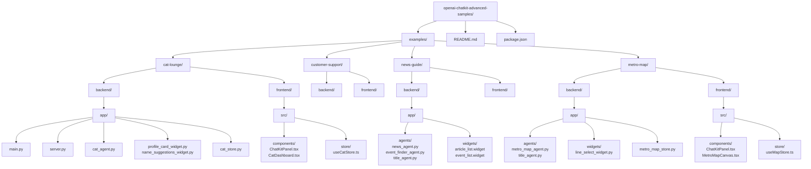
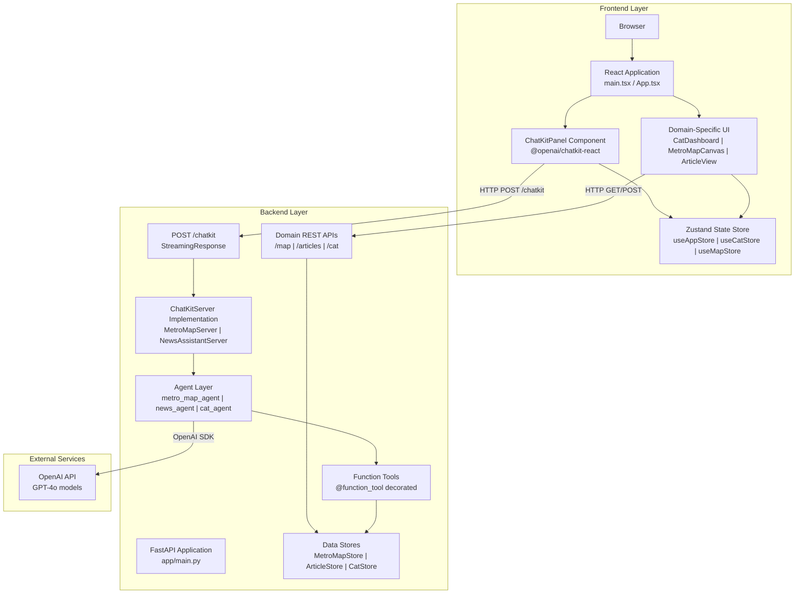

<!-- source: DeepWiki mcp.deepwiki.com · repo openai/openai-chatkit-advanced-samples · page 1 Overview · fetched 2026-10-26 -->

# Overview

<details>
<summary>Relevant source files</summary>

The following files were used as context for generating this wiki page:

- [README.md](README.md)

</details>


This document provides a high-level introduction to the OpenAI ChatKit Advanced Samples repository. This repository is a collection of scenario-driven demonstrations showing how to build full-stack conversational AI applications using ChatKit. Each example pairs a FastAPI backend (using the ChatKit Python SDK) with a Vite + React frontend (using @openai/chatkit-react), illustrating different ChatKit features and integration patterns.

The repository contains four complete example applications, each demonstrating distinct capabilities:
- **Examples Overview**: See page [1.1]()
- **Repository Structure**: See page [1.2]()
- **Getting Started**: See page [2]()
- **Common Architecture**: See page [3]()
- **Individual Example Documentation**: See pages [4](), [5](), [6]()

## Purpose and Scope

The repository demonstrates how to build production-ready ChatKit applications by providing reference implementations across multiple domains. Each example showcases:

- **Full-stack architecture**: FastAPI backend + Vite/React frontend
- **ChatKit integration**: Server-side Python SDK and client-side React library
- **ChatKit features**: Server tools, client tools, client effects, widgets, entity tags, annotations, and more
- **Domain-specific patterns**: Virtual pet management, metro route planning, news editorial workflows, airline customer support

Developers can use these examples to understand ChatKit capabilities, compare implementation approaches across different use cases, and adapt patterns for their own applications.

**Sources**: [README.md:1-11]()
</thinking>

## Example Applications

The repository includes four complete applications, each running on a dedicated port and demonstrating distinct ChatKit features:

| Example | Port | Primary Features | What It Demonstrates |
|---------|------|------------------|---------------------|
| **Cat Lounge** | 5170 | Virtual pet caretaker | Client effects (fire-and-forget UI updates), interactive widgets with actions, dynamic thread titles |
| **Customer Support** | 5171 | Airline concierge | Live itinerary data, timeline syncing, domain-specific tools |
| **News Guide** | 5172 | Newsroom assistant | Page-aware responses, @-mentions, tool choice routing, progress updates |
| **Metro Map** | 5173 | Metro route planner | Client tools (bidirectional state queries), entity annotations, custom header actions, complex state synchronization |

Each example is self-contained with its own backend and frontend implementations, demonstrating different aspects of the ChatKit platform in domain-specific contexts.

**Sources**: [README.md:5-10](), [README.md:18-23]()

## Repository Organization

**Repository Structure Diagram**



Each example follows a consistent structure:
- **`backend/`**: FastAPI application with Python 3.11+ requirement
  - **`app/`**: Main Python package
    - `main.py`: FastAPI application and HTTP endpoints
    - `server.py`: ChatKitServer implementation
    - `agents/`: AI agent implementations using ChatKit Python SDK
    - `widgets/`: Widget templates and builders
    - `*_store.py`: Domain-specific data stores
- **`frontend/`**: Vite + React application with Node 18.18+ requirement
  - **`src/`**: TypeScript source code
    - `components/`: React components including ChatKitPanel
    - `store/`: Zustand state management
    - `lib/`: Configuration and utilities

**Sources**: [README.md:1-11]()

## Common Architecture Pattern

All examples follow an identical architectural pattern: a FastAPI backend paired with a Vite + React frontend, connected through the ChatKit platform.

**High-Level Architecture Diagram**



This architecture separates conversational AI (ChatKit integration) from domain-specific functionality (application data and UI), enabling clean testing and maintainability. For detailed architecture documentation, see:
- Backend architecture: [3.1]()
- Frontend architecture: [3.2]()
- Communication patterns: [3.3]()

**Sources**: [README.md:1-11]()

## Feature Demonstration Matrix

Each example demonstrates a different subset of ChatKit features, providing comprehensive coverage when viewed together:

**Feature Coverage by Example**

| Feature Category | Cat Lounge | Customer Support | News Guide | Metro Map |
|------------------|------------|------------------|------------|-----------|
| **Server Tools** | `get_cat_status`, `feed_cat`, `play_with_cat` | Itinerary tools | `search_articles`, `get_current_page` | `get_map`, `list_lines`, `list_stations` |
| **Client Tools** | — | — | — | `get_selected_stations` |
| **Client Effects** | `update_cat_status`, `cat_say` | Timeline sync | — | `location_select_mode`, `add_station` |
| **Widgets (Presentation)** | `cat_profile` | Itinerary display | `article_preview`, `author_preview` | — |
| **Widgets (Interactive)** | `name_suggestions` | — | `article_list`, `event_list` | `line_selector` |
| **Widget Actions (Client)** | `cats.select_name` (client) | — | `open_article` | — |
| **Widget Actions (Server)** | `cats.select_name` (server), `cats.more_names` | — | `view_event_details` | `line.select` |
| **Entity Tags** | — | — | @-mention articles/authors | @-mention stations |
| **Annotations** | — | — | — | Route planning with station sources |
| **Thread Titles** | Dynamic with `set_cat_name` | — | `title_agent` | `title_agent` |
| **Page Awareness** | — | — | `article-id` header | — |
| **Progress Updates** | — | — | Search feedback | Map loading |
| **Tool Choice** | — | — | Agent routing | — |
| **Custom Header** | — | — | — | Dark/light mode toggle |

This matrix reveals the complementary nature of the examples:
- **Cat Lounge**: Focus on client effects and state synchronization
- **Customer Support**: Domain-specific tools and real-time data integration
- **News Guide**: Page awareness, entity tags, and agent routing
- **Metro Map**: Most feature-rich, demonstrating client tools, complex UI interactions, and annotations

**Sources**: [README.md:25-131]()

## Technology Stack

All examples use a consistent technology stack with specific version requirements:

### Runtime Requirements

| Requirement | Version | Purpose |
|-------------|---------|---------|
| **Python** | 3.11+ | Backend runtime |
| **Node.js** | 18.18+ | Frontend build and dev server |
| **uv** | Latest | Python package manager |

### Backend Stack

| Technology | Version Range | Purpose |
|------------|---------------|---------|
| **FastAPI** | 0.114-0.116 | Async web framework and API routing |
| **Uvicorn** | 0.36 | ASGI server for FastAPI |
| **openai-chatkit** | 1.4.0-2.0 | ChatKit Python SDK for agent implementation |
| **openai** | 1.40+ | OpenAI API client |
| **Jinja2** | Latest | Widget template rendering |

### Frontend Stack

| Technology | Version Range | Purpose |
|------------|---------------|---------|
| **Vite** | 7.x | Build tool and dev server with HMR |
| **React** | 19.2 | UI framework |
| **TypeScript** | 5.4 | Type safety |
| **@openai/chatkit-react** | ^1.3.0 | ChatKit React components and hooks |
| **Zustand** | 5.0 | Lightweight state management |
| **React Router** | 6.28 | Client-side routing |

### Domain-Specific Dependencies

- **Metro Map**: ReactFlow 11.11 for interactive graph visualization
- **News Guide**: Additional date parsing and content processing utilities

The tight version constraints on ChatKit and FastAPI ensure API compatibility across examples. For complete dependency details, see [9.1]().

**Sources**: [README.md:1-11]()

## Communication Patterns

ChatKit applications use four distinct communication patterns, all demonstrated across the examples:

**Communication Patterns Diagram**

```mermaid
sequenceDiagram
    participant User
    participant Frontend["Frontend<br/>ChatKitPanel"]
    participant Backend["Backend<br/>ChatKitServer"]
    participant Agent["Agent<br/>metro_map_agent"]
    participant Store["Data Store<br/>MetroMapStore"]
    
    rect rgb(245, 245, 245)
    Note over User,Store: Pattern 1: Server Tool Call
    User->>Frontend: "Plan a route"
    Frontend->>Backend: POST /chatkit (streaming)
    Backend->>Agent: Process request
    Agent->>Store: get_map()
    Store-->>Agent: Map data
    Agent-->>Backend: Response with data
    Backend-->>Frontend: Stream events
    end
    
    rect rgb(245, 245, 245)
    Note over User,Store: Pattern 2: Client Tool Call
    Agent->>Backend: Request client tool
    Backend-->>Frontend: ClientToolCallEvent
    Frontend->>Frontend: get_selected_stations()
    Frontend-->>Backend: Return selection
    Backend->>Agent: Continue with result
    end
    
    rect rgb(245, 245, 245)
    Note over User,Store: Pattern 3: Client Effect
    Agent->>Backend: Trigger effect
    Backend-->>Frontend: ClientEffectEvent
    Frontend->>Frontend: Update UI (location_select_mode)
    Note over Frontend: No response required
    end
    
    rect rgb(245, 245, 245)
    Note over User,Store: Pattern 4: Widget Action
    User->>Frontend: Click widget button
    Frontend->>Backend: sendAction(action, widgetId)
    Backend->>Store: Process action
    Store-->>Backend: Updated data
    Backend-->>Frontend: ThreadItemUpdated
    end
```

### Pattern Summary

1. **Server Tools**: Agent queries backend data stores to ground responses in application state (synchronous from agent perspective)
2. **Client Tools**: Agent requests information from frontend UI state, requiring a round-trip (agent waits for result)
3. **Client Effects**: Fire-and-forget actions that update UI without server acknowledgment (asynchronous)
4. **Widget Actions**: User interactions with rendered widgets, handled either client-side (navigation) or server-side (state persistence)

For detailed documentation of each pattern, see [3.3]().

**Sources**: [README.md:27-95]()

## Quick Start

To run any example application:

### Prerequisites

1. **Environment Setup**
   - Python 3.11 or higher
   - Node.js 18.18 or higher
   - `uv` package manager installed
   - OpenAI API key exported: `export OPENAI_API_KEY=sk-...`

2. **Running Examples**

From the repository root:

```bash
# Cat Lounge (port 5170)
npm run cat-lounge

# Customer Support (port 5171)
npm run customer-support

# News Guide (port 5172)
npm run news-guide

# Metro Map (port 5173)
npm run metro-map
```

Alternatively, from within an example directory:

```bash
cd examples/cat-lounge
npm install
npm run start
```

Each command starts both backend and frontend servers concurrently with hot reloading enabled.

For detailed setup instructions, environment configuration, and development workflow, see [2]().

**Sources**: [README.md:12-23]()

## Quick Start Summary

To run the basic starter template:

1. **Backend**: `npm run backend` (requires `uv` and `OPENAI_API_KEY`)
2. **Frontend**: `npm run frontend` (from repository root)
3. **Both together**: `npm start` (from repository root)

The application will be accessible at `http://127.0.0.1:5170` with the backend API at `http://127.0.0.1:8000`. For detailed setup instructions, see [Getting Started](#2).

**Sources**: [README.md:12-71](), [agents.md:23-40]()

---

