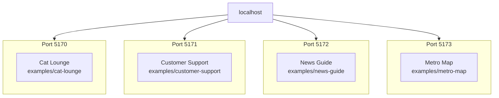
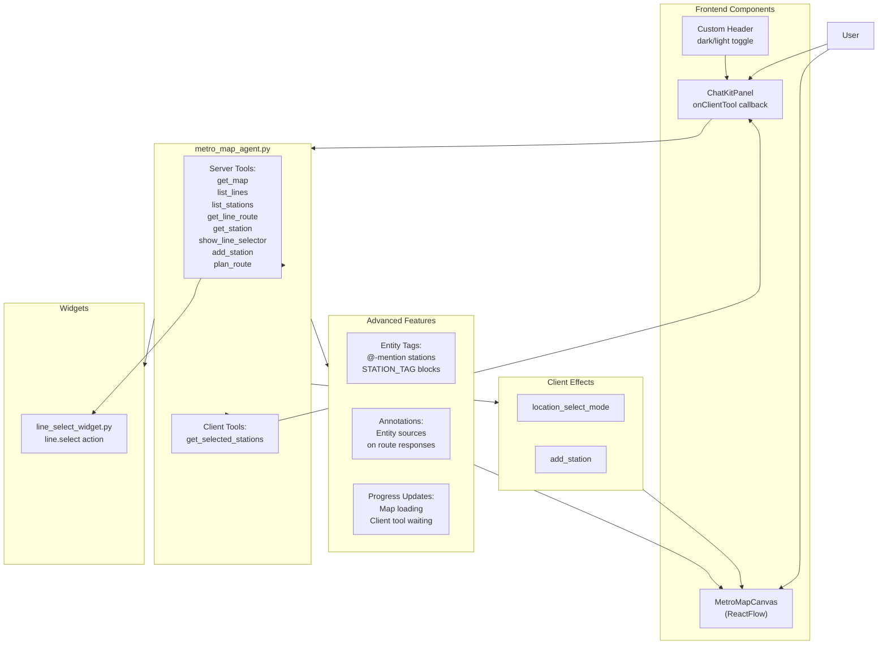
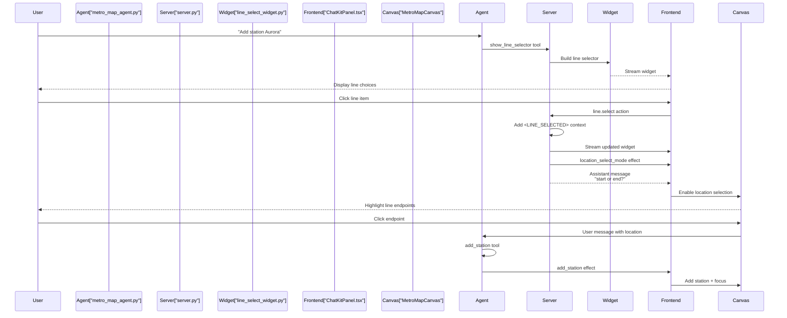
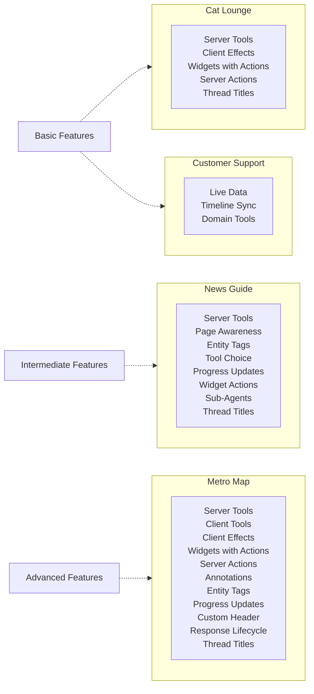

<!-- source: DeepWiki mcp.deepwiki.com · repo openai/openai-chatkit-advanced-samples · page 1.1 Examples Overview · fetched 2026-10-26 -->

# Examples Overview

Relevant source files

The following files were used as context for generating this wiki page:

- [README.md](README.md)
- [examples/cat-lounge/README.md](examples/cat-lounge/README.md)
- [examples/cat-lounge/frontend/src/components/ChatKitPanel.tsx](examples/cat-lounge/frontend/src/components/ChatKitPanel.tsx)
- [examples/metro-map/README.md](examples/metro-map/README.md)

## Purpose

This page provides a comprehensive overview of the four example applications included in the OpenAI ChatKit Advanced Samples repository. Each example demonstrates a distinct set of ChatKit features through a complete FastAPI + Vite/React implementation. For detailed architecture patterns shared across examples, see [Common Architecture](#3). For in-depth documentation of individual examples, see [Example: Metro Map](#4), [Example: Cat Lounge](#5), and [Example: News Guide](#6).

## Example Applications Summary

The repository contains four standalone applications, each running on a dedicated port and demonstrating different aspects of the ChatKit framework:

| Example | Port | Primary Focus | Repository Path |
|---------|------|---------------|-----------------|
| **Cat Lounge** | 5170 | Client effects and state synchronization | `examples/cat-lounge` |
| **Customer Support** | 5171 | Live data integration and timeline syncing | `examples/customer-support` |
| **News Guide** | 5172 | Page awareness, entity tags, and agent routing | `examples/news-guide` |
| **Metro Map** | 5173 | Client tools, annotations, and interactive widgets | `examples/metro-map` |

**Sources:** [README.md:5-11](), [README.md:18-23]()

## Application Port Mapping

**Sources:** [README.md:18-23]()

## Cat Lounge (`examples/cat-lounge`)

The Cat Lounge example implements a virtual cat caretaker application that demonstrates fire-and-forget client effects and widget-based interactions. The application maintains per-thread cat state including energy, happiness, and cleanliness statistics.

### Key Features

- **Server Tools**: `get_cat_status`, `feed_cat`, `play_with_cat`, `clean_cat`, `set_cat_name`, `speak_as_cat` defined in `cat_agent.py`
- **Client Effects**: `update_cat_status` and `cat_say` fire-and-forget events that update UI without server acknowledgment
- **Interactive Widgets**: Name suggestion widget with `cats.select_name` and `cats.more_names` actions
- **Presentation Widgets**: `show_cat_profile` displays read-only cat profile cards
- **Dynamic Thread Titles**: Thread title updates to `{name}'s Lounge` after cat naming
- **Hidden Context**: Action tags (`<FED_CAT>`, `<PLAYED_WITH_CAT>`, `<CLEANED_CAT>`, `<CAT_NAME_SELECTED>`) track conversation history

### Primary Use Case

Demonstrates how to build stateful conversational applications where the AI agent reads and mutates domain state, with real-time UI synchronization through client effects handled in `onEffect` callback.

**Sources:** [README.md:7](), [examples/cat-lounge/README.md:1-27](), [README.md:29-30](), [README.md:46-47](), [README.md:73-80](), [README.md:89-91](), [README.md:104-105]()

## Customer Support (`examples/customer-support`)

The Customer Support example implements an airline concierge assistant with live itinerary data access and timeline synchronization capabilities.

### Key Features

- **Live Data Integration**: Server tools access real-time itinerary and booking information
- **Timeline Syncing**: Maintains temporal context for travel-related queries
- **Domain-Specific Tools**: Custom function tools for airline operations

### Primary Use Case

Demonstrates integration with external data sources and temporal awareness in customer service scenarios.

**Sources:** [README.md:8]()

## News Guide (`examples/news-guide`)

The News Guide example implements a newsroom editorial assistant for the fictional Foxhollow Dispatch, featuring comprehensive article search, page-aware responses, and agent routing capabilities.

### Key Features Demonstrated

| Feature Category | Implementation | Code References |
|------------------|----------------|-----------------|
| **Server Tools** | `list_available_tags_and_keywords`, `get_article_by_id`, `search_articles_by_tags`, `search_articles_by_keywords`, `search_articles_by_exact_text`, `get_current_page` | `news_agent.py` |
| **Page Awareness** | `article-id` header forwarded by client, exposed via `get_current_page` tool | `ChatKitPanel.tsx`, `main.py` |
| **Entity Tags** | @-mention articles and authors with preview via `/articles/tags` endpoint | `ChatKitPanel.tsx`, `main.py` |
| **Entity Conversion** | `<ARTICLE_REFERENCE>` and `<AUTHOR_REFERENCE>` markers for model | `thread_item_converter.py` |
| **Progress Updates** | `ProgressUpdateEvent` during searches and page loads | `news_agent.py`, `event_finder_agent.py` |
| **Tool Choice** | Composer menu forces specific agents (`event_finder`, `puzzle`) | `ChatKitPanel.tsx`, `config.ts`, `server.py` |
| **Widget Actions** | `open_article` (client-handled), `view_event_details` (server-handled) | `article_list_widget.py`, `event_list_widget.py` |
| **Sub-Agents** | `event_finder_agent`, `puzzle_agent`, `title_agent` for specialized tasks | `server.py` |
| **Thread Titles** | `title_agent` generates newsroom-friendly titles on first message | `title_agent.py` |

### Primary Use Case

Demonstrates page-aware conversational AI where responses adapt to the user's current context (open article), with sophisticated agent routing and entity mention capabilities for editorial workflows.

**Sources:** [README.md:9](), [README.md:31-33](), [README.md:54-56](), [README.md:60-62](), [README.md:82-83](), [README.md:92-93](), [README.md:106-107](), [README.md:113-116](), [README.md:123-126]()

## Metro Map (`examples/metro-map`)

The Metro Map example is the most feature-rich demonstration, implementing a chat-driven metro planner with an interactive React Flow canvas for visualizing and extending transit networks.

### Key Features Demonstrated

**Sources:** [README.md:10](), [examples/metro-map/README.md:1-28](), [README.md:34-37](), [README.md:41-42](), [README.md:48-50](), [README.md:63-64](), [README.md:68-69](), [README.md:84-85](), [README.md:94-95](), [README.md:99-100](), [README.md:108-109](), [README.md:117-119](), [README.md:130-131]()

### Feature Breakdown

| Feature | Purpose | Implementation |
|---------|---------|----------------|
| **Map Synchronization** | Keep agent grounded in network topology | `get_map` tool in `metro_map_agent.py` |
| **Client Tool Call** | Query UI selection state | `get_selected_stations` client tool handled in `onClientTool` callback |
| **Client Effects** | Update canvas without server roundtrip | `location_select_mode` and `add_station` effects in `ChatKitPanel.tsx` |
| **Interactive Widget** | Multi-choice line selection | `show_line_selector` streams `line_select_widget.py` |
| **Server Action Handler** | Process line selection with context injection | `line.select` action in `server.py` adds `<LINE_SELECTED>` hidden item |
| **Entity Annotations** | Clickable station references in responses | `plan_route` attaches entity sources, handled in `onEntityClick` |
| **Entity Tags** | @-mention stations with metadata | `<STATION_TAG>` blocks via `thread_item_converter.py` |
| **Progress Updates** | Loading feedback during operations | `ProgressUpdateEvent` in `get_map` and `get_selected_stations` |
| **Custom Header** | Theme switching | Dark/light mode toggle in header actions |
| **Response Locking** | Prevent state drift during agent updates | `onResponseStart` and `onResponseEnd` lock canvas interaction |

### Station Creation Flow

**Sources:** [examples/metro-map/README.md:23-24]()

### Primary Use Case

Demonstrates bidirectional communication patterns including client tools (frontend queries), client effects (fire-and-forget updates), interactive widgets with server-side action handling, entity annotations for clickable references, and response lifecycle management for complex GUI applications.

**Sources:** [examples/metro-map/README.md:19-27]()

## Feature Distribution Across Examples

**Sources:** [README.md:25-132]()

## Quick Start Commands

Each example can be launched from the repository root using npm scripts or from the project directory:

| Example | Root Command | Project Directory Command |
|---------|--------------|---------------------------|
| Cat Lounge | `npm run cat-lounge` | `cd examples/cat-lounge && npm install && npm run start` |
| Customer Support | `npm run customer-support` | `cd examples/customer-support && npm install && npm start` |
| News Guide | `npm run news-guide` | `cd examples/news-guide && npm install && npm run start` |
| Metro Map | `npm run metro-map` | `cd examples/metro-map && npm install && npm run start` |

All examples require `OPENAI_API_KEY` environment variable and `uv` package manager installed.

**Sources:** [README.md:12-23]()

## Example Selection Guide

Choose an example based on the ChatKit features you want to explore:

- **Start with Cat Lounge** if you're learning basic client effects and widget interactions
- **Explore Customer Support** for live data integration patterns
- **Study News Guide** for page-aware responses, entity mentions, and agent routing
- **Deep-dive into Metro Map** for the complete feature set including client tools, annotations, and complex UI synchronization

For common patterns across all examples, see [Common Architecture](#3). For detailed feature documentation, see [ChatKit Integration Guide](#7).

**Sources:** [README.md:1-11]()

---

