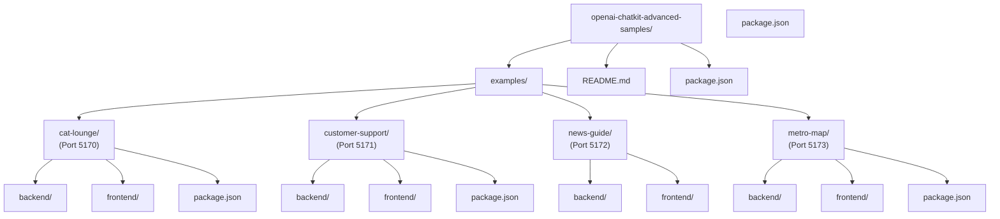
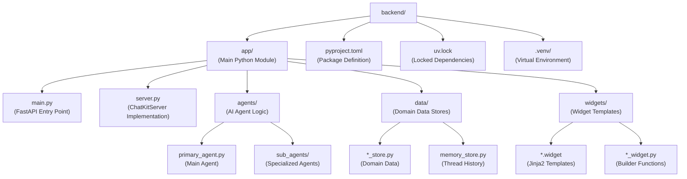
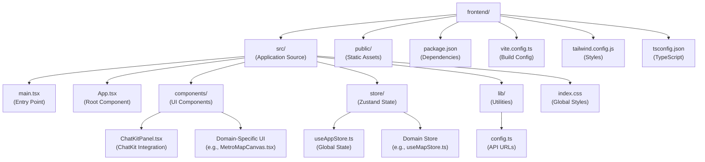
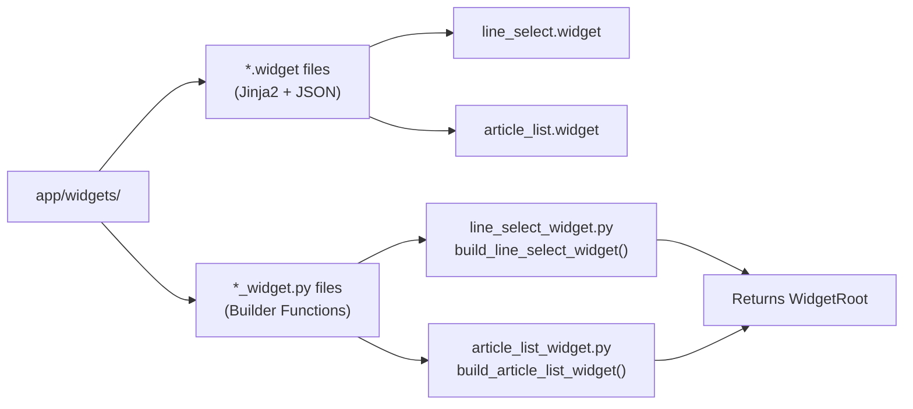
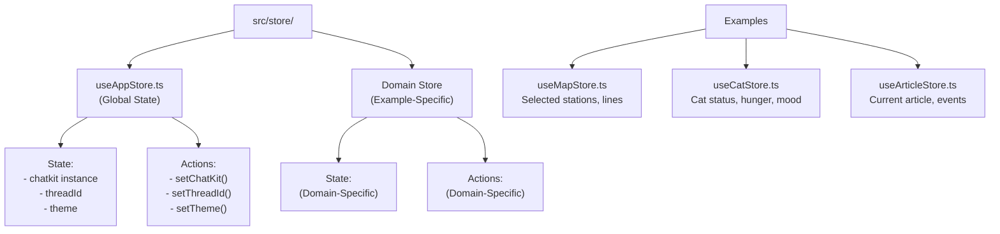

<!-- source: DeepWiki mcp.deepwiki.com · repo openai/openai-chatkit-advanced-samples · page 1.2 Repository Structure · fetched 2026-10-26 -->

# Repository Structure

<details>
<summary>Relevant source files</summary>

The following files were used as context for generating this wiki page:

- [examples/metro-map/backend/app/widgets/line_select_widget.py](examples/metro-map/backend/app/widgets/line_select_widget.py)
- [examples/metro-map/backend/pyproject.toml](examples/metro-map/backend/pyproject.toml)
- [examples/metro-map/frontend/package.json](examples/metro-map/frontend/package.json)
- [examples/news-guide/backend/pyproject.toml](examples/news-guide/backend/pyproject.toml)
- [examples/news-guide/backend/uv.lock](examples/news-guide/backend/uv.lock)

</details>


This page explains the common directory structure shared across all example applications in the OpenAI ChatKit Advanced Samples repository. Each example follows an identical organizational pattern, making it easy to understand one example and apply that knowledge to the others. For detailed information about the architecture within each directory, see page 3 (Common Architecture). For setup instructions, see page 2 (Getting Started).

## Repository Layout

The repository contains four independent example applications, each demonstrating different ChatKit features. Each example is a self-contained full-stack application with its own backend and frontend.



**Sources:** README.md (repository overview), examples directory structure

## Example Applications Overview

Each example application is independent and can be run on its own port:

| Example | Directory | Frontend Port | Backend Port | Key Features |
|---------|-----------|---------------|--------------|--------------|
| Cat Lounge | `examples/cat-lounge/` | 5170 | 8000 | Client effects, widget actions, dynamic thread titles |
| Customer Support | `examples/customer-support/` | 5171 | 8001 | Tool choice, progress updates, multi-agent routing |
| News Guide | `examples/news-guide/` | 5172 | 8002 | Page awareness, entity tags, sub-agent delegation |
| Metro Map | `examples/metro-map/` | 5173 | 8003 | Client tools, annotations, custom headers, ReactFlow |

Each example directory contains a `package.json` with npm scripts to run both servers:
- `npm start` - Starts both backend and frontend
- `npm run backend` - Starts only the backend
- `npm run frontend` - Starts only the frontend

**Sources:** README.md (example applications section)

## Common Backend Directory Structure

Every example's backend follows the same structure as a Python package named `chatkit-backend`. The backend implements a FastAPI server with ChatKit integration.



### Backend Package Configuration

All backends share the same core dependencies defined in `pyproject.toml`:

| Dependency | Version Constraint | Purpose |
|------------|-------------------|---------|
| `fastapi` | >=0.114.1,<0.116 | Web framework for HTTP APIs |
| `uvicorn[standard]` | >=0.36,<0.37 | ASGI server |
| `openai` | >=1.40 | OpenAI API client |
| `openai-chatkit` | >=1.4.0,<2 | ChatKit Python SDK |
| `jinja2` | Latest | Template engine for widgets |

**Sources:** [examples/news-guide/backend/pyproject.toml:1-30](), [examples/metro-map/backend/pyproject.toml:1-30]()

### Backend Module Organization

The `app/` module contains all application code organized into these directories:

| Directory/File | Purpose | Example Files |
|----------------|---------|---------------|
| `main.py` | FastAPI application entry point | Creates `FastAPI()` instance, defines routes |
| `server.py` | `ChatKitServer` implementation | Handles ChatKit protocol, action routing |
| `agents/` | AI agent implementations | Primary agent, sub-agents, tools |
| `data/` | Data storage layers | Domain stores (MetroMapStore, ArticleStore), MemoryStore |
| `widgets/` | Widget templates and builders | `.widget` files, `build_*_widget()` functions |

### Backend Entry Point

The FastAPI application is instantiated in `app/main.py`. The server is started using:
```bash
uvicorn app.main:app --reload --port 8000
```

All backends expose these common endpoints:
- `POST /chatkit` - ChatKit streaming endpoint (required)
- Domain-specific REST endpoints (e.g., `GET /map`, `GET /articles`)

**Sources:** [examples/news-guide/backend/uv.lock:100-129](), backend directory structure across examples

## Common Frontend Directory Structure

Every example's frontend is a React 19 application built with Vite 7 and TypeScript. All frontends share the same structural pattern.



### Frontend Dependencies

All frontends share these core dependencies:

| Package | Version | Purpose |
|---------|---------|---------|
| `@openai/chatkit-react` | ^1.3.0 | ChatKit React SDK |
| `react` | ^19.2.0 | UI framework |
| `react-dom` | ^19.2.0 | React DOM renderer |
| `react-router-dom` | ^6.28.0 | Client-side routing |
| `zustand` | ^5.0.8 | State management |
| `lucide-react` | ^0.544.0 | Icon library |

**Sources:** [examples/metro-map/frontend/package.json:16-27]()

### Frontend Module Organization

The `src/` directory contains all application code organized as follows:

| Directory/File | Purpose | Example Files |
|----------------|---------|---------------|
| `main.tsx` | React application entry point | Renders `<App />` |
| `App.tsx` | Root component | Routing, theme provider, layout |
| `components/` | React components | `ChatKitPanel.tsx`, domain UI components |
| `store/` | Zustand stores | `useAppStore.ts`, domain-specific stores |
| `lib/` | Utilities and configuration | `config.ts` (API URLs, domain keys) |
| `index.css` | Global styles | Tailwind CSS directives |

### Vite Configuration Pattern

Each frontend's `vite.config.ts` configures:
- **Port**: Unique per example (5170-5173)
- **Host**: `0.0.0.0` (allows network access)
- **Proxy Rules**: Routes `/chatkit` and domain endpoints to backend

Example from Metro Map:
- Frontend runs on port 5173
- Proxies `/chatkit` → `http://127.0.0.1:8003`
- Proxies `/map` → `http://127.0.0.1:8003`

This proxy configuration eliminates CORS issues during development by routing API requests through the Vite dev server.

**Sources:** [examples/metro-map/frontend/package.json:1-48](), vite.config.ts files across examples

## Backend Widget System Structure

Backends that use widgets (Cat Lounge, News Guide, Metro Map) follow this pattern in the `widgets/` directory:



### Widget File Organization

Widget templates use the `.widget` extension and contain JSON structure with Jinja2 templating:

```
app/
└── widgets/
    ├── line_select.widget          # Template file
    ├── line_select_widget.py       # Builder function
    ├── article_list.widget
    └── article_list_widget.py
```

The builder functions follow a consistent pattern:

1. Load template using `WidgetTemplate.from_file()`
2. Accept data as function parameters
3. Call `.build()` with data dictionary
4. Return `WidgetRoot` object

Example builder function structure:
```python
# app/widgets/line_select_widget.py
from chatkit.widgets import WidgetRoot, WidgetTemplate

line_select_widget_template = WidgetTemplate.from_file("line_select.widget")

def build_line_select_widget(lines: list[Line], selected: str | None = None) -> WidgetRoot:
    return line_select_widget_template.build(
        data={"items": lines, "selected": selected}
    )
```

**Sources:** [examples/metro-map/backend/app/widgets/line_select_widget.py:1-22]()

## Frontend State Management Pattern

All frontends use Zustand for state management, split across two store types:



### Global App Store

`useAppStore.ts` manages ChatKit integration and theme:

| State Field | Type | Purpose |
|-------------|------|---------|
| `chatkit` | `ChatKit \| null` | ChatKit instance from `useChatKit()` |
| `threadId` | `string \| null` | Current conversation thread ID |
| `theme` | `'light' \| 'dark'` | UI theme |

### Domain-Specific Stores

Each example implements a domain store for application-specific state:

| Example | Store Name | State Fields |
|---------|-----------|--------------|
| Metro Map | `useMapStore` | `selectedStations`, `highlightedLine`, `routeAnnotations` |
| Cat Lounge | `useCatStore` | `catStatus`, `hunger`, `mood`, `name` |
| News Guide | `useArticleStore` | `currentArticleId`, `searchResults`, `events` |

**Sources:** Frontend store directories across examples

## Configuration Files Overview

Each example contains the same set of configuration files:

### Backend Configuration

| File | Purpose | Key Settings |
|------|---------|--------------|
| `backend/pyproject.toml` | Package definition | Dependencies, Python >=3.11, package metadata |
| `backend/uv.lock` | Locked dependencies | Reproducible builds with exact versions |
| `backend/.env` (local) | Environment variables | `OPENAI_API_KEY` |

### Frontend Configuration

| File | Purpose | Key Settings |
|------|---------|--------------|
| `frontend/package.json` | Package definition | Dependencies, scripts, Node >=18.18 |
| `frontend/vite.config.ts` | Build configuration | Port, proxy rules, allowedHosts |
| `frontend/tsconfig.json` | TypeScript configuration | Compiler options, module resolution |
| `frontend/tailwind.config.js` | Tailwind CSS configuration | Theme, content paths |
| `frontend/src/lib/config.ts` | Runtime configuration | API URLs, domain keys, constants |

**Sources:** [examples/news-guide/backend/pyproject.toml:1-30](), [examples/metro-map/backend/pyproject.toml:1-30](), [examples/metro-map/frontend/package.json:1-48]()

## File Organization Patterns

### Backend Pattern

The backend follows a modular structure where:
- `app/main.py` - Defines FastAPI application and routes
- `app/server.py` - Implements `FactAssistantServer` (ChatKit server)
- `app/tools/` - Contains individual tool implementations (`weather.py`, `facts.py`, `theme.py`)
- `app/storage/` - Implements in-memory data stores (`fact_store.py`, `memory_store.py`)

### Frontend Pattern

The frontend follows a component-based architecture:
- `src/main.tsx` - React application entry point
- `src/App.tsx` - Root component with theme orchestration
- `src/components/` - Reusable UI components (Home, ChatKitPanel, Facts, etc.)
- `src/lib/config.ts` - Centralized configuration
- `src/lib/` - Custom hooks (`useColorScheme`, `useFacts`)

This organization allows for clean separation of concerns and makes both backend and frontend codebases easy to navigate and extend.

**Sources:** [README.md:1-98]()

---

