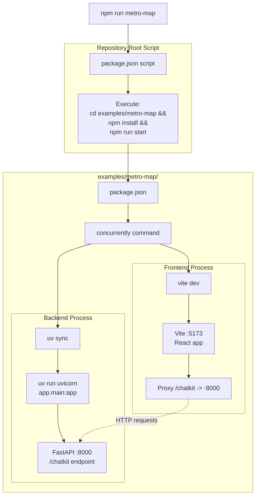

<!-- source: DeepWiki mcp.deepwiki.com · repo openai/openai-chatkit-advanced-samples · page 2 Getting Started · fetched 2026-10-26 -->

# Getting Started

<details>
<summary>Relevant source files</summary>

The following files were used as context for generating this wiki page:

- [README.md](README.md)
- [examples/news-guide/backend/pyproject.toml](examples/news-guide/backend/pyproject.toml)
- [examples/news-guide/backend/uv.lock](examples/news-guide/backend/uv.lock)

</details>


This guide covers prerequisites and instructions for running any of the four example applications in the OpenAI ChatKit Advanced Samples repository. Each example demonstrates different ChatKit features through a FastAPI backend paired with a Vite + React frontend.

---

## Prerequisites

Before running any example, ensure the following tools and credentials are available:

### Required Software

| Tool | Minimum Version | Purpose |
|------|----------------|---------|
| Python | 3.11+ | Backend runtime for FastAPI servers |
| Node.js | 18.18+ | Frontend runtime for Vite + React |
| uv | Latest | Python package manager (recommended) |
| npm | 7+ | Node package manager (included with Node.js) |

**Installation**: 
- Python: [python.org/downloads](https://www.python.org/downloads)
- Node.js: [nodejs.org](https://nodejs.org)
- uv: [docs.astral.sh/uv](https://docs.astral.sh/uv/getting-started/installation/)

### Required API Key

| Environment Variable | Purpose | Obtain From |
|---------------------|---------|-------------|
| `OPENAI_API_KEY` | Powers AI agents in backend | [platform.openai.com/api-keys](https://platform.openai.com/api-keys) |

Export the API key before starting any example:

```bash
export OPENAI_API_KEY=sk-proj-...
```

**Sources**: [README.md:14](), [examples/news-guide/backend/pyproject.toml:6]()

---

## Running Examples

Each example can be launched using npm scripts from the repository root or by running commands directly from the example's directory. The `uv` package manager handles dependency installation automatically when using the npm scripts.

### Example Applications and Ports

| Example | Port | Command (from repo root) | Command (from project directory) |
|---------|------|-------------------------|----------------------------------|
| **Cat Lounge** | 5170 | `npm run cat-lounge` | `cd examples/cat-lounge && npm install && npm run start` |
| **Customer Support** | 5171 | `npm run customer-support` | `cd examples/customer-support && npm install && npm start` |
| **News Guide** | 5172 | `npm run news-guide` | `cd examples/news-guide && npm install && npm run start` |
| **Metro Map** | 5173 | `npm run metro-map` | `cd examples/metro-map && npm install && npm run start` |

**Example Architecture**: Each application follows an identical structure with a FastAPI backend (`backend/app/`) and Vite + React frontend (`frontend/src/`). The npm scripts coordinate starting both servers and handle dependency installation via `uv`.

**Sources**: [README.md:18-23]()

### Running from Repository Root (Recommended)

The repository root [package.json]() provides convenience scripts that handle both backend and frontend setup:

```bash
# 1. Export your OpenAI API key
export OPENAI_API_KEY=sk-proj-...

# 2. Run any example (e.g., Metro Map)
npm run metro-map
```

This approach:
- Automatically runs `uv sync` to install Python dependencies
- Automatically runs `npm install` in the frontend directory
- Starts both FastAPI backend and Vite frontend servers
- Opens the application at the appropriate localhost URL

**Sources**: [README.md:14-23]()

### Running from Project Directory (Alternative)

For more control or debugging, navigate to the specific example directory:

```bash
# 1. Export your OpenAI API key
export OPENAI_API_KEY=sk-proj-...

# 2. Navigate to example
cd examples/metro-map

# 3. Install frontend dependencies
npm install

# 4. Start servers
npm run start
```

The [examples/*/package.json]() `start` script executes both backend and frontend commands concurrently using the `concurrently` package.

**Sources**: [README.md:20-23]()

### Application Startup Sequence



**Sources**: [README.md:18-23]()

### Verifying Successful Startup

When an example starts successfully, you should see:

1. **Terminal Output**: Both backend and frontend processes logging startup messages
2. **Browser Access**: The application opens automatically at the appropriate localhost URL
3. **ChatKit Interface**: The chat panel renders with no initialization errors
4. **Backend Connectivity**: The frontend can communicate with `/chatkit` endpoint

**Example Verification (Metro Map)**:
- URL: `http://localhost:5173`
- Try: "Show me the metro map"
- Expected: Interactive React Flow visualization appears

**Sources**: [README.md:18-23]()

### Common Startup Issues

| Issue | Likely Cause | Solution |
|-------|-------------|----------|
| `OPENAI_API_KEY not found` | API key not exported | Run `export OPENAI_API_KEY=sk-proj-...` before starting |
| `Port already in use` | Previous process still running | Kill existing process or change port |
| `uv command not found` | uv not installed | Install uv from [docs.astral.sh/uv](https://docs.astral.sh/uv) |
| Frontend shows errors | Backend not ready | Wait for backend startup to complete first |

**Sources**: [README.md:14]()

---

## Next Steps

Once the application is running successfully:

- Explore the demo interactions described in [README.md:81-88]()
- Review [Frontend Architecture](#3.2) to understand the React component structure
- Review [Backend Architecture](#3.3) to understand the ChatKit server implementation
- See [Frontend Configuration](#4.1) to customize API URLs and UI constants
- For production deployment, see [Deployment](#7) and [Domain Allowlisting](#7.1)

**Sources**: [README.md:89-97]()

---

