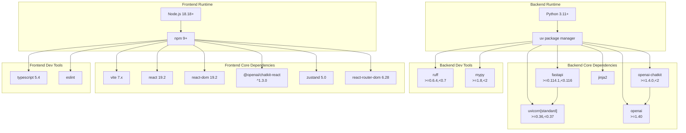

<!-- source: DeepWiki mcp.deepwiki.com · repo openai/openai-chatkit-advanced-samples · page 2.1 Prerequisites · fetched 2026-10-26 -->

# Prerequisites

<details>
<summary>Relevant source files</summary>

The following files were used as context for generating this wiki page:

- [examples/metro-map/backend/app/widgets/line_select_widget.py](examples/metro-map/backend/app/widgets/line_select_widget.py)
- [examples/metro-map/backend/pyproject.toml](examples/metro-map/backend/pyproject.toml)
- [examples/metro-map/frontend/package.json](examples/metro-map/frontend/package.json)
- [examples/news-guide/backend/pyproject.toml](examples/news-guide/backend/pyproject.toml)
- [examples/news-guide/backend/uv.lock](examples/news-guide/backend/uv.lock)

</details>


This page documents the system requirements, required software, and configuration needed to run any of the four example applications in this repository. All examples share the same technical prerequisites due to their common architectural patterns.

For installation and running instructions after meeting these prerequisites, see [Running Examples](#2.2). For details about the common technology stack used across examples, see [Technology Stack](#9.1).

---

## System Requirements

All example applications run on the following operating systems with standard hardware:

| Requirement | Specification |
|------------|---------------|
| **Operating System** | Linux, macOS, or Windows (with WSL recommended) |
| **Memory** | Minimum 4GB RAM (8GB recommended for development) |
| **Storage** | 500MB free space per example application |
| **Network** | Internet connection for OpenAI API access |
| **Available Ports** | One port per example (default: 5170-5173) |

**Sources:** Repository structure analysis, README.md

---

## Required Runtime Environments

### Python 3.11 or Higher

All backend services require Python 3.11 or higher due to use of modern Python features and type hints.

**Version Requirement:** `>=3.11`

**Verification Command:**
```bash
python --version
# or
python3 --version
```

**Installation:**
- macOS: `brew install python@3.11` or download from [python.org](https://www.python.org)
- Linux: Use your distribution's package manager or pyenv
- Windows: Download from [python.org](https://www.python.org) or use Microsoft Store

**Sources:** [examples/news-guide/backend/pyproject.toml:6](), [examples/metro-map/backend/pyproject.toml:6]()

### Node.js 18.18 or Higher

All frontend applications require Node.js 18.18 or higher for Vite 7.x compatibility and modern JavaScript features.

**Version Requirement:** `>=18.18`

**Verification Command:**
```bash
node --version
npm --version
```

**Installation:**
- Use [nvm](https://github.com/nvm-sh/nvm) (recommended): `nvm install 18`
- Download from [nodejs.org](https://nodejs.org)
- macOS: `brew install node`

**Sources:** [examples/metro-map/frontend/package.json:12-15]()

---

## Package Managers

### uv (Python - Recommended)

`uv` is the recommended Python package manager for this repository. It provides faster dependency resolution and installation compared to pip.

**Installation:**
```bash
# macOS/Linux
curl -LsSf https://astral.sh/uv/install.sh | sh

# Windows
powershell -c "irm https://astral.sh/uv/install.ps1 | iex"

# Via pip (alternative)
pip install uv
```

**Alternative:** Standard `pip` can be used, but `uv` is optimized for the project's `uv.lock` files.

**Sources:** [examples/news-guide/backend/uv.lock:1-3]()

### npm (Node.js)

`npm` is included with Node.js installation and is used for frontend dependency management.

**Verification:**
```bash
npm --version
# Should be >=9
```

**Sources:** [examples/metro-map/frontend/package.json:14]()

---

## OpenAI API Configuration

### API Key Requirement

All examples require an OpenAI API key to access GPT models through the ChatKit framework. The key must have access to:

- `gpt-4o` or `gpt-4o-mini` models (depending on example configuration)
- Chat Completions API
- Function calling capabilities

### Setting Up the API Key

The `OPENAI_API_KEY` environment variable must be set before running any backend service.

**Obtaining an API Key:**
1. Visit [platform.openai.com](https://platform.openai.com)
2. Navigate to API Keys section
3. Create a new secret key
4. Copy the key (it won't be shown again)

**Configuration Methods:**

```bash
# Method 1: Export in current shell session
export OPENAI_API_KEY='sk-...'

# Method 2: Add to shell profile (~/.bashrc, ~/.zshrc, etc.)
echo 'export OPENAI_API_KEY="sk-..."' >> ~/.bashrc

# Method 3: Use .env file in backend directory
echo 'OPENAI_API_KEY=sk-...' > examples/cat-lounge/backend/.env
```

**Security Note:** Never commit API keys to version control. The `.env` file should be in `.gitignore`.

**Sources:** Repository README, standard OpenAI SDK configuration

---

## Port Availability

Each example application requires one port to be available on your system:

| Example | Default Port | Purpose |
|---------|-------------|---------|
| Cat Lounge | 5170 | Backend API and frontend dev server |
| Customer Support | 5171 | Backend API and frontend dev server |
| News Guide | 5172 | Backend API and frontend dev server |
| Metro Map | 5173 | Backend API and frontend dev server |

**Port Conflict Resolution:**

If a port is already in use, you can modify the port configuration:

- **Backend:** Edit the `uvicorn` command in startup scripts or run directly with `--port` flag
- **Frontend:** Edit `vite.config.ts` or use `vite --port` flag

**Verification:**
```bash
# Check if port is in use (Unix-like systems)
lsof -i :5170

# Windows
netstat -ano | findstr :5170
```

**Sources:** High-level system architecture diagrams

---

## Core Dependencies Overview

The following diagram shows the dependency structure for both backend and frontend components:



**Sources:** [examples/news-guide/backend/pyproject.toml](), [examples/metro-map/backend/pyproject.toml](), [examples/metro-map/frontend/package.json]()

### Backend Dependencies

| Dependency | Version Constraint | Purpose |
|-----------|-------------------|---------|
| `fastapi` | `>=0.114.1,<0.116` | ASGI web framework for REST APIs and streaming responses |
| `uvicorn[standard]` | `>=0.36,<0.37` | ASGI server with WebSocket and HTTP/2 support |
| `openai` | `>=1.40` | Official OpenAI Python SDK for GPT model access |
| `openai-chatkit` | `>=1.4.0,<2` | ChatKit framework for agent development and streaming |
| `jinja2` | `>=3.1,<4` | Template engine for widget generation |

**Development Dependencies:**
- `ruff` (>=0.6.4,<0.7): Fast Python linter and formatter
- `mypy` (>=1.8,<2): Static type checker

**Sources:** [examples/news-guide/backend/pyproject.toml:7-13](), [examples/metro-map/backend/pyproject.toml:7-13]()

### Frontend Dependencies

| Dependency | Version Constraint | Purpose |
|-----------|-------------------|---------|
| `@openai/chatkit-react` | `^1.3.0` | ChatKit React components and hooks |
| `react` | `^19.2.0` | React library for UI components |
| `react-dom` | `^19.2.0` | React DOM renderer |
| `vite` | `^7.1.9` | Build tool with fast HMR |
| `zustand` | `^5.0.8` | Lightweight state management |
| `react-router-dom` | `^6.28.0` | Client-side routing |
| `typescript` | `^5.4.0` | TypeScript compiler and type system |

**Example-Specific:**
- `reactflow` (^11.11.3): Used only in Metro Map for graph visualization

**Sources:** [examples/metro-map/frontend/package.json:16-27]()

---

## Version Compatibility Matrix

The following table shows tested version combinations:

| Component | Minimum Version | Recommended Version | Maximum Tested Version |
|-----------|----------------|---------------------|----------------------|
| Python | 3.11.0 | 3.11.x | 3.13.x |
| Node.js | 18.18.0 | 20.x LTS | 22.x |
| FastAPI | 0.114.1 | 0.115.x | 0.115.14 |
| openai-chatkit | 1.4.0 | 1.4.0+ | 1.x |
| @openai/chatkit-react | 1.3.0 | 1.3.0+ | 1.3.x |
| React | 19.2.0 | 19.2.0 | 19.2.0 |
| Vite | 7.0.0 | 7.1.9 | 7.x |

**Sources:** [examples/news-guide/backend/uv.lock](), [examples/metro-map/frontend/package.json]()

---

## Verification Checklist

Before proceeding to run examples, verify all prerequisites are met:

**Runtime Environments:**
- [ ] Python 3.11 or higher installed: `python --version`
- [ ] Node.js 18.18 or higher installed: `node --version`
- [ ] npm 9 or higher installed: `npm --version`

**Package Managers:**
- [ ] `uv` installed (recommended): `uv --version`
- [ ] Alternative: `pip` available: `pip --version`

**Configuration:**
- [ ] OpenAI API key obtained from platform.openai.com
- [ ] `OPENAI_API_KEY` environment variable configured
- [ ] Ports 5170-5173 available (or alternative ports chosen)

**Network:**
- [ ] Internet connection available for API access
- [ ] No firewall blocking OpenAI API endpoints

Once all prerequisites are verified, proceed to [Running Examples](#2.2) for installation and startup instructions.

**Sources:** Repository structure, all example pyproject.toml and package.json files

---

