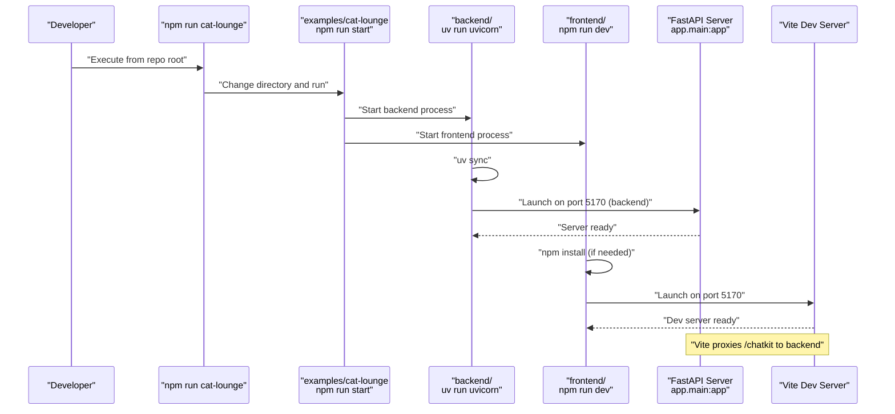
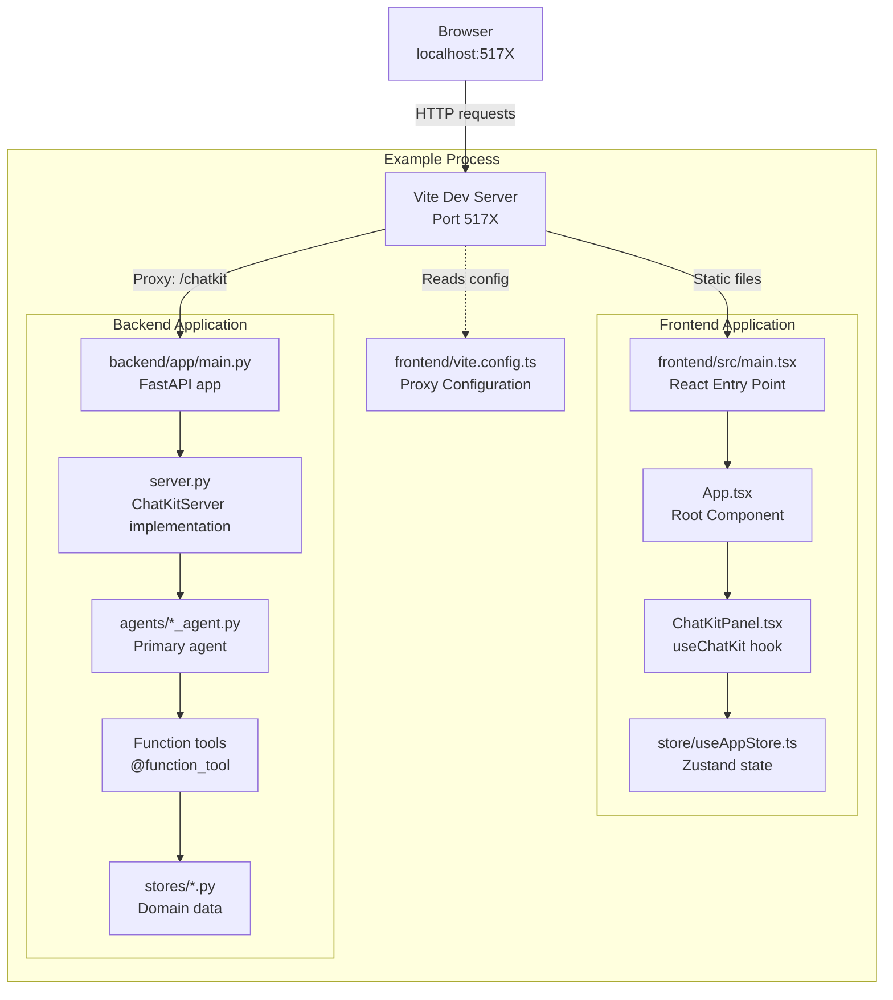

<!-- source: DeepWiki mcp.deepwiki.com · repo openai/openai-chatkit-advanced-samples · page 2.2 Running Examples · fetched 2026-10-26 -->

# Running Examples

<details>
<summary>Relevant source files</summary>

The following files were used as context for generating this wiki page:

- [README.md](README.md)

</details>


This document describes how to launch any of the four example applications in the repository. Each example runs as a standalone application with its own FastAPI backend and Vite + React frontend.

Before running examples, ensure prerequisites are met (see [Prerequisites](#2.1)). For environment configuration details, see [Environment Setup](#8.1).

---

## Available Examples

The repository contains four example applications, each demonstrating different ChatKit features:

| Example | Port | Command from Root | Key Features |
|---------|------|-------------------|--------------|
| Cat Lounge | 5170 | `npm run cat-lounge` | Client effects, interactive widgets, thread titles |
| Customer Support | 5171 | `npm run customer-support` | Timeline syncing, itinerary data, domain tools |
| News Guide | 5172 | `npm run news-guide` | Page awareness, @-mentions, tool choice, progress updates |
| Metro Map | 5173 | `npm run metro-map` | Client tools, annotations, entity tags, custom header |

Each example follows the same architectural pattern: a FastAPI backend using the ChatKit Python SDK paired with a Vite + React frontend using `@openai/chatkit-react`.

**Sources:** [README.md:5-23]()

---

## Quick Start from Repository Root

The simplest method to launch any example is to run the automated startup script from the repository root. This approach handles both backend and frontend initialization.

### Prerequisites Check

Before running, ensure:
1. `OPENAI_API_KEY` environment variable is set
2. `uv` package manager is installed
3. Node.js 18.18+ is available

```bash
export OPENAI_API_KEY=sk-proj-...
```

### Launch Commands

From the repository root directory, execute one of the following:

```bash
# Cat Lounge (port 5170)
npm run cat-lounge

# Customer Support (port 5171)
npm run customer-support

# News Guide (port 5172)
npm run news-guide

# Metro Map (port 5173)
npm run metro-map
```

Each command performs the following sequence:
1. Installs frontend dependencies (`npm install` in example directory)
2. Synchronizes backend dependencies (`uv sync`)
3. Starts the FastAPI backend
4. Starts the Vite dev server
5. Opens the example in your default browser

**Sources:** [README.md:12-23]()

---

## Running from Project Directory

For more granular control, you can navigate to an example's directory and run commands directly. This method is useful when working on a single example or when troubleshooting.

### Step-by-Step Instructions

1. Navigate to the example directory:
```bash
cd examples/cat-lounge
# or: cd examples/metro-map
# or: cd examples/news-guide
# or: cd examples/customer-support
```

2. Install dependencies and start:
```bash
npm install
npm run start
```

The `npm run start` command in each example's `package.json` handles both backend and frontend startup concurrently.

### Alternative: Manual Backend and Frontend Startup

For separate control of backend and frontend processes:

**Backend:**
```bash
cd examples/metro-map/backend
uv sync
uv run uvicorn app.main:app --reload
```

**Frontend (in separate terminal):**
```bash
cd examples/metro-map/frontend
npm install
npm run dev
```

Each example's backend exposes a `/chatkit` endpoint and domain-specific REST endpoints. The frontend's Vite configuration proxies requests to the backend.

**Sources:** [README.md:18-23]()

---

## Startup Architecture

Each example application consists of two concurrent processes that communicate via HTTP. The following diagram illustrates the startup sequence and runtime architecture:

**Example Startup Process**



**Port Assignments by Example**

| Example | Frontend Port | Backend Port | Access URL |
|---------|--------------|--------------|------------|
| Cat Lounge | 5170 | Internal* | http://localhost:5170 |
| Customer Support | 5171 | Internal* | http://localhost:5171 |
| News Guide | 5172 | Internal* | http://localhost:5172 |
| Metro Map | 5173 | Internal* | http://localhost:5173 |

*The backend runs on an internal port and is accessed through the Vite dev server's proxy configuration. The frontend `vite.config.ts` file in each example defines the proxy rules for `/chatkit` and any domain-specific endpoints.

**Sources:** [README.md:18-23]()

---

## Common Architecture Pattern

All examples follow an identical structural pattern:

**Runtime Component Diagram**



Each example implements:
- **FastAPI backend**: ChatKitServer subclass, agents with function tools, domain stores
- **Vite frontend**: React with ChatKitPanel component, Zustand state management, domain-specific UI
- **Proxy layer**: Vite forwards `/chatkit` and domain endpoints to backend

**Sources:** [README.md:3]()

---

## Verifying Example Startup

After launching an example, verify both frontend and backend are operational:

### Frontend Verification

Open the example's URL in a browser:

- Cat Lounge: http://localhost:5170
- Customer Support: http://localhost:5171
- News Guide: http://localhost:5172
- Metro Map: http://localhost:5173

You should see the React application with a chat interface and domain-specific UI elements.

### Backend Verification

Each example's backend can be verified by checking its domain-specific endpoints. Examples of verification commands:

**Cat Lounge:**
```bash
curl http://localhost:5170/api/cat/status
```

**Metro Map:**
```bash
curl http://localhost:5173/api/map
```

**News Guide:**
```bash
curl http://localhost:5172/api/articles
```

The Vite proxy forwards these requests to the backend, which responds with domain data.

### ChatKit Endpoint Verification

All examples expose a `/chatkit` endpoint for streaming chat responses. This endpoint requires a POST request with proper authentication headers and is typically accessed through the frontend's ChatKit integration.

**Sources:** [README.md:18-23]()

---

## Troubleshooting Startup Issues

### Backend Fails to Start

**Issue:** `HTTPException: ChatKit dependencies are missing`

**Cause:** The `_chatkit_server` instance is `None` in [backend/app/main.py:20-32]().

**Solution:** Ensure ChatKit Python SDK is installed via `uv sync` or `pip install -e .`

### Frontend Cannot Connect to Backend

**Issue:** API requests fail with network errors

**Cause:** Backend is not running or proxy configuration is incorrect

**Solution:**
1. Verify backend is running: `curl http://127.0.0.1:8000/health`
2. Check proxy configuration in [frontend/vite.config.ts:12-20]()
3. Ensure `BACKEND_URL` matches the actual backend address

### Port Already in Use

**Issue:** `Error: listen EADDRINUSE: address already in use`

**Cause:** Another process is using port 8000 or 5170

**Solution:**
1. Find the process: `lsof -i :8000` or `lsof -i :5170`
2. Kill the process or use a different port (see Port Customization above)

**Sources:** [backend/app/main.py:20-32](), [frontend/vite.config.ts:12-20]()

---

## Next Steps

After successfully starting the application:

1. Open `http://127.0.0.1:5170` in a browser
2. Test the chat interface with sample prompts (see [README.md:81-87]())
3. Explore the agent tools: fact recording, weather info, and theme switching
4. Review the frontend architecture in [Frontend Architecture](#3.2)
5. Understand the backend implementation in [Backend Architecture](#3.3)

For production deployment, see [Domain Allowlisting](#7.1) and [Building for Production](#7.3).

**Sources:** [README.md:81-98]()

---

