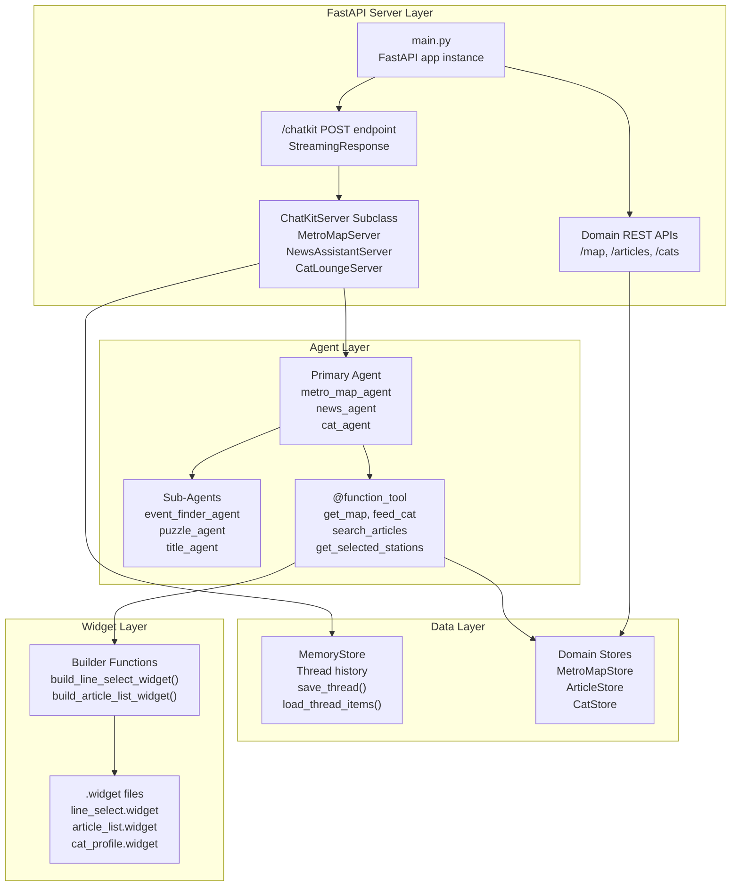
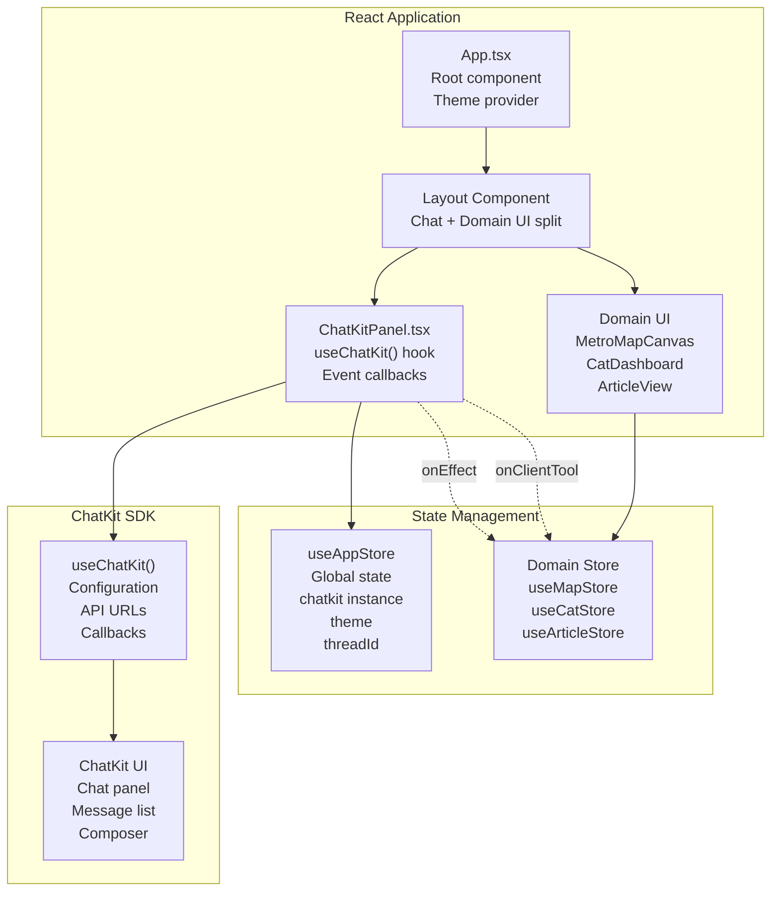
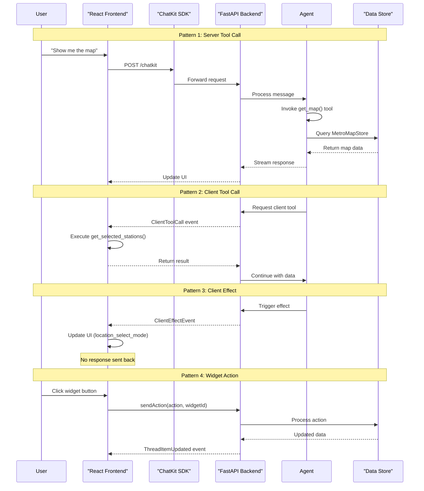
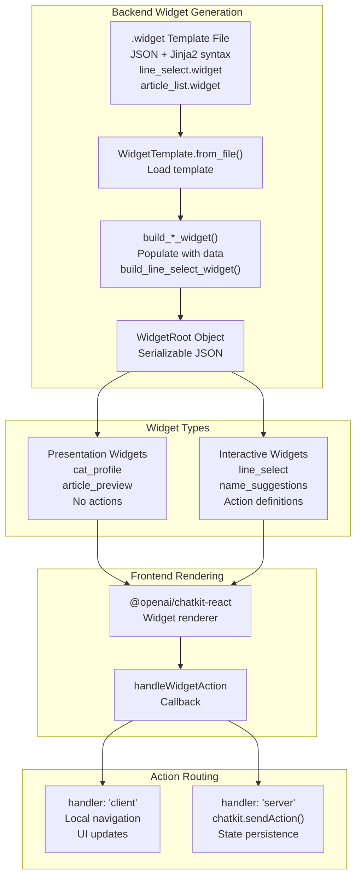
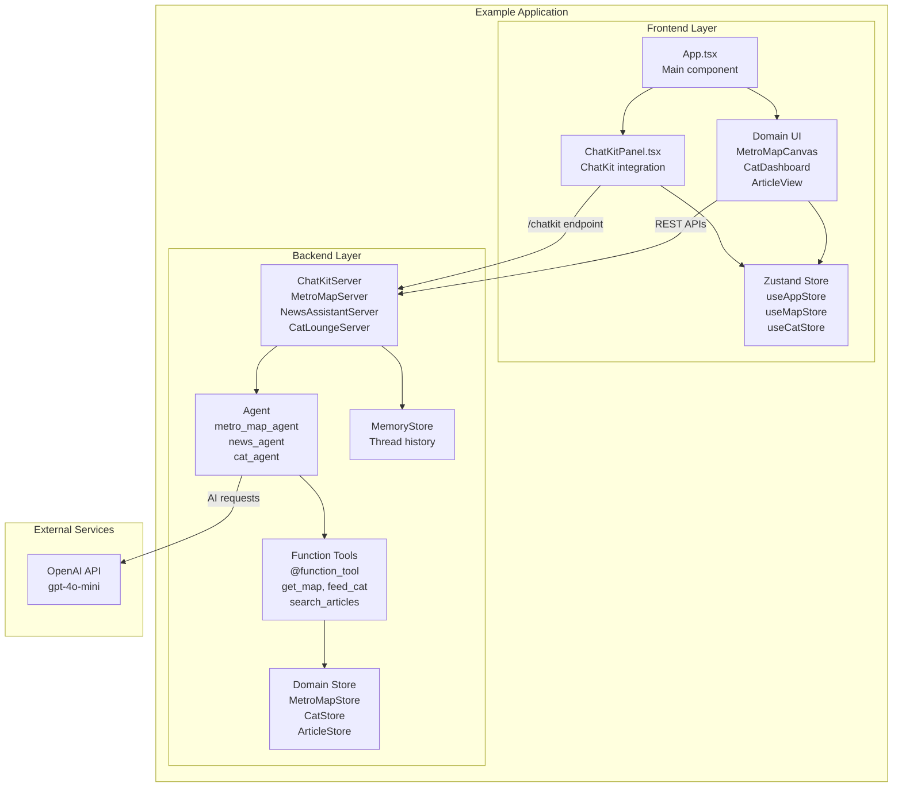
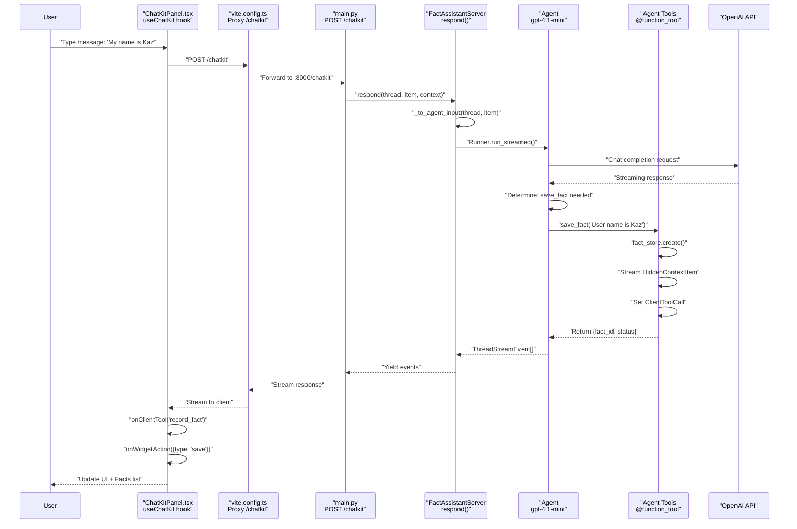

<!-- source: DeepWiki mcp.deepwiki.com · repo openai/openai-chatkit-advanced-samples · page 3 Common Architecture · fetched 2026-10-26 -->

---

## Backend Architecture Pattern

All examples implement a `ChatKitServer` subclass that handles streaming chat requests and coordinates between agents, storage, and external services. The backend follows a four-layer architecture.

### Backend Layer Diagram



**Sources:** [examples/metro-map/backend/app/server.py:1-150](), [examples/news-guide/backend/app/server.py:1-150](), [examples/cat-lounge/backend/app/cat_agent.py:1-100](), [README.md:27-109]()

### ChatKitServer Implementation Pattern

Each example implements a server class that extends `ChatKitServer`:

| Example | Server Class | Primary Agent | Domain Store |
|---------|-------------|---------------|--------------|
| Cat Lounge | `CatLoungeServer` | `cat_agent` | `CatStore` |
| Customer Support | `CustomerSupportServer` | `support_agent` | `ItineraryStore` |
| News Guide | `NewsAssistantServer` | `news_agent` | `ArticleStore`, `EventStore` |
| Metro Map | `MetroMapServer` | `metro_map_agent` | `MetroMapStore` |

The server class implements two key methods:

- **`respond(thread, item, context)`**: Processes user messages, delegates to agents, and streams events back to the client. Handles agent selection, context building, and widget action routing.

- **`handle_action(thread, action)`** (optional): Processes server-side widget actions without invoking the agent. Used for interactions like expanding event details or updating line selections.

**Sources:** [examples/metro-map/backend/app/server.py:1-150](), [examples/news-guide/backend/app/server.py:1-150]()

### Agent and Tool Pattern

Agents are configured with model, instructions, and function tools:

```python
Agent[CustomAgentContext](
    model="gpt-4o-mini",
    name="Agent Name",
    instructions="System prompt...",
    tools=[tool1, tool2, tool3],
)
```

Tools are decorated with `@function_tool` and receive a `RunContextWrapper[AgentContext]`:

```python
@function_tool
async def get_cat_status(
    ctx: RunContextWrapper[CatAgentContext],
) -> dict[str, Any]:
    """Get current cat status."""
    cat = ctx.context.cat_store.get_cat(ctx.context.thread.id)
    return {"energy": cat.energy, "happiness": cat.happiness}
```

Common tool patterns across examples:
- **Server tools**: Query backend data (`get_map`, `get_cat_status`, `search_articles`)
- **Client tools**: Request frontend state (`get_selected_stations`)
- **Client effects**: Trigger UI updates (`update_cat_status`, `location_select_mode`, `add_station`)
- **Widget rendering**: Stream interactive UI components (`show_line_selector`, `show_article_list`)

**Sources:** [examples/cat-lounge/backend/app/cat_agent.py:1-100](), [examples/metro-map/backend/app/agents/metro_map_agent.py:1-150](), [examples/news-guide/backend/app/agents/news_agent.py:1-150](), [README.md:27-96]()

### Data Storage Pattern

Each example maintains two types of storage:

1. **MemoryStore**: Shared across all examples for thread history. Stores `ThreadItem` objects (user messages, assistant responses, tool calls, widgets).

2. **Domain-Specific Stores**: Custom data stores for application state:
   - `MetroMapStore`: Lines, stations, and user-added stations
   - `CatStore`: Cat status (energy, happiness, cleanliness, name)
   - `ArticleStore` / `EventStore`: News articles and calendar events
   - `ItineraryStore`: Flight bookings and customer data

Domain stores are typically implemented as in-memory Python dictionaries or classes with methods for CRUD operations.

**Sources:** [examples/metro-map/backend/app/data/metro_map_store.py:1-100](), [examples/cat-lounge/backend/app/cat_store.py:1-100](), [examples/news-guide/backend/app/data/article_store.py:1-100]()

---

## Frontend Architecture Pattern

All examples use React with the `@openai/chatkit-react` library and Zustand for state management. The frontend architecture separates chat UI from domain-specific visualizations.

### Frontend Component Structure



**Sources:** [examples/metro-map/frontend/src/components/ChatKitPanel.tsx:1-150](), [examples/news-guide/frontend/src/components/ChatKitPanel.tsx:1-100](), [examples/cat-lounge/frontend/src/components/ChatKitPanel.tsx:1-100]()

### ChatKitPanel Integration

The `ChatKitPanel` component wraps the ChatKit UI and bridges between the chat system and application-specific functionality. It accepts callbacks and configuration:

| Configuration | Purpose | Examples |
|--------------|---------|----------|
| `api.url` | Backend `/chatkit` endpoint | `http://localhost:8000/chatkit` |
| `api.domainKey` | ChatKit domain authorization | From environment variables |
| `theme` | Color scheme and styling | `{ colorScheme, color, radius }` |
| `startScreen` | Welcome message and prompts | Greeting text + starter questions |
| `composer.tools` | Tool choice menu (News Guide only) | `event_finder`, `puzzle` agents |

**Sources:** [examples/metro-map/frontend/src/components/ChatKitPanel.tsx:1-150](), [examples/news-guide/frontend/src/components/ChatKitPanel.tsx:1-100]()

### Event Callbacks

The `useChatKit` hook accepts callbacks that translate ChatKit events into application state updates:

| Callback | Purpose | Example Usage |
|----------|---------|---------------|
| `onClientTool` | Execute client-side tools | `get_selected_stations` → return selected nodes |
| `onEffect` | Handle client effects | `location_select_mode` → enable station selection |
| `onThreadChange` | React to thread switches | Clear domain state caches |
| `onReady` | ChatKit initialization complete | Store chatkit instance in global state |
| `onResponseStart` / `onResponseEnd` | Response lifecycle | Lock/unlock UI during agent responses |
| `handleWidgetAction` | Widget button clicks | Navigate to article or save selections |
| `onEntityClick` | Entity tag interactions | Pan map to clicked station |
| `onTagSearch` | Entity search in composer | Search stations/articles for @-mentions |

**Sources:** [examples/metro-map/frontend/src/components/ChatKitPanel.tsx:1-150](), [examples/news-guide/frontend/src/components/ChatKitPanel.tsx:1-100](), [README.md:39-131]()

### State Management with Zustand

Each example uses Zustand stores to separate concerns:

**`useAppStore`** (Global State):
- `chatkit`: ChatKit instance reference
- `threadId`: Current conversation thread
- `theme`: Color scheme preference

**Domain-Specific Stores**:
- `useMapStore`: Selected stations, interaction mode, focused station
- `useCatStore`: Cat status, speech bubble text
- `useArticleStore`: Current article ID, search results

Stores expose actions for state updates and are accessed by both `ChatKitPanel` callbacks and domain UI components.

**Sources:** [examples/metro-map/frontend/src/store/useMapStore.ts:1-100](), [examples/cat-lounge/frontend/src/store/useCatStore.ts:1-100]()

---

## Communication Patterns

ChatKit enables four distinct communication patterns between frontend and backend, each serving different interaction needs.

### Pattern Overview



**Sources:** [README.md:27-96](), [examples/metro-map/backend/app/agents/metro_map_agent.py:1-150](), [examples/metro-map/frontend/src/components/ChatKitPanel.tsx:1-150]()

### Server Tool Calls

Server tools allow agents to query backend data stores to ground responses in application state. Tools are synchronous from the agent's perspective and can access domain stores via the agent context.

**Examples across applications:**
- `get_cat_status` (Cat Lounge): Query cat's energy, happiness, and cleanliness
- `get_map` (Metro Map): Retrieve all lines and stations
- `search_articles` (News Guide): Full-text search across articles
- `get_booking` (Customer Support): Lookup flight itinerary

Tools return structured data that the agent incorporates into its response.

**Sources:** [README.md:27-37](), [examples/cat-lounge/backend/app/cat_agent.py:1-100](), [examples/metro-map/backend/app/agents/metro_map_agent.py:1-150](), [examples/news-guide/backend/app/agents/news_agent.py:1-150]()

### Client Tool Calls

Client tools enable agents to request information from the frontend's UI state. The agent execution pauses while waiting for the client's response, creating a synchronous bidirectional flow.

**Metro Map Example:**
- Agent invokes `get_selected_stations` client tool
- Backend streams `ClientToolCall` event to frontend
- Frontend's `onClientTool` callback reads Zustand store
- Frontend returns `{ "station_ids": ["id1", "id2"] }`
- Backend forwards result to agent
- Agent continues execution with client data

This pattern is essential when the source of truth for certain data lives in the frontend (e.g., selected nodes on a canvas).

**Sources:** [README.md:39-42](), [examples/metro-map/backend/app/agents/metro_map_agent.py:1-150](), [examples/metro-map/frontend/src/components/ChatKitPanel.tsx:1-150]()

### Client Effects

Client effects are fire-and-forget events that trigger UI updates without requiring a response back to the server. They enable real-time visual feedback synchronized with agent actions.

**Examples across applications:**
- `update_cat_status` (Cat Lounge): Sync cat's stats in dashboard
- `cat_say` (Cat Lounge): Display speech bubble with text
- `location_select_mode` (Metro Map): Enable station selection mode on canvas
- `add_station` (Metro Map): Focus newly created station

Effects are dispatched during tool execution or agent responses and handled in the `onEffect` callback, which updates Zustand stores or triggers component state changes.

**Sources:** [README.md:44-50](), [examples/cat-lounge/backend/app/cat_agent.py:1-100](), [examples/metro-map/backend/app/agents/metro_map_agent.py:1-150](), [examples/metro-map/frontend/src/components/ChatKitPanel.tsx:1-150]()

### Widget Actions

Widgets can include action definitions that trigger when users interact with buttons or list items. Actions can be handled client-side (for navigation) or server-side (for state persistence).

**Client-Side Actions:**
- `open_article` (News Guide): Navigate to article page
- `cats.select_name` (Cat Lounge): Update local UI immediately

**Server-Side Actions:**
- `line.select` (Metro Map): Save line selection, stream updated widget, inject hidden context
- `view_event_details` (News Guide): Expand event in timeline widget
- `cats.select_name` (Cat Lounge): Also handled server-side to update widget

Actions are sent via `chatkit.sendAction(action, widgetId)`. Server-handled actions trigger the `handle_action()` method in the `ChatKitServer` subclass, which can stream widget updates and hidden context without invoking the agent.

**Sources:** [README.md:76-95](), [examples/metro-map/backend/app/server.py:1-150](), [examples/news-guide/backend/app/server.py:1-150](), [examples/cat-lounge/frontend/src/components/ChatKitPanel.tsx:1-100]()

---

## Widget System

The widget system enables agents to render interactive UI components within the chat stream. Widgets are defined using Jinja2 templates and assembled via builder functions.

### Widget Architecture



**Sources:** [examples/metro-map/backend/app/widgets/line_select_widget.py:1-22](), [examples/news-guide/backend/app/widgets/article_list_widget.py:1-50](), [examples/cat-lounge/backend/app/profile_card_widget.py:1-50](), [README.md:71-95]()

### Widget Template Structure

Widget templates are `.widget` files containing JSON structure with Jinja2 templating for dynamic content:

```python
# Load template

<details>
<summary>Relevant source files</summary>

The following files were used as context for generating this wiki page:

- [README.md](README.md)
- [examples/metro-map/backend/app/widgets/line_select_widget.py](examples/metro-map/backend/app/widgets/line_select_widget.py)
- [examples/metro-map/backend/pyproject.toml](examples/metro-map/backend/pyproject.toml)
- [examples/metro-map/frontend/package.json](examples/metro-map/frontend/package.json)
- [examples/news-guide/backend/pyproject.toml](examples/news-guide/backend/pyproject.toml)
- [examples/news-guide/backend/uv.lock](examples/news-guide/backend/uv.lock)

</details>


line_select_widget_template = WidgetTemplate.from_file("line_select.widget")

# Build widget with data
def build_line_select_widget(lines: list[Line], selected: str | None = None) -> WidgetRoot:
    return line_select_widget_template.build(
        data={"items": lines, "selected": selected}
    )
```

Templates define:
- Component structure (lists, cards, buttons)
- Data bindings (`{{ item.name }}`)
- Action configurations with `handler` field ("client" or "server")

**Sources:** [examples/metro-map/backend/app/widgets/line_select_widget.py:1-22]()

### Widget Streaming

Agents stream widgets using the `ctx.context.stream_widget()` method within function tools:

```python
@function_tool
async def show_line_selector(ctx: RunContextWrapper[MetroMapAgentContext]) -> dict:
    lines = ctx.context.metro_map_store.get_all_lines()
    widget = build_line_select_widget(lines)
    await ctx.context.stream_widget(widget)
    return {"status": "displayed"}
```

The widget appears inline in the chat stream and remains interactive after the response completes.

**Sources:** [examples/metro-map/backend/app/agents/metro_map_agent.py:1-150](), [examples/news-guide/backend/app/agents/news_agent.py:1-150]()

### Action Handling Patterns

Actions defined in widgets include:
- `name`: Action identifier (e.g., `"line.select"`, `"open_article"`)
- `handler`: "client" or "server"
- `payload`: Data passed when action triggers

**Client-handled actions** are processed in `handleWidgetAction`:
```typescript
const handleWidgetAction = (action: WidgetAction) => {
  if (action.name === "open_article") {
    navigate(`/article/${action.payload.articleId}`);
  }
};
```

**Server-handled actions** call `chatkit.sendAction()`, which routes to `ChatKitServer.handle_action()`. The server can:
- Update widget state without agent invocation
- Stream `ThreadItemUpdated` events with modified widgets
- Inject hidden context for next agent turn

**Sources:** [examples/metro-map/backend/app/server.py:1-150](), [examples/news-guide/backend/app/server.py:1-150](), [examples/metro-map/frontend/src/components/ChatKitPanel.tsx:1-150](), [README.md:87-95]()
# Common Architecture

This document describes the architectural patterns shared across all four example applications in the repository: **Cat Lounge**, **Metro Map**, **News Guide**, and **Customer Support**. Each example follows an identical technical stack and structural organization, demonstrating different ChatKit features while maintaining consistent architectural principles.

For example-specific implementations, see pages 4 (Metro Map), 5 (Cat Lounge), and 6 (News Guide). For detailed ChatKit integration concepts, see page 7.

---

## Technology Stack Overview

All examples use a modern, production-ready stack with tight version constraints to ensure API compatibility:

### Backend Stack

| Technology | Version | Purpose |
|------------|---------|---------|
| Python | 3.11+ | Runtime environment |
| FastAPI | 0.114-0.116 | Async web framework |
| Uvicorn | 0.36 | ASGI server with `[standard]` extras |
| openai | 1.40+ | OpenAI Python SDK |
| openai-chatkit | 1.4.0-2.0 | ChatKit agent framework |
| Jinja2 | 3.1+ | Widget template engine |

### Frontend Stack

| Technology | Version | Purpose |
|------------|---------|---------|
| Node.js | 18.18+ | Runtime environment |
| Vite | 7.x | Build tool and dev server |
| React | 19.2 | UI framework |
| TypeScript | 5.4 | Type system |
| @openai/chatkit-react | ^1.3.0 | ChatKit UI library |
| Zustand | 5.0 | Lightweight state management |
| React Router | 6.28 | Client-side routing |

### Development Tools

- **uv**: Fast Python package manager
- **ruff**: Python linter and formatter
- **mypy**: Static type checker

**Sources:** [examples/news-guide/backend/pyproject.toml:1-30](), [examples/metro-map/backend/pyproject.toml:1-30](), [examples/metro-map/frontend/package.json:1-49](), [README.md:1-132]()

---

## System Architecture Pattern

Each example implements a three-layer architecture: Frontend (React + Vite), Backend (FastAPI + ChatKit), and External Services (OpenAI API). During development, Vite's proxy configuration routes API requests to the backend without CORS issues.

### Common Application Structure



**Sources:** [README.md:1-132](), [examples/metro-map/backend/app/server.py:1-150](), [examples/news-guide/backend/app/server.py:1-150](), [examples/cat-lounge/frontend/src/components/ChatKitPanel.tsx:1-100]()

### Port Allocation

Each example runs on a dedicated port to allow concurrent execution:

| Example | Frontend Port | Backend Port |
|---------|--------------|--------------|
| Cat Lounge | 5170 | 8000 |
| Customer Support | 5171 | 8001 |
| News Guide | 5172 | 8002 |
| Metro Map | 5173 | 8003 |

Frontend development servers proxy `/chatkit` and domain-specific API paths to their respective backend ports.

**Sources:** [README.md:18-23]()


---

## Data Flow

The complete request/response cycle involves multiple layers of processing, from user input through AI agent execution to UI updates.

### Chat Message Flow



**Sources:** [frontend/src/components/ChatKitPanel.tsx:55-84](), [backend/app/chat.py:235-266](), [backend/app/main.py:1-50]()

### Tool Invocation Flow

When the agent decides to invoke a tool, the following sequence occurs:

1. **Agent Decision**: The AI model determines a tool call is needed based on conversation context
2. **Tool Execution**: The `@function_tool` decorated function executes with `RunContextWrapper[FactAgentContext]`
3. **Side Effects**: Tool may stream events (`HiddenContextItem`, widgets) or modify storage (`fact_store`, `MemoryStore`)
4. **Return Value**: Tool returns structured data or `None` on error
5. **Client Tool Call**: For `switch_theme` and `save_fact`, sets `ctx.context.client_tool_call = ClientToolCall(...)`
6. **Event Streaming**: `stream_agent_response()` yields `ThreadStreamEvent` objects back to client

The `ClientToolCall` mechanism enables the backend to trigger client-side actions without direct HTTP callbacks. The frontend's `onClientTool` handler processes these invocations:

```typescript
onClientTool: async (invocation) => {
  if (invocation.name === "switch_theme") {
    onThemeRequest(invocation.params.theme);
    return { success: true };
  }
  if (invocation.name === "record_fact") {
    onWidgetAction({ type: "save", factId, factText });
    return { success: true };
  }
  return { success: false };
}
```

**Sources:** [backend/app/chat.py:109-208](), [frontend/src/components/ChatKitPanel.tsx:55-84]()

### Thread State Management

The `MemoryStore` maintains thread history for conversation continuity:

1. **Thread Creation**: Automatic on first message to a thread ID
2. **Item Storage**: Each `ThreadItem` (user messages, assistant messages, tool calls) is stored
3. **Retrieval**: `load_thread_items()` provides paginated history access
4. **Context Building**: Agent receives relevant history for each request

The `FactAssistantServer._to_agent_input()` method converts `ThreadItem` objects into agent-compatible input format using the `ThreadItemConverter` if available, otherwise falling back to extracting text from `UserMessageItem` content.

**Sources:** [backend/app/chat.py:289-353](), [backend/app/memory_store.py:1-100]()

---

