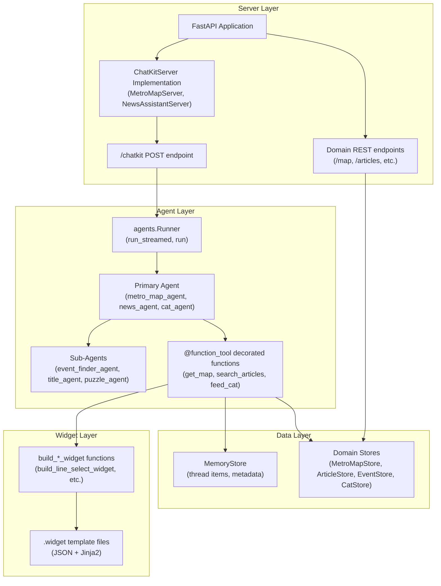
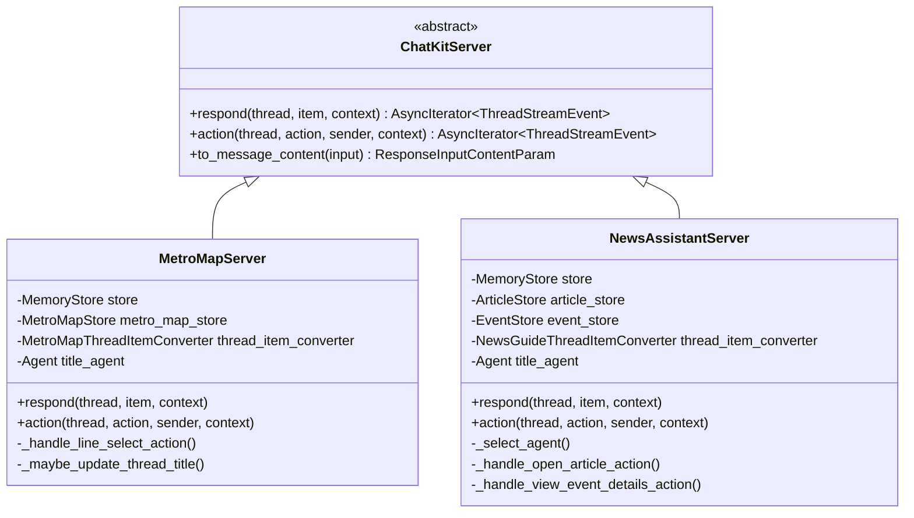
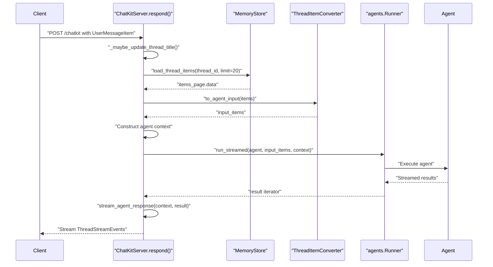
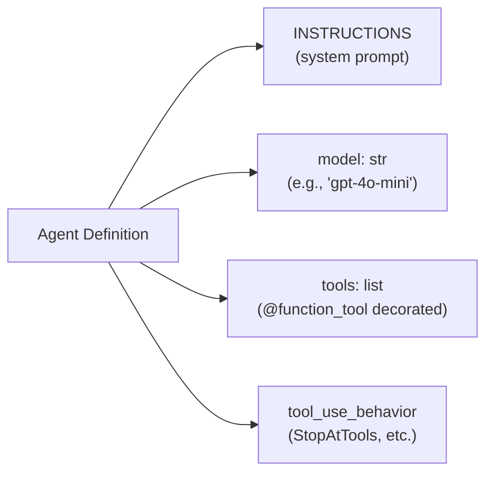
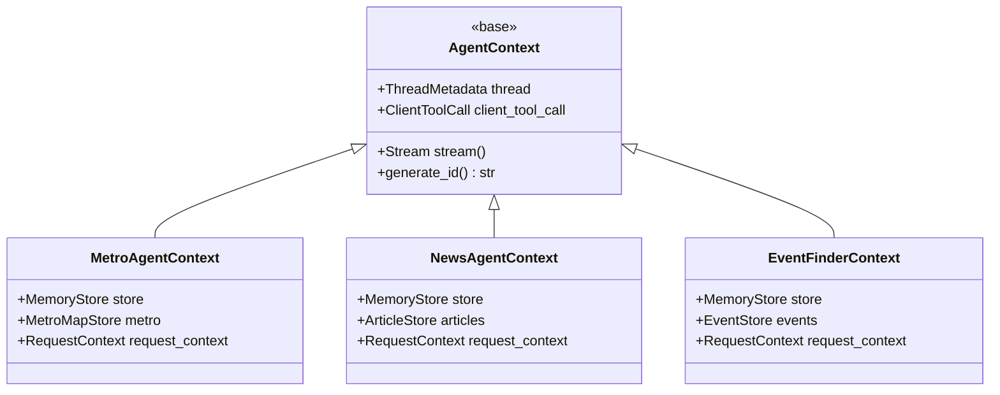
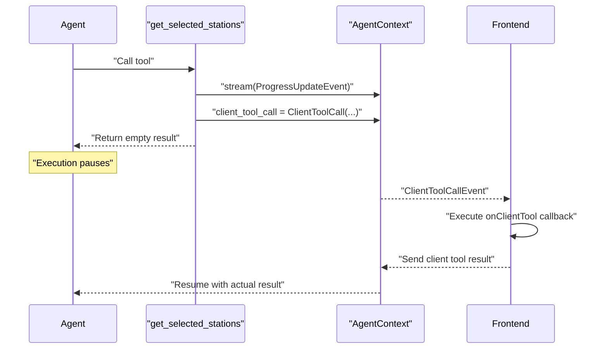
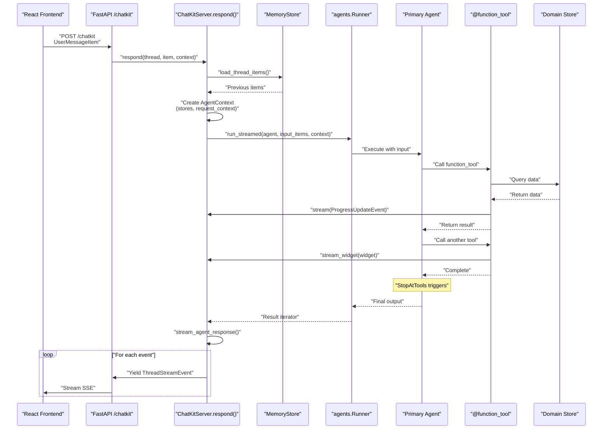
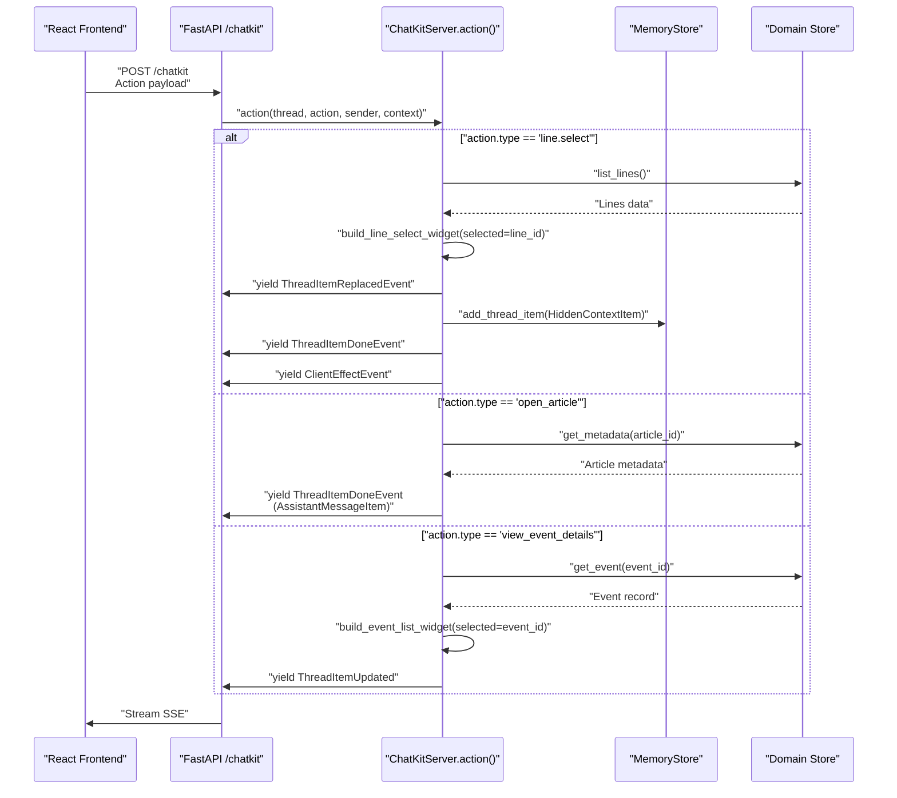

<!-- source: DeepWiki mcp.deepwiki.com · repo openai/openai-chatkit-advanced-samples · page 3.1 Backend Architecture Pattern · fetched 2026-10-26 -->

# Backend Architecture Pattern

<details>
<summary>Relevant source files</summary>

The following files were used as context for generating this wiki page:

- [examples/metro-map/backend/app/agents/metro_map_agent.py](examples/metro-map/backend/app/agents/metro_map_agent.py)
- [examples/metro-map/backend/app/server.py](examples/metro-map/backend/app/server.py)
- [examples/news-guide/backend/app/server.py](examples/news-guide/backend/app/server.py)

</details>


## Purpose and Scope

This document describes the common backend architecture pattern used across all example applications in this repository. Each example follows a consistent layered structure built on FastAPI and the ChatKit Python SDK, enabling conversational AI with rich UI interactions.

For frontend architectural patterns, see [Frontend Architecture Pattern](#3.2). For details on how backend and frontend communicate, see [Communication Patterns](#3.3). For example-specific agent implementations, see [Metro Map Agent](#4.2), [Cat Agent](#5.2), and [News Agent](#6.2).

---

## Architectural Layers

All backend implementations follow a four-layer architecture that separates concerns between HTTP handling, AI logic, data persistence, and UI generation.



**Sources:**
- [examples/metro-map/backend/app/server.py:1-185]()
- [examples/news-guide/backend/app/server.py:1-227]()
- [examples/metro-map/backend/app/agents/metro_map_agent.py:1-314]()

---

## Server Layer

### ChatKitServer Implementation

Each example implements a subclass of `ChatKitServer` that wires together the conversational interface with domain-specific logic. The implementation provides two required methods: `respond()` for handling user messages and `action()` for processing widget interactions.

**Key Components:**

| Component | Type | Purpose |
|-----------|------|---------|
| `ChatKitServer[RequestContext]` | Base class | Abstract interface for ChatKit integration |
| `MetroMapServer` | Implementation | Metro Map example server |
| `NewsAssistantServer` | Implementation | News Guide example server |
| `MemoryStore` | Storage | Thread history and metadata persistence |
| Domain stores | Storage | Application-specific data (maps, articles, cats) |

**Example Server Structure:**



**Sources:**
- [examples/metro-map/backend/app/server.py:41-185]()
- [examples/news-guide/backend/app/server.py:42-227]()

### respond() Method Pattern

The `respond()` method orchestrates the agent execution flow. It loads thread history, converts items to agent input format, constructs agent context, and streams the response.

**Standard Flow:**

1. Optionally trigger thread title generation
2. Load recent thread items from `MemoryStore`
3. Convert thread items to agent input format using `ThreadItemConverter`
4. Construct agent-specific context (e.g., `MetroAgentContext`, `NewsAgentContext`)
5. Execute agent using `Runner.run_streamed()`
6. Stream agent response events using `stream_agent_response()`



**Sources:**
- [examples/metro-map/backend/app/server.py:54-86]()
- [examples/news-guide/backend/app/server.py:56-80]()

### action() Method Pattern

The `action()` method handles user interactions with widgets. Actions are routed based on `action.type`, and handlers can update widgets, inject hidden context, or trigger client effects.

**Action Handling Examples:**

| Example | Action Type | Handler Method | Behavior |
|---------|-------------|----------------|----------|
| Metro Map | `line.select` | `_handle_line_select_action()` | Updates widget, injects `<LINE_SELECTED>` tag, triggers `location_select_mode` effect |
| News Guide | `open_article` | `_handle_open_article_action()` | Sends assistant message prompting for article questions |
| News Guide | `view_event_details` | `_handle_view_event_details_action()` | Updates event list widget to show selected event details |

**Sources:**
- [examples/metro-map/backend/app/server.py:88-159]()
- [examples/news-guide/backend/app/server.py:82-179]()

---

## Agent Layer

### Primary Agents

Each example defines a primary agent that handles the conversational logic. Agents are created using the `Agent` class from the `agents` library, specifying instructions, model, tools, and optional tool use behavior.

**Agent Configuration Pattern:**



**Example Agent Definitions:**

| Agent | Variable Name | Model | Notable Tools | Tool Behavior |
|-------|--------------|-------|---------------|---------------|
| Metro Map | `metro_map_agent` | `gpt-4o-mini` | `get_map`, `add_station`, `show_line_selector`, `get_selected_stations` | `StopAtTools([plan_route, show_line_selector, get_selected_stations])` |
| News Guide | `news_agent` | `gpt-4o` | `search_articles`, `get_current_page` | Default (continues after tools) |
| Event Finder | `event_finder_agent` | `gpt-4o-mini` | `find_events` | `StopAtTools([find_events])` |

**Sources:**
- [examples/metro-map/backend/app/agents/metro_map_agent.py:286-313]()

### Agent Context

Each agent receives a typed context object that provides access to stores, request context, and streaming methods. Context classes extend `AgentContext` and use Pydantic for validation.

**Context Structure:**



**Sources:**
- [examples/metro-map/backend/app/agents/metro_map_agent.py:77-82]()

### Function Tools

Tools are Python async functions decorated with `@function_tool`. They receive a `RunContextWrapper[AgentContext]` as the first parameter, providing access to the agent context and streaming capabilities.

**Tool Categories:**

| Category | Purpose | Examples |
|----------|---------|----------|
| Data Retrieval | Query domain stores | `get_map()`, `list_stations()`, `search_articles()` |
| State Mutation | Modify application state | `add_station()`, `feed_cat()`, `set_cat_name()` |
| Client Interaction | Request client data | `get_selected_stations()`, `get_current_page()` |
| UI Generation | Output widgets | `show_line_selector()` |
| Response Enhancement | Add annotations | `plan_route()` |

**Function Tool Pattern:**

```python
@function_tool(description_override="Tool description for the model")
async def tool_name(
    ctx: RunContextWrapper[AgentContext],
    param1: str,
    param2: int = 0,
) -> ResultModel:
    # Access context
    store = ctx.context.store
    
    # Stream progress updates
    await ctx.context.stream(ProgressUpdateEvent(text="Processing..."))
    
    # Query data
    data = store.get_data()
    
    # Return structured result
    return ResultModel(data=data)
```

**Sources:**
- [examples/metro-map/backend/app/agents/metro_map_agent.py:110-146]()
- [examples/metro-map/backend/app/agents/metro_map_agent.py:228-265]()

### Client Tool Calls

Tools that need to query frontend state set `ctx.context.client_tool_call` with a `ClientToolCall` object. This triggers a round-trip to the client, suspending agent execution until the client responds.

**Client Tool Example:**



**Sources:**
- [examples/metro-map/backend/app/agents/metro_map_agent.py:268-283]()

### StopAtTools Behavior

The `tool_use_behavior` parameter controls when agent execution stops. `StopAtTools` specifies tool names that should terminate the agent's turn, allowing the server to process outputs before continuing the conversation.

**Use Cases:**

- **Widget Tools**: Stop after `show_line_selector()` to display widget without additional text
- **Client Tools**: Stop after `get_selected_stations()` to wait for client response
- **Annotation Tools**: Stop after `plan_route()` to display annotated response

**Sources:**
- [examples/metro-map/backend/app/agents/metro_map_agent.py:306-312]()

---

## Data Layer

### MemoryStore

The `MemoryStore` class manages conversational thread data, including thread metadata and thread items (messages, widgets, context). It provides the storage interface required by `ChatKitServer`.

**Core Methods:**

| Method | Purpose | Returns |
|--------|---------|---------|
| `load_thread_items(thread_id, after, limit, order, context)` | Load paginated thread items | `ThreadItemsPage` |
| `add_thread_item(thread_id, item, context)` | Append item to thread | `None` |
| `save_thread(thread, context)` | Persist thread metadata | `None` |
| `generate_item_id(type, thread, context)` | Create unique item ID | `str` |

**Sources:**
- [examples/metro-map/backend/app/memory_store.py]() (referenced but not provided)

### Domain Stores

Domain stores encapsulate application-specific data. They are passed to agent contexts and accessed by function tools.

**Example Domain Stores:**

| Store Class | Data | Key Methods |
|-------------|------|-------------|
| `MetroMapStore` | Metro lines and stations | `get_map()`, `list_lines()`, `add_station()`, `find_station()` |
| `ArticleStore` | News articles | `search_articles()`, `get_article_content()`, `get_metadata()` |
| `EventStore` | Calendar events | `find_events()`, `get_event()` |
| `CatStore` | Virtual cat state | `get_cat_status()`, `feed_cat()`, `play_with_cat()` |

**Store Initialization Pattern:**

```python
class MetroMapServer(ChatKitServer[RequestContext]):
    def __init__(self) -> None:
        self.store: MemoryStore = MemoryStore()
        super().__init__(self.store)
        
        data_dir = Path(__file__).resolve().parent / "data"
        self.metro_map_store = MetroMapStore(data_dir)
```

**Sources:**
- [examples/metro-map/backend/app/server.py:44-50]()
- [examples/news-guide/backend/app/server.py:45-52]()

---

## Widget Layer

### Widget Templates

Widgets are defined in `.widget` files using JSON structure with Jinja2 templating. Templates enable dynamic content generation while maintaining consistent UI structure.

**Template File Pattern:**

```
backend/app/widgets/
├── widget_name.widget          # JSON template with Jinja2
└── widget_name_widget.py       # Builder function
```

**Sources:**
- Referenced in high-level diagrams

### Widget Builders

Builder functions populate widget templates with data and return `WidgetRoot` objects. These functions are called by tools or server action handlers.

**Builder Function Pattern:**

```python
def build_widget_name(
    data: DataType,
    selected: str | None = None,
) -> WidgetRoot:
    # Load and render template
    template_path = Path(__file__).parent / "widget_name.widget"
    template_content = template_path.read_text()
    rendered = Template(template_content).render(
        data=data,
        selected=selected,
    )
    
    # Parse and return widget
    return WidgetRoot.model_validate_json(rendered)
```

**Widget Output in Tools:**

```python
@function_tool(description_override="Show widget")
async def show_widget(ctx: RunContextWrapper[AgentContext], message: str):
    widget = build_widget_name(ctx.context.store.get_data())
    
    # Output message first
    await ctx.context.stream(ThreadItemDoneEvent(item=AssistantMessageItem(...)))
    
    # Then stream widget
    await ctx.context.stream_widget(widget)
```

**Sources:**
- [examples/metro-map/backend/app/agents/metro_map_agent.py:116-128]()

---

## Request Flow

### Complete Request-Response Flow

This diagram shows the complete flow from an HTTP request through all architectural layers to the streamed response.



**Sources:**
- [examples/metro-map/backend/app/server.py:54-86]()
- [examples/metro-map/backend/app/agents/metro_map_agent.py:286-313]()

### Action Handling Flow

Widget actions follow a different path through the server's `action()` method.



**Sources:**
- [examples/metro-map/backend/app/server.py:88-159]()
- [examples/news-guide/backend/app/server.py:82-179]()

---

## Key Design Patterns

### Separation of Concerns

| Layer | Responsibility | Does NOT Handle |
|-------|----------------|-----------------|
| Server | HTTP routing, ChatKit protocol | AI logic, data queries |
| Agent | Conversational flow, tool selection | HTTP, storage implementation |
| Tools | Data access, side effects | Conversation management |
| Stores | Data persistence, queries | UI generation, streaming |

### Dependency Injection

Agent contexts provide dependency injection, making stores and utilities available to tools without global state:

```python
# Context defines dependencies
class MetroAgentContext(AgentContext):
    store: MemoryStore
    metro: MetroMapStore
    request_context: RequestContext

# Server constructs context
agent_context = MetroAgentContext(
    thread=thread,
    store=self.store,
    metro=self.metro_map_store,
    request_context=context,
)

# Tools access via context
@function_tool
async def get_map(ctx: RunContextWrapper[MetroAgentContext]) -> MapResult:
    return MapResult(map=ctx.context.metro.get_map())
```

**Sources:**
- [examples/metro-map/backend/app/agents/metro_map_agent.py:77-82]()
- [examples/metro-map/backend/app/server.py:75-80]()

### Streaming Events

All agent outputs are streamed to the client in real-time using async generators. This enables progress updates, incremental responses, and rich UI updates during long-running operations.

**Event Types:**
- `ProgressUpdateEvent`: Transient status messages
- `ThreadItemDoneEvent`: Completed messages or widgets
- `ClientEffectEvent`: Fire-and-forget UI updates
- `ThreadItemReplacedEvent`: Widget state updates
- `ThreadItemUpdated`: Partial widget updates

**Sources:**
- [examples/metro-map/backend/app/agents/metro_map_agent.py:137-138]()
- [examples/metro-map/backend/app/agents/metro_map_agent.py:239-246]()

---

