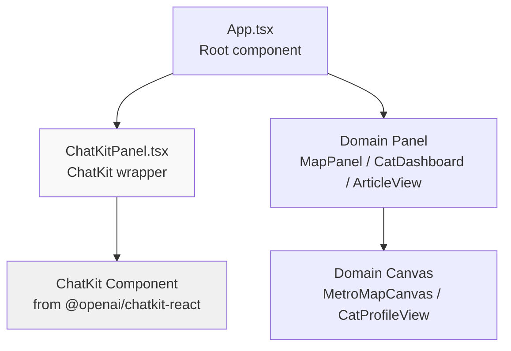
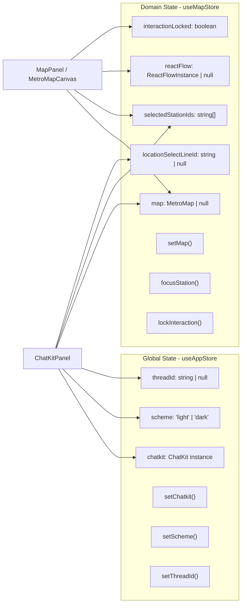
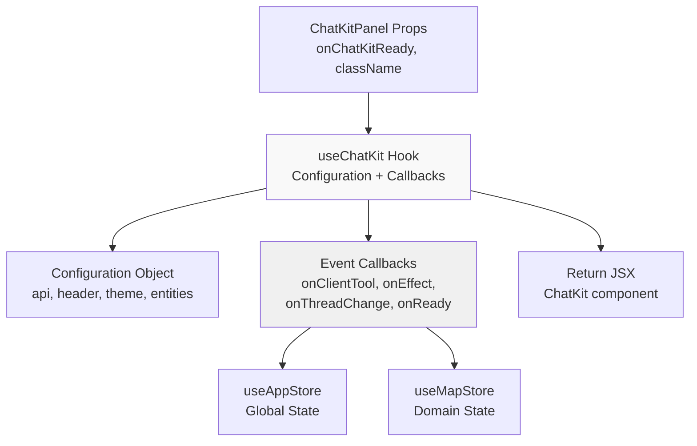
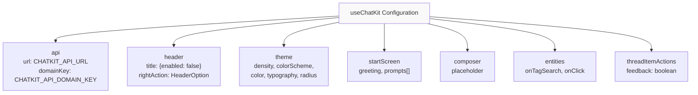
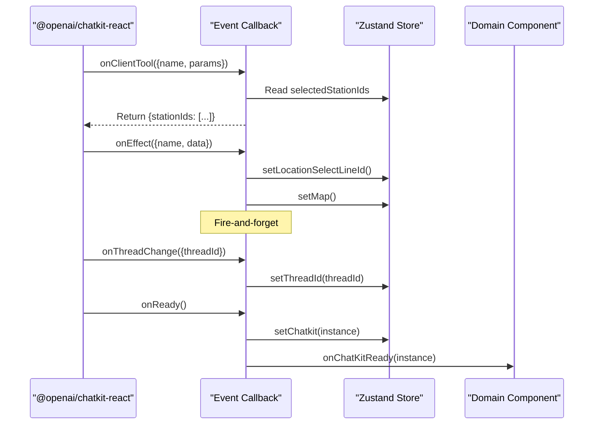
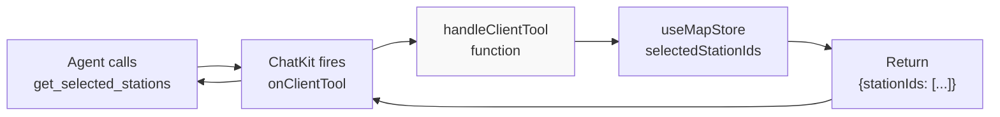
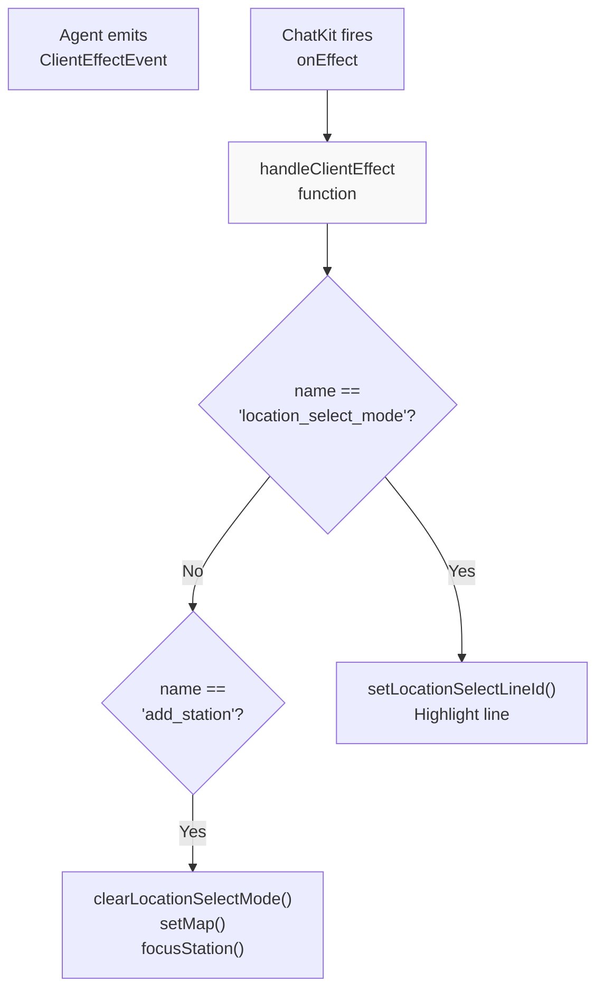
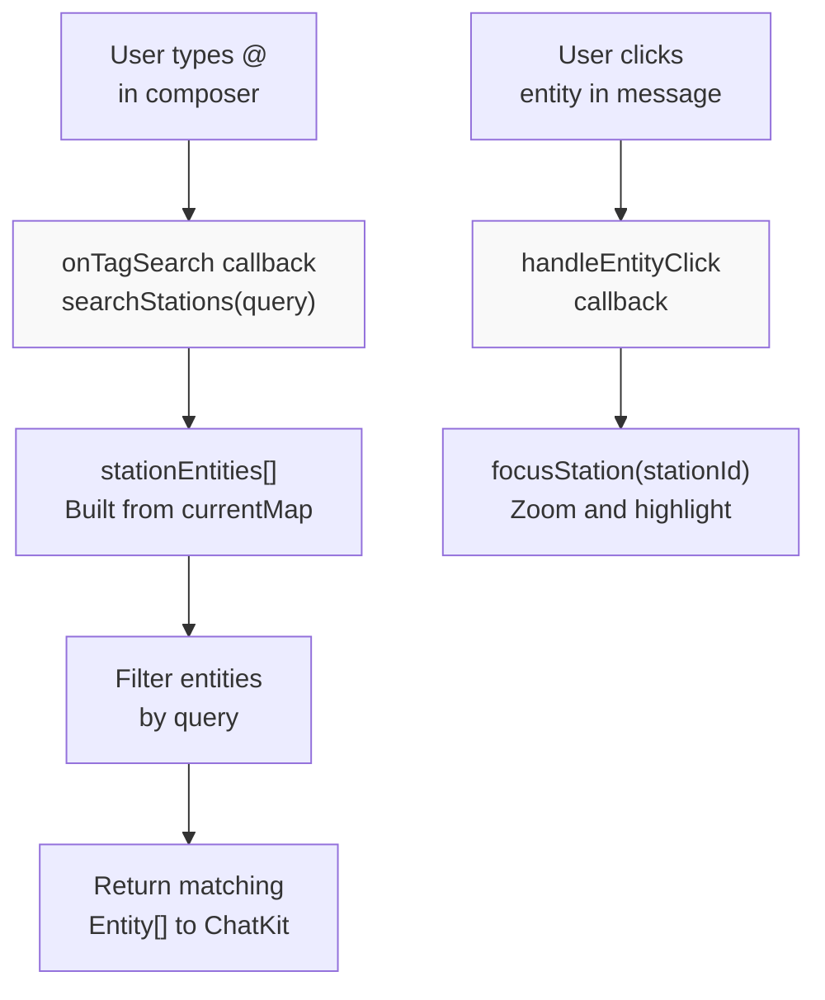
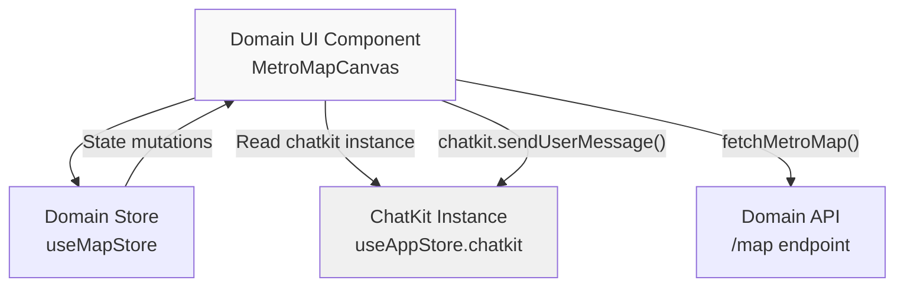

<!-- source: DeepWiki mcp.deepwiki.com · repo openai/openai-chatkit-advanced-samples · page 3.2 Frontend Architecture Pattern · fetched 2026-10-26 -->

# Frontend Architecture Pattern

<details>
<summary>Relevant source files</summary>

The following files were used as context for generating this wiki page:

- [examples/metro-map/frontend/package-lock.json](examples/metro-map/frontend/package-lock.json)
- [examples/metro-map/frontend/src/components/ChatKitPanel.tsx](examples/metro-map/frontend/src/components/ChatKitPanel.tsx)
- [examples/metro-map/frontend/src/components/MapPanel.tsx](examples/metro-map/frontend/src/components/MapPanel.tsx)
- [examples/metro-map/frontend/src/components/MetroMapCanvas.tsx](examples/metro-map/frontend/src/components/MetroMapCanvas.tsx)
- [examples/metro-map/frontend/src/lib/config.ts](examples/metro-map/frontend/src/lib/config.ts)
- [examples/metro-map/frontend/src/store/useMapStore.ts](examples/metro-map/frontend/src/store/useMapStore.ts)

</details>


## Purpose and Scope

This page documents the common frontend architecture pattern shared across all example applications in the repository. All examples follow an identical React + TypeScript structure using Vite as the build tool, Zustand for state management, and `@openai/chatkit-react` for chat UI integration.

For backend architecture patterns, see [Backend Architecture Pattern](#3.1). For specific communication patterns between frontend and backend, see [Communication Patterns](#3.3).

---

## Component Hierarchy

All examples follow a three-layer component structure: the root `App` component, the `ChatKitPanel` component for chat integration, and domain-specific UI components for application functionality.



**Sources**: [examples/metro-map/frontend/src/components/ChatKitPanel.tsx:37-218](), [examples/metro-map/frontend/src/components/MetroMapCanvas.tsx:1-492](), [examples/metro-map/frontend/src/components/MapPanel.tsx:16-279]()

---

## State Management Architecture

State is split into two categories using Zustand: global application state managed by `useAppStore`, and domain-specific state managed by domain stores like `useMapStore`.



### Global State Store Pattern

The `useAppStore` maintains state that is shared across the entire application:

| State Field | Type | Purpose |
|-------------|------|---------|
| `chatkit` | `ChatKit \| null` | ChatKit instance for programmatic control |
| `scheme` | `'light' \| 'dark'` | Current theme scheme |
| `threadId` | `string \| null` | Active conversation thread ID |

**Sources**: [examples/metro-map/frontend/src/components/ChatKitPanel.tsx:41-54]()

### Domain State Store Pattern

Domain stores manage application-specific state independent of the chat interface. The `useMapStore` example demonstrates the pattern:

| State Field | Type | Purpose |
|-------------|------|---------|
| `map` | `MetroMap \| null` | Current map data |
| `selectedStationIds` | `string[]` | User-selected stations |
| `locationSelectLineId` | `string \| null` | Line ID when in location selection mode |
| `reactFlow` | `ReactFlowInstance \| null` | ReactFlow instance for map manipulation |
| `interactionLocked` | `boolean` | Locks UI during agent responses |

**Sources**: [examples/metro-map/frontend/src/store/useMapStore.ts:8-85]()

---

## ChatKit Integration Layer

The `ChatKitPanel` component serves as the bridge between the ChatKit UI library and the application. It configures the `useChatKit` hook and implements event callbacks that translate ChatKit events into application state mutations.

### ChatKitPanel Component Structure



**Sources**: [examples/metro-map/frontend/src/components/ChatKitPanel.tsx:37-218]()

### useChatKit Configuration

The `useChatKit` hook accepts a configuration object with the following structure:



**Key Configuration Fields**:

| Field | Purpose | Example |
|-------|---------|---------|
| `api.url` | ChatKit backend endpoint | `"/chatkit"` or `CHATKIT_API_URL` |
| `api.domainKey` | Domain allowlist key | `"domain_pk_localhost_dev"` |
| `header.rightAction` | Custom header button | Dark/light mode toggle |
| `theme.colorScheme` | `"light"` or `"dark"` | Synced with `useAppStore.scheme` |
| `startScreen` | Initial prompts and greeting | Dynamic based on selected stations |
| `entities.onTagSearch` | Entity autocomplete function | `searchStations` |

**Sources**: [examples/metro-map/frontend/src/components/ChatKitPanel.tsx:155-211](), [examples/metro-map/frontend/src/lib/config.ts:1-68]()

---

## Event Callback System

ChatKit events are handled through callback functions that bridge the chat system to application state. Each callback receives event data and performs state mutations or triggers domain actions.

### Callback Flow Diagram



**Sources**: [examples/metro-map/frontend/src/components/ChatKitPanel.tsx:119-211]()

### Client Tool Callback - onClientTool

Client tools enable the agent to query frontend state during response generation. The callback executes synchronously and returns data to continue the agent's response.



**Implementation**: The `handleClientTool` callback inspects the `name` field and returns the requested data:

```typescript
const handleClientTool = useCallback(
  ({name}: { name: string; params: Record<string, unknown> }) => {
    if (name === "get_selected_stations") {
      return { stationIds: selectedStationIds };
    }
  },
  [selectedStationIds]
);
```

**Sources**: [examples/metro-map/frontend/src/components/ChatKitPanel.tsx:119-128]()

### Client Effect Callback - onEffect

Client effects are fire-and-forget actions that update the UI without requiring server acknowledgment. They enable real-time feedback during agent responses.



**Implementation**: The `handleClientEffect` callback uses the `name` field to route to the appropriate state mutation:

```typescript
const handleClientEffect = useCallback(
  ({name, data}: { name: string; data: Record<string, unknown> }) => {
    if (name === "location_select_mode") {
      const lineId = data.lineId as string | undefined;
      if (lineId) {
        setLocationSelectLineId(lineId);
      }
    }
    if (name === "add_station") {
      const stationId = data.stationId as string | undefined;
      const nextMap = data.map as MetroMap | undefined;
      clearLocationSelectMode();
      if (nextMap) {
        setMap(nextMap);
      }
      if (stationId) {
        requestAnimationFrame(() => focusStation(stationId, nextMap));
      }
    }
  },
  [clearLocationSelectMode, focusStation, setLocationSelectLineId, setMap]
);
```

**Sources**: [examples/metro-map/frontend/src/components/ChatKitPanel.tsx:130-153]()

### Thread Change Callback - onThreadChange

Tracks the active conversation thread ID, enabling thread-specific UI states or navigation.

```typescript
onThreadChange: ({ threadId }) => {
  setThreadId(threadId);
}
```

**Sources**: [examples/metro-map/frontend/src/components/ChatKitPanel.tsx:194-196]()

### Ready Callback - onReady

Fires when ChatKit is fully initialized, providing access to the ChatKit instance for programmatic control.

```typescript
onReady: () => {
  onChatKitReady?.(chatkit);
  setChatkit(chatkit);
}
```

**Sources**: [examples/metro-map/frontend/src/components/ChatKitPanel.tsx:200-203]()

### Response Lifecycle Callbacks

Lock UI interactions during agent responses to prevent conflicting state mutations:

```typescript
onResponseStart: () => {
  lockInteraction();
},
onResponseEnd: () => {
  unlockInteraction();
}
```

**Sources**: [examples/metro-map/frontend/src/components/ChatKitPanel.tsx:205-210]()

---

## Entity Tag Integration

Entity tags enable @-mentions of domain objects within chat messages. The frontend provides search and click handlers to integrate entities with domain UI.

### Entity Tag Flow



**Entity Structure**: Entities are built from domain data and include metadata for search and display:

```typescript
const stationEntities = useMemo<Entity[]>(() => {
  if (!currentMap) return [];
  return currentMap.stations.map((station) => {
    return {
      id: station.id,
      title: station.name,
      interactive: true,
      group: "Stations",
      data: {
        type: "station",
        station_id: station.id,
        name: station.name,
      },
    };
  });
}, [currentMap]);
```

**Search Handler**: Filters entities based on user input:

```typescript
const searchStations = useCallback(
  async (query: string) => {
    if (!stationEntities.length) return [];
    const normalized = query.trim().toLowerCase();
    if (!normalized) return stationEntities;
    return stationEntities.filter((entity) => {
      return entity.title.toLowerCase().includes(normalized) ||
             entity.id.toLowerCase().includes(normalized);
    });
  },
  [stationEntities]
);
```

**Click Handler**: Executes domain actions when entities are clicked:

```typescript
const handleEntityClick = useCallback(
  (entity: Entity) => {
    const stationId = (entity.data?.station_id || entity.id || "").trim();
    if (stationId) {
      focusStation(stationId, currentMap ?? undefined);
    }
  },
  [currentMap, focusStation]
);
```

**Sources**: [examples/metro-map/frontend/src/components/ChatKitPanel.tsx:73-117]()

---

## Configuration Patterns

Frontend configuration uses environment variables with fallback defaults, following the pattern shown in the config files.

### Configuration Structure

| Configuration | Environment Variable | Default | Purpose |
|---------------|---------------------|---------|---------|
| `CHATKIT_API_URL` | `VITE_CHATKIT_API_URL` | `"/chatkit"` | ChatKit backend endpoint |
| `CHATKIT_API_DOMAIN_KEY` | `VITE_CHATKIT_API_DOMAIN_KEY` | `"domain_pk_localhost_dev"` | Domain allowlist key |
| `MAP_API_URL` | `VITE_MAP_API_URL` | `"/map"` | Domain API endpoint |

**Configuration Loading Pattern**:

```typescript
export const CHATKIT_API_URL = import.meta.env.VITE_CHATKIT_API_URL ?? "/chatkit";

export const CHATKIT_API_DOMAIN_KEY =
  import.meta.env.VITE_CHATKIT_API_DOMAIN_KEY ?? "domain_pk_localhost_dev";

export const MAP_API_URL = import.meta.env.VITE_MAP_API_URL ?? "/map";
```

**Sources**: [examples/metro-map/frontend/src/lib/config.ts:3-14]()

### Dynamic Configuration Functions

Some configuration values are computed dynamically based on application state:

```typescript
export const getGreeting = (selectedStationIds: string[]) => {
  if (selectedStationIds.length > 1) {
    return "Any questions about the selected stations?";
  }
  return "Welcome to Orbital Transit";
};

export const getStartScreenPrompts = (selectedStationIds: string[]): StartScreenPrompt[] => {
  if (selectedStationIds.length > 1) {
    return [
      {
        label: "Tell me about these stations.",
        prompt: "Tell me about the stations I've selected",
        icon: "map-pin",
      },
      // ...
    ];
  }
  return DEFAULT_START_SCREEN_PROMPTS;
};
```

**Sources**: [examples/metro-map/frontend/src/lib/config.ts:39-66]()

---

## Domain UI Integration

Domain-specific UI components operate independently of ChatKit, communicating through shared Zustand stores and programmatic ChatKit API calls.

### Integration Pattern



**Programmatic Message Sending**: Domain components can send messages on user interaction:

```typescript
const handleNodeClick = useCallback(
  (_: MouseEvent, node: Node) => {
    handleSelectionChange({ nodes: [node] });
    if (!chatkit) return;

    const stationName =
      (node.data as StationNodeData | undefined)?.name ??
      map.stations.find((station) => station.id === node.id)?.name;

    if (!stationName) return;

    chatkit
      .sendUserMessage({ text: `Tell me about ${stationName}` })
      .catch((error) => console.error("Failed to send station prompt.", error));
  },
  [chatkit, handleSelectionChange, map.stations]
);
```

**Sources**: [examples/metro-map/frontend/src/components/MetroMapCanvas.tsx:415-431]()

---

## Technology Stack Summary

| Layer | Technology | Version | Purpose |
|-------|-----------|---------|---------|
| Build Tool | Vite | 7.x | Fast builds and HMR |
| Framework | React | 19.2 | UI framework |
| Language | TypeScript | 5.4 | Type safety |
| State Management | Zustand | 5.0 | Lightweight state |
| ChatKit Integration | `@openai/chatkit-react` | ^1.3.0 | Chat UI library |
| Routing | React Router | 6.28 | Client-side navigation |
| Graph Visualization | ReactFlow | 11.11 | Metro Map example only |

**Sources**: [examples/metro-map/frontend/package-lock.json:1-46]()

---

## Common Patterns Summary

1. **Single ChatKitPanel per App**: Each application has exactly one `ChatKitPanel` component that configures and wraps the ChatKit UI
2. **Two-Store Pattern**: Global state in `useAppStore`, domain state in domain-specific stores
3. **Event Callback Bridge**: ChatKit events are translated to state mutations through callback functions
4. **Programmatic Control**: Domain UI accesses `chatkit` instance for sending messages or controlling threads
5. **Dynamic Configuration**: Start screen prompts and greetings adapt to application state
6. **Entity Integration**: Domain objects become @-mentionable through `entities` configuration
7. **Interaction Locking**: UI interactions disabled during agent responses via `interactionLocked` state

**Sources**: [examples/metro-map/frontend/src/components/ChatKitPanel.tsx:1-219](), [examples/metro-map/frontend/src/store/useMapStore.ts:1-86]()

---

