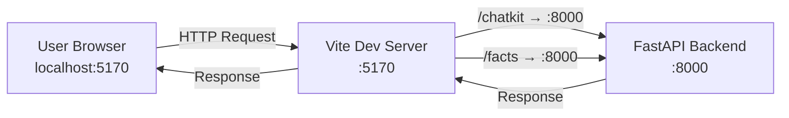
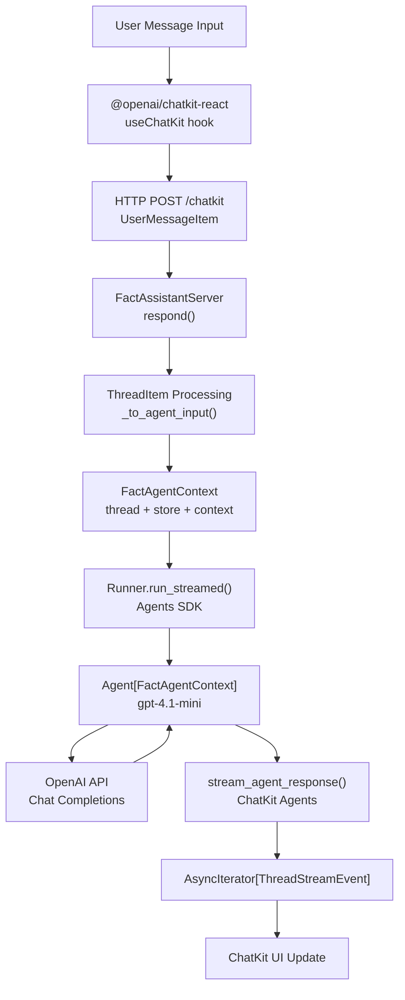
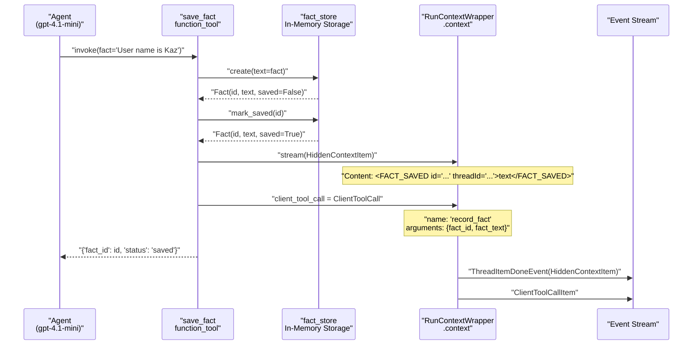
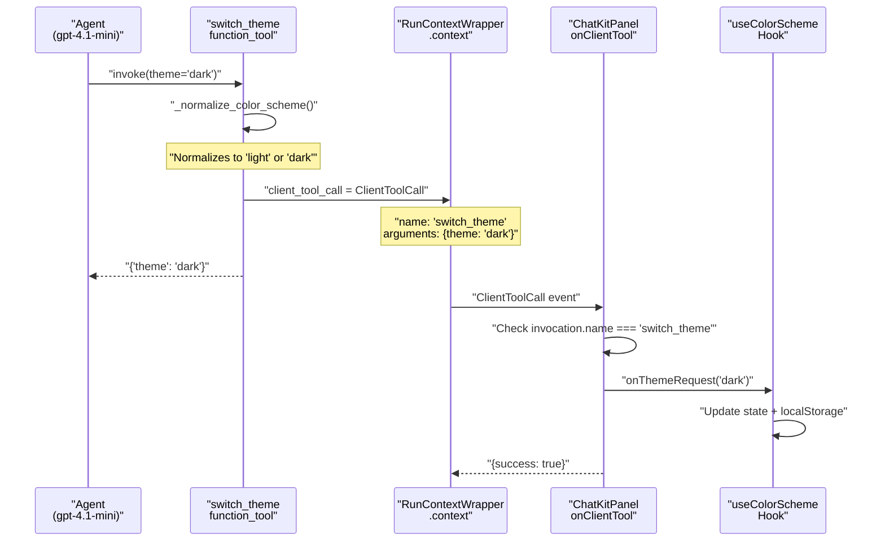
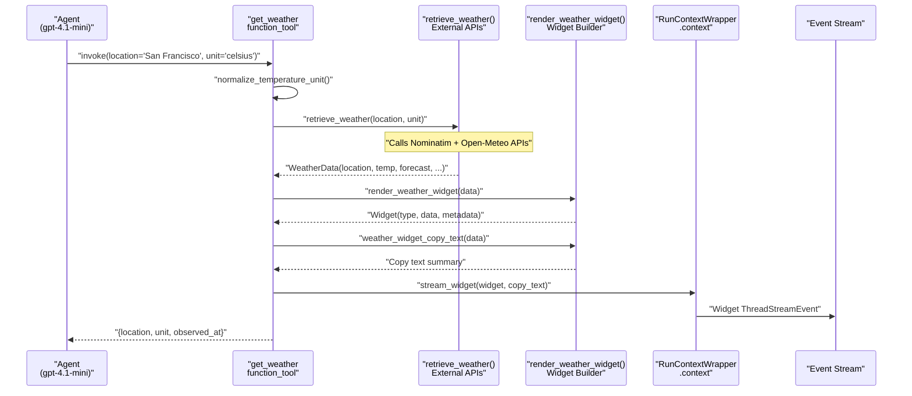
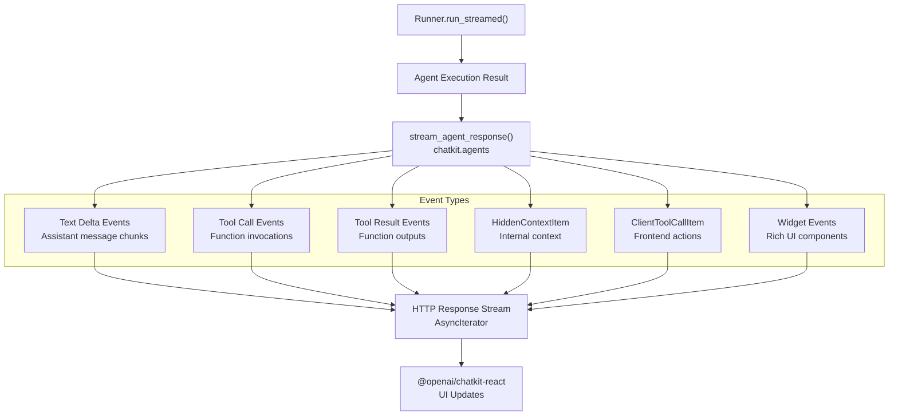
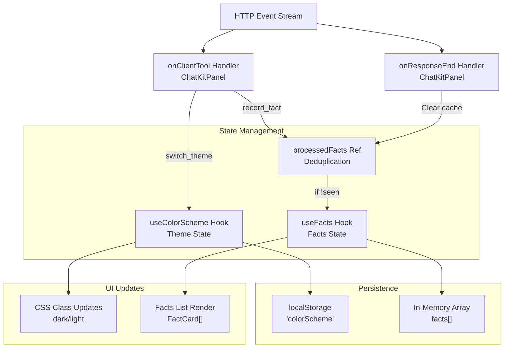
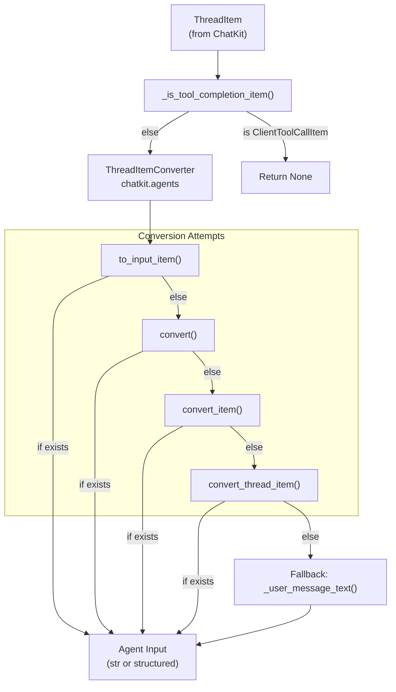
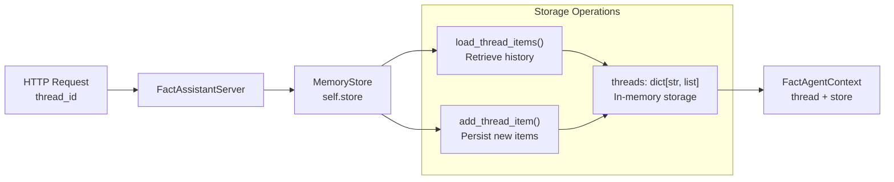

<!-- source: DeepWiki mcp.deepwiki.com · repo openai/openai-chatkit-advanced-samples · page 3.3 Communication Patterns · fetched 2026-10-26 -->

# Communication Patterns

Relevant source files

The following files were used as context for generating this wiki page:

- [README.md](README.md)
- [examples/cat-lounge/README.md](examples/cat-lounge/README.md)
- [examples/cat-lounge/frontend/src/components/ChatKitPanel.tsx](examples/cat-lounge/frontend/src/components/ChatKitPanel.tsx)
- [examples/metro-map/README.md](examples/metro-map/README.md)

This page documents the four primary communication patterns used across all ChatKit Advanced Samples applications. These patterns define how the frontend, backend agents, and UI state interact to create rich, bidirectional conversational experiences.

The four patterns are:
1. **Server Tool Calls** - Agents query backend data stores to ground responses
2. **Client Tool Calls** - Agents request information from frontend UI state
3. **Client Effects** - Fire-and-forget UI updates triggered by agents
4. **Widget Actions** - User interactions with rendered widgets, handled client-side or server-side

For the overall architecture, see [Backend Architecture Pattern](#3.1) and [Frontend Architecture Pattern](#3.2). For widget-specific details, see [Widget System](#3.4).

## Request Routing

All client requests flow through the Vite development server's proxy configuration before reaching the FastAPI backend. This eliminates CORS issues during local development.

The proxy rules are configured in `vite.config.ts` to forward `/chatkit` and `/facts` endpoints to the backend target (default: `http://127.0.0.1:8000`).

**Sources:** [frontend/vite.config.ts:12-20]()

## Message Processing Pipeline

When a user sends a message, it flows through multiple processing layers before generating a response. The following diagram shows the complete pipeline from user input to streamed events.

The `FactAssistantServer.respond()` method orchestrates this flow:

1. Receives a `UserMessageItem` from the ChatKit frontend
2. Creates a `FactAgentContext` containing thread metadata, memory store, and request context
3. Converts the thread item to agent input format using `_to_agent_input()`
4. Invokes `Runner.run_streamed()` with the agent and input
5. Streams events back to the client via `stream_agent_response()`

**Sources:** [backend/app/chat.py:235-266]()

## Tool Invocation Flows

The agent can invoke three different tools during conversation processing, each with distinct data flow patterns.

### Save Fact Flow

The `save_fact` tool persists user information and emits two types of events: a `HiddenContextItem` for the agent's context and a `ClientToolCall` for frontend state updates.

The `HiddenContextItem` includes XML-formatted content that provides context to the AI model in subsequent turns, while the `ClientToolCall` triggers frontend state updates via the `onClientTool` handler.

**Sources:** [backend/app/chat.py:109-128](), [frontend/src/components/ChatKitPanel.tsx:68-81]()

### Switch Theme Flow

The `switch_theme` tool demonstrates pure client-side tool invocations without server-side state changes.

No server-side state is modified. The tool simply validates the theme value and emits a `ClientToolCall` that the frontend handles to update the UI color scheme.

**Sources:** [backend/app/chat.py:131-148](), [frontend/src/components/ChatKitPanel.tsx:56-66]()

### Get Weather Flow

The `get_weather` tool demonstrates widget rendering, combining external API calls with complex UI component streaming.

The widget is streamed as a `ThreadStreamEvent` and rendered inline in the ChatKit UI. The agent receives a summary response containing the location, unit, and observation timestamp.

**Sources:** [backend/app/chat.py:151-208]()

## Event Streaming Architecture

All responses from the backend stream as `ThreadStreamEvent` objects through an asynchronous iterator. This enables real-time UI updates as the agent processes the request.

The `stream_agent_response()` function from `chatkit.agents` converts the agent's execution result into a stream of `ThreadStreamEvent` objects. Each event type triggers specific UI behaviors in the ChatKit React component.

**Sources:** [backend/app/chat.py:258-266]()

## Frontend State Synchronization

The frontend maintains two primary state stores that are updated in response to streamed events from the backend.

The `onClientTool` callback processes client-side tool invocations:
- For `switch_theme`: Updates the `useColorScheme` hook, which persists to `localStorage` and updates CSS classes
- For `record_fact`: Checks deduplication via `processedFacts` ref before updating the `useFacts` hook

The `processedFacts` ref prevents duplicate fact additions when the same `ClientToolCall` event is received multiple times during streaming.

**Sources:** [frontend/src/components/ChatKitPanel.tsx:26-94]()

## Thread Item Conversion

The backend converts incoming `ThreadItem` objects into agent-compatible input format through a multi-stage conversion process.

The `_to_agent_input()` method attempts multiple conversion strategies:
1. Tries various method names on the `ThreadItemConverter` instance
2. Intelligently determines method signatures to pass thread metadata when required
3. Falls back to extracting text from `UserMessageItem` content parts
4. Returns `None` for `ClientToolCallItem` types (tool completion acknowledgments)

This flexible approach ensures compatibility with different versions of the ChatKit Python SDK.

**Sources:** [backend/app/chat.py:299-353]()

## Memory Store Integration

Thread history and items are persisted in the `MemoryStore` to maintain conversation context across turns.

The `FactAssistantServer` initializes a `MemoryStore` instance at construction and passes it to each `FactAgentContext`. The store maintains an in-memory dictionary of thread items, enabling the agent to access conversation history when processing new messages.

**Sources:** [backend/app/chat.py:223-225](), [backend/app/chat.py:241-245]()

## Data Flow Summary

The following table summarizes the different data flow patterns in the application:

| Flow Type | Direction | Components | Data Format | Purpose |
|-----------|-----------|------------|-------------|---------|
| User Message | Frontend → Backend | ChatKit React → Vite → FastAPI → Agent | `UserMessageItem` | Initiate conversation turn |
| Agent Response | Backend → Frontend | Agent → stream_agent_response → HTTP Stream → ChatKit React | `ThreadStreamEvent[]` | Display AI responses |
| Fact Storage | Backend → Backend → Frontend | save_fact → fact_store → HiddenContextItem + ClientToolCall | `Fact` object + events | Persist user information |
| Theme Switch | Backend → Frontend | switch_theme → ClientToolCall → onClientTool | `ClientToolCall` | Update UI color scheme |
| Weather Widget | Backend → External → Frontend | get_weather → Weather APIs → Widget → stream_widget | `Widget` event | Display rich weather UI |
| Thread History | Backend Storage | MemoryStore ↔ ChatServer | `ThreadItem[]` | Maintain conversation context |
| Facts API | Frontend ↔ Backend | HTTP GET/POST /facts | JSON | Direct fact management |

Each flow pattern demonstrates a different aspect of the ChatKit integration: streaming responses, tool invocations, client-side actions, widget rendering, and state persistence.

**Sources:** [backend/app/chat.py:1-376](), [frontend/src/components/ChatKitPanel.tsx:1-102]()

---

