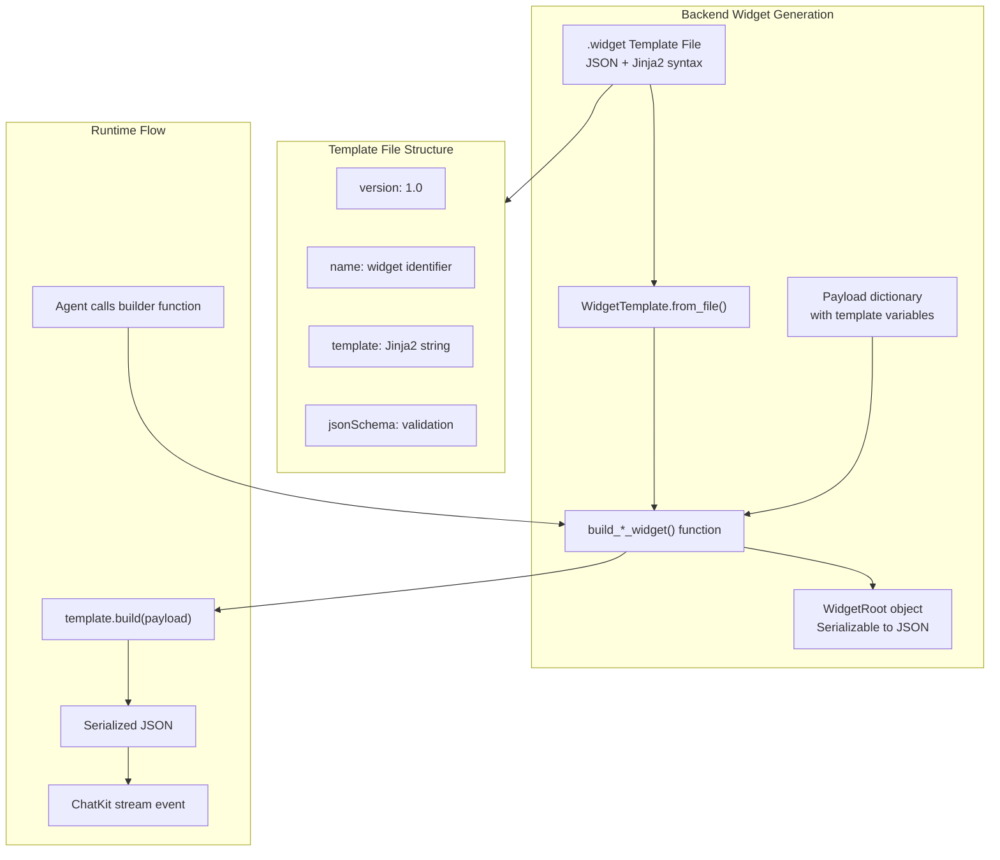
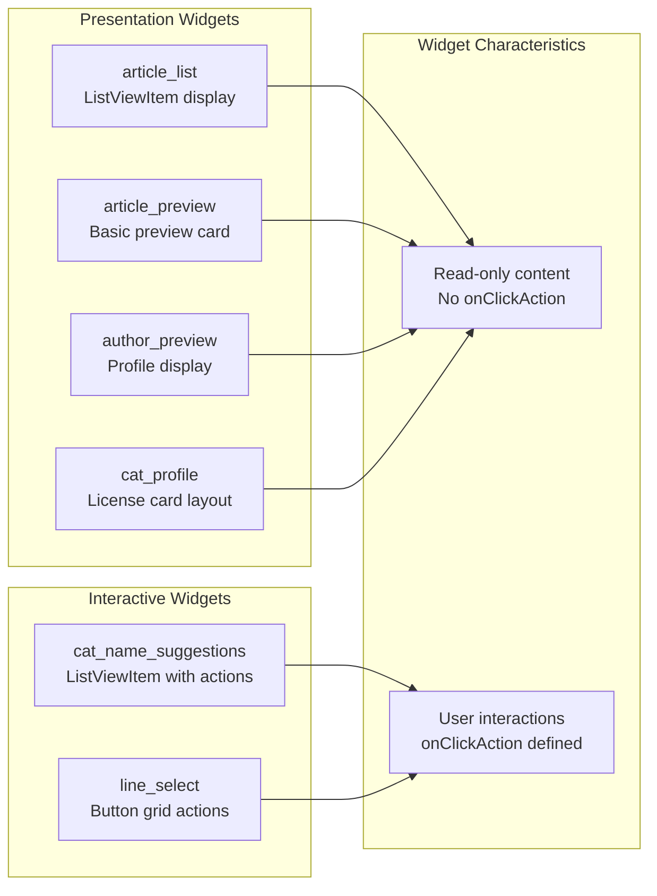
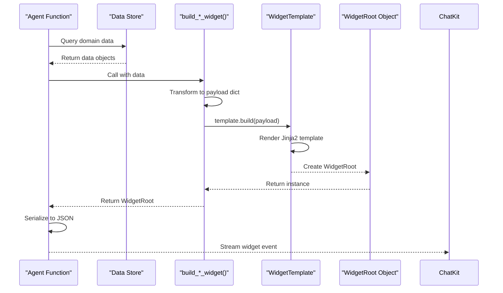
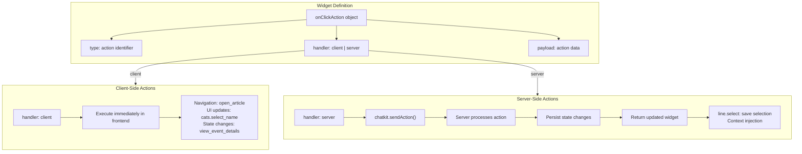

<!-- source: DeepWiki mcp.deepwiki.com · repo openai/openai-chatkit-advanced-samples · page 3.4 Widget System · fetched 2026-10-26 -->

# Widget System

<details>
<summary>Relevant source files</summary>

The following files were used as context for generating this wiki page:

- [examples/cat-lounge/backend/app/widgets/cat_name_suggestions.widget](examples/cat-lounge/backend/app/widgets/cat_name_suggestions.widget)
- [examples/cat-lounge/backend/app/widgets/cat_profile.widget](examples/cat-lounge/backend/app/widgets/cat_profile.widget)
- [examples/news-guide/backend/app/widgets/article_list.widget](examples/news-guide/backend/app/widgets/article_list.widget)
- [examples/news-guide/backend/app/widgets/article_list_widget.py](examples/news-guide/backend/app/widgets/article_list_widget.py)
- [examples/news-guide/backend/app/widgets/article_preview.widget](examples/news-guide/backend/app/widgets/article_preview.widget)
- [examples/news-guide/backend/app/widgets/author_preview.widget](examples/news-guide/backend/app/widgets/author_preview.widget)

</details>


The Widget System provides a template-based architecture for rendering interactive and presentational UI components within ChatKit conversations. Widgets are defined using `.widget` template files that combine JSON structure with Jinja2 templating, allowing agents to dynamically generate rich UI elements populated with application data. This system enables both read-only information display and interactive user actions that can be handled either client-side or server-side.

For information about how agents invoke widget creation, see [Server Tools](#7.1). For information about widget action handling in the frontend, see [Widget Actions](#7.4).

---

## Widget Template Architecture



**Sources:**
- [examples/news-guide/backend/app/widgets/article_list_widget.py:21-27]()
- [examples/cat-lounge/backend/app/widgets/cat_profile.widget:1-5]()

The widget architecture separates template definition from data population. Templates are loaded at module initialization using `WidgetTemplate.from_file()`, which reads `.widget` files containing the template structure. Builder functions accept domain-specific data, transform it into a payload dictionary matching the template's JSON schema, and call `template.build(payload)` to generate a `WidgetRoot` object. This object serializes to JSON for transmission through the ChatKit stream.

---

## Widget File Format

Widget template files follow a standardized JSON structure:

| Field | Type | Purpose |
|-------|------|---------|
| `version` | string | Template format version (currently "1.0") |
| `name` | string | Human-readable widget identifier |
| `template` | string | Jinja2 template producing JSON widget structure |
| `jsonSchema` | object | JSON Schema validating payload data |
| `outputJsonPreview` | object | Example rendered output for development |
| `encodedWidget` | string | Base64-encoded widget editor state (optional) |

**Sources:**
- [examples/news-guide/backend/app/widgets/article_list.widget:1-52]()
- [examples/cat-lounge/backend/app/widgets/cat_profile.widget:1-35]()

The `template` field contains a Jinja2 string that generates JSON conforming to the ChatKit widget schema. Variables are injected using `{{ variable | tojson }}` syntax to ensure proper JSON escaping. Conditional rendering uses `...` blocks, and iteration uses `...` loops.

---

## Widget Types



**Sources:**
- [examples/news-guide/backend/app/widgets/article_list_widget.py:24-27]()
- [examples/news-guide/backend/app/widgets/article_preview.widget:1-38]()
- [examples/news-guide/backend/app/widgets/author_preview.widget:1-38]()
- [examples/cat-lounge/backend/app/widgets/cat_profile.widget:1-35]()
- [examples/cat-lounge/backend/app/widgets/cat_name_suggestions.widget:1-46]()

### Presentation Widgets

Presentation widgets display information without user interaction. They render using ChatKit's layout primitives (`Row`, `Col`, `Box`, `Text`, `Image`, `Title`) to create structured displays. Examples include:

- **article_list**: Displays multiple articles in a `ListView` with hero images, titles, authors, and dates. Each `ListViewItem` shows a card layout but includes a "View" button with `handler: "client"` for navigation [examples/news-guide/backend/app/widgets/article_list.widget:134-140]()
- **article_preview** / **author_preview**: Compact preview cards showing key metadata in a horizontal layout [examples/news-guide/backend/app/widgets/article_preview.widget:39-103]()
- **cat_profile**: Styled card mimicking a California driver's license with cat details [examples/cat-lounge/backend/app/widgets/cat_profile.widget:35-174]()

### Interactive Widgets

Interactive widgets define `onClickAction` properties on interactive elements (`Button`, `ListViewItem`). Each action specifies:

```javascript
{
  "type": "action.type.identifier",
  "handler": "client" | "server",
  "payload": { /* action-specific data */ }
}
```

**Sources:**
- [examples/cat-lounge/backend/app/widgets/cat_name_suggestions.widget:53-73]()
- [examples/news-guide/backend/app/widgets/article_list.widget:134-140]()

The **cat_name_suggestions** widget demonstrates interactive patterns:
- Each `ListViewItem` has an `onClickAction` for selecting a name [examples/cat-lounge/backend/app/widgets/cat_name_suggestions.widget:53-73]()
- The action includes the selected name and all options in the payload
- A "Suggest more names" button triggers a separate action [examples/cat-lounge/backend/app/widgets/cat_name_suggestions.widget:227-230]()
- Visual feedback changes icons from `dot` to `check` when selected [examples/cat-lounge/backend/app/widgets/cat_name_suggestions.widget:80-84]()

---

## Widget Creation Workflow



**Sources:**
- [examples/news-guide/backend/app/widgets/article_list_widget.py:16-37]()

### Template Loading

Templates are loaded at module initialization as module-level variables:

```python
article_list_widget_template = WidgetTemplate.from_file("article_list.widget")
```

The `from_file()` method reads the `.widget` file from the same directory as the Python module.

**Sources:**
- [examples/news-guide/backend/app/widgets/article_list_widget.py:21]()

### Builder Function Pattern

Builder functions follow a consistent pattern:

1. Accept domain-specific objects as parameters
2. Transform objects into a payload dictionary
3. Call `template.build(payload)` to render
4. Return the `WidgetRoot` object

Example from `article_list_widget.py`:

```python
def build_article_list_widget(articles: list[ArticleMetadata]) -> WidgetRoot:
    """Render an article list widget using the .widget template."""
    payload = {"articles": [_serialize_article(article) for article in articles]}
    return article_list_widget_template.build(payload)
```

Helper functions like `_serialize_article()` convert domain objects to dictionaries matching the JSON schema [examples/news-guide/backend/app/widgets/article_list_widget.py:30-37]().

**Sources:**
- [examples/news-guide/backend/app/widgets/article_list_widget.py:24-37]()

---

## Action Handling System



**Sources:**
- [examples/cat-lounge/backend/app/widgets/cat_name_suggestions.widget:53-73]()
- [examples/news-guide/backend/app/widgets/article_list.widget:134-140]()

### Client-Side Actions

Client-side actions use `"handler": "client"` and are processed entirely in the frontend without backend communication. Common use cases include:

| Action Type | Widget | Purpose |
|-------------|--------|---------|
| `open_article` | article_list | Navigate to article detail view |
| `cats.select_name` | cat_name_suggestions | Select name and update local state |
| `view_event_details` | event_list | Show event details panel |

The `open_article` action demonstrates client-side navigation:

```json
{
  "type": "open_article",
  "handler": "client",
  "payload": {
    "id": "bench-orientation-debate"
  }
}
```

The frontend's `handleWidgetAction` callback intercepts these actions and executes the appropriate state updates or navigation [examples/news-guide/backend/app/widgets/article_list.widget:134-140]().

**Sources:**
- [examples/news-guide/backend/app/widgets/article_list.widget:134-140]()
- [examples/cat-lounge/backend/app/widgets/cat_name_suggestions.widget:53-73]()

### Server-Side Actions

Server-side actions use `"handler": "server"` and require backend processing. The frontend calls `chatkit.sendAction(action, widgetId)` to send the action to the server. The backend's `respond()` method handles the action by:

1. Extracting action type and payload from the request
2. Processing the action (updating state, querying data)
3. Optionally returning an updated widget via `ThreadItemUpdated` event
4. Optionally injecting hidden context into the conversation

Server-side actions enable state persistence and complex business logic that must remain on the backend. For detailed information about server-side action handling, see [Widget Actions](#7.4).

**Sources:**
- [examples/cat-lounge/backend/app/widgets/cat_name_suggestions.widget:53-73]()

---

## Widget State Management

Interactive widgets often need to maintain state across user interactions. The template system supports stateful widgets through payload variables that control conditional rendering.

### Example: Name Selection State

The `cat_name_suggestions` widget maintains a `selected` field in its payload:

```python
payload = {
    "items": [{"name": "Willow", "reason": "Calm vibes"}, ...],
    "selected": None  # or "Willow" after selection
}
```

The template uses this field to:
- Disable actions when a selection is made: `{{ none | tojson }}...` [examples/cat-lounge/backend/app/widgets/cat_name_suggestions.widget:3]()
- Change icon from `dot` to `check` for the selected item [examples/cat-lounge/backend/app/widgets/cat_name_suggestions.widget:3]()
- Adjust text colors based on selection state [examples/cat-lounge/backend/app/widgets/cat_name_suggestions.widget:3]()
- Disable the "Suggest more names" button [examples/cat-lounge/backend/app/widgets/cat_name_suggestions.widget:239]()

**Sources:**
- [examples/cat-lounge/backend/app/widgets/cat_name_suggestions.widget:1-46]()

---

## Layout Primitives

Widgets are constructed from ChatKit's layout primitive components:

| Primitive | Purpose | Common Properties |
|-----------|---------|-------------------|
| `Basic` | Root container for simple layouts | `children` |
| `Card` | Elevated container with borders | `size`, `padding`, `children` |
| `Box` | Flexible container with styling | `padding`, `border`, `background`, `radius` |
| `Row` | Horizontal flex layout | `gap`, `align`, `justify`, `children` |
| `Col` | Vertical flex layout | `gap`, `align`, `justify`, `flex`, `children` |
| `ListView` | Scrollable list container | `children` (ListViewItem[]) |
| `ListViewItem` | Individual list entry | `key`, `onClickAction`, `children` |
| `Text` | Text display | `value`, `size`, `weight`, `color`, `maxLines` |
| `Title` | Heading text | `value`, `size`, `weight`, `color` |
| `Caption` | Secondary text label | `value` |
| `Image` | Image display | `src`, `alt`, `width`, `height`, `fit`, `position`, `radius` |
| `Icon` | Icon display | `name`, `color`, `size` |
| `Button` | Interactive button | `label`, `onClickAction`, `variant`, `color`, `size`, `pill` |
| `Badge` | Small label indicator | `label`, `color`, `variant` |
| `Spacer` | Flexible spacing element | - |

**Sources:**
- [examples/cat-lounge/backend/app/widgets/cat_profile.widget:35-174]()
- [examples/news-guide/backend/app/widgets/article_list.widget:52-251]()
- [examples/cat-lounge/backend/app/widgets/cat_name_suggestions.widget:47-244]()

### Layout Example

The `cat_profile` widget demonstrates complex layout composition:

```
Card
  ├─ Box (yellow header background)
  │   └─ Row (title + badge)
  │       ├─ Title ("C A L I F O R N I A")
  │       ├─ Spacer
  │       └─ Badge ("meowing license")
  └─ Row (main content)
      ├─ Box (gradient background)
      │   └─ Image (cat photo)
      └─ Col (details)
          ├─ Title (cat name)
          ├─ Row (Age label + value)
          ├─ Row (Color pattern label + value)
          └─ Row (Toy choice label + value)
```

**Sources:**
- [examples/cat-lounge/backend/app/widgets/cat_profile.widget:35-174]()

---

## Integration with ChatKit Stream

Widgets are transmitted to the frontend as part of the ChatKit event stream. Agents include widgets in their responses by returning `WidgetRoot` objects that get serialized to JSON.

The frontend's `@openai/chatkit-react` library automatically renders widgets when they appear in the message stream. The `ChatKitPanel` component configures widget action handling through the `handleWidgetAction` callback, which routes actions based on their `handler` field.

For details on the frontend integration, see [Frontend Architecture Pattern](#3.2). For information about how the server generates and streams widget events, see [Backend Architecture Pattern](#3.1).

**Sources:**
- [examples/news-guide/backend/app/widgets/article_list_widget.py:24-27]()
- [examples/cat-lounge/backend/app/widgets/cat_profile.widget:1-176]()

---

